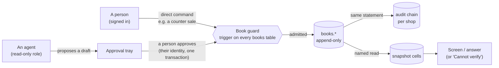

# Munshi

Munshi is an AI back office for a small shop that sells, stocks and buys: a kirana (an Indian corner store) in the demo,
with a salon and a clothes boutique beside it. It runs the counter, stock, buying, the books, customer credit (udhaar),
staff and salary. A cast of agents watches the shop's records, explains what happened, finds where money leaks and
drafts the fix. A named person approves every change, and every figure on screen can be traced to the row behind it.
All data in this repository is synthetic.

- [What Munshi is](#what-munshi-is): three layers
- [The One Guarantee](#the-one-guarantee), and how the code enforces it
- [The agents](#the-agents)
- [A tour by screen](#a-tour-by-screen)
- [Architecture at a glance](#architecture-at-a-glance)
- [Quick start](#quick-start)
- [Configuration](#configuration): what needs keys, and what runs without them
- [Testing](#testing)
- [Deployment, limitations, licence](#deployment)

More depth: [docs/README.md](docs/README.md) indexes the architecture, security, testing and decision records.

## What Munshi is

| Layer | What it is | Where it lives |
|---|---|---|
| **Munshi, the agentic back office** | The owner app: counter, stock, bills and suppliers, credit, settlements, staff, customers, orders, campaigns and an inbox. Agents watch the records, raise findings and draft fixes; people approve them. | [`apps/web`](apps/web) (`/app`), [`packages/core`](packages/core), [`packages/agent`](packages/agent) |
| **The Munshi API** | The same shop as a backend for any storefront: catalogue, services, offers, packages, slots, bookings, orders and holds, under `/api/v1`. Every figure it returns carries the address of the stored cell it came from. A typed, dependency-free SDK and an embeddable order widget sit on top. | [`apps/web/app/api/v1`](apps/web/app/api/v1), [`packages/contracts`](packages/contracts), [`packages/sdk`](packages/sdk), [`packages/widgets`](packages/widgets) |
| **Munshi Studio** | Shop websites built on that API. Today: two hand-built sites, a salon and a boutique, each reading the shop only through the SDK. The developer docs are served at `/developers`. | [`apps/sites`](apps/sites) |

## The One Guarantee

> **Nothing changes the books without a named person's approval, and every number shown traces to a ledger row.**

"The books" are the ledgers, stock, prices, the catalogue, customer credit, staff records, and messages to customers or
suppliers. Every other rule in the code serves this one, and the database enforces it, not only the app.



| Control | What it does | Code |
|---|---|---|
| **The agent's role cannot write** | Agents run on their own database role, `munshi_agent`, which reads snapshots and a few name-only views and holds no INSERT, UPDATE or DELETE on any table. An agent reaches the books only by proposing a draft through core. | [`db/schema/00_bootstrap.sql`](db/schema/00_bootstrap.sql), [`db/schema/30_agent_views.sql`](db/schema/30_agent_views.sql), [`packages/agent/src/port.ts`](packages/agent/src/port.ts) |
| **The book guard** | A trigger on every books table admits an insert only for a person's own direct command their role holds, or for an approved decision made in this same transaction by a member allowed to approve it, and only if that command writes this table. Anything else fails with `MS001`. Books are append-only; a correction is an exact reversal. | `books.write()` in [`db/schema/02_shared.sql`](db/schema/02_shared.sql) |
| **Approval** | `proposeDraft` refuses a draft whose numbers are not each mapped to a stored cell. `decide` re-runs every cited read; if anything moved, the draft goes stale instead of running. Otherwise it executes under the approver's identity, with its audit entry, in one transaction. | [`packages/core/src/approvals.ts`](packages/core/src/approvals.ts) |
| **Snapshot cells** | A screen or an agent gets numbers only through a registered named read, stored as an immutable snapshot of typed cells. Model prose carries references to cells, never free digits. | [`packages/core/src/snapshots.ts`](packages/core/src/snapshots.ts), [`packages/core/src/queries.ts`](packages/core/src/queries.ts), [`db/schema/06_snap.sql`](db/schema/06_snap.sql) |
| **Cannot verify** | The validator refuses an answer with a digit, a number written as words (English or Hindi) or a cell from another run or shop. The screen then shows "Cannot verify", never the model's text. | [`packages/agent/src/answer.ts`](packages/agent/src/answer.ts), [`packages/core/src/read.ts`](packages/core/src/read.ts) |
| **Why this number** | Tap a figure to walk its chain: the cell, the read, the book row, the decision, the approver. A link that cannot be walked says "Cannot verify" where it breaks. | [`apps/web/components/WhyChain.tsx`](apps/web/components/WhyChain.tsx) |

Each of these protections has a gate test paired with a sabotage case that removes the protection; the red-proof
harness requires the test to fail under the sabotage and pass without it (see [Testing](#testing)). The full model is in [docs/architecture.md](docs/architecture.md) and
[docs/security.md](docs/security.md).

## The agents

Seven names on screen, each covering some of the database's desks and run kinds
([`apps/web/lib/cast.ts`](apps/web/lib/cast.ts)).

| Name | Role | What it does |
|---|---|---|
| **Munshi** | The lead | Answers questions, typed or spoken; writes the morning brief; runs the watchers; reads answers aloud |
| **Tally** | Stock | Counts a shelf from a photo; watches shrinkage, expiry and dead stock; offers near-expiry stock to a recipient ("Offer it") |
| **Ledger** | Money | Reads supplier bills (photo or PDF); watches sales, overdue credit, short settlements and staff advances |
| **Dash** | The counter and fixes | Works the counter's runs; turns a finding into a draft ("Draft the fix") by a fixed recipe, not model output |
| **Echo** | Customers | The inbox: transcribes voice notes, drafts replies and orders from chat; watches orders, bookings and lapsing regulars |
| **Bloom** | Packages and campaigns | Writes campaign copy for the owner to edit; watches expiring packages |
| **Keeper** | Memory | Keeps short notes from past decisions (why a draft was rejected, a stated preference); the owner can make it forget |

The office (`/app/office`) shows each one's last seven days of runs: proposed, approved, rejected, abstained and failed.
The run log opens any run step by step.

A finding offers **Why?** (an explanation that cites its cells), **Draft the fix**, **Snooze** and **Dismiss**. Five
finding kinds have a fix recipe ([`packages/agent/src/recipes.ts`](packages/agent/src/recipes.ts)): a shelf shortage
becomes a reorder; overdue credit becomes a reminder or a PayPal (sandbox) payment link; an expiring package becomes a
reminder or its expiry; an expiring lot becomes a gift to a simulated recipient; and a PayPal payment the books do not
show yet becomes a draft to record it. Every other kind is explained only.

## A tour by screen

The owner app groups its screens into five hubs on a desktop, with a jump-to palette; phones get a bottom bar. Counter
staff see the counter, the credit book and stock only; everything else belongs to the owner and a manager
([`packages/core/src/read-roles.ts`](packages/core/src/read-roles.ts), [`apps/web/lib/nav.ts`](apps/web/lib/nav.ts)).

| Hub | Screen | What it does |
|---|---|---|
| Today | Home `/app` | The morning brief, the findings with the most rupees at stake first, and the tray of drafts waiting for you |
| | Office `/app/office` | The cast, their recent runs and the step-by-step run log |
| | Ask `/app/ask` | A question, typed or spoken, answered from named reads, with every figure cited |
| | Inbox `/app/inbox` | WhatsApp and Instagram messages; drafted replies and orders wait for approval |
| Sell | Counter `/app/counter` | Ring up a sale (a direct command, under your own name) |
| | Orders, invoices, offers, packages, calendar, requests | Orders from any channel, GST invoices, offers, prepaid packages, bookings and booking requests |
| Stock and buying | Stock `/app/stock` | Stock on hand, a shelf count from a photo, and a spreadsheet-style table |
| | Bills `/app/bills`, Suppliers `/app/suppliers` | A bill read from a photo or PDF becomes a purchase draft; suppliers' price history |
| | Surplus `/app/surplus` | Near-expiry stock given to (simulated) recipients, with its tally |
| Money | Credit `/app/credit` | The udhaar book: balances, reminders, PayPal (sandbox) links |
| | Settlements `/app/settlements` | A payout statement (a file, or the simulated payments feed) previewed against the books, then recorded |
| | Reports `/app/reports`, Growth `/app/growth` | Sales, margins, peak hours, basket trend, slow movers, payment mix |
| People | Customers, staff, salary, loyalty, campaigns | Customer history; attendance, advances and salary; loyalty; campaigns for WhatsApp and Instagram |
| | Settings `/app/settings`, AI staff `/app/settings/ai` | Shop settings; each agent's model, the AI features switched on, and this month's AI spend |

Outside the owner app:

- `/demo`: pick a sample shop and a person; no password.
- `/`, `/how-it-works`, `/sign-up`, `/developers`: the product site, sign-up for a real shop, and the API docs.
- `/platform`: the superadmin console (accepting shops, model lists, AI features, channel grants). It is linked from
  nowhere on the site and sits behind a password and a TOTP code; see [docs/security.md](docs/security.md).
- The app installs as a PWA. Offline, it shows a read-only view of the last Home and stock list; nothing can be
  recorded offline.

## Architecture at a glance

```
apps/web            Next.js 16: the owner app (/app), demo sign-in, product site, superadmin console (/platform),
                    the public API (/api/v1), webhooks, the jobs tick. One server process.
apps/sites          the shop websites (a salon, a boutique), reading the shop through the SDK only
packages/core       the framework-free domain: commands, approvals, snapshots and named reads, watchers, jobs,
                    sessions, the platform, AI switches, caps and spend
packages/agent      the agent flows: ask, shelf photo, bill, voice, read-aloud, inbox, campaign copy, recipes,
                    and the cite-or-abstain validator. Holds only the read-only agent pool
packages/ai         the model provider layer: roles, the model catalogue, adapters, fallback, prices, recorded
                    fixtures. No database and no agent logic
packages/adapters   channels (WhatsApp, Instagram, recorded), payments (PayPal sandbox), identity (password,
                    Supabase email), cache (memory, Redis), media store, bot check
packages/config     the one config module: reads the environment, checks it at boot, never prints a secret
packages/contracts  API v1 as zod schemas, which generate openapi.json and the SDK's types (pnpm contracts)
packages/sdk        the dependency-free API client
packages/widgets    an embeddable order widget (a web component) built on the SDK
db                  db/schema (the SQL, ordered files 00 to 90), db/seed (synthetic shops), db/test (gates,
                    red-proofs), db/src (dev, build, deploy checks)
```

PostgreSQL 17 holds the truth. `tenant_id` leads every key, row-level security is enabled and forced on every tenant
table, and each process connects as its own least-privilege role. Details: [docs/architecture.md](docs/architecture.md).

## Quick start

Needs Node 22 or later and pnpm 11. No Docker, no database to install, and no API key. `redis-server` on your path is
optional; without it the app uses an in-memory cache.

```bash
pnpm install
pnpm dev
```

`pnpm dev` ([`db/src/dev.ts`](db/src/dev.ts)):

1. starts an embedded PostgreSQL 17 in `.run/pg17`, generates its passwords and the session secret under `.run/`, and
   builds the schema from `db/schema`;
2. seeds the synthetic sample shops: Sharma General Store (a kirana, with known problems planted), Elite Unisex Salon
   and Academy, and Prabhave (a boutique); runs their watchers and drafts one reorder;
3. starts the app at http://localhost:3000 in recorded mode, with the jobs ticker.

Open http://localhost:3000/demo, pick a shop and a person, and you are in. The superadmin console's local sign-in is
written to `.run/dev-operator.json` (never printed).

The kirana's planted problems (stock missing from the shelf, a supplier's price creeping up, overdue credit, a short
settlement, goods near expiry) are worked out by hand in
[`db/seed/kirana.answers.json`](db/seed/kirana.answers.json), so the watchers can be checked against an answer key.

In recorded mode the Ask screen offers the questions that have recorded answers. For the shelf count, the bill reader
and voice, use the synthetic samples in
[`packages/agent/fixtures/media/`](packages/agent/fixtures/media) (`shelf.png`, `bill.png`, `ask-en.wav`,
`ask-hi.wav`). Other inputs have no recording, and the screen says so.

## Configuration

All settings are environment variables, read in one place ([`packages/config`](packages/config)); the names are in
[`.env.example`](.env.example). **None are needed for the demo.** `pnpm dev` passes your shell's environment to the
app, so to use keys run `node --env-file=.env db/src/dev.ts`.

**Models.** Agents ask for a role, not a model: router, reason, vision, segment, voice, narrate and speak. Meta's models
are the default for every role Meta serves; Gemini is the first fallback; Anthropic, OpenAI, OpenRouter and NVIDIA are
available through the operator's allow-list; Sarvam serves speech to text, read-aloud and PDF bills. In live mode a
call whose provider has no key, or fails, moves to the next allowed model that has one, in this order: the owner's
pick, the shop's default, the build's default, then Meta-hosted models, then Gemini, then the other providers.

| Mode (`MUNSHI_MODEL_MODE`) | Behaviour |
|---|---|
| `recorded` (the default) | Every model call is answered from a committed fixture; nothing leaves the machine. Screens say "Recorded response". A request with no fixture abstains |
| `live` | Calls the providers whose keys are set |
| `record` | Calls the providers and saves their answers as fixtures |

| To turn on | Set | Without it |
|---|---|---|
| Meta's models: Muse Spark (router, reason, vision), SAM 3.1 (shelf count), Muse Voice Transcribe | `MUNSHI_MODEL_MODE=live`, `META_MODEL_API_KEY` | Recorded. The Meta fixtures are hand-written, not recordings |
| Muse Spark Open on Baseten (narrate) | `BASETEN_API_KEY` | Recorded, or falls back |
| Gemini (the first fallback for text and images) | `GEMINI_API_KEY` | Not called |
| Sarvam: speech to text, read-aloud, PDF bills | `SARVAM_API_KEY` | Recorded |
| Other providers | `CLAUDE_API_KEY`, `OPENAI_API_KEY`, `OPENROUTER_API_KEY`, `NVIDIA_API_KEY` | Not called |
| PayPal sandbox payment links | `PAYPAL_CLIENT_ID`, `PAYPAL_CLIENT_SECRET`, `PAYPAL_WEBHOOK_ID` (`PAYPAL_ENV` must be `sandbox`) | Recorded mode, labelled on screen; PayPal is never called |
| WhatsApp Cloud API | the four `WHATSAPP_*` credentials, `MUNSHI_PHONE_ROUTE_SECRET`, `MUNSHI_SEND_MODE=live`; optional `WHATSAPP_TEMPLATE_*` | Sends are recorded (ids and body hashes only) |
| Instagram | the five `INSTAGRAM_*` settings, `MUNSHI_SEND_MODE=live`, an https `MUNSHI_APP_URL` and a media store | The webhook answers 404; posts are recorded |
| Hosted database and real-shop email sign-up (Supabase) | the role URLs (`DATABASE_URL` and the other `*_DATABASE_URL`), `SUPABASE_URL`, `SUPABASE_PUBLISHABLE_KEY`, `MUNSHI_APP_URL`; for pictures `SUPABASE_SECRET_KEY`, `SUPABASE_STORAGE_BUCKET` | Embedded PostgreSQL; on a hosted deployment, no real-shop sign-up |
| Redis cache | `MUNSHI_CACHE_URL` | In-process memory cache (`pnpm dev` starts `redis-server` if it finds one) |

A real WhatsApp or Instagram send needs all of: the channel's credentials, `MUNSHI_SEND_MODE=live`, a real shop the
operator accepted (never a sample shop), the operator's grant for that channel, and, on WhatsApp, a listed recipient.
All are rechecked at send time; anything less is recorded, and the screen says which condition is missing.

**Simulated means labelled.** Suppliers and surplus recipients are simulated. Payments are recorded, never processed;
the payments feed is simulated. Every screen with simulated parts says so on the screen.

## Testing

```bash
pnpm check                                      # lint, typecheck and every package's tests
pnpm --filter @munshi/db test                   # database gates and core's tests on embedded PostgreSQL 17
cd db && node test/redproof.ts <case names>     # prove named gates fail when their protection is removed
pnpm redproof                                   # every red-proof case (slow; run on a quiet machine)
```

- **The database is never mocked.** Each test file gets a fresh clone of a template built from `db/schema` on an
  embedded PostgreSQL 17, because row-level security, grants and the book guard are what is under test.
- **Every gate can fail.** Each case in [`db/test/v2/sabotage`](db/test/v2/sabotage) breaks exactly one protection
  (through SQL, a source change applied as the module loads, or a harness switch) and names the test that must then
  fail. [`db/test/redproof.ts`](db/test/redproof.ts) requires that test to pass clean and fail under the sabotage; a
  sabotage that did not apply is an error, never a pass.
- **A failing run exits non-zero**, even though `embedded-postgres` registers an exit hook that calls
  `process.exit(0)` ([`db/test/v2/g8-exit-code.test.ts`](db/test/v2/g8-exit-code.test.ts)).

Details, suites and known flakiness: [docs/testing.md](docs/testing.md).

## Deployment

The hosted shape is Supabase (PostgreSQL 17) plus Vercel, one project serving the app and both shop sites. See
[docs/deployment.md](docs/deployment.md).

## Limitations

No live Meta model call has been made yet, the cite-or-abstain validator is a word-list filter that errs toward
refusing, and some provider request shapes are unverified against the live services. The full list is in
[docs/limitations.md](docs/limitations.md).

## Contributing

See [CONTRIBUTING.md](CONTRIBUTING.md). The review bar is the One Guarantee.

## Licence

Munshi is licensed under the [Apache License, Version 2.0](LICENSE). Copyright 2026 Satvik Sawhney. If you
redistribute Munshi or a work derived from it, keep the [NOTICE](NOTICE) file (or reproduce its attribution), as
section 4(d) of the licence requires.
