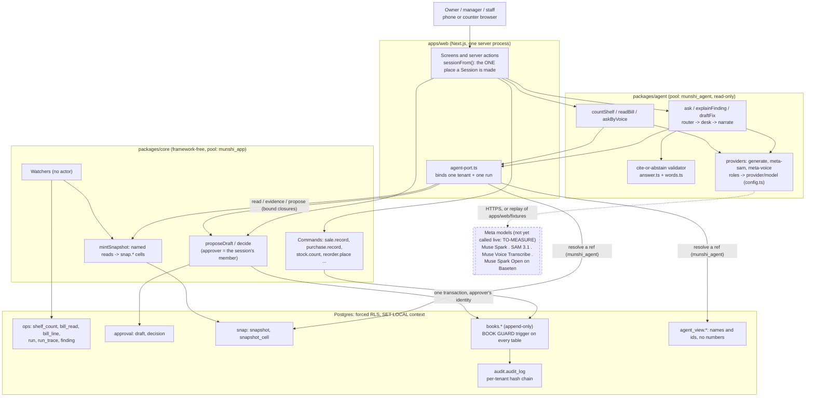

# Munshi

Munshi is an AI back office for small shops that sell, stock and buy. A kirana (Indian corner store) is the demo; the
same code serves a restaurant. It runs the counter, stock, purchasing, books, customer credit and bills, and its agents
explain what happened, find where money leaks and **draft** the fix.

**The One Guarantee.** *Nothing changes the books without a named person's approval, and every number shown traces to
a ledger row.* The agents cannot break it: their database role has no write grant, and a number on screen is rendered
from a stored database cell, never from model text.

Built for the Meta Global AI Developer Hackathon (Indie track). All code was written from 27 Oct 2026. **All data is
synthetic, suppliers are simulated, and payments are recorded, never processed: no real money moves.**

## Who it is for

The owner of a shop with one to a few outlets, who keeps books in a notebook or a billing app, buys from wholesalers,
sells on credit (udhaar), and asks questions in Hindi or English. The problems it targets are ordinary: stock that
disappears between the books and the shelf, a supplier's price creeping up on the bill, credit that is overdue, a UPI
settlement that comes in short, goods near expiry. The demo shop plants one of each so the watchers can be checked
against an answer key worked out by hand (`db/seed/kirana.answers.json`).
**No pilot with a real shop has happened. What the demo shows is a behaviour on synthetic data, not a measured benefit.**

## The 30-second aha (the hero chain)

1. **Photograph a shelf.** Muse Spark names the products; SAM 3.1 finds every unit of each one; plain code compares the
   count with the books' stock. Where they differ, the app shows both numbers side by side and drafts a stock correction.
2. **Photograph a supplier's bill.** Muse Spark copies the lines off the page, each figure with its place on the photo.
   Plain code matches the lines to the catalogue and flags a unit price above the last one paid. The app drafts the
   purchase; every figure carries a "Read on the bill" chip you can tap.
3. **Ask by voice, in Hindi or English.** Muse Voice Transcribe turns speech into text, which is asked like a typed
   question. The answer's numbers are tappable cells; if a number cannot be traced the screen says "Cannot verify".
4. **A person approves.** Each draft waits under a "Waiting for you" tag. Approving executes it under the approver's name
   in one transaction with its audit entry, after re-checking that the books it was based on have not moved.

Steps 1 to 3 run today on **hand-written, replayed model responses** (recorded mode, the default): no Meta key existed
when this was written. Their live behaviour is **TO-MEASURE** (see [Limitations](docs/LIMITATIONS.md)).

## Where each Meta model is used

Roles map to a provider and model in [`packages/agent/src/config.ts`](packages/agent/src/config.ts) (edition `meta`).
No provider name appears in the database schema, and no provider-specific code lives outside its adapter.

| Role | Model (config) | What it does | Called from |
|---|---|---|---|
| router | Muse Spark (`muse-spark-1.3`) | sends a question to the stock, sales or credit desk, or to "none" | `packages/agent/src/run.ts` `ask` |
| reason | Muse Spark | the desk's tool loop: picks named reads (at most 8, 45 s budget) | `run.ts` `answer` |
| vision | Muse Spark | names products on a shelf photo; copies a bill off a photo. Offered no tools; an answer that tries one is discarded | `photo.ts` `look`, used by `shelf.ts` and `bill.ts` |
| segment | SAM 3.1 (`sam-3.1`) | finds every unit of ONE product per request; the count is the number of matches | `providers/meta-sam.ts`, called from `shelf.ts` |
| voice | Muse Voice Transcribe (`muse-voice-transcribe-1.0`) | speech to text, Hindi and English | `providers/meta-voice.ts`, called from `voice.ts` |
| narrate | Muse Spark Open on Baseten (`meta-models/muse-spark-open-1026`, open weights) | writes the short answer, citing cells by read, row and column | `run.ts` `answer`, through `providers/generate.ts` |

The model ids are as configured; none has been confirmed against a live call (TO-MEASURE). The Muse Spark calls use the
Responses API with schema-constrained JSON (`providers/generate.ts`); the narrate call goes to Baseten's OpenAI-compatible
Chat Completions endpoint, whose request shape is unverified.

The models never do arithmetic and never see a tenant id or a database id (they see handles such as `item:1`).
`MUNSHI_EDITION=paytm` is a placeholder edition: its model ids are `TODO-...` and only the switch is exercised.

## The guarantee, and how it is enforced

- **The database refuses unapproved book writes.** A trigger on every `books.*` table admits an insert only for (a) a
  person's own direct command that their role holds in `ops.command_authority` and that writes that table, or (b) an
  approved decision made in this same transaction by an active member whose role holds the draft's command. Anything
  else raises `MS001`. Books have no UPDATE or DELETE grant; corrections are reversals with a reason and an actor. Journal
  entries must balance per currency at commit.
- **The agent cannot write.** Its role `munshi_agent` holds only SELECT on `snap.*` and on views of names and ids. It
  reaches a book row only by proposing a draft, which a person approves. A source gate fails if `packages/agent`
  imports a database URL or any core writer.
- **Every book row has an audit entry** in a per-tenant hash chain, naming the person.
- **Numbers render only from cells.** A named read mints a snapshot (`snap.snapshot_cell`: typed values stored by the
  server). Model prose carries handles `⟦1⟧` that point at cells; the validator refuses any digit, number in words
  (English, Hindi, romanised Hindi, Han and Roman numerals), a handle glued to a unit, scale or currency, and a cell that
  belongs to another run or another tenant. A refused answer shows "Cannot verify" in fixed words, never the model's text.
- **A draft's numbers are cells too.** `proposeDraft` maps every number in the payload to the stored cell holding exactly
  that value, and a draft that moves stock must cite the item's current on-hand.
- **Row-level security is forced** on every tenant table; tenant and actor context is set only with `SET LOCAL`.

Details and the known weak points: [docs/ARCHITECTURE.md](docs/ARCHITECTURE.md), [docs/SCHEMA.md](docs/SCHEMA.md),
[docs/LIMITATIONS.md](docs/LIMITATIONS.md).

## Architecture



The same diagram is in [docs/architecture-diagram.md](docs/architecture-diagram.md).

## Run it

Needs Node 22+ and pnpm 11. No Docker, no database to install, no API key.

```bash
pnpm install
pnpm dev        # embedded Postgres in .run/, migrated, the synthetic shop seeded, watchers run, then the app on http://localhost:3000
pnpm check      # lint + typecheck + all test suites
pnpm redproof   # breaks each protection in turn and proves its gate goes red (slow; run it on a quiet tree)
```

`pnpm dev` runs in **recorded mode** (`MUNSHI_MODEL_MODE` unset means `recorded`): every model call is answered from a
committed fixture, and a request with no fixture degrades to "Cannot verify", never an error. Screens show a "Recorded
response" label. Sign in as one of the demo shop's members. With a Meta key, put it in a git-ignored `.env` (names in
`.env.example`) and set `MUNSHI_MODEL_MODE=live`; `scripts/hero-smoke.ts` runs the hero chain once against the live API.
That path has never run.

## Tests and red-proofs

Measured on 27 Oct 2026 with `NO_COLOR=1 pnpm --filter ./packages/agent --filter ./packages/core --filter ./db test`
(exit 0):

| Suite | Files | Tests | What it covers |
|---|---|---|---|
| `packages/agent` | 8 | 78 | validator rules, the precision corpus, adapters, runs, photo flows (recorded model turns) |
| `packages/core` | 3 | 11 | money, time, the source-scanning boundary gates |
| `db` | 25 | 144 | database gates G1 to G12 and C1 to C7, the hero flows H1 to H3 and the agent layer A1, on embedded Postgres 18 with a fresh database per file |

The web app has its own suite (`apps/web`, run by `pnpm check`); it is not counted here because that tree was being
edited when these numbers were taken.

**Red-proofs.** `pnpm redproof` breaks each protection in turn (SQL in the test database, a source mutation applied as
the module loads, or a harness switch) and requires its gate to go red, then green when clean; a sabotage that did not
apply is an error, not a pass. The last count in git history is **217 of 217** (commit `57b1700`, in its message); it was
not re-run for this README. That a failing run exits non-zero despite embedded-postgres's exit hook is itself a gate (G8).

The precision corpus holds 199 clean answer sentences (English, Hindi, Hinglish) that must never abstain and 157 attacks
that must always be refused. Expected values in the database tests come from the seed's hand-worked answer key or from
JavaScript arithmetic over raw rows, not from the code under test.

## Limitations

Read [docs/LIMITATIONS.md](docs/LIMITATIONS.md). In short: no live Meta model has been called (every live result is
TO-MEASURE); the cite-or-abstain filter is word-list based and errs towards refusing; the shelf-count hash binds the
stored response to itself, not to Meta's; the audit chain is unkeyed; data is synthetic, suppliers are simulated and
payments are recorded, never processed.

## Layout

```
apps/web         Next.js app: owner home, counter, ask, stock, credit, bills, suppliers, reports
packages/core    framework-free domain: money, time, commands, approvals, snapshots, watchers, audit
packages/agent   model adapters by role, tools, runs, shelf/bill/voice flows, cite-or-abstain
db               SQL migrations 0001-0009, the embedded-Postgres test harness, the synthetic seed
docs             ARCHITECTURE.md, SCHEMA.md, LIMITATIONS.md, BOARD.md (the build plan)
```

## Licence

To be decided by the founder. No licence is granted until one is added here.
