# Munshi blueprint (BP-1): the whole project on one page

Status: **PROPOSED, design only (Wed 28 Oct 2026, late).** Nothing here is built. This page is the single source the
build lanes follow from 29 Oct, and the content of the founder's "site blueprint" page. Where it and a binding decision
disagree, the decision wins (`../hackathon/_meta/DECISIONS.md` D-037 to D-043, and the orchestrator rulings in
`PLANS-2026-10-28-munshi-hardening.md`). Once code exists, the code wins (`db/schema/*.sql` is the database contract).

Tags: **FACT** (read in this repo, a review, a study, or an official page this session, with its URL), **INFERENCE**
(reasoning), **UNVERIFIED** (not confirmed; it must be checked before anyone relies on it).

## Contents

0. [Check these first](#0--check-these-first)
1. [The suite](#1--the-suite)
2. [The database, v2](#2--the-database-v2)
3. [No migrations while building](#3--no-migrations-while-building)
4. [Core and the hosting layer](#4--core-and-the-hosting-layer)
5. [API v1, the SDK and the developer portal](#5--api-v1-the-sdk-and-the-developer-portal)
6. [Sign-in with Supabase Auth, onboarding and the demo fence](#6--sign-in-with-supabase-auth-onboarding-and-the-demo-fence)
7. [The AI back office](#7--the-ai-back-office)
8. [Every merchant feature, end to end](#8--every-merchant-feature-end-to-end)
9. [Design system hooks](#9--design-system-hooks)
10. [Build plan to 5 Nov](#10--build-plan-to-5-nov)
11. [Guarantee scan](#11--guarantee-scan)
12. [Open questions for the founder](#12--open-questions-for-the-founder)
13. [What was verified this session](#13--what-was-verified-this-session)

---

## 0 · Check these first

> The decisions most likely to be wrong, and every place this page changes the reviewed W5 design (MERCHANTS-DESIGN.md)
> because a later ruling forced it. Read this section before any other.

### 0.1 Fourteen decisions to check first

| # | Decision | Why | Rejected, in one line |
|---|---|---|---|
| 1 | **Supabase Auth only proves who a person is, once, at sign-in.** Munshi then opens its own `ops.login_session` row and signed cookie; shop and role come from Munshi's rows on every request | Keeps the session rules already proved (revocation, `via`, expiry, deactivation) and needs no Supabase token refresh inside server components | Carrying Supabase's access token on every request: refresh logic everywhere, and roles must still come from our tables |
| 2 | **Six database logins:** owner (no login), migrator, app, **public** (new: public and webhook routes), **jobs** (new: background work, no book grant at all, the only role that may delete a snapshot), agent (read-only) | The public routes stop running as a role that can act as any member (R1 #12); a jobs bug cannot write the books (Munim's `munim_svc` lesson) | Running jobs as `munshi_app`: the app would then need DELETE on snapshots |
| 3 | **Every person lives in the `ops.contact` vault, on every tenant, the synthetic kirana included.** No books table has a name or phone column; `books.party_contact` links a customer, supplier or staff row to a contact by effective-dated rows | One path for real and invented people (R1 #10); a name or phone can be corrected without touching a book row; the `books.pii` trigger disappears because the column it guarded is gone | Names on synthetic books rows (MERCHANTS-DESIGN 0012): two code paths, and the demo never exercises the real one |
| 4 | **Live slot booking is operational, not books.** A public hold or a requested booking blocks the calendar at once (one table, `ops.booking`, a GiST exclusion over `tstzrange`); a person's `booking.confirm` writes the customer and the confirmation message. Shifts, leave, holidays, attendance and salary **are** books | A customer's request is not a book change, exactly like today's `ops.site_request`; the staff calendar and pay are staff records | Bookings as books: the public would write books without a named person |
| 5 | **A GST invoice is written by `sale.record` in the sale's own transaction** when the shop is registered: a gapless number per shop, series and financial year under a lock; a cancellation is a credit note in its own series | A tax invoice is a ledger row like the sale; numbering inside the sale's transaction is what makes it gapless | A separate `invoice.issue` later: gaps on failure, and a sale without its invoice |
| 6 | **One write trigger per books table.** Every books table has exactly `a_write` (admit, stamp, parent transaction, reversal rule), optional table rules named `b_<rule>`, and `z_audit` after insert; a catalog gate holds the set and the order | R1: trigger order must not depend on names nobody checks; lanes can add a table rule in their own file without editing the shared guard | One function with a per-table branch inside: every feature lane would edit the same function |
| 7 | **Foreign keys to the global `ref.*` constants are allowed** (reason codes, accounts, business types, commands). Gate G10's "tenant_id leads every foreign key" applies to foreign keys between tenant tables only | A foreign-key check needs no EXECUTE grant, which was the wip lane's reason for a trigger; codes become a table the reports join | A CHECK calling a function (needs EXECUTE for the app); a trigger per column (more functions to red-prove) |
| 8 | **Snapshots are one row each:** typed cells as one JSON array plus a sha256. A display read reuses the newest identical snapshot; a snapshot cited by a draft, finding, release, answer or decision is pinned; the jobs role purges unpinned display snapshots after 7 days | Ruling (R1 rank 1, R2 #3): about 5× smaller, refs unchanged, storage stops growing on every read | Minting only when the source drawer opens: a figure on screen would have no stored cell behind it until tapped |
| 9 | **The product site, the app, `/developers` and `/api/v1` share one origin** (`apps/web`), with the app under `/app/*`; the hosted shop sites are one app (`apps/sites`) at `/{slug}/…` that reads only the public API | R2: `vercel.app` is a public suffix (no shared cookies across apps); one origin is one sign-in; the sites hold no database login | A separate `apps/site` for marketing (Munim G): a second origin and a sign-in bridge |
| 10 | **The demo deploy has no real sign-in at all.** Its "Sign up" runs the real onboarding screens into a synthetic sandbox shop with no email (Should); real sign-up exists only on the live deploy | Judges can try onboarding, and the demo database still holds no real person | Supabase Auth on the demo: judges' emails would sit in the demo database |
| 11 | **Two Supabase projects, demo and live,** as MERCHANTS-DESIGN §8 decided for Neon | Roles are cluster-wide, so two databases cannot share one project's roles; physical separation is the fence | One project, two databases: role names collide (FACT, `create role` is cluster-wide) |
| 12 | **The schema is rebuilt, not migrated, until the freeze** (Tue 3 Nov night, before any live shop holds data): `db/schema/*.sql` in order, one runner, one populate script | D-043 | Keep layering 0014 onwards: `0001` still has to change for a managed database |
| 13 | **A WhatsApp cart's line totals and total are "derived figures":** code (never a model) computes them from published price cells, the response carries those refs, the message says "at today's prices · the shop confirms", and the counter re-derives the real price (§8.5) | a cart is built by an anonymous customer, so nothing may be minted for it; its parts are ledger rows | minting a snapshot per cart: anonymous traffic would write `snap.*` rows (MERCHANTS-DESIGN §5.3 rejected that) |
| 14 | **Slot times are roster times, not book figures:** each free slot names the shift row it comes from; it shows no amount (§8.8) | availability is computed live from the calendar, holds included, and changes by the second | publishing availability in a release: stale within minutes, double bookings |

### 0.2 What changes from MERCHANTS-DESIGN.md, and the ruling that forced it

MERCHANTS-DESIGN.md passed two Opus guarantee reviews. Its guarantee decisions are kept unless a row below changes them.

| Area | MERCHANTS-DESIGN said | This page says | Forced by |
|---|---|---|---|
| Database host | Neon free, two projects | Supabase free, two projects (Postgres, Auth, Storage); local stand-ins first | D-043 |
| Schema delivery | migrations 0010–0020, append-only | ordered `db/schema/*.sql` rebuilt by one script; freezes into one baseline migration | D-043 |
| Staff sign-in | Google OIDC + PKCE in our code, `ops.member_login` with provider `google` | Supabase Auth (Google and email magic link); `ops.login` maps the Supabase user id to a member; invites and session rows kept | D-043 |
| Staff emails (B1) | no lasting copy of a staff member's email anywhere | **Supabase keeps each signed-in person's email in its own `auth.users`** (in the same database, outside our schemas). Erasing a member, or the 365-day purge, now also deletes that Supabase user through the identity adapter once no live login names the subject; the jobs runner retries until it is gone. PII3's scan adds `auth.users` on the live project | D-043 (a consequence of choosing Supabase Auth) |
| Files | `ops.document_blob` bytea, 25 MB per tenant | Supabase Storage, one private bucket per tenant, short signed links; the database keeps id, sha256 and size; `.run/blobs/` stands in locally | D-043 |
| Hosted sites | one `apps/sites` build per business (`MUNSHI_SITE`), four site projects, a gate scanning for the other business | one app by slug, the look as data in a release, a fixed font palette, two site projects (demo, live); the gate proves the bundle holds **no** business | D-041, R2 #7, ruling "Hosted shop sites" |
| Public API paths | `/api/v1/site`, `/catalogue`… with the tenant from the key | `/api/v1/sites/{slug}/…`; reads need no key; writes need the publishable key `mpk_<slug>_…` | R2, ruling "Hosted shop sites" |
| SDK types | hand-written; OpenAPI a Should | zod contracts → `openapi.json` → SDK types, committed, with a freshness test; the SDK keeps zero runtime dependencies | ruling P3, R2 |
| Public routes' role | `munshi_app` | `munshi_public` (narrow grants, restrictive policies) | ruling "A narrow munshi_public login", R1 #12 |
| Reason codes | wip 0019: a trigger | a foreign key to `ref.reason` | R1 "reason codes in a table"; decision 7 above |
| People in books | names on synthetic rows, vault on showcase/live, `books.pii` trigger | the vault on every tenant, no name or phone column in books, `books.party_contact` revisions | R1 #10, decision 3 |
| Snapshot storage | one row per cell, never deleted | one row per snapshot (JSON + sha256), reuse, pins, purge | ruling "Snapshots" |
| Audit payload | the whole row (`to_jsonb(new)`) | the row's sha256 digest; `audit.verify_books`; checkpoints | ruling "Audit stores a digest" |
| Findings | unique dedupe key forever | one open finding per key, auto-resolve, dismiss, snooze | study H, ruling P5 |
| Reversals | `reverses_id` + reason, amounts unchecked (0005) or exact (0014) | one rule in `a_write` (exact opposite of the declared signed columns, once) and one `*.reverse` command per book | ruling "One reversal rule" |
| Master data | append-only, never changes | `books.item_revision`, `books.staff_terms`, `books.customer_terms` (latest in effect wins, like price) | ruling "Master data" |
| Idempotency | `site_request.idempotency_key` only | `ops.idempotency` for every form and API write, inside the command's transaction | ruling "Idempotency" |
| Services and stock | a service line could write a stock move | `books.stock_move` keys to `(item_id, item_kind)` with `item_kind = 'good'` | ruling "Services never write stock" |
| Phone rules | `+91[6-9]` regex in SQL | SQL checks E.164 shape only; the India mobile rule lives in core's country pack | ruling "Country logic stays out of the schema" |
| Sign-up | operator-only provisioning; the directory written as `munshi_owner` in a second transaction | self-serve: the app writes the directory row in the tenant's own transaction, checked by a trigger on slug and txid; first-owner binding without an invite; the operator command remains for seeds | ruling "Self-serve sign-up", R1 #6 |
| Background work | in-request flush, page-load sweeps, a daily cron | one `runDueJobs` in core with four triggers: after writes, owner page loads, an external tick, the daily cron | R2 #2 |
| Rate-counter cleanup | the public route deletes expired windows | the jobs role deletes them; the public role has no DELETE | decision 2 |
| AI rows | `ops.run`, `ops.run_trace`, `ops.finding` | a schema `ai` (runs, traces, findings, answers, brief, policy, usage) | clarity; the agent's grants become one schema |
| Bookings | a request with a date and a morning/afternoon/evening window | requests stay for shops without a calendar; Elite books live slots per branch and stylist | D-041 |
| GST and staff | unmodelled; attendance only | GST invoices; shifts, attendance, leave, holidays, salary runs and advances | D-041, D-043 ("everything by 5 Nov") |

Unchanged and kept: two deploys on two databases; `data_class` synthetic | showcase | live; `ops.deployment` immutable;
`only_erase` and `fill_once` exactly as fixed in cycle 2; the contact vault's erasure rules and retention defaults
(D-038); consent by double opt-in; the derived, claimed, rechecked outbox; at-most-once sends; no real channel on the
demo; the webhook writes ops only; copy by `text_id` and hash; digit spans parsed in the database; draft-only commands
refused by the guard; release snapshots limited to `site.*` reads of the same transaction; demo request values pinned to
samples; hashed publishable keys answering 404; the AI-output disclosure line written by code.

### 0.3 The wip lane's keep-list, and where each item lands

The paused 0014–0020 work (branch `wip/w5b-schema-draft`, all gates passing) asked for these to be kept.

| Keep | Where it lands | Changed? |
|---|---|---|
| Reason codes checked without the app needing EXECUTE | `ref.reason` foreign key (§2.5) | mechanism changes (FK, not trigger); the property holds; G9's function list does not grow |
| Off the live deployment only the owner role publishes releases | `ops.site_release` `release_check` (§2.10.8); the reset publishes as `munshi_owner` | kept |
| A delivery is real only from a real sign-in | `ops.delivery` derivation (§2.10.7): real only when the deployment is `live` **and** `munshi.via = 'auth'` (a Supabase-Auth session) | `google` becomes `auth` |
| Simulated suppliers are always recorded | `ops.delivery` derivation (§2.10.7) | kept |
| Each package entry kind is bound to its command | `b_package_tally` on `books.package_entry` (§2.10.5) | kept |
| Offer items, plan lines and sold sessions accepted only in their parent's transaction | generalised: every child books table names its parent in `ref.book_table`, and `a_write` refuses a child of an earlier transaction (§2.4) | now covers every child table (sale lines, purchase lines, invoice lines, salary lines too) |
| A balance holds even an owner's erasure | the `ops.contact` erase rule (§2.6) | kept; credit, package, loyalty and advance balances and open bookings all hold |
| A STOP's withdrawal must hold its phone; no STOP is erased alone | `ops.inbound_message` `inbound_flow` (§2.6, §2.10.7) | kept |
| Avoid the reserved column name `column` | `ops.grid_change.kind` (`price` \| `new_item`), as the wip lane had it | kept |

## 1 · The suite

> Five surfaces on two Next.js apps and seven packages: the product site, the app, the developer portal and `/api/v1` on
> one origin (`apps/web`), and every hosted shop site in one app found by slug (`apps/sites`).

### 1.1 The five surfaces

| Surface | Who it is for | Where | Signed in? |
|---|---|---|---|
| **Munshi's product website**: landing, how it works, one page per business type (kirana, apparel, salon), for developers, privacy, sign-up, log-in | owners deciding whether to use Munshi | `apps/web` at `/`, `/how-it-works`, `/for/<type>`, `/privacy`, `/terms`, `/sign-up`, `/log-in` | no |
| **The owner and staff app**: home, counter, ask, inbox, office, stock, bills, credit, packages, offers, campaigns, bookings and calendar, staff, invoices, reports, settings | the shop's owner, managers and staff, on a phone or the counter browser | `apps/web` at `/app/*` | yes (a member) |
| **Hosted shop sites**: one site per shop, its look as data (§5.5) | the shop's customers | `apps/sites` at `/<slug>/<lang>/…` (a path now; a sub-domain once a domain exists) | no |
| **Public API v1, the SDK and the developer portal** | the shop's own developer, and Munshi's own sites | `apps/web` at `/api/v1/*` and `/developers/*`; the SDK in `packages/sdk` | API reads: no; writes: a publishable key |
| **The AI back office**: desks, findings, the brief, drafts, Ask, the office page and run log | the owner and managers | inside the app (`/app/home`, `/app/inbox`, `/app/office`, `/app/ask`) | yes |

### 1.2 Apps and packages

```
apps/web                    ONE origin per deployment (R2: vercel.app is a public suffix, so no cookie crosses apps)
  app/(site)/               the product website (static where possible)
  app/(auth)/               sign-up, log-in, auth callback, invite, choose-shop, onboarding
  app/app/                  the app: every screen under /app/*; no SQL here (gate SQL1)
  app/developers/           the developer portal, built from openapi.json and Markdown in docs/kit
  app/api/v1/[...path]/     one catch-all → lib/api (router, keys, origins, limits, idempotency, errors)
  app/api/internal/tick/    the background-jobs tick (CRON_SECRET)
  app/api/webhooks/whatsapp/  the signature-checked webhook (live deploy only)
  app/api/health/           health
  lib/server/               session, pools, adapter wiring; calls packages/core only
apps/sites                  every hosted shop by slug; imports only @munshi/sdk, @munshi/ui and its own files (gate B5)
packages/core               framework-free domain: commands, approvals, snapshots, screen reads (views-*), tenancy,
                            sign-up, jobs runner, country pack (IN), money, time, errors
packages/agent              model roles and adapters, desks, the run loop, photo and voice flows, the validator;
                            imports only @munshi/core/read (gate B1)
packages/contracts          zod schemas for every v1 request, response and error, and every app form input
packages/sdk                fetch client; types from contracts (type-only); zero runtime dependencies
packages/ui                 calm-ledger tokens and primitives (Figure, SourceSheet, Card, Sheet, Field, Button, Chip,
                            Stamp); brand token sets per surface; no data access
packages/config             one zod schema per process for its environment; secrets redacted in every error
packages/adapters           vendor IO outside the models: identity (Supabase Auth | local), blob (Supabase Storage |
                            local folder), channels (WhatsApp Cloud | Instagram | manual link | recorded), bot check
                            (Turnstile | recorded); each with its stand-in beside it
db                          schema files, runner, harness, populate script, seeds
```

*Rejected:* R2's list without `adapters` (vendor calls would sit in core, which must stay testable with no network);
Munim G's four apps (a second origin needs a sign-in bridge, the pitfall G names); a separate API service (R2: it adds no
trust boundary on Vercel; the boundary is the database roles).

### 1.3 Deployments and the local stand-ins

| Deployment | App | Data | Notes |
|---|---|---|---|
| `munshi-demo` (Vercel) | `apps/web`, `MUNSHI_DEPLOYMENT=demo` | Supabase project **demo** (`ops.deployment = demo`): the kirana, Elite and the suit shop (showcase), sandboxes | the demo picker; no real sign-in; no channel credential at all; what judges, the film and screenshots see |
| `munshi` (Vercel) | `apps/web`, `MUNSHI_DEPLOYMENT=live` | Supabase project **live** (`ops.deployment = live`): the merchants' live tenants and self-serve sign-ups | Supabase Auth; WhatsApp test number; Instagram; never blocks the submission |
| `munshi-shops-demo` | `apps/sites`, API = `munshi-demo` | none (reads the public API) | "Sample site · what you type is not stored or sent to the shop" |
| `munshi-shops` | `apps/sites`, API = `munshi` | none | the merchants' live sites, linked from the submission (D-038) |

Every Vercel function runs in `bom1` (Mumbai) and each Supabase project in Mumbai (`ap-south-1`) so a round trip stays
about a millisecond (R1 #11; that the free plan offers Mumbai is UNVERIFIED, Singapore is the fallback). Everything runs
**local first** (D-043): PostgreSQL 17 in `.run/pg`, the `local` identity adapter (a typed email, refused on a live
deployment), blobs in `.run/blobs/`, the recorded sender, the recorded bot check and recorded model turns. The founder
connects Supabase later (BP-OPS-2).

### 1.4 Architecture

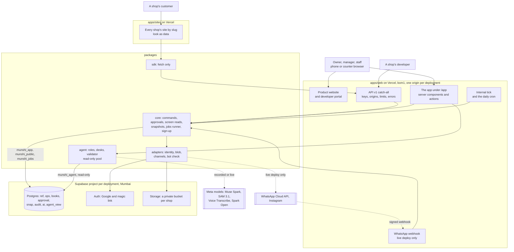

### 1.5 Request flows

**A member opens a screen (one transaction per page).**

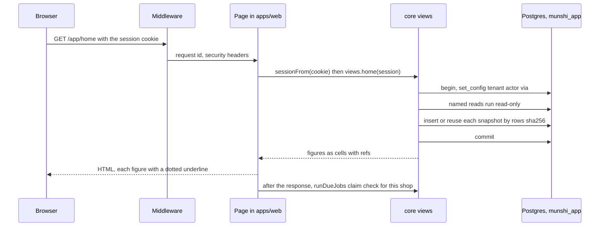

**A counter sale (a person's direct command, idempotent).**

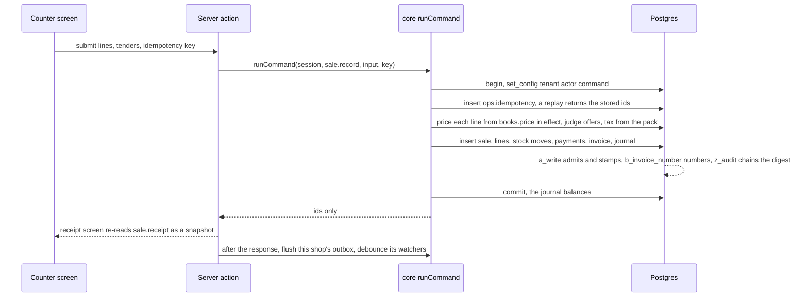

**An approval** (unchanged in kind: one transaction, the approver's identity).

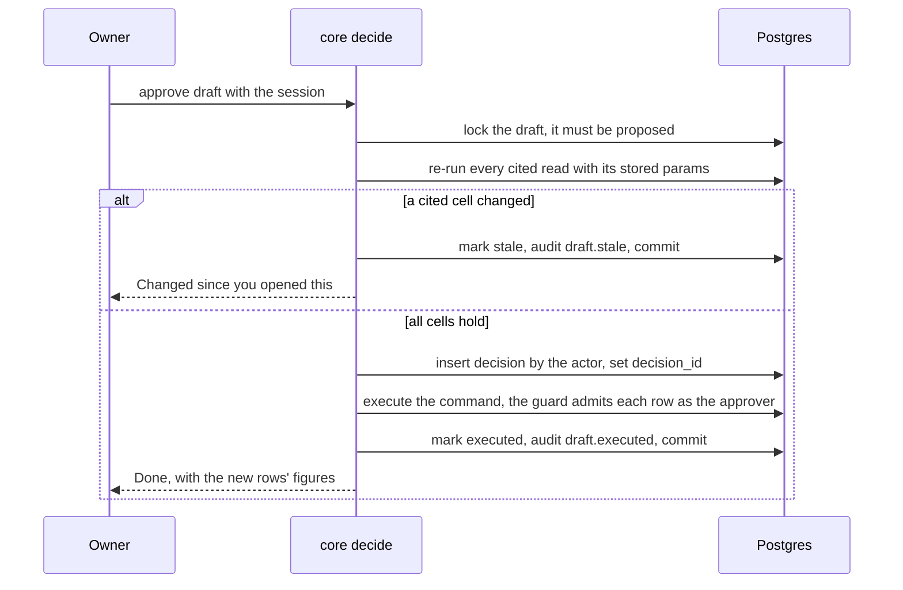

**A public read** (`GET /api/v1/sites/elite/services`): the router parses the slug, finds the tenant in the directory
(public pool), reads the latest release's `site.services` snapshot under that tenant (the restrictive policy lets it see
only release-pinned snapshots), and returns each figure as `{minor, currency, ref}`. `Cache-Control: public,
s-maxage=60`, `ETag` = the release id. Anonymous traffic writes nothing.

## 2 · The database, v2

> One clean, ordered schema with every review fix folded in: eight schemas, six roles, forced RLS, one write trigger per
> books table, digests in the audit chain, JSON snapshots with pins, effective-dated master data, and a table for every feature.

### 2.1 Shape: schemas, the books/ops split, conventions

| Schema | Holds | Who writes it |
|---|---|---|
| `ref` | global constants: business types, the chart of accounts, reason codes, commands, who may run them, which book tables each writes, the book-table manifest | only the schema files (no runtime role writes) |
| `ops` | tenancy, members, sign-in, the contact vault, documents, idempotency, sites and their releases, public requests, bookings, holds, carts, campaigns, inbox and outbox, photo evidence, grid batches | app, public and jobs, each on named columns, each refusal held by a trigger |
| `books` | the books: catalogue, prices, parties, sales, purchases, stock, payments, credit, settlements, journal, offers, loyalty, packages, messages to people, staff records (roster, leave, holidays, attendance, advances, salary), tax registration and invoices | app only, and only through the book guard; append-only |
| `approval` | drafts and decisions | app |
| `snap` | snapshots (the only source of a shown number) and their pins | app (mint), jobs (mint for watchers; purge unpinned display snapshots) |
| `audit` | the per-tenant hash chain and its checkpoints | app (through triggers), jobs (checkpoints) |
| `ai` | runs, traces, findings and their events, answers, the daily brief, the AI policy and usage | app and jobs; the agent reads none of it directly |
| `agent_view` | views of names and ids for the agent (no numbers) | nobody (views) |

**Book or ops?** The rule, applied to every table below: *a row is a book if it changes what is owed, held, sold,
priced, paid, stocked or promised to a person, or records a staff member's work or pay, or is a message Munshi sends to
a real person.* Everything a member of the public submits, every calendar hold, every piece of evidence and every
setting is ops. A book row is written only by a person's own command or an approved draft (§2.4); an ops row is written
by the role whose job it is, and a trigger decides which columns may change and how.

**Conventions (every table):**
- `tenant_id uuid not null references ops.tenant` is the first column and leads the primary key `(tenant_id, id)`, every
  index and every foreign key **between tenant tables** (gate G10). Foreign keys to `ref.*` are exempt: those rows have
  no tenant (decision 7).
- Ids are UUIDv7 made by core (time-ordered, Munim F). Rows the database makes itself default to `gen_random_uuid()`.
  No PostgreSQL 18 feature is used (Supabase's major version is UNVERIFIED, probably 17); the harness pins 17 (§3).
- RLS enabled **and forced**, one policy `tenant_isolation` on `nullif(current_setting('munshi.tenant_id', true), '')::uuid`;
  the public role has extra **restrictive** policies where it may see less (§2.3).
- An explicit `revoke all … from public, munshi_app, munshi_public, munshi_jobs, munshi_agent`, then the exact grants.
- Every function: `revoke execute … from public`, `set search_path = pg_catalog, pg_temp`, never SECURITY DEFINER (G9).
  Trigger functions call no other Munshi function (the caller would need EXECUTE).
- Money: `<name>_minor bigint` + `currency char(3)`. Quantities: `qty_milli bigint` (milli-units of the item's unit).
  Rates: basis points (`rate_bp`, 500 = 5%). Time: `timestamptz`; business dates `date`; ranges `tstzrange`.
- Phones: `^\+[1-9][0-9]{7,14}$` (E.164 shape) in SQL; which mobiles are valid is the country pack's rule in core.
- Indexes declared one per statement (`create [unique] index <name> on <schema>.<table> (<cols>) [where …];`), each
  asserted in `pg_index` (G10).

Abbreviations used in §2.10: **[T]** the tenant key above; **[S]** the book stamp `created_by uuid not null` (→ member),
`decision_id uuid` (→ decision), `created_txid bigint not null`, `created_at timestamptz not null`, all set by `a_write`
whatever the caller sent; **[R]** reversible: `reverses_id uuid` (→ same table, unique) and `reason text` (→
`ref.reason`), both or neither; **[E]** erasable: `erased_at timestamptz` plus `ops.only_erase(<cols>)`.

### 2.2 Roles, and how they work on Supabase

| Role | Login | Owns / holds | Connects through (hosted) | Used by |
|---|---|---|---|---|
| `munshi_owner` | no | owns every schema, table, view, function | — | nobody logs in as it; the migrator and the hosted reset `SET ROLE` to it |
| `munshi_migrator` | yes, member of owner (NOINHERIT) | nothing directly | Supabase **session** pooler (port 5432) | `pnpm db:build` / migrations; the demo reset |
| `munshi_app` | yes | the grants in §2.10; no DELETE anywhere; no UPDATE on books | **transaction** pooler (6543) | signed-in members' requests (`packages/core`) |
| `munshi_public` | yes | SELECT on published data; INSERT on public requests, holds, carts, rate counters, idempotency, inbox | transaction pooler | `/api/v1/*` public routes, the WhatsApp webhook |
| `munshi_jobs` | yes | SELECT on books and ops; snapshot mint and **purge**; findings; outbox claims; retention erasure; checkpoints; **no INSERT on any books table** | transaction pooler | `runDueJobs` (§4.3) |
| `munshi_agent` | yes | SELECT on `snap.snapshot` and `agent_view.*` only | transaction pooler | `packages/agent`'s resolve pool |

None is a superuser or has BYPASSRLS (G4). The app and agent roles own nothing (gotcha 3 in Munim).

**On Supabase** (FACT, https://supabase.com/docs/guides/database/connecting-to-postgres, read 28 Oct):
- A custom role logs in through the shared pooler as `<role>.<project-ref>`, with its own password. So each URL above
  is the project's pooler host with that user name.
- The shared pooler is IPv4 on every plan; direct connections are IPv6 on Free. Vercel therefore uses the pooler
  (INFERENCE: Vercel functions egress over IPv4).
- The shared pooler does not support prepared statements in transaction mode. `node-postgres` uses unnamed statements
  for parameterised queries; whether Supavisor accepts those in transaction mode is **UNVERIFIED** and is the first gate
  of the connect ticket (BP-OPS-2). `SET LOCAL` (our only context mechanism) is safe in transaction mode.
- Munim ran exactly this pattern on Supabase (custom login roles with passwords through Supavisor, `<role>.<ref>`; FACT,
  `foodops-intel/deploy/vercel/README.md`). It measured about 15 backend connections per (role, database), shared by both
  ports (INFERENCE in Munim's own notes). Pool sizes per Vercel instance: app 3, public 2, jobs 1, agent 2.

**The bootstrap file on a managed admin** (R1 #4: today's `0001` probably fails there). `db/schema/00_bootstrap.sql`
runs as the project's admin (`postgres` on Supabase, a real superuser locally) and is written for a non-superuser:
1. `create role …` for the six roles (the admin holds CREATEROLE; on PostgreSQL 16+ it gets ADMIN OPTION on each role
   it creates, INFERENCE from the PostgreSQL docs), then `grant munshi_owner to current_user with inherit false, set true`
   so it may `create schema … authorization munshi_owner` (16+ needs SET on the owner role).
2. `create schema if not exists extensions; create extension if not exists btree_gist with schema extensions;` here, as
   the admin, not in a later file (btree_gist is in Supabase's pre-configured list, UNVERIFIED from the official page).
3. Revokes from PUBLIC: TEMP on the database, CREATE on schema `public`, and EXECUTE on the `pg_catalog` large-object
   functions. **On a non-superuser admin the last one only warns** (the functions belong to the bootstrap superuser).
   So instead of raising, the file records what holds, and the gates measure the outcome:
   - locally (a real superuser) gate G1 requires that the agent can create no large object;
   - on Supabase, `deploy-check` prints `agent_large_objects=possible` if it still can. That is a stated residual (a
     write of unlinked bytes, never a table row, never a book) carried into LIMITATIONS.md, as R1 named it for Neon.
4. Supabase's own roles must reach nothing of ours. `deploy-check` asserts that `anon`, `authenticated`, `service_role`
   and every role with BYPASSRLS except the admin hold no USAGE on any Munshi schema and no privilege on any Munshi
   table (`has_schema_privilege`, `has_table_privilege`), and that the Data API exposes none of our schemas. No Munshi
   object lives in `public`. Red-proof: grant `anon` USAGE on `books` in a scratch database, and deploy-check fails.

### 2.3 Tenant context: RLS and `SET LOCAL`

Every transaction sets its context with `set_config(name, value, true)` (transaction-local) in **one** place, core's
`withTx` (gate B3); a pooled connection returns `''` afterwards, so every reader uses `nullif(…, '')`.

| Setting | Set from | Trusted because |
|---|---|---|
| `munshi.tenant_id` | the session (members), the verified slug and key (public), the job's claimed row (jobs), the run's binding (agent) | RLS uses it; every source is verified before `withTx` |
| `munshi.actor_id` | the signed-in member only | set in one place from the session; the agent and public roles never set it; the jobs role never sets it |
| `munshi.command` | a member's direct command | checked against `ref.command_authority` by the guard |
| `munshi.decision_id` | `decide()` | checked against the decision row, its transaction id and its approver |
| `munshi.via` | the session's origin: `demo`, `auth` (Supabase Auth), `local` (the dev stand-in) | set beside the actor; forces recorded sends and refuses releases when `demo` |

Any role can set any custom setting (Munim gotcha 20), so no rule trusts `decision_id` or `command` alone; the actor
and `via` are trusted only because one module sets them and gate B3 proves no other shipped file names them.

**Restrictive policies for `munshi_public`** (it may see less than its tenant): on `snap.snapshot`, only snapshots
pinned by a release; on `ops.document`, only kinds `card` and `art` that a release names; on `ops.site_look`, only looks
a release names. **Column grants** give it exactly what live slots and holds need, ids and times, never a name or an
amount: `books.shift_pattern` and `books.shift_change` (staff, shop, weekday or day, starts, ends, off),
`books.leave` (staff, first and last day, half day, `reverses_id`), `books.holiday` (shop, day, `reverses_id`),
`books.item_revision` (item, duration, sellable, effective from), `ops.shop_hours`, `ops.booking` (shop, stylist,
service, during, state, expiry) and `ops.reservation` (item, state, held until). These are the only books columns any
role but the app, the jobs runner and the owner can read. Gate PUB1 reads as the public role and must find nothing else
(red-proof: drop a restrictive policy; widen a column grant).

### 2.4 The book guard: one write trigger per books table

Every books table has exactly these triggers, and a catalog gate (TRG1) compares each table's set with
`ref.book_table.rules` and fails on any extra, missing or renamed trigger:

| Trigger | When | Does |
|---|---|---|
| `a_write` → `books.write()` | before insert, update, delete | 1. UPDATE and DELETE always raise `MS001`. 2. The row is for the current tenant. 3. **Admit** under (a) an approved decision of this transaction by an active member whose role holds the draft's command, or (b) a direct command the acting member's role holds in `ref.command_authority` and that `ref.command` does not mark draft-only; else `MS001`. 4. The admitting command writes this table (`ref.command_table`); else `MS001`. 5. **Stamp** `created_by`, `decision_id`, `created_txid`, `created_at`. 6. **Parent transaction:** if `ref.book_table` names a parent, the parent row must have `created_txid = txid_current()`; else `MS006` (so a committed sale, offer, plan, run or invoice can never gain a line). 7. **Reversal rule** (§2.9) when `reverses_id` is set |
| `b_<rule>` → one function per rule | before insert, after `a_write` (name order, held by TRG1) | a table's own rule: `b_loyalty_tally`, `b_package_tally`, `b_advance_recovery` (balances under a lock), `b_invoice_number` (gapless numbering), `b_one_live` (one live settlement per channel and day, one live purchase per bill), `b_offer_cap` (redemption caps), `b_revision_kind` (a revision fits its item's kind), `b_outbound_derive` (the text exists, unerased, with that hash) |
| `z_audit` → `books.audit_row()` | after insert | appends the row's audit entry with its digest (§2.7) |
| `z_balance` → `books.check_balanced()` | deferred constraint trigger, journal tables only | each entry has lines and sums to zero per currency at commit (`MS004`); `z_invoice_total` does the same for an invoice's totals against its lines |
| `z_outbound_delivery` | after insert, `books.outbound_message` only | derives the message's `ops.delivery` row (§2.10.7) |

Same-timing triggers fire in name order (FACT, PostgreSQL docs, as 0005 relied on); the `a_`, `b_`, `z_` prefixes make
the order a property TRG1 checks, not an accident (R1 rank 3). A lane adding a book table adds its `b_` function in its
own schema file and its row in `ref.book_table`; nobody edits `books.write()` after the foundation ticket.

**Command authority** lives in three `ref` tables, changed only by the schema files:
`ref.command` (the command and whether it is draft-only), `ref.command_authority` (command × role) and
`ref.command_table` (command × the book tables it writes). G3 keeps them total: every held command writes a book table,
every book table is written by some command. Ops-only actions (erase, publish, keys, invites, deactivation, bookings,
holds, carts, settings) are **not** commands: core checks the role, and an ops trigger checks it again where the action
is irreversible.

**Direct commands by role** (the seed of `ref.command_authority`; draft-only commands appear under "approves"):

| Role | Runs directly | Approves (draft-only) |
|---|---|---|
| owner | `item.create`, `item.revise`, `item.alias`, `price.set`, `supplier.create`, `customer.create`, `customer.terms`, `contact.link`, `staff.create`, `staff.terms`, `sale.record`, `sale.reverse`, `purchase.record`, `purchase.reverse`, `stock.count`, `stock.waste`, `stock.reverse`, `reorder.place`, `credit.record`, `credit.reverse`, `payment.record`, `payment.reverse`, `settlement.record`, `settlement.reverse`, `consent.record`, `booking.confirm`, `offer.create`, `offer.end`, `loyalty.rule.set`, `package.plan.create`, `package.redeem`, `shift.pattern.set`, `shift.change`, `leave.record`, `leave.reverse`, `holiday.set`, `holiday.reverse`, `attendance.mark`, `advance.give`, `advance.reverse`, `tax.registration.set` | `campaign.send`, `campaign.post`, `message.reply`, `package.expire`, `grid.apply`, `salary.run`, `customer.remind` |
| manager | the owner's list without `price.set`, `item.revise`, `staff.create`, `staff.terms`, `offer.*`, `loyalty.rule.set`, `package.plan.create`, `advance.*`, `tax.registration.set`, `*.reverse` of money (`sale`, `payment`, `credit`, `settlement`, `purchase`) | `message.reply`, `customer.remind` |
| staff | `sale.record`, `payment.record`, `stock.waste`, `consent.record`, `package.redeem`, `attendance.mark` (own row only, checked by core) | none |

(`journal.post` and `message.send` from 0002 are retired: neither had a core command, both were dormant direct paths.)

### 2.5 Reference data (`ref`)

| Table | Columns | Seeded with |
|---|---|---|
| `ref.business_type` | `code text pk` check `kirana\|apparel\|salon`; `item_kinds text[]`; `has_variants bool`; `has_calendar bool` | the three types |
| `ref.account` | `code text pk` (`^[a-z_]{2,40}$`); `kind text` check `asset\|liability\|equity\|income\|expense`; `normal text` check `debit\|credit`; `label_key text` | the fixed chart (§2.9) |
| `ref.reason` | `code text pk`; `used_for text[]` ⊆ `reversal, decision, dismiss, decline` | `wrong_figure`, `duplicate`, `not_now`, `customer_cancelled`, `entered_in_error`, `returned_goods`, `damaged`, `expired_offer`, `not_relevant`, `already_handled`, `no_show`, `staff_unavailable`, `other` |
| `ref.command` | `command text pk` (`^[a-z]+(\.[a-z_]+)+$`); `draft_only bool` | §2.4 |
| `ref.command_authority` | `command → ref.command`, `role` check `owner\|manager\|staff`; pk both | §2.4 |
| `ref.command_table` | `command → ref.command`, `rel → ref.book_table`; pk both | per command, §2.10 |
| `ref.book_table` | `rel text pk` (`^books\.[a-z_]+$`); `parent_rel text → ref.book_table`, `parent_col text` (both or neither); `reversible bool`; `signed_cols text[]` (negated by a reversal); `match_cols text[]` (copied by a reversal); `rules text[]` (its `b_` triggers) | every books table |

The app, public, jobs and agent roles hold **no** grant on `ref` beyond SELECT for the app and jobs (core reads the chart
and reasons to render labels); foreign-key checks run with the owner's rights, so the app needs no grant to be checked
against them (INFERENCE from PostgreSQL's RI trigger behaviour; gate R1 red-proves a bad code is refused).

### 2.6 People: the contact vault, erasure, consent

Every person a shop knows (customer, staff member, sole-trader supplier, a requester who gets confirmed) lives in
`ops.contact`. Books point at people by id only (`books.party_contact`), so **no name or phone ever enters a book row,
an audit payload, a draft payload, a decision reason or a snapshot cell** (MERCHANTS-DESIGN decision 4, now on every
tenant).

**`ops.only_erase(cols…)`** (trigger `erase`, before update) and **`ops.fill_once(col, stamp)`**, exactly as fixed in cycle 2:
- a listed column goes to NULL only in the one UPDATE that moves `erased_at` from NULL to `now()` and nulls **every**
  listed column; it never goes from NULL to a value; an erased row never changes again (frozen);
- a fill-once column goes from NULL to a value once, in the UPDATE that sets its stamp from NULL to `now()`; the stamp is
  never cleared; erasure still nulls it through `only_erase`, which then freezes the row; `only_erase` does not apply its
  "never NULL → value" rule to a column `fill_once` governs (the BOARD's 28 Oct clarification);
- identity and recipient columns are never filled after insert (`phone_e164`, `subject`, `to_address`, `from_address`,
  `email`, `name`, `contact_name`, `note`, `text`, `body`, `storage_key`). A changed phone is a new contact, linked by a
  new `books.party_contact` row; a new Google account is a new invite.

**Erasure** (`contact.erase`, owner only; refused on demo tenants by the deny-list):
- **held while any balance is open**, whoever asks (an owner included): credit, an unexpired package holding with value
  or sessions left, loyalty points, an unrecovered staff advance, an open request or a booking still ahead. The request
  waits as `erase_requested_at`; the jobs runner completes it the day the balance clears (wip keep-list);
- in one transaction: the contact's columns, every `site_request`, `booking`, `reservation`, `inbound_message` (and its
  media document), `message_text` and `delivery` holding that phone are erased; the audit entry `contact.erase` carries
  `{contact_id}` only;
- **a STOP outlives the purge:** an `opt_out` inbox row is marked handled only in the transaction that writes the
  person's withdrawal (`consent.record`, granted false, naming the message as evidence), and neither the purge nor an
  owner erases it before that while a live contact holds its phone (wip keep-list).

**Retention** (D-038 defaults, run by the jobs role with no actor, reason `retention`): requests and enquiries 90 days
after closed (an open one is closed after 30); inbound messages and voice notes 30 days; voice audio once transcribed or
7 days; reply and copy text 30 days after its final status; delivery addresses 30 days after final; unused invites at
expiry; contacts a year after the last activity unless a balance holds them; demo sample rows 7 days; display snapshots
7 days unless pinned; idempotency rows 7 days; rate counters 1 day.

**Consent** stays a book (`books.customer_consent`), written only by `consent.record`, latest row per (customer, channel,
purpose) by `created_at` wins, by double opt-in (a ticked web box only makes the confirmation ask "Reply YES").

### 2.7 The audit chain: digests, `verify_books`, checkpoints

- `audit.audit_log` keeps one gapless hash chain per tenant: `hash(n) = sha256(hash(n-1) ‖ canonical(entry n))`, `seq`,
  `prev_hash`, `hash` and `created_at` set by the trigger under a per-tenant advisory lock. An entry names the acting
  member; an entry for a book row needs that row, written by that member under that decision; one entry per book row
  (partial unique index).
- **A book row's entry stores its digest, not the row** (ruling; R1 #5: 913 B per entry against a ~300 B row): payload
  `{"d": "<sha256 hex of to_jsonb(row)::text>"}`. `jsonb`'s text form is deterministic (keys ordered), but it renders a
  `timestamptz` in the session's time zone (INFERENCE from PostgreSQL's JSON output; 0004 hashed `created_at` as epoch
  seconds for this reason). So `books.audit_row` and `audit.verify_books` both pin `set TimeZone = 'UTC'` and
  `set IntervalStyle = 'postgres'` as function settings, and VB1 writes rows under UTC and verifies them under
  `Asia/Kolkata` (red-proof: drop the setting, and every row reads as a mismatch). Ops entries (`member.add`,
  `contact.erase`, `site.publish`, `draft.executed`…) carry ids and codes only.
- **`audit.verify_books(tenant)`** walks every table in `ref.book_table` and returns `(rel, id, problem)` for each row
  whose digest no longer matches its entry (`digest_mismatch`), each book row with no entry (`no_entry`) and each entry
  whose row is gone (`no_row`). This closes R1 #5: an owner who disables the triggers and edits a sale is caught,
  because the row's digest stops matching the chain.
- **`audit.checkpoint`** `(tenant_id, seq, hash, made_at)`: the jobs runner verifies the chain from the last checkpoint
  nightly and writes a new one, so `verify_chain(tenant)` checks only the tail by default (R1: 681 ms for 30.6k entries);
  `verify_chain(tenant, full => true)` checks everything.
- **Residual, stated:** the chain is unkeyed. The owner role can rewrite rows *and* re-hash the chain and the
  checkpoints. The latest checkpoint's head is shown in *Settings → Books integrity* so an owner can note it down, and
  the daily job writes it to the structured log (outside the database, kept as long as the host keeps logs; UNVERIFIED
  retention on Hobby). `verify_books` and `verify_chain` both refuse a tenant other than the current one (`MS003`).

### 2.8 Snapshots: JSON cells, reuse, pins, purge

- **One row per snapshot** (ruling): `snap.snapshot` holds `columns` (name, kind, unit or currency column) and `rows`, a
  JSON array of arrays of typed cells, e.g. `{"k":"money","n":"249900","c":"INR"}`, `{"k":"qty","n":"12000","u":"pack"}`,
  `{"k":"text","t":"Amul butter 100 g"}`, `{"k":"date","d":"2026-10-29"}`, `{"k":"null"}`, plus `rows_sha256`. Refs are
  unchanged: `⟨snap:ID·row·col⟩`. Every snapshot also answers `⟨snap:ID·0·_count⟩`, its row count, so an empty read is
  citable ("no overdue credit") (study H: "empty reads uncitable").
- **The database checks the shape** in the `snap_check` trigger (before insert): the row count equals the array length
  and is at most 500, each row has one cell per column, each cell's kind matches its column and carries exactly its
  fields, and `rows_sha256` is the sha256 of `rows::text`; it stamps `created_txid` and `actor_id`. Snapshots are
  immutable.
- **Reuse:** a member's display read with no run runs, hashes its rows, and reuses the newest snapshot of that tenant
  with the same `query_name`, params, `rows_sha256` and no run, returning its id instead of inserting (R2 #3). **Agent
  runs, watchers, evidence and releases always insert**, because the validator refuses a cell of another run
  (`not_this_run`, gate A1) and a release must mint in its own transaction (B8). The counter's quote reuses on every
  keystroke that does not change the bill.
- **`created_at` is returned from the insert** (R1), so a screen needs no second read.
- **Pins:** `snap.pin (tenant_id, snapshot_id, holder, holder_id)` is written **by triggers** on the citing rows, in their
  own transaction: `approval.draft` (every snapshot in `based_on` and `payload_refs`), `ai.finding`, `ai.answer`,
  `ai.brief`, `ops.site_release`, and `ops.grid_batch` (its base snapshot, which it also names by foreign key). A pin is
  never deleted. Every row that names a snapshot by foreign key is a pin holder, so the purge can never hit a key.
- **Purge:** the jobs role may DELETE a snapshot only where its policy allows it:
  `purpose in ('display','watch') and created_at < now() - interval '7 days' and not exists (a pin)`. The app holds no
  DELETE. Gate J2: a pinned snapshot survives any purge (red-proof: drop the pin clause). An old figure re-opened after
  a purge re-mints when its screen loads; a ref whose snapshot is gone renders "Cannot verify", never a number.

### 2.9 Drafts, decisions, revisions, reversals, the journal, idempotency

**Drafts and decisions** (kept from 0003/0007/0009, with the decided simplifications): a draft names its command, payload,
`based_on` and `payload_refs` (every payload number → the cell that holds it); `decide()` locks it, re-runs every cited
read (changed → `stale`), inserts the one decision (decider = the actor; draft from an earlier transaction), executes the
command under it, and audits `draft.executed`. New: a person who edits a draft before approving creates a new draft whose
typed numbers are their own `ops.member_input` rows, minted as cells by the `input.values` read and labelled "typed by
<name>"; the original becomes `superseded`. Decisions carry a reason code (`ref.reason`), never words.

**Lifecycle:**

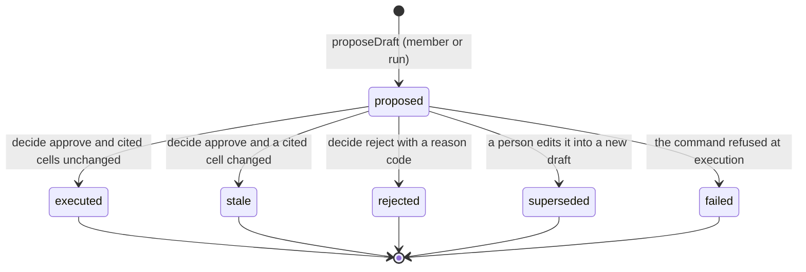

**Effective-dated revisions for master data** (ruling; R1 #3): the identity row never changes; what changes is a new
revision row, and the latest in effect wins, like `books.price` today.

| Identity | Revision | What may change |
|---|---|---|
| `books.item` (kind, unit, parent) | `books.item_revision` | name, category, barcode, variant attributes, service duration, HSN/SAC code, tax class, sellable (discontinued) |
| `books.item` | `books.price` | the selling price |
| `books.customer` | `books.customer_terms` | the credit limit |
| `books.staff` | `books.staff_terms` | home branch, title, pay kind and amount |
| customer / supplier / staff | `books.party_contact` | which `ops.contact` names them |
| tenant | `books.tax_registration` | GST scheme, GSTIN, state |
| staff | `books.shift_pattern` | the weekly roster |

**One reversal rule, one trigger, one command per book** (ruling; R1 #8). A reversible table declares in
`ref.book_table` its `signed_cols` and `match_cols`. `a_write` admits a row with `reverses_id` only if: the original
exists in this tenant, is not itself a reversal, has not been reversed before (unique `reverses_id`), every signed
column is the exact negation of the original's, every match column is equal, and the reason is a `ref.reason` code with
`reversal` in `used_for`. Each book gets one `*.reverse` command that writes the reversal of the header **and** of every
row it caused (lines, stock moves, payments, credit, journal, discounts, loyalty and package entries, invoice → credit
note), so the net of the original and its reversal is zero everywhere (gate REV1). Leave and holidays reverse with no
signed columns (match columns only); attendance needs no reversal (latest mark per staff and day wins).

**The journal, read by reports and GST** (ruling: keep it and read it). Accounts are rows of `ref.account`, referenced
by foreign key:

| Code | Kind | Normal | Written by |
|---|---|---|---|
| `cash`, `upi_clearing`, `card_clearing`, `bank` | asset | debit | tenders of sales and payments |
| `receivable` | asset | debit | credit sales, repayments |
| `inventory` | asset | debit | purchases |
| `staff_advance` | asset | debit | advances given; recovered by salary runs |
| `payable` | liability | credit | purchases on credit, supplier payments |
| `package_liability` | liability | credit | package sales, redemptions, expiries |
| `gst_output_cgst`, `gst_output_sgst` | liability | credit | invoices of a registered shop |
| `wages_payable` | liability | credit | salary runs, wage payments |
| `opening_equity` | equity | credit | opening stock |
| `sales` | income | credit | sales (taxable value), package redemptions |
| `sales_discount` | income (contra) | debit | offer and loyalty discounts |
| `package_breakage` | income | credit | package expiries |
| `wages_expense` | expense | debit | salary runs |

The day report, the GST summary and the salary page read `books.journal_line` joined to `ref.account`; a gate (JR1)
proves each report figure equals the journal's sum for its accounts over the period, computed independently in the test
from raw lines.

**Idempotency** (ruling; R2 #5): `ops.idempotency (tenant_id, scope, key, command, request_sha256, result, created_at)`,
primary key `(tenant_id, scope, key)`. Every form render and every API write carries a key (the SDK makes one). Inside
the command's own transaction core inserts the key first: a fresh key proceeds; a duplicate waits on the unique index
until the first commits, then returns the stored ids (`result`, ids only) if `request_sha256` matches, or `conflict`
(409) if it does not. A double tap on the counter records one sale (gate IDEM1, red-proof: skip the insert).

### 2.10 Every table

Grant letters: **A** `munshi_app`, **P** `munshi_public`, **J** `munshi_jobs`, **G** `munshi_agent`; `S` select, `I`
insert, `U(cols)` column-pinned update, `D` delete (only where a policy allows). Every books table is `A: S I` and `J: S`
only (plus the public role's column grants listed in §2.3), with `a_write` and `z_audit`; the column "Written by" lists
the commands in `ref.command_table`. A table not listed for a role grants it nothing.

#### 2.10.1 `ops`: tenancy, shops, members, sign-in

| Table | Columns (type, check) | Keys and indexes | Grants | Triggers and rules |
|---|---|---|---|---|
| `ops.deployment` (global) | `one bool pk default true check (one)`, `kind text` demo\|live, `created_at` | — | A P J: S | inserted only by the owner before any tenant; never updated, deleted or truncated (`MS010`) |
| `ops.schema_version` (global) | `one bool pk`, `source text` schema\|migrations, `sha256 text`, `built_at` | — | A P J: S | written by the build; the app refuses to boot when its compiled-in sha differs (§4.2) |
| `ops.tenant` | `tenant_id uuid pk`, `name text 1..120`, `business_type → ref.business_type`, `data_class text` synthetic\|showcase\|live, `country char(2) default 'IN'`, `currency char(3) default 'INR'`, `time_zone text default 'Asia/Kolkata'`, `count_max_age interval default '6 hours'`, `sandbox bool default false`, `created_txid bigint`, `created_at` | pk | A: S I · P: S (name, business_type, data_class, currency, time_zone) · J: S | `tenant_class`: `live` exactly on a live deployment; `sandbox` only off live and only `synthetic`; stamps `created_txid`; never updated (no U grant to anyone) |
| `ops.tenant_directory` (global) | `slug text pk` `^[a-z][a-z0-9-]{2,39}$`, `tenant_id uuid unique → ops.tenant`, `created_txid`, `created_at` | pk, unique tenant | A: S I · P: S · J: S | `directory_guard`: the tenant row was created in **this** transaction; the slug is not reserved (`app`, `api`, `developers`, `sign-in`, `sign-up`, `log-in`, `invite`, `privacy`, `terms`, `demo`, `live`, `www`, `munshi`…); never updated. The demo picker lists the directory's synthetic and showcase tenants that are not sandboxes, each read under its own context |
| `ops.shop` | [T] `id`, `name 1..80`, `area ≤80`, `address ≤300`, `state_code text ^[0-9]{2}$` (GST state), `invoice_series text ^[A-Z0-9]{1,8}$`, `created_at`, `updated_at` | pk | A: S I U(name, area, address, state_code, invoice_series, updated_at) · P: S(id, name, area) · J: S | `shop_guard`: only an active owner updates; audited `shop.update {shop_id}` |
| `ops.shop_hours` | [T] `id`, `shop_id`, `weekday smallint 1..7`, `opens time`, `closes time > opens`, `closed bool`, `effective_from date`, `created_by`, `created_at` | `(tenant_id, shop_id, weekday, effective_from)` | A: S I · P: S · J: S | append-only; the latest in effect per shop and weekday wins |
| `ops.member` | [T] `id`, `display_name ≤80` (NULL once erased), `phone_e164` (NULL once erased), `role` owner\|manager\|staff, `active bool`, `created_at`, `deactivated_at`, [E] | `(tenant_id, active)` | A: S I U(active, deactivated_at, display_name, phone_e164, erased_at) · J: S U(display_name, phone_e164, erased_at) | `member_guard` (first member is the owner adding themself; then owners add owners and managers, owners or managers add staff; serialised per tenant); `member_deactivate` (one way, never the last owner, under the same lock); `erase(display_name, phone_e164)` only after deactivation; audited `{member_id, role}` only |
| `ops.member_invite` | [T] `id`, `member_id`, `email ≤254` (NULL once used or expired), `token_sha256 bytea`, `expires_at` (24 h), `created_by`, `created_at`, `used_at`, `used_txid`, [E] | unique `(tenant_id, token_sha256)` | A: S I U(used_at, used_txid, email, erased_at) · J: U(email, erased_at) | `invite_guard`: owner invites anyone, manager invites staff; use is the invited member, before expiry, in one UPDATE that nulls the email |
| `ops.login` (global) | `id uuid pk`, `provider text` supabase\|local, `subject text` (NULL once erased), `tenant_id`, `member_id`, `invite_id` (NULL only for a first owner), `first_owner bool`, `created_txid`, `created_at`, `revoked_at`, [E] | unique `(provider, subject, tenant_id) where subject is not null`; unique `(tenant_id, member_id, provider) where revoked_at is null and erased_at is null`; `(provider, subject)` | A: S I U(revoked_at, subject, erased_at) | `login_bind`: for the current tenant and the acting member; **either** an invite naming that member was used in this transaction, **or** `first_owner` and the tenant was created in this transaction and the member is its first, an owner (self-serve sign-up, no SECURITY DEFINER); `local` refused on a live deployment; no email column |
| `ops.login_session` | [T] `id`, `member_id`, `via` demo\|auth\|local, `created_at`, `expires_at`, `revoked_at` | `(tenant_id, member_id)` | A: S I U(revoked_at) | `session_via`: a member opens their own; `demo` only on synthetic or showcase tenants; `auth` only on a live deployment with a live `supabase` login; `local` only off live; ≤ 12 h (demo, local), ≤ 14 days (auth); revoked once |

#### 2.10.2 `ops`: people, files, idempotency, jobs, limits

| Table | Columns | Keys and indexes | Grants | Triggers and rules |
|---|---|---|---|---|
| `ops.contact` | [T] `id`, `name ≤80`, `phone_e164`, `language` hi\|en, `created_by` (a member), `created_at`, `erased_by`, `erase_reason` request\|retention, `erase_requested_at`, [E] | unique `contact_phone (tenant_id, phone_e164) where erased_at is null` | A: S I U(name, phone_e164, erased_at, erased_by, erase_reason, erase_requested_at) · J: S U(same) | `contact_guard` (an active member adds; erasure is the owner's own request or the no-actor purge, and is **held while any balance is open**, §2.6); `erase(name, phone_e164)`; audited `{contact_id}` |
| `ops.document` | [T] `id`, `kind` photo\|bill\|voice\|image\|card\|art\|import, `source` upload\|inbound\|seed, `storage_key text` (`<bucket>/<path>`; NULL once erased), `sha256 text`, `mime` (jpeg, png, webp, svg for `art` only, ogg, wav, csv, xlsx), `bytes int 1..4000000`, `uploaded_by` (NULL unless `upload`), `purge_after`, `created_at`, [E] | unique `(tenant_id, sha256)` | A: S I U(storage_key, erased_at) · P: S (restrictive: `card`/`art` named by a release) I (inbound `voice`/`image`) · J: S U(storage_key, erased_at) | `document_check` (an `art` document is SVG ≤ 200 KB, a `card` JPEG); `erase(storage_key)`; the bytes live in Supabase Storage, one private bucket per tenant (local: `.run/blobs/`) |
| `ops.idempotency` | `tenant_id`, `scope text` `^(member\|site\|webhook):[0-9a-f-]{36}$`, `key text ^[A-Za-z0-9_-]{8,128}$`, `command`, `request_sha256 bytea`, `result jsonb` (ids only), `created_at` | pk `(tenant_id, scope, key)` | A: S I · P: S I · J: D (older than 7 days) | §2.9 |
| `ops.job_claim` (global) | `job text`, `slot text` (e.g. `watch:<tenant>:2026-10-29T10:15`), `claimed_at`, `finished_at`, `outcome` ok\|skipped\|failed, `error_code` | pk `(job, slot)` | J: S I U(finished_at, outcome, error_code) | a job runs once per slot however often it is triggered (§4.3) |
| `ops.rate_counter` (global) | `bucket bytea` (16-byte keyed hash of IP, key or phone plus route class), `window_start`, `hits int` | pk `(bucket, window_start)` | P: S I U(hits) · J: D (windows older than a day) | RLS forced with permissive policies; nothing personal |
| `ops.member_input` | [T] `id`, `member_id`, `path text`, `kind` money\|quantity\|integer\|date, `num bigint`, `currency`, `unit`, `day`, `created_txid`, `created_at` | `(tenant_id, member_id, created_at)` | A: S I | the member is the actor; minted by the `input.values` read so a person's typed number in an edited draft is a cell labelled as theirs |

#### 2.10.3 `books`: catalogue and parties

| Table | Columns | Keys and indexes | Written by | Rules |
|---|---|---|---|---|
| `books.item` | [T][S] `id`, `kind` good\|service\|package, `unit` piece\|pack\|kg\|g\|l\|ml\|m\|session, `parent_item_id` | unique `(tenant_id, id, kind)` (for composite keys); `item_parent (tenant_id, parent_item_id)` | `item.create`, `package.plan.create`, `grid.apply` | `(kind = 'service') = (unit = 'session')`; a variant's parent is a `good` with no parent (one level, core); `m` (fabric by the metre) only if the suit shop needs it (§12) |
| `books.item_revision` | [T][S] `id`, `item_id`, `name 1..120`, `category ≤60`, `barcode ≤64`, `attrs jsonb` (object; values ≤30, keys from the business type), `duration_min 5..600`, `hsn_sac ^[0-9]{4,8}$`, `tax_class ^[a-z0-9_]{2,40}$` (a country-pack code), `sellable bool`, `effective_from` | `(tenant_id, item_id, effective_from)` | `item.create`, `item.revise`, `package.plan.create`, `grid.apply` | latest in effect wins; `duration_min` set exactly for services (checked against the item by core and by `b_revision_kind`) |
| `books.item_alias` | [T][S] `id`, `item_id`, `alias` (NFKC, trimmed, lower case) | unique `(tenant_id, alias)` | `item.alias` | — |
| `books.price` | [T][S] `id`, `item_id`, `amount_minor ≥0`, `currency`, `effective_from` | `price_item (tenant_id, item_id, effective_from)` | `price.set`, `package.plan.create`, `grid.apply` | latest in effect wins; prices are tax-inclusive (§8.10, INFERENCE) |
| `books.customer` | [T][S] `id` | pk | `customer.create`, `booking.confirm` | an identity only; the person is in the vault |
| `books.customer_terms` | [T][S] `id`, `customer_id`, `credit_limit_minor ≥0`, `currency`, `effective_from` | `(tenant_id, customer_id, effective_from)` | `customer.create`, `customer.terms` | latest wins |
| `books.supplier` | [T][S] `id`, `is_simulated bool not null` (no default: every supplier states it), `gstin` | pk | `supplier.create` | a simulated supplier's deliveries are always recorded (§2.10.7) |
| `books.staff` | [T][S] `id`, `member_id` (NULL for staff with no app sign-in) | unique `(tenant_id, member_id) where member_id is not null` | `staff.create` | — |
| `books.staff_terms` | [T][S] `id`, `staff_id`, `shop_id` (home branch), `title ≤40`, `pay_kind` daily\|monthly, `pay_minor ≥0`, `currency`, `effective_from date` | `(tenant_id, staff_id, effective_from)` | `staff.create`, `staff.terms` | latest wins |
| `books.party_contact` | [T][S] `id`, `customer_id` \| `supplier_id` \| `staff_id` (exactly one), `contact_id → ops.contact`, `effective_from` | `(tenant_id, contact_id)`; `(tenant_id, customer_id, effective_from)`; same for supplier and staff | `customer.create`, `supplier.create`, `staff.create`, `booking.confirm`, `contact.link` | latest wins; the link survives the contact's erasure (an id) |
| `books.customer_consent` | [T][S] `id`, `customer_id`, `channel` whatsapp\|sms, `purpose` marketing\|service, `granted bool`, `source` in_person\|whatsapp_reply\|in_chat_attested\|import, `evidence_rel`, `evidence_id` (both or neither), `notice_version` (required when granted), `at ≤ created_at` | `consent_latest (tenant_id, customer_id, channel, purpose, created_at)` | `consent.record` | latest wins; a withdrawal is a new row |

#### 2.10.4 `books`: trade, stock, money, the journal

| Table | Columns | Keys and indexes | Written by | Rules |
|---|---|---|---|---|
| `books.sale` | [T][S][R] `id`, `shop_id`, `sold_at`, `customer_id`, `total_minor`, `currency`, `booking_id → ops.booking`, `reservation_id → ops.reservation`, `wa_cart_id → ops.wa_cart` | `sale_shop_day (tenant_id, shop_id, sold_at)`; `sale_customer (tenant_id, customer_id) where customer_id is not null` | `sale.record`, `sale.reverse` | signed `total_minor`; the total is re-derived by core, a client's total is never read |
| `books.sale_line` | [T][S] `id`, `sale_id` (parent), `line_no`, `item_id`, `item_kind`, `price_id → books.price`, `qty_milli ≠0`, `unit_price_minor ≥0`, `gross_minor`, `tax_class`, `tax_rate_bp ≥0`, `tax_minor`, `currency` | unique `(tenant_id, sale_id, line_no)`; `sale_line_item (tenant_id, item_id)` | `sale.record`, `sale.reverse` | composite key `(item_id, item_kind) → books.item`; accepted only in its sale's transaction |
| `books.sale_discount` | [T][S][R] `id`, `sale_id` (parent), `line_no`, `source` offer\|loyalty, `offer_id`, `loyalty_entry_id` (exactly the source's), `amount_minor ≠0`, `currency` | `(tenant_id, sale_id)`; `(tenant_id, offer_id)` | `sale.record`, `sale.reverse` | `b_offer_cap`: under a per-offer lock, live redemptions stay within `max_redemptions` and `per_customer_limit` |
| `books.purchase` | [T][S][R] `id`, `supplier_id`, `bill_no ≤40`, `bill_date`, `document_id`, `bill_read_id → ops.bill_read`, `total_minor`, `currency` | `purchase_supplier (tenant_id, supplier_id, bill_date)` | `purchase.record`, `purchase.reverse` | `b_one_live`: one live purchase per supplier and bill number |
| `books.purchase_line` | [T][S] `id`, `purchase_id` (parent), `line_no`, `item_id`, `item_kind = 'good'`, `qty_milli`, `unit_cost_minor ≥0`, `currency`, `expires_on`, `bill_line_id → ops.bill_line` | unique `(tenant_id, purchase_id, line_no)` | `purchase.record`, `purchase.reverse` | services are never bought into stock |
| `books.stock_move` | [T][S][R] `id`, `item_id`, `item_kind = 'good'`, `qty_milli ≠0`, `kind` opening\|purchase\|sale\|count_adjust\|waste\|return, `source_rel`, `source_id` (both or neither), `expires_on`, `at` | `stock_item (tenant_id, item_id, at)`; `stock_source (tenant_id, source_id)` | `sale.record`, `purchase.record`, `stock.count`, `stock.waste`, `stock.reverse`, `sale.reverse`, `purchase.reverse` | **composite key `(item_id, item_kind) → books.item (id, kind)` with `item_kind = 'good'`: a service or package can never move stock** (ruling) |
| `books.payment` | [T][S][R] `id`, `direction` in\|out, `method` cash\|upi\|card\|bank, `amount_minor ≠0`, `currency`, `customer_id`, `supplier_id`, `staff_id`, `sale_id`, `purchase_id`, `reference ^[A-Za-z0-9-]{1,64}$`, `paid_at` | `payment_sale (tenant_id, sale_id) where sale_id is not null`; `payment_day (tenant_id, paid_at)` | `sale.record`, `payment.record`, `payment.reverse`, `advance.give`, `sale.reverse` | recorded, never processed |
| `books.credit_entry` | [T][S][R] `id`, `customer_id`, `amount_minor ≠0` (+ given, − repaid), `currency`, `sale_id`, `payment_id`, `due_on`, `at` | `credit_customer (tenant_id, customer_id, at)`; `credit_sale (tenant_id, sale_id) where sale_id is not null` | `sale.record`, `credit.record`, `payment.record`, `credit.reverse`, `sale.reverse` | balance = sum per customer |
| `books.settlement` | [T][S][R] `id`, `channel` upi\|card, `business_date`, `amount_minor >0`, `currency`, `reference`, `received_on` | `(tenant_id, channel, business_date)` | `settlement.record`, `settlement.reverse` | `b_one_live`: one live settlement per channel and day (a reversed one may be recorded again, which 0007's partial index forbade) |
| `books.journal_entry` | [T][S][R] `id`, `entry_date`, `memo_code ^[a-z_]{2,40}$` (a code, never words), `source_rel`, `source_id` | `journal_day (tenant_id, entry_date)`; `journal_source (tenant_id, source_id)` | every money command | `z_balance` |
| `books.journal_line` | [T][S] `id`, `entry_id` (parent), `account → ref.account`, `amount_minor ≠0` (debit +, credit −), `currency` | `(tenant_id, entry_id)`; `journal_account (tenant_id, account)` | every money command | `z_balance` (deferred, once per entry at commit) |

#### 2.10.5 `books`: offers, loyalty, packages

| Table | Columns | Keys | Written by | Rules |
|---|---|---|---|---|
| `books.offer` | [T][S] `id`, `name 1..80`, `kind` percent_off\|amount_off, `percent_bp 1..9000`, `amount_off_minor >0`, `currency`, `scope` all\|category\|items, `category`, `min_spend_minor`, **`code ^[A-Z0-9]{4,16}$`**, **`max_redemptions >0`**, **`per_customer_limit >0`**, `starts_at`, `ends_at > starts_at`, `published bool` | `offer_window (tenant_id, starts_at, ends_at)`; unique `offer_code (tenant_id, code) where code is not null` | `offer.create` | the kind's amount and only it; never drafted by AI |
| `books.offer_item` | [T][S] `id`, `offer_id` (parent), `item_id` | `(tenant_id, item_id)` | `offer.create` | only in the offer's transaction, only for scope `items` |
| `books.offer_end` | [T][S] `id`, `offer_id` (unique), `ended_at`, `reason → ref.reason` | — | `offer.end` | once per offer |
| `books.loyalty_rule` | [T][S] `id`, `earn_per_100 0..10000`, `point_value_minor ≥1`, `currency`, `min_redeem ≥1`, `effective_from` | `(tenant_id, effective_from)` | `loyalty.rule.set` | latest wins |
| `books.loyalty_entry` | [T][S][R] `id`, `customer_id`, `kind` earned\|redeemed\|reversal, `points ≠0`, `seq`, `balance_after ≥0`, `sale_id`, `at` | unique `(tenant_id, customer_id, seq)` | `sale.record`, `sale.reverse` | `b_loyalty_tally`: `seq` and `balance_after` set under a per-customer lock; below zero `MS009` |
| `books.package_plan` | [T][S] `id`, `item_id` (unique; the `package` item), `kind` sessions\|value, `value_minor`, `currency`, `validity_days 1..1095` | unique item | `package.plan.create` | — |
| `books.package_plan_line` | [T][S] `id`, `plan_id` (parent), `line_no`, `item_id` (a service), `sessions 1..100` | unique `(tenant_id, plan_id, line_no)` | `package.plan.create` | only in the plan's transaction |
| `books.package_holding` | [T][S] `id`, `customer_id not null`, `plan_id`, `sale_id` (parent), `starts_on`, `expires_on ≥ starts_on`, `liability_minor ≥0`, `currency` | `(tenant_id, customer_id)`; `(tenant_id, expires_on)` | `sale.record` | only in its sale's transaction |
| `books.package_entry` | [T][S][R] `id`, `holding_id`, `shop_id` (the branch), `item_id` (NULL for value plans), `kind` sold\|redeemed\|expired\|reversal, `sessions`, `value_minor`, `currency`, `seq`, `sessions_after ≥0`, `value_after ≥0`, `at` | unique `(tenant_id, holding_id, seq)` | `sale.record` (sold), `package.redeem`, `package.expire` | `b_package_tally`: balances under a per-holding lock (`MS009`), and **each kind bound to its command**: sold only by `sale.record`, redeemed only by `package.redeem`, expired only by an approved `package.expire` (wip keep-list) |

#### 2.10.6 `books`: staff records

| Table | Columns | Keys | Written by | Rules |
|---|---|---|---|---|
| `books.shift_pattern` | [T][S] `id`, `staff_id`, `shop_id`, `weekday 1..7`, `starts time`, `ends time > starts`, `off bool`, `effective_from date` | `(tenant_id, staff_id, weekday, effective_from)` | `shift.pattern.set` | the weekly roster; latest in effect per staff and weekday wins; `off` means no hours |
| `books.shift_change` | [T][S] `id`, `staff_id`, `day`, `shop_id`, `starts`, `ends`, `off bool` (`off` = no times) | `(tenant_id, staff_id, day)` | `shift.change` | a one-day swap; the latest row for that day wins over the pattern |
| `books.leave` | [T][S][R] `id`, `staff_id`, `kind` paid\|unpaid\|sick, `first_day`, `last_day ≥ first_day`, `half_day bool` (only for one day) | `(tenant_id, staff_id, first_day)` | `leave.record`, `leave.reverse` | a reversal copies the match columns |
| `books.holiday` | [T][S][R] `id`, `shop_id` (NULL = every branch), `day`, `name_key ^[a-z_]{2,40}$` | `(tenant_id, day)` | `holiday.set`, `holiday.reverse` | — |
| `books.attendance` | [T][S] `id`, `staff_id`, `shop_id`, `day`, `status` present\|absent\|half_day\|leave\|off, `in_at`, `out_at > in_at` | `(tenant_id, staff_id, day, created_at)` | `attendance.mark` | the latest mark per staff and day wins (no reversal needed) |
| `books.advance` | [T][S][R] `id`, `staff_id`, `amount_minor >0`, `currency`, `given_on` | `(tenant_id, staff_id, given_on)` | `advance.give`, `advance.reverse` | journal: debit `staff_advance`, credit the tender |
| `books.salary_run` | [T][S][R] `id`, `period_start`, `period_end ≥ start`, `shop_id` (NULL = all) | `(tenant_id, period_start)` | `salary.run` (draft-only) | — |
| `books.salary_line` | [T][S] `id`, `run_id` (parent), `staff_id`, `pay_kind`, `pay_minor` (the terms used), `days_milli ≥0`, `gross_minor ≥0`, `advance_recovered_minor ≥0`, `net_minor`, `currency` | unique `(tenant_id, run_id, staff_id)` | `salary.run` | `net = gross − recovered`; `b_advance_recovery`: recovered ≤ the staff member's outstanding advances, under a per-staff lock (`MS009`) |

#### 2.10.7 `books` and `ops`: messages, campaigns, outbox, inbox

| Table | Columns | Keys | Grants / written by | Rules |
|---|---|---|---|---|
| `books.outbound_message` | [T][S] `id`, `channel` whatsapp\|sms\|instagram, `recipient_kind` customer\|supplier\|staff\|public, `recipient_id`, `template_code` (code-composed text, e.g. `booking_confirmed`), `text_id → ops.message_text not null`, `body_sha256 bytea not null`, `campaign_id`, `reply_to_id → ops.inbound_message`, `booking_id → ops.booking` | `(tenant_id, recipient_kind, recipient_id)`; `(tenant_id, campaign_id)` | `reorder.place`, `booking.confirm`, `campaign.send`, `campaign.post`, `message.reply`, `customer.remind` | `b_outbound_derive` (the text exists, is unerased and has that sha256); `z_outbound_delivery` derives the delivery; `(channel = 'instagram') = (recipient_kind = 'public')`. Every body, templated or written, is an erasable `ops.message_text`; the book keeps its hash |
| `ops.message_text` | [T] `id`, `body ≤4096` (NULL once erased), `body_sha256` (= sha256 of body while present), `author` member\|run\|template, `created_by`, `run_id`, `created_at`, [E] | — | A: S I U(body, erased_at) · J: U(body, erased_at) | immutable but for erasure |
| `ops.campaign` | [T] `id`, `name ≤80`, `channel` whatsapp\|instagram, `offer_id`, `copy_text_id`, `card_document_id`, `segment` bought_within_days\|lapsed_regulars\|package_expiring, `segment_days 1..365`, `status` composing\|proposed\|approved\|rejected\|sent, `created_by`, `created_at`, `updated_at` | `(tenant_id, status)` | A: S I U(status, copy_text_id, card_document_id, updated_at) | the composer's working object; the send is the draft |
| `ops.delivery` | [T] `id`, `message_id` (unique; NULL for a test send), `test_member_id`, `test_text_id`, `channel`, `to_address` (NULL once erased), `mode` recorded\|pending\|cloud_api\|manual_link\|instagram, `status` queued\|sending\|sent\|delivered\|read\|failed\|needs_window\|blocked\|handed_off\|expired, `claimed_at`, `attempts 0..1`, `provider_message_id`, `error_code ^[0-9]{1,8}$`, `not_after`, `sent_at`, `final_at`, `created_at`, `updated_at`, [E] | `delivery_due (tenant_id, status, not_after)`; unique `(tenant_id, provider_message_id) where provider_message_id is not null` | A: S I U(status, mode, claimed_at, attempts, provider_message_id, error_code, sent_at, final_at, updated_at) · P: U(status, error_code, final_at, updated_at) (webhook statuses) · J: S U(as A, erased_at) | `delivery_derive`: created only by the message's trigger in its transaction; every field derived (address from the contact; `mode = recorded` unless the deployment is `live` **and** `munshi.via = 'auth'` **and** the recipient is not a simulated supplier); `delivery_status`: forward only, claimed once, so sent at most once; `erase(to_address)` |
| `ops.inbound_message` | [T] `id`, `channel` whatsapp, `provider_message_id`, `from_address` (insert only), `kind` text\|audio\|image\|other, `text ≤4096`, `media_document_id` + `media_at`, `transcript` + `transcribed_at`, `opt_out bool`, `received_at`, `status` new\|handled\|ignored, `handled_by`, `handled_at`, [E] | unique `(tenant_id, provider_message_id)`; `inbound_from (tenant_id, from_address, received_at)`; `inbound_status (tenant_id, status, received_at)` | P: I U(media_document_id, media_at) · A: S U(status, handled_by, handled_at, transcript, transcribed_at) · J: S U(erase) | `inbound_flow` (arrives with no actor; a STOP is handled only beside its withdrawal); `erase(text, from_address, transcript, media_document_id)`; `fill_once(transcript, transcribed_at)`, `fill_once(media_document_id, media_at)` |
| `ops.inbound_extract` | [T] `id`, `message_id`, `run_id`, `field` amount\|date\|service\|quantity, `num`, `day`, `item_id`, `span_start`, `span_end`, `span_sha256`, `parsed_as` digits\|words, `created_at` | `(tenant_id, message_id)` | A: S I | `extract_span`: the span lies inside the live transcript and hashes to `span_sha256`; a digit span is re-parsed by the database and must equal `num` (`MS006`); no quote is stored |

#### 2.10.8 `ops`: sites, public requests, bookings, holds, carts

| Table | Columns | Keys | Grants | Rules |
|---|---|---|---|---|
| `ops.site` | [T] `id`, `intake` open\|paused, `booking_mode` none\|request\|slots, `origins text[]` (`https://host[:port]`; `http://localhost:<port>` only off live), `privacy_version`, `consent_version`, `hold_minutes 2..30 default 10`, `reservation_hours 1..168 default 48`, `created_by`, `created_at`, `updated_at` | unique `(tenant_id)` (one site per tenant, serving every branch) | A: S I U(intake, booking_mode, origins, privacy_version, consent_version, hold_minutes, reservation_hours, updated_at) · P: S | `site_guard`: an active owner; audited `site.update` |
| `ops.site_key` | [T] `id`, `site_id`, `key_sha256 bytea`, `prefix` (`mpk_<slug>_` + 4), `created_by`, `created_at`, `revoked_at`, `revoked_by` | unique `(tenant_id, key_sha256)` | A: S I U(revoked_at, revoked_by) · P: S(id, site_id, key_sha256, revoked_at) | revoked once by an active owner, never restored |
| `ops.site_look` | [T] `id`, `site_id`, `tokens jsonb` (≤16 KB; only the fixed token names, colour values `^#[0-9a-f]{6}$`), `font_pair` (a code of the fixed palette, §9), `profile jsonb` (≤32 KB: tagline, story, sections, FAQ, hours note; the merchant's copy, no personal data), `art jsonb` (slot → an `art` document id), `created_by`, `created_at` | `(tenant_id, site_id, created_at)` | A: S I · P: S (restrictive: looks a release names) | append-only revisions; validated by the contract schema in core and by `look_check` |
| `ops.site_release` | [T] `id`, `site_id`, `look_id`, `snapshots jsonb` (read name → snapshot ids), `published_by`, `published_at`, `created_txid` | `site_release_latest (tenant_id, site_id, published_at)` | A: S I · P: S | `release_check`: every snapshot is this tenant's, purpose `release`, a `site.*` read, minted in **this** transaction (B8); the look is this site's; refused when `munshi.via = 'demo'`; **off the live deployment only the owner role publishes** (the reset, wip keep-list); pins its snapshots |
| `ops.staff_public` | [T] `id`, `staff_id`, `shop_id`, `display_name ≤40`, `blurb ≤200`, `art_document_id`, `shown bool`, `consent_at` (the owner attests the person agreed), `created_by`, `created_at`, [E] | `(tenant_id, shop_id)` | A: S I U(shown, display_name, blurb, erased_at) · P: S (shown, unerased) | the only personal data a public page shows, opt-in per person; never in a snapshot cell |
| `ops.site_request` | [T] `id`, `site_id`, `shop_id`, `kind` enquiry\|booking_request, `source` site\|whatsapp, `contact_name ≤80`, `contact_phone_e164`, `item_ids uuid[] ≤3`, `preferred_on`, `time_window` morning\|afternoon\|evening, `note ≤500`, `wa_updates bool`, `notice_version`, `consent_version`, `ip_hash bytea`, `status` new\|confirmed\|declined\|spam\|closed, `handled_by`, `handled_at`, `customer_id`, `created_at`, [E] | `(tenant_id, status, created_at)`; `(tenant_id, contact_phone_e164) where erased_at is null` | P: I · A: S U(status, handled_by, handled_at, customer_id, erase) · J: U(status, erase) | `request_flow` (no actor on insert; handled once; paused intake refused; versions current); **on a demo deployment the name, phone and note are pinned to the samples** (`Sample customer`, `+910000000000`, NULL); `erase(contact_name, contact_phone_e164, note)` |
| `ops.booking` | [T] `id`, `site_id` (NULL when made in the app), `shop_id`, `staff_id → books.staff`, `service_item_id` + `service_kind = 'service'` (composite key), `during tstzrange` (`[)`, ≤ 8 h), `state` held\|requested\|confirmed\|declined\|cancelled\|expired\|done\|no_show, `source` site\|app\|whatsapp, `expires_at` (holds), `hold_token_sha256 bytea`, `customer_id`, `handled_by`, `handled_at`, `reason → ref.reason`, `created_at`, `updated_at` | **`booking_no_overlap exclude using gist (tenant_id with =, staff_id with =, during with &&) where (state in ('held','requested','confirmed'))`** (btree_gist); `(tenant_id, shop_id, state)` | P: S(id, shop_id, staff_id, service_item_id, during, state, expires_at) I U(state, updated_at) · A: S I U(state, customer_id, handled_by, handled_at, reason, updated_at) · J: U(state, updated_at) | `booking_flow`: held → requested (before `expires_at`, with the hold token, its contact row in the same transaction) \| expired; requested → confirmed (only inside `booking.confirm`) \| declined \| cancelled; confirmed → done (with a sale naming it) \| no_show \| cancelled; **fits the calendar**: inside the staff member's shift that day at that shop, not on leave, not a holiday, inside the shop's hours (`MS015` otherwise); **no personal column** |
| `ops.booking_contact` | `tenant_id`, `booking_id` (pk with tenant), `contact_name ≤80`, `contact_phone_e164`, `note ≤500`, `wa_updates`, `notice_version`, `consent_version`, `ip_hash`, `created_at`, [E] | pk `(tenant_id, booking_id)` | P: I · A: S U(erase) · J: U(erase) | inserted only while its booking moves held → requested in the same transaction; demo samples pinned; `erase(contact_name, contact_phone_e164, note)` |
| `ops.reservation` | [T] `id`, `site_id`, `item_id` + `item_kind = 'good'`, `qty_milli >0`, `state` requested\|held\|declined\|released\|expired\|sold, `contact_name`, `contact_phone_e164`, `note`, `notice_version`, `consent_version`, `ip_hash`, `held_until`, `handled_by`, `handled_at`, `reason`, `created_at`, [E] | `(tenant_id, item_id, state)` | P: S(item_id, state, held_until) I · A: S U(state, held_until, handled_by, handled_at, reason, erase) · J: U(state, erase) | `reservation_flow`: an active member moves requested → held (setting `held_until`) or declined; held → sold only in the transaction of a sale that names this reservation and sells that item; → released; → expired after `held_until` (jobs); demo samples pinned; `erase(…)` |
| `ops.wa_cart` | [T] `id`, `site_id`, `code ^ORD-[A-Z0-9]{4,6}$`, `release_id`, `lines jsonb` (≤ 20 of `{itemId, qtyMilli}`), `offer_code`, `created_at`, `expires_at` (7 days) | unique `(tenant_id, code)` | P: I · A: S | **holds no personal data**; the customer's WhatsApp carries the code; staff open the cart by code at the counter, and the sale names the cart |

#### 2.10.9 `books`: GST

| Table | Columns | Keys | Written by | Rules |
|---|---|---|---|---|
| `books.tax_registration` | [T][S] `id`, `scheme` regular\|composition\|unregistered, `gstin ^[0-9]{2}[A-Z0-9]{13}$` (required unless unregistered), `state_code ^[0-9]{2}$`, `effective_from date` | `(tenant_id, effective_from)` | `tax.registration.set` | latest in effect wins; tenant-wide (one GSTIN per state, INFERENCE) |
| `books.invoice` | [T][S] `id`, `sale_id` (parent), `shop_id`, `kind` tax_invoice\|bill_of_supply\|credit_note, `series`, `fy ^[0-9]{4}-[0-9]{2}$`, `number >0`, `issued_at`, `seller_gstin`, `buyer_gstin`, `place_of_supply ^[0-9]{2}$`, `taxable_minor`, `cgst_minor`, `sgst_minor`, `igst_minor = 0` (v1), `total_minor`, `currency`, `original_invoice_id` (credit notes only) | unique `invoice_no (tenant_id, shop_id, series, fy, number)`; unique `(tenant_id, sale_id)` | `sale.record`, `sale.reverse` (credit note) | **`b_invoice_number`**: under a lock on (tenant, shop, series, fy), `number = max + 1`, the caller's value overwritten; in the sale's own transaction, so a rollback frees the number: **gapless**; a bill of supply carries no tax; `total = taxable + cgst + sgst` |
| `books.invoice_line` | [T][S] `id`, `invoice_id` (parent), `line_no`, `sale_line_id`, `description ≤120` (the item's name then), `hsn_sac`, `qty_milli`, `taxable_minor`, `rate_bp`, `cgst_minor`, `sgst_minor`, `total_minor` | unique `(tenant_id, invoice_id, line_no)` | `sale.record`, `sale.reverse` | sums checked per line; `z_invoice_total`, a deferred constraint trigger like `z_balance`, makes the invoice's totals equal its lines' sums at commit (`MS004`) |

#### 2.10.10 `ops`: photo evidence and the grid

Kept from 0008 and wip 0020: `ops.shelf_count` (run, item, photo sha256, phrase, model, raw response, raw sha256,
matches; checks `shelf_count_hashed` and `shelf_count_matches`), `ops.bill_read` (run, supplier, photo sha256, model,
bill number and date as printed, `created_txid`), `ops.bill_line` (bill read, line, text as printed, matched item,
quantity, unit cost, each figure's place on the 0–1000 grid; `bill_line_placed`), `ops.grid_batch` (base snapshot,
source typed\|pasted\|file, document, actor, `created_txid`) and `ops.grid_change` (batch, `line_no 1..500`, `kind`
price\|new_item, item or `add_key`, amount, currency, new item as JSON text). All A: S I, append-only, lines only in
their parent's transaction (`MS006`); the agent reads them only as cells of `count.shelf`, `bill.lines` and `grid.batch`.

#### 2.10.11 `approval`, `snap`, `audit`

| Table | Columns | Keys | Grants | Rules |
|---|---|---|---|---|
| `approval.draft` | [T] `id`, `command → ref.command`, `payload jsonb`, `based_on jsonb` (1..50 refs), `payload_refs jsonb`, `source` member\|run, `proposed_by`, `run_id → ai.run`, `finding_id → ai.finding`, `desk`, `supersedes_id`, `status` proposed\|executed\|rejected\|stale\|failed\|superseded, `created_txid`, `created_at`, `updated_at` | `(tenant_id, status, created_at)`; unique `draft_open_per_finding (tenant_id, finding_id) where status = 'proposed'` | A: S I U(status, updated_at) | `stamp_draft`, `draft_status` (status follows the decision), `draft_pin` |
| `approval.decision` | [T] `id`, `draft_id` (unique), `verdict` approved\|rejected, `decided_by`, `reason → ref.reason`, `created_txid`, `created_at` | unique `(tenant_id, draft_id)` | A: S I | `stamp_decision` (decider is the actor; draft from an earlier transaction) |
| `snap.snapshot` | [T] `id`, `query_name`, `params jsonb`, `params_sha256`, `purpose` display\|evidence\|watch\|release, `columns jsonb`, `rows jsonb`, `rows_sha256`, `row_count 0..500`, `actor_id`, `run_id`, `created_txid`, `created_at` | `snapshot_reuse (tenant_id, query_name, params_sha256, created_at)`; `snapshot_purge (tenant_id, created_at) where purpose in ('display','watch')` | A: S I · J: S I D(policy) · G: S · P: S (restrictive: release-pinned) | `snap_check` (§2.8); immutable |
| `snap.pin` | `tenant_id`, `snapshot_id`, `holder` draft\|finding\|answer\|brief\|release\|grid, `holder_id`, `created_at` | pk all four | A J: S I (from triggers only) · P: S (release pins) | inserted only from a holder's trigger (`pg_trigger_depth() > 1`, else refused) |
| `audit.audit_log` | [T] `seq`, `actor_id`, `decision_id`, `command`, `action`, `entity ^[a-z_]+\.[a-z_]+$`, `entity_id`, `payload jsonb` (a digest, or ids and codes), `created_at`, `prev_hash`, `hash` | pk `(tenant_id, seq)`; `audit_entity`; unique `audit_book_row (tenant_id, entity, entity_id) where entity like 'books.%'` | A: S I · J: S | `chain` (§2.7) |
| `audit.checkpoint` | [T] `seq`, `hash`, `made_at` | pk `(tenant_id, seq)` | J: S I · A: S | written after a passing verification |

Functions the roles execute: `audit.entry_hash` (A J), `audit.verify_chain(uuid, boolean)` (A J), `audit.verify_books(uuid)`
(A J). No other function is executable by any runtime role (G9).

#### 2.10.12 `ai`

| Table | Columns | Keys | Grants | Rules |
|---|---|---|---|---|
| `ai.run` | [T] `id`, `trigger` question\|voice\|watcher\|brief\|photo\|inbox\|campaign\|recipe, `desk`, `started_by` (a member, or NULL), `started_at`, `ended_at`, `outcome` answered\|abstained\|proposed\|raised\|failed\|budget\|off, `tainted bool`, `model_calls int` | `(tenant_id, started_at)` | A J: S I U(ended_at, outcome, tainted, model_calls) | `run_flow`: `tainted` only false → true (a run that read untrusted text); ends once |
| `ai.trace` | [T] `id`, `run_id`, `seq >0`, `kind` route\|model\|read\|budget\|validate\|answer\|abstain\|propose\|evidence\|watch\|recipe, `label ≤64` (core's fixed list, else `unlisted`), `ids jsonb` (≤16 uuids), `ms ≥0`, `at` | unique `(tenant_id, run_id, seq)` | A J: S I | ids and labels only, never text |
| `ai.finding` | [T] `id`, `desk`, `kind`, `dedupe_key ≤200`, `status` open\|snoozed\|dismissed\|resolved, `severity` low\|medium\|high\|critical, `snapshot_id`, `snapshot_row`, `impact_col` (the cell holding ₹ at stake per month), `first_run_id`, `last_run_id`, `first_seen_at`, `last_seen_at`, `snoozed_until`, `closed_at`, `closed_by`, `close_reason → ref.reason`, `created_at`, `updated_at` | unique **`finding_one_open (tenant_id, dedupe_key) where status in ('open','snoozed')`**; `(tenant_id, status, severity)` | A: S U(status, snoozed_until, closed_at, closed_by, close_reason, updated_at) · J: S I U(status, snapshot_id, snapshot_row, last_run_id, last_seen_at, closed_at, updated_at) | `finding_flow` (§7.4): open ↔ snoozed, → dismissed (a member, a dismiss code), → resolved (jobs, no actor); dismissed and resolved are final; a key dismissed in the last 30 days is not raised again (`MS012`); every change writes `ai.finding_event`; pins its snapshot |
| `ai.finding_event` | [T] `id`, `finding_id`, `kind` raised\|seen\|snoozed\|woke\|dismissed\|resolved\|drafted, `run_id`, `member_id`, `reason`, `at` | `(tenant_id, finding_id, at)` | A J: S I (from triggers only) | the finding's history |
| `ai.answer` | [T] `id`, `run_id`, `kind` ask\|explain\|brief_line\|copy\|gloss, `segments jsonb` (≤6 of text with refs), `verdict` answered\|abstained, `rules text[]`, `created_at` | `(tenant_id, run_id)` | A J: S I | pins every cited snapshot |
| `ai.brief` | [T] `id`, `business_date`, `run_id`, `items jsonb` (≤5 finding ids with rank), `answer_id`, `created_at` | unique `(tenant_id, business_date)` | J: S I · A: S | one a day per shop |
| `ai.policy` | [T] `id`, `enabled bool`, `daily_call_cap 0..2000`, `narrate_min_severity`, `effective_from`, `created_by`, `created_at` | `(tenant_id, effective_from)` | A: S I (owner, trigger) · J: S | latest wins; **no row means off** (fails closed); audited `ai.policy {policy_id}` |
| `ai.usage` | `tenant_id`, `day`, `role` router\|reason\|vision\|segment\|voice\|narrate, `calls ≥0` | pk `(tenant_id, day, role)` | A J: S I U(calls) | core's `allow()` increments only while under the cap |

#### 2.10.13 `agent_view`

Owned by `munshi_owner`; the agent holds SELECT only; the base tables force RLS, so each view is tenant-scoped.
`item` (id, kind, unit, name, category from the latest revision, sellable) · `shop` (id, name, area) · `customer`,
`supplier`, `staff` (id; `name` from the linked contact **only when the tenant is synthetic or showcase**, NULL on a live
tenant, so no real name reaches a model through the agent) · `finding` (id, desk, kind, status, severity, snapshot_id,
snapshot_row, impact_col). No view has a numeric column (numbers reach the agent only as cells).

#### 2.10.14 Which book tables each command writes (`ref.command_table`)

| Command | Writes `books.` |
|---|---|
| `item.create` | item, item_revision |
| `item.revise` | item_revision |
| `item.alias` · `price.set` | item_alias · price |
| `customer.create` | customer, customer_terms, party_contact |
| `customer.terms` · `contact.link` | customer_terms · party_contact |
| `supplier.create` | supplier, party_contact |
| `staff.create` | staff, staff_terms, party_contact |
| `staff.terms` | staff_terms |
| `sale.record` | sale, sale_line, sale_discount, stock_move, payment, credit_entry, loyalty_entry, package_holding, package_entry, invoice, invoice_line, journal_entry, journal_line |
| `sale.reverse` | the same set (reversal rows, a credit note) |
| `purchase.record` · `purchase.reverse` | purchase, purchase_line, stock_move, journal_entry, journal_line |
| `stock.count` · `stock.waste` · `stock.reverse` | stock_move |
| `credit.record` · `credit.reverse` | credit_entry, journal_entry, journal_line |
| `payment.record` · `payment.reverse` | payment, credit_entry, journal_entry, journal_line |
| `settlement.record` · `settlement.reverse` | settlement, journal_entry, journal_line |
| `consent.record` | customer_consent |
| `booking.confirm` | customer, customer_terms, party_contact, outbound_message |
| `reorder.place` · `campaign.send` · `campaign.post` · `message.reply` · `customer.remind` | outbound_message |
| `offer.create` · `offer.end` · `loyalty.rule.set` | offer, offer_item · offer_end · loyalty_rule |
| `package.plan.create` | item, item_revision, price, package_plan, package_plan_line |
| `package.redeem` · `package.expire` | package_entry, journal_entry, journal_line |
| `shift.pattern.set` · `shift.change` | shift_pattern · shift_change |
| `leave.record` · `leave.reverse` · `holiday.set` · `holiday.reverse` | leave · holiday |
| `attendance.mark` | attendance |
| `advance.give` · `advance.reverse` | advance, payment, journal_entry, journal_line |
| `salary.run` | salary_run, salary_line, journal_entry, journal_line |
| `tax.registration.set` | tax_registration |
| `grid.apply` | item, item_revision, price |

### 2.11 Indexes for every real read path

Each is declared in the schema file and asserted in `pg_index` (G10); the read it serves is named so a reviewer can
check it is used (R1 rank 1 #2 measured a missing one at 1.85 s for 6,000 sales).

| Read path | Index |
|---|---|
| payments of a sale (receipt, day report) | `payment_sale (tenant_id, sale_id) where sale_id is not null` |
| a customer's sales, credit and packages | `sale_customer`, `credit_customer`, `package_holding (tenant_id, customer_id)` |
| the people behind a contact (erasure, STOP) | `party_contact (tenant_id, contact_id)` |
| recipients of messages | `outbound (tenant_id, recipient_kind, recipient_id)` |
| purchases from a supplier, the last price | `purchase_supplier (tenant_id, supplier_id, bill_date)`; `purchase_line (tenant_id, item_id)` |
| credit raised by a sale | `credit_sale (tenant_id, sale_id) where sale_id is not null` |
| stock moves caused by a row (reversal) | `stock_source (tenant_id, source_id)` |
| on-hand and stock history | `stock_item (tenant_id, item_id, at)` |
| the price and revision in effect | `price_item`, `item_revision (tenant_id, item_id, effective_from)` |
| a day's sales per branch (watchers, day report) | `sale_shop_day (tenant_id, shop_id, sold_at)`, queried with timestamp bounds computed in core from the shop's zone, never `(sold_at at time zone tz)::date` (R1 rank 3) |
| the journal by account and day (reports, GST) | `journal_account (tenant_id, account)`, `journal_day (tenant_id, entry_date)` |
| a staff member's calendar | `shift_pattern (tenant_id, staff_id, weekday, effective_from)`, `shift_change (tenant_id, staff_id, day)`, `leave (tenant_id, staff_id, first_day)`, `holiday (tenant_id, day)`, the GiST index behind `booking_no_overlap` |
| holds on a piece | `reservation (tenant_id, item_id, state)` |
| due deliveries, open requests, the inbox | `delivery_due`, `site_request (tenant_id, status, created_at)`, `inbound_status`, `inbound_from` |
| open findings by severity | `finding_one_open`, `(tenant_id, status, severity)` |
| snapshot reuse and purge | `snapshot_reuse`, `snapshot_purge` |
| drafts waiting | `draft (tenant_id, status, created_at)` |

### 2.12 ER diagrams

Keys and relations only; full columns are in §2.10. Every relation also carries `tenant_id` (omitted below).

**Tenancy, sign-in and people**

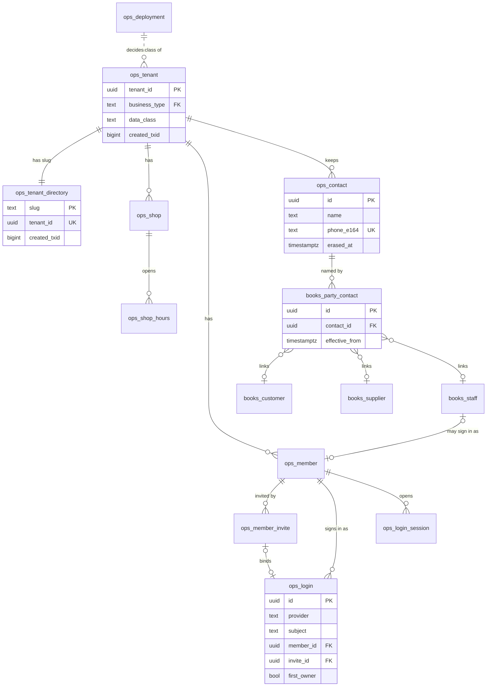

**The books: catalogue, trade, money**

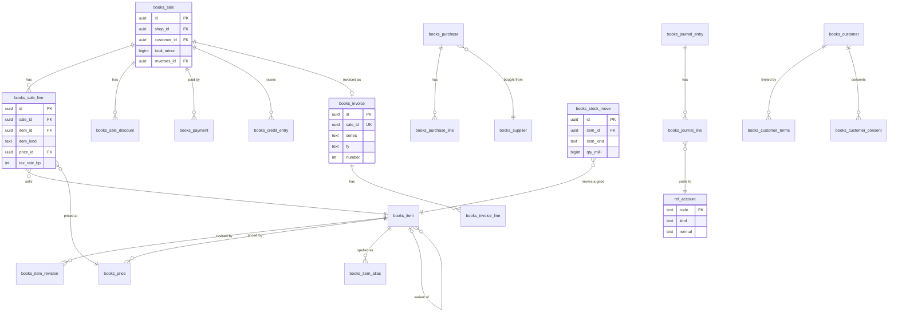

**The books: offers, loyalty, packages**

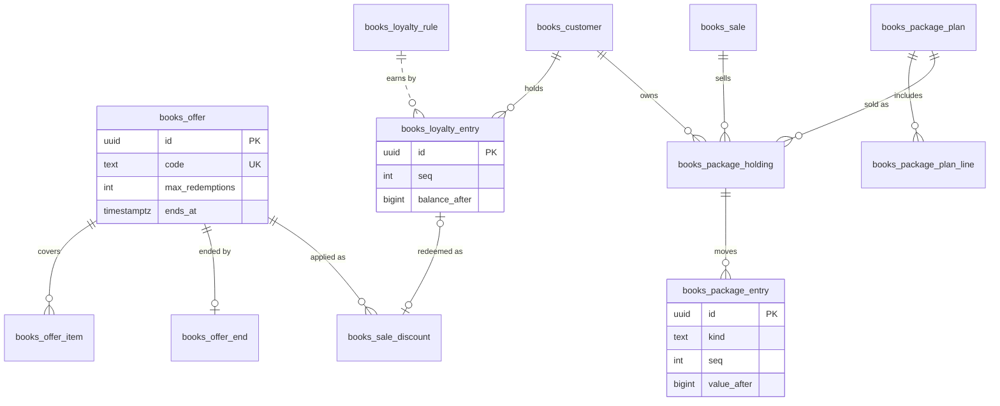

**Staff, calendar and bookings**

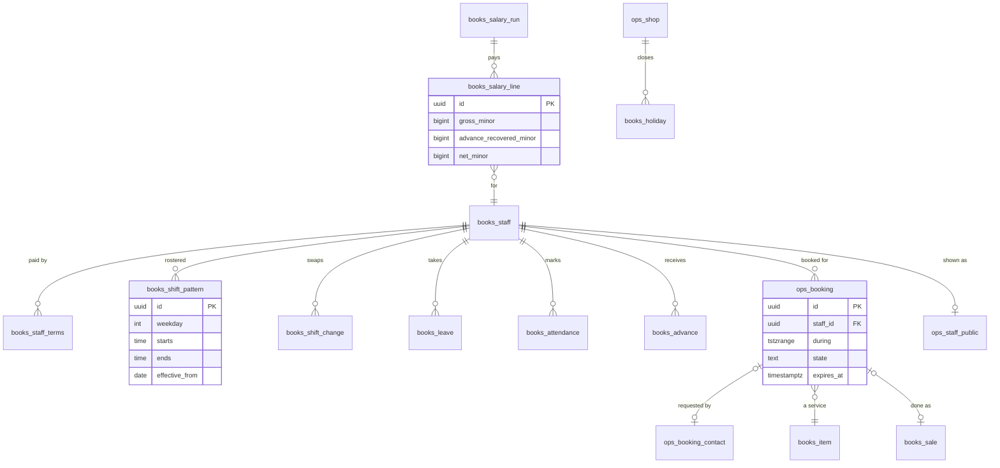

**Sites, public requests, messages**

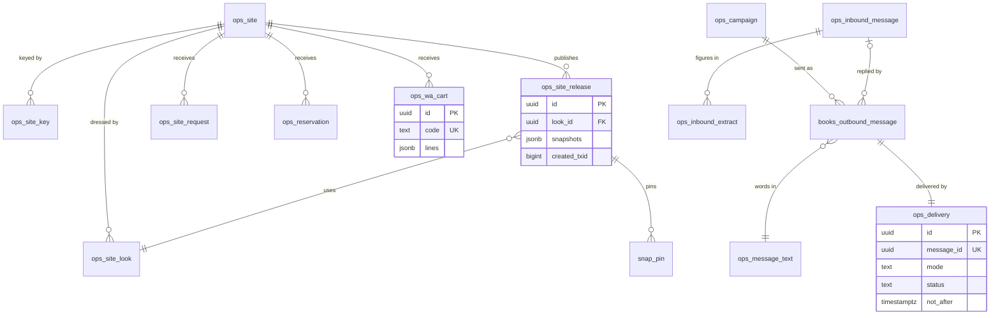

**Approvals, snapshots, audit, the AI back office**

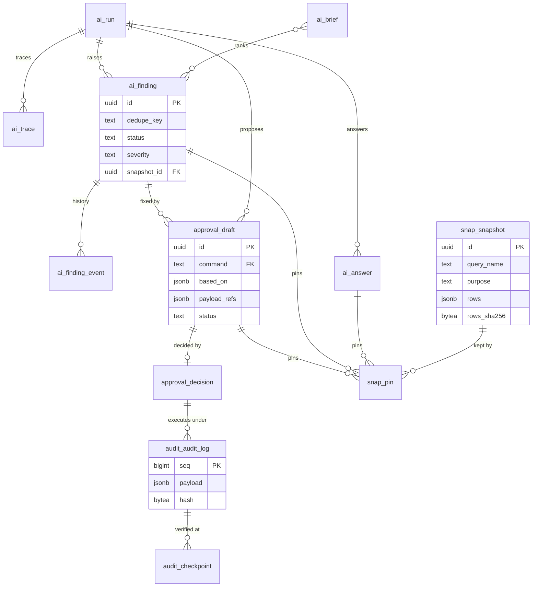

### 2.13 Error codes and gates

| Code | Meaning | Core maps to |
|---|---|---|
| `MS001` | book write refused (the guard) | `refused` |
| `MS002` | draft or decision refused | `refused` |
| `MS003` | verify for another tenant | `refused` |
| `MS004` | a journal entry does not balance | `unbalanced` |
| `MS005` | audit entry refused | `refused` |
| `MS006` | a child after its parent's transaction; a span or cell that does not hold | `refused` |
| `MS007` | who may do it: member, contact, invite, login, session, site, key, request, booking | `refused` |
| `MS009` | a balance would go below zero (loyalty, package, advance) | `invalid` |
| `MS010` | tenant class or deployment mismatch; an immutable row changed | `refused` |
| `MS011` | an erase-only or fill-once column changed other than allowed | `refused` |
| `MS012` | a finding change not allowed (a dismissed key raised again within 30 days) | `conflict` |
| `MS013` | a reversal that is not the exact opposite, or a second reversal | `invalid` |
| `MS015` | a booking outside the calendar (no shift, leave, holiday, closed, expired hold) | `invalid` |
| `23P01` | two bookings overlap (the exclusion) | `conflict` ("That time was just taken") |
| `23505`, `42501` | duplicate; no privilege or a row outside the tenant | `conflict`; `refused` |

(`MS008`, personal data in the books, is retired: no books column can hold a name or phone any more.)

**Gates kept and retargeted to `db/schema/`** (same meaning, new targets; §3 says how): G1 (the agent cannot write;
counts from the manifest), G2 (guard), G3 (command authority, totality), G4 (isolation over every tenant table, every
role), G5 (append-only), G6 (balance), G7 (chain), G8 (a failing run exits non-zero), G9 (functions: none executable by
PUBLIC; none SECURITY DEFINER; search_path pinned), G10 (indexes in `pg_index`; tenant_id leads every key and every
tenant-to-tenant FK), G11 (children only in the parent's transaction, now every child table), G12 (members), G13 (global
tables), T1–T3 (class, deployment, reset as owner), OE1 (erase and fill rules, every exploit path), F4–F7 (invites,
logins, sessions, the `via` rule), PII2/PII3 (no planted name or phone in cells, views, traces, audit, drafts, global
tables), E1 (erasure leaves nothing), K1–K5 (consent, double opt-in, whole-audience recheck), W1–W8 (webhook, outbox),
S1–S10 (API), D1–D2 (draft-only), L1–L2, P1–P4, O1–O2 (loyalty, packages, offers), GR1–GR4 (grid), C1–C7, H1–H3, A1,
B0–B4 (core, hero chain, agent, boundaries).

**New gates** (each red-proved, each with a positive expected count from an independent source):

| Gate | Holds | Red-proof |
|---|---|---|
| TRG1 | every books table has exactly its declared triggers, in `a_`, `b_`, `z_` order | add a stray trigger; rename `a_write` |
| J1 | the jobs role holds no INSERT on any books table and every attempt is refused | grant one |
| J2 | snapshot purge never deletes a pinned or recent snapshot; deletes an old unpinned display one | drop the pin clause |
| PUB1 | the public role reads only release-pinned snapshots, published looks and documents, and the allowed columns | drop a restrictive policy |
| VB1 | `verify_books` finds a book row edited with triggers disabled (as the owner), a deleted row and a row with no entry | skip the digest compare |
| REV1 | a reversal must be the exact opposite, once; each `*.reverse` nets to zero everywhere | allow a partial amount |
| IDEM1 | a replayed key returns the stored ids; a different body under the same key is 409 | skip the key insert |
| INV1 | 20 concurrent sales on one series get numbers 1..20 with no gap and no repeat; a rolled-back sale leaves no gap | drop the lock |
| BK1 | overlapping holds or bookings for one stylist are refused (`23P01`); an expired hold frees its slot | drop the exclusion |
| BK2 | a booking outside the shift, on leave, on a holiday or after its hold expired is refused | drop the calendar check |
| SAL1 | a salary run's journal balances; recovered advances never exceed outstanding | drop the recovery lock |
| GST1 | golden invoices: a salon service at 5%; apparel at 5% up to ₹2,500 a piece and 18% above; a composition shop's bill of supply carries no tax; CGST + SGST = the line's tax; values from a hand-worked key | change a rate in the pack |
| SIGNUP1 | a directory row or a first-owner login is accepted only in the transaction that created the tenant | insert one a transaction later |
| SUPA1 | (deploy-check, hosted) `anon`, `authenticated`, `service_role` hold nothing on any Munshi schema; our schemas are not exposed by the Data API; the large-object residual is printed | grant `anon` USAGE in a scratch database |
| PG17 | the schema builds on PostgreSQL 17 (the harness's pinned major); no PostgreSQL 18-only function appears | use `uuidv7()` |
| JR1 | the day report, the GST summary and the salary page equal the journal's sums, computed in the test from raw lines | report from `sale.total_minor` instead |
| SWEEP1 | each jobs purge removes exactly the planted due rows in every tenant (a positive count) and keeps every pinned or recent one (§4.4) | run a job without its per-tenant loop |
| VB1-TZ | (part of VB1) digests written under UTC verify under `Asia/Kolkata` (§2.7) | drop the functions' `TimeZone` setting |

## 3 · No migrations while building

> Until the freeze, the database is rebuilt from ordered SQL files under `db/schema/` plus a populate script; every gate
> and red-proof runs on that build. It freezes into one baseline migration before any real shop's data lives in a database.

### 3.1 The files

Each file is one concern, applied in name order, each in one transaction, and each sits beside a hand-written manifest
fragment `NN_name.manifest.json` (its tables, global tables, books tables with their expected triggers, views,
functions). The runner merges the fragments; the gates count against the merged manifest, an independent source that is
not read from the catalog. No two lanes share a file (§10).

| File | Concern | Runs as |
|---|---|---|
| `00_bootstrap.sql` | the five roles (idempotent `do` blocks), `grant create on database … to munshi_owner`, the admin's SET on the owner role, schema `extensions` + `btree_gist`, the PUBLIC revokes (§2.2) | the admin, once per database (`pnpm db:bootstrap`) |
| `01_ref.sql` | the eight schemas (`authorization munshi_owner`), the `ref` tables, the chart of accounts, reason codes, business types | migrator → `set local role munshi_owner` (every file from here) |
| `02_shared.sql` | `ops.only_erase`, `ops.fill_once`, `books.write`, `books.audit_row`, `books.check_balanced`, `audit.chain`, `audit.entry_hash`, `audit.verify_chain`, `audit.verify_books`, `snap.snap_check`, the pin and event guards | |
| `03_tenancy.sql` | deployment, schema version, tenant, directory, shop, hours, member, invite, login, session | |
| `04_ops_infra.sql` | contact, document, idempotency, job claim, rate counter, member input | |
| `05_runs.sql` | `ai.run`, `ai.trace` | |
| `06_snap.sql` | `snap.snapshot`, `snap.pin`, the purge policy | |
| `07_ai.sql` | findings and events, answers, brief, policy, usage | |
| `08_approval_audit.sql` | draft, decision, audit log, checkpoint | |
| `10_catalogue.sql` | item, revision, alias, price, and their commands' `ref` rows | |
| `11_parties.sql` | customer, terms, supplier, staff, staff terms, party contact, consent | |
| `12_staff_records.sql` | shift pattern and change, leave, holiday, attendance, advance, salary run and lines | |
| `13_evidence.sql` | shelf count, bill read and lines | |
| `14_sites_public.sql` | site, key, look, release, staff public, request, booking and its contact, reservation, cart | |
| `15_trade_journal.sql` | sale, lines, purchase, lines, stock move, payment, credit, settlement, journal | |
| `16_offers_loyalty.sql` | offer, items, end, sale discount, loyalty rule and entries | |
| `17_packages.sql` | plan, lines, holding, entries | |
| `18_gst.sql` | tax registration, invoice, lines | |
| `19_messaging.sql` | outbound message, message text, campaign, delivery, inbound, extract | |
| `20_grid.sql` | grid batch and changes | |
| `30_agent_views.sql` | the agent's views | |
| `90_seal.sql` | asserts the build: every manifest table exists with RLS enabled and forced; every books table has its `ref.book_table` row; every command in `ref.command` writes a table; raises otherwise | |

Each books file inserts its own `ref.command`, `ref.command_authority`, `ref.command_table` and `ref.book_table` rows,
so the foundation file never changes when a feature lands. References run one way to keep the order acyclic: a sale
names its booking, reservation and cart (books → ops), and those ops rows do not name the sale back.

### 3.2 The scripts

| Command | Does | Refuses |
|---|---|---|
| `pnpm db:bootstrap` | `00_bootstrap.sql` as the admin (`ADMIN_DATABASE_URL`) | — |
| `pnpm db:build` | drops the eight Munshi schemas (as the owner role), applies `01`–`90`, writes `ops.schema_version` (the sha256 of the files) and the `ops.deployment` row | a database whose `ops.deployment` says `live` (live is built once, then only migrated after the freeze) |
| `pnpm db:populate` | provisions the three tenants through core's real paths (§3.3) | any tenant that is not synthetic or showcase; a live deployment |
| `pnpm db:reset` | build + populate on the local database (`.run/pg`), in about the time `pnpm reseed` takes today | any database that is not the local one or an embedded test database |
| `pnpm db:reset-demo` | the same against the hosted demo, by the operator from a laptop, as the migrator | a live deployment, any live tenant (T3, run as `munshi_owner`) |
| `pnpm dev` | starts the local Postgres (pinned to 17), runs `db:reset` if the schema sha changed, then the app with env from `.run/dev.env` | — |

### 3.3 The populate script and the three tenants

`db/seed/populate.ts` creates each tenant the way a real owner would (the self-serve path: tenant, directory row and
first owner in one transaction, §6.3), then writes everything else through core's commands as that tenant's members.
Ids are derived from the slug and a fixed namespace, so a rebuild keeps them and the recorded fixtures stay valid.

| Tenant (slug) | Class | Type | Holds |
|---|---|---|---|
| Sharma General Store (`sharma-kirana`) | synthetic | kirana | today's seed: the catalogue, a month of sales, purchases from simulated suppliers, credit, settlements; the five planted situations and near-miss controls with the hand-worked answer key (`db/seed/kirana.answers.json`); its people now through the vault |
| Elite Unisex Salon & Academy (`elite`) | showcase | salon | two shops (Kirti Nagar, Kalkaji), the service menu with durations, packages, stylists with weekly rosters and one-day changes, holidays, bookings across both branches, invented customers, package holders, staff attendance and one salary month; a planted package expiry, an idle stylist and a lapsing regular |
| The suit shop (`suit-shop`) | showcase | apparel | suits as parents with size and colour variants, stock, a Diwali offer with a code, two pieces on hold, a WhatsApp cart, invented customers and udhaar; a planted dead-stock line and an expiring hold |

The showcase catalogues come from `db/seed/merchants/<slug>/` (the wip branch has both catalogues as JSON); real
catalogue values replace them when the merchants send theirs. A test checks every planted situation against its key.

### 3.4 How the gates and the red-proof harness retarget

- **The harness** builds one template database per test run from `db/schema/` (bootstrap as the embedded superuser,
  files `01`–`90` as `munshi_migrator`), then clones it per test file (`CREATE DATABASE … TEMPLATE`, copying the ACL as
  today). Building as the migrator in every run replaces the separate MS-13 migrator test: if any file needs a superuser,
  every suite fails.
- **embedded-postgres is pinned to major 17** to match Supabase (UNVERIFIED major; checked first in BP-OPS-2). Gate PG17
  fails on a PostgreSQL 18-only function.
- **Gate counts** come from the merged manifest. G1, G4, G9, G10 and G13 iterate it; their expected numbers rise by
  exactly the new entries.
- **Sabotage entries** (`db/test/sabotage.ts`) stay keyed by gate. Entries that name a renamed object are rewritten:
  `guard` → `a_write`, `guard_audit` → `z_audit`, `ops.run`/`ops.run_trace`/`ops.finding` → `ai.*`,
  `snap.snapshot_cell` → `snap.snapshot.rows`, `books.pii` → removed (its gate PII1 becomes "no books column can hold a
  name or phone", checked against the catalog). A sabotage that does not apply is still an ERROR, never a red (kept).
  The file is split per area (R3 #12: 1,535 lines) so lanes own their entries.
- **The kirana's recorded model turns** are keyed by the sha256 of the request, which carries handles and data blocks,
  never ids or the storage format, so most survive; any that change are re-recorded by the ticket that changed them.

### 3.5 The freeze (D-043)

The rebuild ends **before any real shop's data lives in a database**: at the feature freeze (Tue 3 Nov night), or at the
live go-live if that comes first.
1. `pnpm db:freeze` writes `db/migrations/0000_bootstrap.sql` (the admin file) and `0001_baseline.sql` (files `01`–`90`
   concatenated, unchanged), records each file's sha256 in `db/migrations/manifest.json`, and deletes `db/schema/`.
2. The runner returns to append-only mode: an applied migration that changes is refused; changes are new numbered files.
   CLAUDE.md's "append-only" rule returns with it.
3. **Gate FREEZE1** builds one database from the migrations and one from the last `db/schema` commit and compares a
   normalised catalog dump (tables, columns, constraints, indexes, triggers, functions, policies, grants). Any difference
   fails. Red-proof: edit one schema file after the freeze.
4. The demo keeps its rebuild (`db:reset-demo` drops and re-applies the migrations, then populates) until after 5 Nov;
   the live database is created once from the baseline and only ever migrated.

## 4 · Core and the hosting layer

> Everything a hosted deploy needs that a laptop hid: config from the environment only, screen reads in core, one
> transaction per page, one background-jobs runner with four triggers, logs, headers, health, AI caps and photo limits.

### 4.1 Screen reads live in core

Every screen's data comes from `packages/core/src/views-<area>.ts` (`viewHome`, `viewCounter`, `viewCalendar`…). A view
takes the session and its params and returns figures as cells with refs, names from `people.ts` (masked by role,
§6.6) and fixed labels. `apps/web/lib/server/*` calls views and commands only. **Gate SQL1** scans `apps/` for SQL
(`select … from`, `insert into`, `update … set`, a schema-qualified Munshi table name) and for any import of `pg`; any
hit fails (red-proof: plant a query in a server file). This moves the ~50 raw SQL references R2 #4 counted, and the
three VIEW maps that disagreed become one.

### 4.2 One transaction per page

`withPage(pool, session, fn)` opens one transaction, sets the context once, and runs every read the page needs, each in
a read-only savepoint, with snapshot inserts or reuse in the same transaction (R1 #11: 8–12 transactions per page
today). Pools are small (app 3, idle timeout 10 s) because Vercel runs many instances. The `set_config` call stays its
own round trip: with the function and the database both in Mumbai a round trip is about a millisecond (INFERENCE), so
folding it into the first statement (R1's option) is not worth the complexity.

### 4.3 Config from the environment only

`packages/config` holds one zod schema per process (`web`, `jobs`, `dev`) and is the only reader of `process.env`
(R2: ten files read it today). The app reads **no file under `.run/` at runtime**: `pnpm dev` generates the dev secrets
into `.run/dev.env` and starts the app with them as environment variables (R2 #1, the deploy blocker). Fixtures are found
relative to the agent package (`import.meta.url`), never through `repoRoot()`. At boot the app refuses to serve unless:
every required name is set; `MUNSHI_DEPLOYMENT` equals `ops.deployment`; the schema sha compiled into the build equals
`ops.schema_version`; each pool connects as its own role with no superuser, no BYPASSRLS and no membership of the owner
(as `db.ts` checks today, now for all four pools); and a demo deployment names no channel credential.

**Environment names this design needs** (proposed; the founder adds them to `.env.example`, no lane edits it):
`MUNSHI_DEPLOYMENT`, `MUNSHI_PUBLIC_URL`, `MUNSHI_SESSION_SECRET`, `MUNSHI_RATE_SECRET`, `MUNSHI_AI`, `MUNSHI_SEND_MODE`,
`CRON_SECRET`, `PUBLIC_DATABASE_URL`, `JOBS_DATABASE_URL` (beside the existing `DATABASE_URL`, `AGENT_DATABASE_URL`,
`MIGRATOR_DATABASE_URL`, `ADMIN_DATABASE_URL`), `SUPABASE_URL`, `SUPABASE_PUBLISHABLE_KEY` (Auth, browser-safe),
`SUPABASE_SECRET_KEY` (Storage, server only; a gate scans every client bundle for it), `TURNSTILE_SECRET_KEY`,
`NEXT_PUBLIC_TURNSTILE_SITE_KEY`; live only: `WHATSAPP_ACCESS_TOKEN`, `WHATSAPP_PHONE_NUMBER_ID`, `WHATSAPP_APP_SECRET`,
`WHATSAPP_VERIFY_TOKEN`, `WHATSAPP_TEST_PHONES`, `INSTAGRAM_ACCESS_TOKEN`, `INSTAGRAM_ACCOUNT_ID`; each site project:
`MUNSHI_API_BASE`. The Google OAuth client is configured inside Supabase Auth, not in our environment.

### 4.4 The background-jobs runner

One function, `runDueJobs(pools, now, only?)` in `packages/core/src/jobs.ts`, runs as `munshi_jobs`. It has no actor,
imports no command runner (a source gate, as R2 asked), and writes no book row (it has no grant to).

| Job | Slot (runs once per) | Does |
|---|---|---|
| `outbox` | every trigger, per shop | claims queued deliveries and sends each once (§8.6) |
| `holds` | every trigger | expires slot holds past `expires_at` and reservations past `held_until` |
| `watch` | 15 minutes per shop, only if the shop's audit seq moved since the last run | the business type's watchers; raises, re-sees and resolves findings (§7.4) |
| `brief` | a day per shop, from 07:00 shop time | ranks the open findings into `ai.brief`; narrates high and critical ones if AI is on and under its cap |
| `retention` | a day per shop | the D-038 purges (§2.6), held erasures that can now complete |
| `snapshots` | a day | deletes unpinned display and watch snapshots older than 7 days |
| `sweep` | an hour | old idempotency rows, rate-counter windows, expired invites, storage objects of erased documents |
| `checkpoint` | a day per shop | verifies the chain from the last checkpoint and writes the next |

Each job first claims `ops.job_claim (job, slot)` with `insert … on conflict do nothing`, so however many triggers fire,
a slot's work runs once (Munim's tick-claim lesson). A run stops taking new work after 20 s and leaves the rest for the
next trigger. **Every job that touches tenant tables iterates the directory and works one tenant at a time under that
tenant's `SET LOCAL` context**: forced RLS would otherwise make a purge silently delete nothing (the B7 lesson). Gate
SWEEP1 plants old rows of each kind (snapshots, idempotency keys, rate windows, expired holds, retention-due requests)
in two tenants and asserts the exact count each job removes, a positive number, and that a pinned or recent row
survives (red-proof: run a job without the tenant loop).

**Four triggers** (Vercel Hobby has no frequent cron):

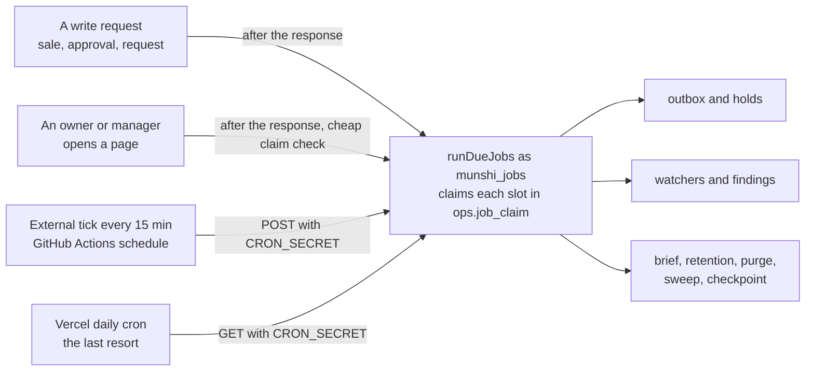

- Next's `after()` runs work after the response is sent, inside the function's time limit.
- Vercel Hobby crons run at most once a day, fired somewhere in the scheduled hour (FACT,
  https://vercel.com/docs/cron-jobs/usage-and-pricing, via search, page dated Jan 2026).
- The external tick needs the repository on GitHub, which does not exist yet (the founder creates it). Scheduled
  workflows on a private repository use the free minutes (UNVERIFIED amount; 96 runs a day may exceed it), so the tick
  runs every 30 minutes while the repo is private and every 15 once it is public. Until a remote exists, the first two
  triggers and the daily cron carry the work; a finding then waits for the next owner page load at worst.

### 4.5 Logs, request ids, headers, health

- **Structured logs:** one module, `log(event, fields)`, writes one JSON line: time, level, a fixed event label, the
  request id, route, tenant id, duration, a `CoreError` code. Never a body, a name, a phone, a key, a token or model
  text. A source scan fails on any `console.` outside it (the three empty `catch {}` blocks R2 found become logged codes).
- **Request ids:** middleware takes Vercel's request id (or makes one), sets `x-request-id` on the response, and core
  reads it from async context for logs and for the API error body.
- **Security headers:** a nonce-based Content-Security-Policy on every page (`default-src 'self'`, scripts by nonce,
  images from self, `data:`, `blob:` and the Storage host, Turnstile's host on the sites' forms, `frame-ancestors
  'none'`); `Strict-Transport-Security`; `X-Content-Type-Options: nosniff`; `Referrer-Policy:
  strict-origin-when-cross-origin`; `Permissions-Policy: camera=(self), microphone=(self), geolocation=()`. API and
  media responses carry `Content-Security-Policy: default-src 'none'` (an SVG served there cannot run a script).
- **`GET /api/health`:** `{ok, deployment, schema (sha prefix), source (schema or migrations), region, modelMode,
  sendMode, ai}`. No counts, no secrets. The capture guard and the deploy check read it.

### 4.6 AI off switch and caps

- `MUNSHI_AI=off` turns every model call off for the deployment; `ai.policy.enabled` turns it off for one shop; no
  policy row means off (fails closed).
- `ai.policy.daily_call_cap` (default 200 calls a day on live tenants, 60 on demo tenants because the demo is public and
  passwordless) is enforced by core's `allow(tenant, role)`, an atomic increment of `ai.usage` that refuses at the cap.
  The agent calls it through its port before every model call, so the count is kept by core, not the agent.
- Off or over the cap, every AI surface degrades to template text or hides (Ask hides its box; findings show their
  template line; drafts from recipes still work, since recipes use no model). Nothing shows an error. The demo's Ask
  also has a per-IP limit in `ops.rate_counter`.

### 4.7 Photos, voice and deadlines

- **Photos are downscaled in the browser** before upload: longest side ≤ 1600 px, JPEG at about 0.8 quality, re-encoded
  through a canvas (which drops EXIF). The server refuses a body over 4 MB: Vercel's limit for a function's request body
  is 4.5 MB (FACT, https://vercel.com/docs/functions/limitations, read 28 Oct; R2 #6 had it UNVERIFIED).
- **Voice** stays 16 kHz mono WAV, at most 60 seconds (about 1.9 MB). An inbound WhatsApp voice note goes to Storage and
  is transcribed only on a person's tap.
- **Whole-flow deadlines:** a shelf count 55 s, a bill read 45 s, an Ask 45 s (the existing budget), each passed down as
  an abort signal; each route sets `maxDuration = 60` (Hobby allows up to 300 s, FACT, same page). A flow past its
  deadline abstains or says "Try again", never hangs.

## 5 · API v1, the SDK and the developer portal

> A small public API that serves only what a person published, takes requests only with a publishable key, and never
> executes anything; zod contracts generate the OpenAPI file the SDK types and the portal are built from.

### 5.1 Resources

All paths are under `/api/v1`. "Release" means the response is built from the latest `ops.site_release`'s cells, so
every figure is a book row a person published. A **Figure** is `{"minor": 249900, "currency": "INR", "ref":
"⟨snap:…·12·price⟩"}` for money or `{"value": 45, "ref": "…"}` for an integer.

| Method and path | Auth | Returns or takes | Writes | Cache |
|---|---|---|---|---|
| `GET /sites/{slug}` | none | name, business type, the label from `data_class` ("Sample site" on demo), shops (id, name, area, hours), booking mode, intake, the notice and consent versions, the look (tokens, font pair, profile, art URLs), release id and time | nothing | `s-maxage=60`, `ETag` = release id |
| `GET /sites/{slug}/catalogue?category=&cursor=&limit=` | none | goods: parents with variants and attributes; each price a Figure; `held: true` on a variant with a live hold (no stock count is ever shown) | nothing | `s-maxage=60` |
| `GET /sites/{slug}/services` | none | services with duration and price Figures, and the branches that offer each | nothing | `s-maxage=60` |
| `GET /sites/{slug}/packages` | none | plans with their lines, sessions, validity and price Figures | nothing | `s-maxage=60` |
| `GET /sites/{slug}/offers` | none | published offers still in effect, with codes the owner chose to publish, as Figures | nothing | `s-maxage=60` |
| `GET /sites/{slug}/stylists?shop=` | none | the opted-in public profiles (display name, blurb, art) | nothing | `s-maxage=60` |
| `GET /sites/{slug}/slots?shop=&service=&date=&stylist=` | none | free start times per stylist for that day, each with the shift row it comes from | nothing | `no-store` |
| `GET /sites/{slug}/media/{id}.jpg` and `.svg` | none | a `card` or `art` document a release names, streamed from Storage (Instagram's fetcher sends no key) | nothing | `max-age=3600` |
| `GET /sites/{slug}/refs/{snapshot}/{row}/{col}` | none | one published cell and the book table and row id it came from ("tap for source" on a shop site) | nothing | `s-maxage=60` |
| `POST /sites/{slug}/holds` | publishable key, Origin, Idempotency-Key, bot check | `{shopId, stylistId, serviceId, start}` → `201 {holdId, holdToken, expiresAt}`; `409 slot_taken` | one `ops.booking` (held) | — |
| `DELETE /sites/{slug}/holds/{id}` | key, Origin, `X-Hold-Token` | releases the hold | the booking's state | — |
| `POST /sites/{slug}/bookings` | key, Origin, Idempotency-Key, bot check | `{holdId, holdToken, name, phone, note?, whatsappUpdates, noticeVersion, consentVersion, botToken, website}` → `202 {id, received}` | the booking (requested) and its `ops.booking_contact` | — |
| `POST /sites/{slug}/booking-requests` | key, Origin, Idempotency-Key, bot check | for shops in request mode: `{shopId, name, phone, serviceIds ≤3, preferredOn, timeWindow, note?, …}` → 202 | one `ops.site_request` | — |
| `POST /sites/{slug}/enquiries` | key, Origin, Idempotency-Key, bot check | `{name, phone, itemId?, message, …}` → 202 | one `ops.site_request` | — |
| `POST /sites/{slug}/reservations` | key, Origin, Idempotency-Key, bot check | hold a piece: `{itemId, name, phone, note?, …}` → 202 | one `ops.reservation` (requested) | — |
| `POST /sites/{slug}/carts` | key, Origin, Idempotency-Key | `{lines: [{itemId, qtyMilli}] ≤20, offerCode?}` → `201 {code, lines (each price a Figure), total, message, waLink}` (§8.5) | one `ops.wa_cart` | — |
| `GET /findings`, `GET /drafts`, `POST /drafts` | **secret key `msk_<slug>_…` (specified, not built for 5 Nov)** | server-to-server: read findings and drafts as ids, codes and Figures; propose a draft whose every number cites a ref; **never** decide or execute | `approval.draft` (proposed) | — |
| `POST /api/internal/tick` | `Authorization: Bearer <CRON_SECRET>` (timing-safe; anything else 404) | runs `runDueJobs` | jobs only | — |
| `GET, POST /api/webhooks/whatsapp` | Meta's verify token; `X-Hub-Signature-256` over the raw body before parsing (MERCHANTS-DESIGN §4.4, kept) | stores inbound messages and status events; live deploy only (404 on demo) | `ops.inbound_message`, delivery status | — |
| `GET /api/health` | none | §4.5 | nothing | `no-store` |

### 5.2 Auth modes

| Mode | Format | Grants | Rules |
|---|---|---|---|
| none | — | published reads by slug | the tenant comes from the slug in the path, never the payload; a slug that is unknown, or a sandbox, is 404 |
| publishable key | `mpk_<slug>_<43 base64url chars>` in `Authorization: Bearer` | the public writes above, for that slug's site | only its sha256 and a display prefix are stored; compared timing-safe under the slug's tenant; bad, revoked or wrong-origin → **404** with the same body and headers as an unknown route (Munim gotcha 16); never in a URL, never logged |
| secret developer key (deferred) | `msk_<slug>_<43 chars>`, shown once, scopes `read:catalogue`, `read:findings`, `read:drafts`, `propose:drafts` | server-to-server reads and proposals | never sent to a browser (a request with an `Origin` header and a secret key is refused); propose only, the draft waits for a person; per-key limits; revocable. Its table (`ops.developer_key`, hashed like `ops.site_key`) arrives as a migration after the freeze, when it is built |
| member session | the app's cookie | nothing under `/api/v1` | `/api/v1` never reads the session cookie (R2), so a logged-in browser cannot be made to act through it |

**Origins and CORS** (kept from MERCHANTS-DESIGN §5.4): a request with an `Origin` must match the site's allow-list; a
POST must carry one; a GET without one (a server render) is allowed; preflight answers permissively but the real request
is the one checked; credentials never allowed. The hosted shop app's own origin is always on its site's list.

### 5.3 Errors

One body for every error: `{"error": {"code": "<code>", "message": "<fixed text>", "fields": ["path", …],
"requestId": "<id>"}}`. Never a database message, a value, or model text (gate C2's pattern, extended to every route).

| Code | Status | When |
|---|---|---|
| `invalid` | 400 | the body fails its contract; unknown fields (strict schemas) |
| `idempotency_key_required` | 400 | a POST or DELETE without `Idempotency-Key` |
| `stale_notice` | 400 | `noticeVersion` or `consentVersion` differs from the site's current one (the SDK refetches) |
| `bot_check` | 400 | the Turnstile token fails, or was solved on another site's hostname |
| `unauthenticated` | 401 | only the webhook's bad signature |
| `not_found` | 404 | unknown route, slug, key, origin, hold token; a revoked key |
| `slot_taken` | 409 | another hold or booking overlaps (`23P01`) |
| `idempotency_mismatch` | 409 | the same key with a different body |
| `gone` | 410 | a retired route after its `Sunset` date |
| `payload_too_large` | 413 | a body over 4 KB |
| `unsupported_media_type` | 415 | anything but JSON |
| `rate_limited` | 429 | with `Retry-After` |
| `intake_paused` | 503 | the owner paused the site's forms (GETs still work) |
| `internal` | 500 | anything else, logged by code and request id |

### 5.4 Idempotency, pagination, versioning

- **Idempotency:** every POST and DELETE carries `Idempotency-Key` (8–128 of `A–Z a–z 0–9 _ -`); the SDK makes one per
  form render. Stored in `ops.idempotency` under the scope `site:<site id>`, inside the write's transaction (§2.9). A
  replay returns the original status and body; a different body under the same key is 409.
- **Pagination:** cursor pages on every list: `?limit=` (default 50, at most 100) and `?cursor=` (opaque base64url of
  the sort key and id); responses are `{data: […], next: "<cursor>" | null}`. Nothing silently stops at 500 any more
  (R2 rank 2).
- **Versioning:** the major version is in the path. Within v1 only additive changes (new fields, new routes, new error
  codes); every response carries `Munshi-Api-Version: 1`; a retired route sends `Sunset` first, then 410; a breaking
  change is `/api/v2` and a new SDK major. Dated versions are deferred (two consumers; Munim deferred them too, G).

### 5.5 Look as data, and the hosted shop app

- A shop's look is an `ops.site_look` revision: theme tokens (the fixed token names of §9, with values), one font pair
  from the fixed palette, profile copy (tagline, story, sections, FAQ, the hours note), and drawn SVG art documents for
  named slots (hero, section dividers, icons). Publishing a release pins one look and the `site.*` snapshots together.
- `apps/sites` renders `/{slug}/{lang}/…` at request time from `GET /sites/{slug}` and the other reads (server render,
  revalidated every 60 s). Tokens become CSS variables on `<html>`; the font pair selects from the fonts the app bundles
  (every shop can use them; fonts are not business material); art is `` from the media route, so an SVG never
  enters the page as markup (Munim gotcha 15), and is checked at upload (an allow-list of elements and attributes; no
  script, no `foreignObject`, no external reference).
- The page structure is the Munim storefront family (D-040): a huge display wordmark, one line-art hero, branch cards
  with status chips, a menu with category chips, a marquee band, item cards, a story page; Elite adds stylists,
  before-and-after, reviews, map and hours, FAQ; the suit shop adds lookbook, new arrivals, size guide, visit us (D-041).
  Which sections a shop shows is profile data.
- **Gate BUNDLE1 flips** (ruling): after `next build`, the output (client and server chunks, static assets, source maps),
  which must be newer than every source, is scanned for every seeded tenant's slug, name, profile strings and art
  hashes, and the kirana's name. **Any hit fails**: the bundle holds no business at all. Red-proof: import a seed
  profile into a page. A second gate holds `apps/sites`'s import closure to `@munshi/sdk`, `@munshi/ui` and its own files.
- A test renders two shops from one build and asserts neither page carries the other's name, art or prices (D-041:
  "a page never carries another shop's material").

### 5.6 Contracts → OpenAPI → SDK

1. `packages/contracts/src/v1/<resource>.ts` defines every request, response and error with zod (registered with ids);
   the route table (method, path, auth mode, request, response) sits beside them.
2. `pnpm contracts` writes `packages/contracts/openapi.json` (zod's JSON Schema output plus the route table) and, from
   it, `packages/sdk/src/schema.gen.ts` (types only). Both are committed; a freshness test fails when either is older than
   its inputs or differs from a fresh generation (Munim gotcha 13).
3. Route handlers parse with the same zod schemas; a type test asserts the handlers' outputs equal the generated types
   both ways.
4. `packages/sdk` is hand-written `fetch` over those types: `createClient({baseUrl, key?})` with `site()`,
   `catalogue()`, `services()`, `packages()`, `offers()`, `stylists()`, `slots()`, `hold()`, `releaseHold()`, `book()`,
   `requestBooking()`, `enquire()`, `reserve()`, `cart()`, `ref()`, plus `formatMoney(figure, locale)` (integers only,
   Indian grouping) and `MunshiError {status, code, requestId}`. **No runtime dependencies** (gate: `dependencies` is
   empty). Shipped as a versioned tarball with its sha256 from `/developers/sdk` (not npm), as Munim did (G).

### 5.7 The developer portal (`/developers`)

| Page | Holds |
|---|---|
| Overview | what the API is for; the One Guarantee as it applies to developers ("every figure you get is a ledger row; nothing you send changes the books until the shop approves it") |
| Getting started | a key, install the SDK, the first call against the sandbox shop, a booking widget in 30 lines |
| Authentication and errors | the modes (§5.2), origins and CORS, the error table, rate limits, idempotency |
| Figures and refs | the Figure shape, refs, `GET …/refs/…`, "Prices from the shop's books · published <date>" |
| Guides | booking widget with live slots; catalogue page; order on WhatsApp; hold a piece; offers with codes |
| Reference | every route from `openapi.json`, searchable, with examples recorded from the demo's showcase shops |
| Sandbox | the demo deployment's showcase shops with a public sandbox key (sample values only are ever stored, §6.5) |
| SDK | downloads with sha256, the changelog |

The pages are built at build time from `openapi.json` and Markdown in `docs/kit/` (Munim's portal is the reference for
sections only, G).

### 5.8 Abuse protection (kept from MERCHANTS-DESIGN §9, adjusted)

Per IP 5 POSTs per 10 minutes and 120 GETs a minute; per key 300 POSTs and 20,000 GETs a day; per phone 3 open requests
or bookings per site; per shop 500 stored requests a day; holds 3 per IP per 10 minutes. Counters in `ops.rate_counter`
(hashed buckets, one statement per hit). Cloudflare Turnstile on every form that stores a person's details, verified
server-side with its hostname checked against the site's origins (the field name is UNVERIFIED); a honeypot answers 202
and stores nothing. Bodies ≤ 4 KB, JSON only, strict schemas; names ≤ 80, notes ≤ 500; phones normalised to E.164 and
checked by the country pack's mobile rule; dates within today and 60 days. The public routes start no agent run and log
fixed labels and ids only.

## 6 · Sign-in with Supabase Auth, onboarding and the demo fence

> Supabase Auth proves who a person is at sign-in; Munshi's own tables decide which shop and role they have, on every
> request. The demo deploy has no real sign-in and no real people; the fence between the two is held in four layers.

### 6.1 Who does what

| Supabase Auth does | Munshi does |
|---|---|
| Google sign-in and email magic links; the OAuth client lives in Supabase's settings | maps the Supabase user id (`sub`) to members through `ops.login`; roles and shops live only in `ops.member` |
| issues an access token at the callback | verifies it **locally** against the project's JWKS (`/auth/v1/.well-known/jwks.json`; FACT, https://supabase.com/docs/guides/auth/signing-keys, read 28 Oct), checking signature, issuer, audience, expiry and a verified email; then signs the person out of Supabase and keeps no Supabase token |
| — | opens its own `ops.login_session` row and signed cookie (decision 1); every request re-reads the member's role and active flag (`openSession`) |

The identity adapter (`packages/adapters/identity`) has two implementations: `supabase` and `local`. `local` is a typed
email signed into a 10-minute cookie, for development and gates; it is refused at boot on a live deployment and by the
`session_via` and `login_bind` triggers in the database (gate AUTH1, red-proof: allow it on live). Supabase never holds
a role: no custom claims (Munim gotcha 11), no `auth.uid()` in any policy (Munim rule), no RLS that reads Supabase's
`auth` schema; our schemas are not exposed to its Data API (§2.2).

**Emails held by Supabase.** Supabase stores every signed-in person's email in `auth.users`. MERCHANTS-DESIGN promised
no lasting copy of a staff member's email (B1), so: when a member is erased, or the 365-day purge erases a deactivated
one, Munshi nulls the `ops.login` subject and then deletes the Supabase user through the adapter (its admin API, with
the server-only secret key) once no live login names that subject; the jobs runner retries until it is gone, and PII3's
scan on the live project includes `auth.users`. While a person is a member their email sits there, which the privacy
notice says. **Magic links need an email sender:** Supabase's built-in sender is meant for testing and is rate-limited
(UNVERIFIED limits), so production magic links need a custom SMTP provider, a new vendor and key (§12). Until then Google
is the primary sign-in and magic links are offered only once a sender is configured.

### 6.2 Signing in

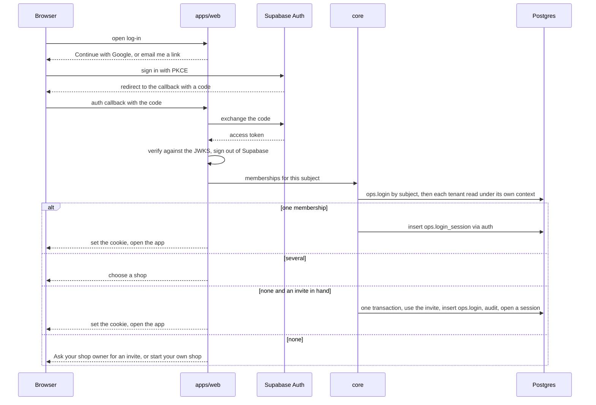

The memberships lookup returns id, name and role only; "none" says nothing about whether the account exists anywhere.

### 6.3 Self-serve sign-up and onboarding (live deploy)

Four short screens after the person signs in (D-041: self-serve and assisted, both):

1. **Your business:** type (kirana, clothing, salon), shop name, web address (the slug, suggested from the name,
   checked against the directory). On *Next*, one transaction creates the tenant (`live`), its directory row (the
   trigger checks the tenant was created in this transaction), the first shop, the owner member (the first member is
   the acting owner), the first-owner login (the trigger checks the same transaction), the session, the first AI policy
   row (on, D-038) and the site (intake paused until the first publish). No SECURITY DEFINER, no operator login
   (ruling; R1 #6). Limits: three shops per identity, five sign-ups per IP a day.
2. **Branches:** more shops (name, area, GST state), each with opening hours.
3. **Catalogue:** a photo of a price list (vision reads it into a draft list, every figure placed on the photo), an
   Excel or CSV file, the spreadsheet table, or a starter list for the type. Every path ends as one `grid.apply` draft
   the owner reviews and approves (imports are drafts; nothing auto-applies).
4. **Staff:** invite by name, role and email (optional; later from *Settings → People*).

**Assisted:** the operator's `pnpm provision --slug … --type … --owner-email …` (no HTTP route) creates the same rows and
prints a one-time owner invite. **Invites** are kept from MERCHANTS-DESIGN §6.2: 32 random bytes stored as sha256, 24
hours, single use, sent by the owner from their own WhatsApp; the verified email must equal the invite's (else 404); the
email is nulled when used.

### 6.4 The tenant picker and branches

- `/choose-shop` lists the person's memberships (name and role). A session belongs to one tenant; switching shops goes
  back through the picker.
- Branches are inside a tenant: Elite is one tenant with two shops, and the app's branch switcher (Kirti Nagar |
  Kalkaji) filters screens by `shop_id`; packages and loyalty stay tenant-wide (MERCHANTS-DESIGN §1.1, kept). Staff are
  tenant-wide in v1; a stylist's home branch is in `books.staff_terms`, and the roster says where they work each day.

### 6.5 The demo deploy and the fence

- **The demo picker** (`/demo`, demo deploy only; 404 on live): shop cards for the directory's synthetic and showcase,
  non-sandbox tenants, each read under its own context, then the chosen shop's active members; the session is
  `via = demo`.
- **Sample shops (Should):** the demo's *Sign up* runs the same four onboarding screens without Supabase (no email; the
  identity is a random local subject kept only in the cookie) into a `synthetic` tenant with `sandbox = true`, which the
  picker never lists. The operator's `db:reset-demo --sandboxes` deletes them. Judges can try onboarding and the demo
  database still holds no real person.
- **Demo shop sites store sample values only:** on a demo deployment the database pins every public request's name,
  phone and note to `Sample customer`, `+910000000000` and NULL (kept from MERCHANTS-DESIGN, now for bookings,
  reservations and enquiries alike), and the form says so.
- **The four layers, each red-proved** (MERCHANTS-DESIGN §6.4, kept, updated for Supabase):
  1. *Where the data lives:* separate Supabase projects; `ops.deployment` decides, and `tenant_class` refuses a live
     tenant in a demo database and any other class in a live one (T1).
  2. *Which deploy this is:* the app refuses to boot when `MUNSHI_DEPLOYMENT` disagrees with `ops.deployment`; the demo
     picker and sandbox sign-up answer 404 on live; the Supabase callback answers 404 on demo; the demo deploy holds no
     WhatsApp, Instagram or Supabase Auth setting (a boot check refuses one).
  3. *Every request:* `openSession` refuses `via = demo` for a live tenant, and the `session_via` trigger refuses to
     store one (F1, F7).
  4. *Nothing real leaves a demo session:* `via = demo` makes every delivery `recorded` and refuses a site release
     (W8, S9).

### 6.6 Session rules and who sees what

- Cookie `munshi_session` v2: `v2.<tenant>.<member>.<session>.<via>.<expires>.<HMAC>`, HttpOnly, Secure, SameSite=Lax,
  secret from `MUNSHI_SESSION_SECRET`. Live sessions last 14 days (absolute), demo and local 12 hours. `sessionFrom`
  (still the one place a Session is made) checks the signature timing-safe, the expiry, that the session row exists and
  is not revoked, that the member is active, and the `via` rule. Sign-out revokes the row; *Settings → People* signs a
  member out everywhere; deactivation ends every session at once.
- **Who sees a person's details** (MERCHANTS-DESIGN §7.5, kept): owner and manager see names and full phones; staff see
  names and the last four digits; the agent sees ids only; on the demo deploy every screen masks every phone. Masking
  happens in core's views, which take the session (gate V1 scans a staff page's HTML for a full phone).

Gates: F1–F7 retargeted (Google → Supabase), plus **AUTH1** (the local adapter refused on live, at boot and in the
database; a token signed by another key, expired, for another audience or without a verified email is refused; red-proof
each), **AUTH2** (a callback with no matching invite or membership writes nothing), **SANDBOX1** (a sandbox cannot exist
on live, is never listed, and the reset deletes only sandboxes).

## 7 · The AI back office

> Desks per business type, deterministic watchers, findings ranked by rupees at stake times age, one open finding per
> key that resolves itself, recipes that turn a finding into a draft, a daily brief, and an office page with a run log.

### 7.1 Shape (kept, extended from study H)

One agent with desks, not many agents (Munim dropped parallel agents because shared state could leak untrusted text).
It runs inside `apps/web`'s server on the read-only `munshi_agent` pool; it holds no writer; the tenant is never a model
argument (tools close over the run's port). The router (role `router`) picks one desk unless the question starts with
`@Desk`; the desk's tool loop (role `reason`) calls named reads only, at most 8 per run inside a 45 s budget; `narrate`
writes at most six short segments with refs; the validator decides answer or "Cannot verify". **Watchers are plain SQL**
in core and run in the jobs runner; the model only explains a finding when a person asks, and narrates the brief's
high and critical lines. **Recipes are code:** a finding becomes a draft by a fixed mapping, never by the model; a model
drafts only when a person asks a desk by name (Munim's rule). Nothing auto-applies.

### 7.2 Desks per business type

The registry is `packages/agent/src/desks.ts` keyed by `ref.business_type` (a totality test fails when a type lacks an
entry; a source scan fails on a type literal outside the registry and the seeds, MERCHANTS-DESIGN §1.3).

| Type | Desks (what each owns) |
|---|---|
| kirana | **Stock** (on-hand, counts, expiry, reorders, bills) · **Sales & Udhaar** (sales by day and item, credit, settlements) · **Staff** (attendance, advances, salary) |
| apparel (the suit shop) | **Stock & Holds** (variants by size and colour, holds, dead stock, bills) · **Sales & Offers** (sales, offer codes and their redemptions) · **Customers** (regulars, consent, campaigns, carts) · **Staff** |
| salon (Elite) | **Bookings** (the calendar, idle chairs, no-shows, unbilled bookings) · **Packages** (holdings, redemptions, expiry, liability) · **Customers** · **Staff** (roster, attendance, leave, salary) · **Money** (sales by branch, credit, settlements, GST) |

### 7.3 Watchers per type

Each is a `watch.*` named read with timestamp bounds computed in core from the shop's zone (R1 rank 3), returning one
row per situation with a key, the figures, and an **impact cell**: the rupees at stake per month, computed in SQL from
book rows. Thresholds are the country pack's defaults (INFERENCE, to be tuned with the founder).

| Watcher | Types | Raises when | Impact cell | Recipe (§7.5) |
|---|---|---|---|---|
| `shrinkage` | kirana, apparel | a shelf count is short of the books | the missing units × last cost | `reorder.place` (exists) |
| `price_creep` | kirana, apparel | a bill's unit cost is above the last one paid | the rise × monthly quantity | explain only |
| `expiry` | kirana | stock expires within 7 days | the expiring units × cost | explain only |
| `overdue_credit` | all | udhaar past its due date | the overdue balance | `customer.remind` |
| `short_settlement` | all | a UPI or card payout is short of the day's receipts | the shortfall | explain only |
| `dead_stock` | kirana, apparel (by size and colour) | no sale for 45 days with stock on hand | the stock's cost | explain; links "Create an offer" (offers are the owner's alone) |
| `unrecovered_advance` | all | a staff advance outstanding over 30 days | the outstanding amount | explain; the next salary run recovers it |
| `hold_expiring` | apparel | a held piece expires within 24 h | the piece's price | explain; links "Extend or release" (ops actions) |
| `regulars_lapsing` | apparel, salon | a customer with 3 or more visits has none in 60 days | their average monthly spend | `campaign.send` (segment `lapsed_regulars`, template copy) |
| `package_expiry` | salon | a holding expires within 14 days with value left | the value left | `customer.remind` before expiry; `package.expire` after it |
| `idle_stylist` | salon | 40% or more of a stylist's rostered hours in the next 3 days are unbooked | the idle hours × the stylist's average service price | `campaign.send` (segment `lapsed_regulars`, "slots open this week") |
| `stylist_absent_booked` | salon | a stylist on leave or marked absent has confirmed bookings | the bookings' prices | explain; links the day's calendar |
| `unbilled_booking` | salon | a booking whose time has passed is still `confirmed`, with no sale naming it | the service's price | explain; links "Record the sale" |

The five existing kirana watchers and their answer key are unchanged (C5 must still find 5 of 5 kinds and nothing else);
each new watcher gets planted situations and near-miss controls in its tenant's seed, checked against a hand-worked key.

### 7.4 The finding lifecycle

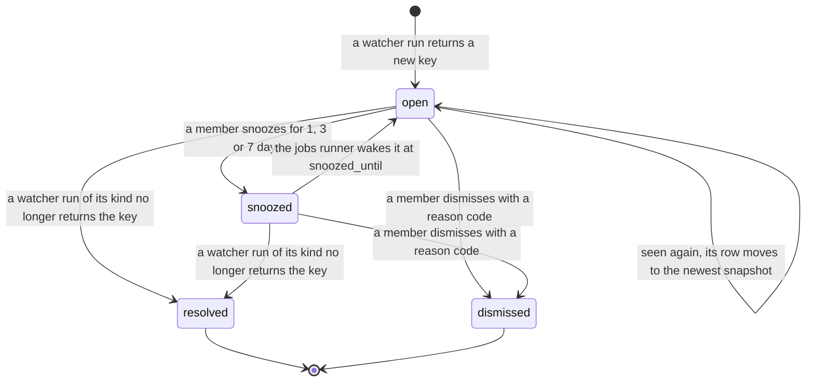

- **One open finding per key** (`finding_one_open`, a partial unique index over open and snoozed). A situation that
  resolves and later recurs raises a new finding (study H: Munshi's key was unique forever, so a recurring situation
  never re-raised; Munim's findings never closed).
- **Auto-resolve** happens only in a watcher run of the same kind, for the same shop, with no actor: a person never
  "resolves" by hand; they dismiss or act.
- **Dismissed keys rest for 30 days** (`MS012` on a new raise), Munim's anti-noise rule; a dismissal needs a reason code
  with `dismiss` in its use (`not_relevant`, `already_handled`, `other`).
- Every change writes `ai.finding_event`; the finding pins the snapshot whose row holds its numbers, so its figures
  stay traceable however old it is.
- **Ranking:** severity from the country pack's ladder on the impact cell (IN defaults for a small shop, INFERENCE:
  critical ≥ ₹10,000 a month, high ≥ ₹2,000, medium ≥ ₹500, low below); the order is `|impact| × (1 + 0.05 ×
  min(days open, 14))`, ties by severity then age, computed in the `brief.ranked` read so the order itself is a cell.

### 7.5 Recipes: finding → draft

Code in `packages/agent/src/recipes.ts`, one function per kind, run when a person taps *Draft the fix*. Each builds a
payload whose every number is a cell of the finding's row or of an undated current-state read (MERCHANTS-DESIGN §3.2's
rules), proposes it through the port, and the draft waits.

| Recipe | Draft | Its numbers cite |
|---|---|---|
| shrinkage → reorder | `reorder.place` to the item's last supplier (simulated) | the latest bill line's quantity; the item's current `stock.on_hand` |
| overdue credit → reminder | `customer.remind` (template `credit_due`) to the customer, by WhatsApp or a manual link | the customer's current `credit.balance` |
| package expiring → reminder | `customer.remind` (template `package_expiring`) | `package.balance` (value and sessions left), `expires_on` |
| package expired → expiry | `package.expire` | `package.balance` (a redemption after it makes it stale) |
| lapsing regulars or an idle stylist → campaign | `campaign.send` with segment `lapsed_regulars` and the template copy for the type; AI copy only if the owner asks the Customers desk | `campaign.audience` (the whole audience set rechecked at approval, K5) |

### 7.6 The daily brief

At 07:00 shop time the jobs runner writes `ai.brief`: the top five open findings by rank, and yesterday's figures per
branch (sales, bookings today, packages expiring this week, credit overdue) as cells of `brief.*` reads. If AI is on and
under its cap, `narrate` writes one line per high or critical finding, validated like any answer; otherwise each finding
shows its template line. The brief opens Home; it is never sent anywhere.

### 7.7 Screens

| Screen | Shows |
|---|---|
| **Home** (`/app/home`) | *What needs you* (drafts waiting, requests and bookings to confirm), *What Munshi noticed* (the top three findings with ₹ at stake, desk and age), today's figures, the brief's line; every figure tappable |
| **Inbox** (`/app/inbox`) | findings (explain, draft the fix, snooze, dismiss with a reason) and drafts (approve, edit, reject with a reason), filtered by desk and branch |
| **The office** (`/app/office`) | one card per desk: what it owns, open findings, drafts waiting, its track record (drafts executed and rejected, as cells); and *What Munshi did*: the run log (trigger, desk, outcome, model calls, trace labels and timings; ids and labels only, never text). No pixel office (study H) |
| **Ask** (`/app/ask`) | typed or spoken questions; `@Stock`, `@Bookings`… forces a desk; answers in cited segments; "Cannot verify" in fixed words; hidden when AI is off |

### 7.8 Cite-or-abstain, untrusted text, model roles

- **The validator** is unchanged in its rules (free digits, number words in English, Hindi and romanised Hindi, other
  scripts, handle glue, scale and unit words, unknown or foreign refs) and runs one number detector shared with core
  (MS-22b). New: an empty read is citable through `⟨snap:ID·0·_count⟩`; a draft's numeric leaves must be refs; an
  abstention shows its rule names in fixed words.
- **Untrusted text is quarantined.** Inbound WhatsApp text and transcripts, bill text and the shop's own catalogue names
  reach a model only inside escaped `<data>` blocks; the vision call is offered no tools. A run that read inbound or
  bill text is **tainted** (`ai.run.tainted`): the port then refuses any proposal except the one recipe the person's tap
  started (`booking.confirm`, `message.reply`, `credit.record` or `purchase.record`). Untrusted text never enters a
  trace, a log, a finding or a snapshot cell; phone-shaped digit runs become "[phone]" before any model call (PII2).
- **Meta model roles** (unchanged; ids from config, Standard ids only, gate AI1; none confirmed live until M0):

| Role | Model | Used for |
|---|---|---|
| router | Muse Spark (`muse-spark-1.3`) | picks a desk |
| reason | Muse Spark | the desk's tool loop; campaign copy in Hinglish; the intent and spans of a voice note |
| vision | Muse Spark | names products on a shelf photo; copies a bill or a price list (no tools) |
| segment | SAM 3.1 (`sam-3.1`) | counts one product per request; cuts a product out of the shop's own photo for a campaign card |
| voice | Muse Voice Transcribe (`muse-voice-transcribe-1.0`) | owner questions and inbound voice notes (Hindi support UNVERIFIED until M0) |
| narrate | Muse Spark Open on Baseten (open weights) | answer segments, the brief's lines, a transcript's English gloss |

Muse Image is never used (barred in India, FACT per study A). Every AI-drafted message ends with the disclosure line
written by code from i18n (MERCHANTS-DESIGN K4, kept).

**After 5 Nov:** investigations, fan-out across desks, Ask threads, negotiation, a richer office view.

## 8 · Every merchant feature, end to end

> Ten features, each with its data, commands, drafts, screens and its own One Guarantee ruling: what is a book, who
> approves, and which ledger row every figure traces to.

Each feature's **Guarantee** line answers three questions: is it a book; who writes or approves it; where each figure it
shows comes from.

### 8.1 Offers with codes

- **Data:** `books.offer` with `code`, `max_redemptions`, `per_customer_limit`; `offer_item`, `offer_end`,
  `sale_discount` (§2.10.5).
- **Commands:** `offer.create`, `offer.end` (owner only). At the counter, staff type or scan a code; `sale.quote_offers`
  previews the bill; `sale.record` takes `offerCodes` (≤ 3) and **re-judges each at `sold_at`**: in effect, in scope,
  minimum spend met on the eligible gross, caps not exceeded (`b_offer_cap` under a per-offer lock; a per-customer cap
  needs a named customer). The best eligible percentage per line wins, offers never stack, an amount-off applies once
  per sale up to the eligible gross, package lines take none (MERCHANTS-DESIGN §3.3, kept).
- **Screens:** `/app/offers` (list, create, end, redemptions so far as cells); the counter's code field; the shop site
  shows published offers, with the code when the owner ticks "show the code".
- **Guarantee:** an offer is a price, so a book, created only by the owner's own command; no AI draft ever creates one
  (Munim D). Every discount on a bill is a `sale_discount` row naming its offer; a campaign's "20% off" is a cell of
  `offer.detail`; the public sees only offers in the published release.

### 8.2 Packages (prepaid packs and memberships)

- **Data:** `books.package_plan`, `package_plan_line`, `package_holding`, `package_entry` (§2.10.5).
- **Commands:** `package.plan.create` (owner: the item, its price, the plan and its lines in one transaction);
  `sale.record` sells a package line (needs a customer) and creates the holding and its `sold` entries; `package.redeem`
  (owner, manager, staff) at either branch; `package.expire` (draft-only, owner approves; recipe in §7.5).
- **Journal:** a sale credits `package_liability`; a redemption moves the session's share (remaining value ÷ remaining
  sessions, integer paise, the last session takes the remainder) to `sales`; an expiry moves what is left to
  `package_breakage`.
- **Screens:** `/app/packages` (plans; holders with balance per holding and expiry; tap-for-source on every balance);
  the counter's "Redeem a session" with the holder's balance cell beside it.
- **Guarantee:** books throughout. Balances are set by the database under a per-holding lock and never go below zero;
  each entry kind is bound to its command; an expiry needs a person's approval and goes stale if a redemption lands first.

### 8.3 Loyalty points

- **Data:** `books.loyalty_rule` (owner), `loyalty_entry` (earned and redeemed in `sale.record`; `b_loyalty_tally`).
- **Flow:** a named customer earns `floor(net × earn_per_100 / 10000)` points per sale; redeeming at least `min_redeem`
  points writes a `redeemed` entry and a `loyalty` discount, never more than the net after offers.
- **Screens:** the customer page and the counter show the balance as a cell of `loyalty.balance`.
- **Guarantee:** books; the balance is the database's, under a per-customer lock; a client's points are never read.

### 8.4 Hold a piece (the suit shop)

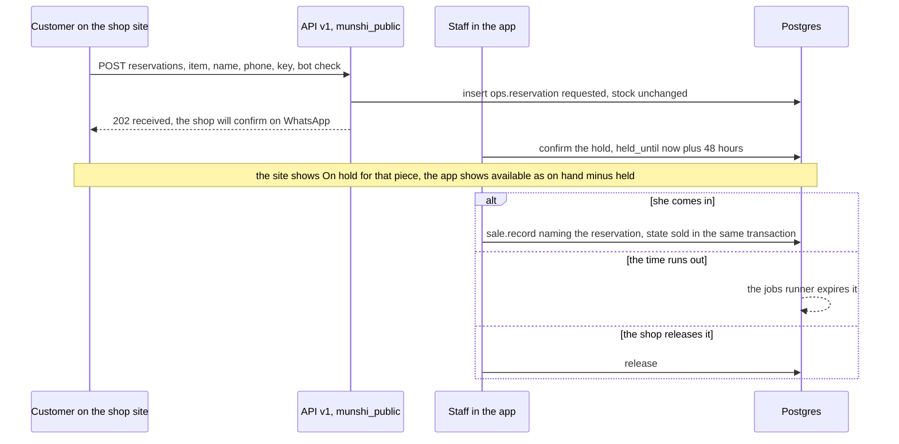

- **Data:** `ops.reservation` (§2.10.8). The app's stock screen shows *available* = on hand − held, both cells
  (`stock.available` reads the books and the holds).
- **Guarantee:** a hold is ops, not a book: nothing owed, sold or moved changes until a person records the sale. The
  site shows "On hold", never a stock number. The customer's details are erasable and pinned to samples on the demo.

### 8.5 Order on WhatsApp (a cart, no online payment)

1. The shop site keeps a cart in the browser; *Order on WhatsApp* posts it to `POST /sites/{slug}/carts`.
2. Core checks every line against the **latest release** (the item is published, the price is its cell), multiplies
   each line by its quantity and adds them up in integer paise, stores `ops.wa_cart` (ids and quantities only, a code
   like `ORD-7K2Q`), and returns the message text and a `wa.me` link to the shop's public WhatsApp number.
3. The message reads, in the shop's language: "Order ORD-7K2Q from <shop>: 2 × Anarkali suit (M, maroon) at ₹2,499 …
   Total ₹4,998 at today's prices. Please confirm." The customer sends it from their own WhatsApp.
4. At the counter, staff open `ORD-7K2Q`; the counter re-prices every line from the books **now** and records the sale
   naming the cart (`sale.record`, `wa_cart_id`).

- **Guarantee ruling:** the cart is ops and holds no personal data. Each line price is a published cell; the line totals
  and the total are **derived figures**: code (never a model) computes them from those cells, the response carries the
  refs they came from, and the message says "at today's prices · the shop confirms". The book number is the sale's own
  total, re-derived at the counter; a cart total is never read back as a price.

### 8.6 Campaigns on the WhatsApp test number, the inbox and voice notes

Kept from MERCHANTS-DESIGN §4 (consent by double opt-in, the derived and claimed outbox, the send-time recheck, the
24-hour window decided at send time, the webhook writing ops only, voice note → spans → draft), with Storage instead of
blobs and `via = auth` instead of `google`.

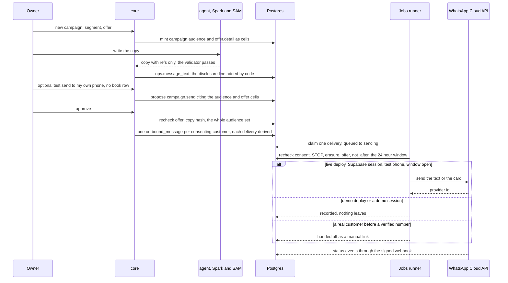

- **Commands:** `campaign.send`, `message.reply`, `customer.remind` (draft-only); ops actions: compose, test send,
  transcribe, handle an inbox item.
- **Screens:** `/app/campaigns` (composer, audience count with its source, copy with "insert figure" chips, card,
  channel line "WhatsApp · sent to consenting test phones" or "Recorded · nothing is sent"), `/app/inbox` (messages:
  Transcribe, Draft a reply, a booking, an udhaar entry).
- **Guarantee:** each message to a person is a book written only under an approved draft; the words are erasable text
  whose hash the book keeps; the audience count and every figure in the copy are cells; a send happens at most once and
  only after the recheck; a demo session can never reach a real phone.

### 8.7 Instagram (Should)

An approved `campaign.post` puts the card on the founder's own professional account (tester role, dev mode; UNVERIFIED
specifics, study A), from the live deploy and a Supabase session only. The card is served as JPEG from
`/api/v1/sites/{slug}/media/{id}.jpg`. **Guarantee:** a public post is a book (`recipient_kind = public`) under an
approved draft; its caption passes the same number detector; the demo holds no token, so its posts are recorded.

### 8.8 Live slot booking with the stylist calendar (Elite)

- **Data:** the roster (`books.shift_pattern`, `shift_change`), leave and holidays, shop hours, the services' durations
  (`item_revision.duration_min`), the opted-in stylist profiles, and `ops.booking` with its contact row (§2.10.6, §2.10.8).
- **Free slots** come from one core read, `slots(shop, service, day, stylist?)`: each stylist working at that shop that
  day (the day's change, else the pattern), minus leave, holidays and closed hours, minus every held, requested or
  confirmed booking, offered on a 15-minute grid where the service's whole duration fits. Each slot carries the shift
  row it comes from.

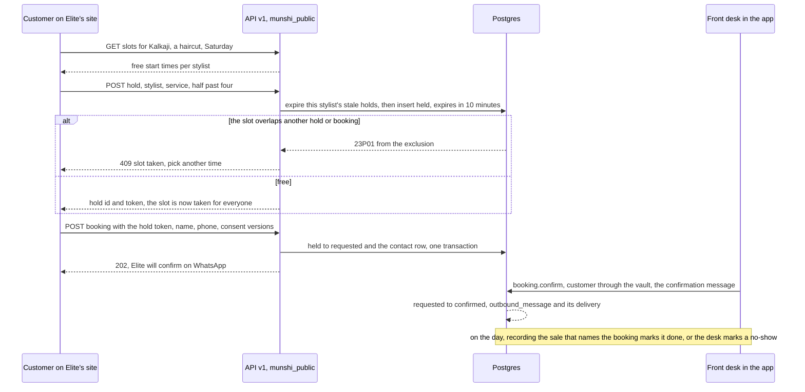

- **Commands:** `booking.confirm` (owner, manager: the customer and the confirmation message); ops actions: decline with
  a reason, cancel, no-show, a staff-made booking for a walk-in or a phone call (`source = app`, confirmed in one step);
  `shift.pattern.set`, `shift.change`, `leave.record`, `holiday.set` (owner, manager).
- **Screens:** `/app/calendar` (per branch, a column per stylist, day and week views, holds shown faint and expiring,
  requests waiting, tap an empty slot to book), `/app/requests` (confirm or decline), the stylist's own day for staff;
  the site's booking page (branch → service → stylist or "anyone" → day → time → details).
- **Guarantee:** a hold and a request are ops: they block the calendar but change no book. A named person confirms; the
  confirmation message is a book under their command. Prices on the booking page are release cells; slot times trace to
  roster rows. The exclusion constraint, not the application, makes double-booking impossible (BK1).

### 8.9 GST invoices

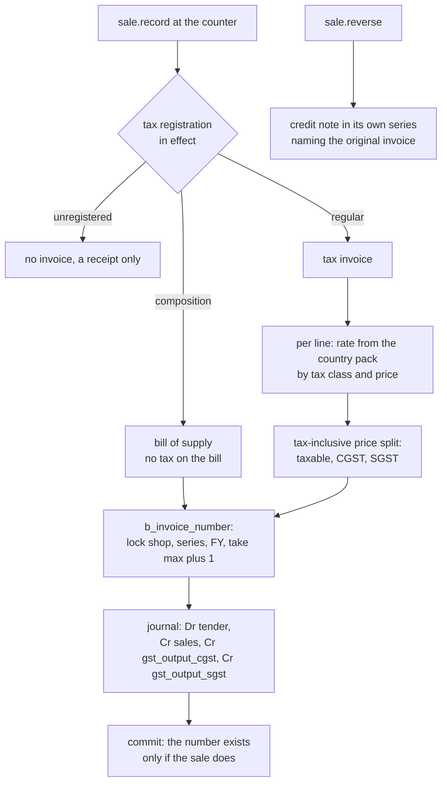

- **Data:** `books.tax_registration`, `invoice`, `invoice_line`; `ops.shop.invoice_series` (e.g. `KN`, `KJ` for Elite's
  branches); the accounts `gst_output_cgst`, `gst_output_sgst`.
- **The country pack** (`packages/core/src/packs/in.ts`, data with effective dates, never in SQL) holds the tax classes:
  salon services 5% without input credit from 22 Sep 2025 (FACT per press, study B); apparel 5% up to ₹2,500 a piece and
  18% above (per EY, study B; the notification was not read, so **UNVERIFIED**, including whether the threshold is on the
  inclusive or the taxable price); a general 5%, 18% and exempt. The financial year runs April to March in the shop's
  time zone. Composition dealers issue a bill of supply and collect no tax (study B).
- **Arithmetic** (INFERENCE, a chartered accountant should confirm): shelf and menu prices are tax-inclusive (B2C
  practice); per line, `taxable = round(gross × 10000 ÷ (10000 + rate_bp))` half away from zero, `tax = gross −
  taxable`, `cgst = floor(tax ÷ 2)`, `sgst = tax − cgst`; intra-state only in v1 (the place of supply is the shop's
  state).
- **Screens:** the invoice (A4 and 80 mm thermal print), `/app/invoices` (by branch and month), the GST summary by rate
  and month, read from `invoice_line` and the journal (JR1). The fields printed follow the tax-invoice rules as
  summarised by study B; the exact mandatory list is UNVERIFIED.
- **Guarantee:** an invoice is a book written by the sale's own command in the sale's transaction; its number is set by
  the database, gapless per shop, series and year; every figure on it is a cell of `invoice.detail`; a cancellation is
  a credit note, never an edit.

### 8.10 Staff management

| Part | Book rows | Who | Screen |
|---|---|---|---|
| Roster | `shift_pattern` (weekly), `shift_change` (one day) | owner, manager | `/app/staff/roster`: a week grid per branch |
| Attendance | `attendance` (latest mark per day wins) | owner, manager; staff mark their own in and out | `/app/staff/today` |
| Leave | `leave` (paid, unpaid, sick; reversible) | owner, manager | the roster grid and the staff page |
| Holidays | `holiday` (one branch or all) | owner, manager | `/app/staff/holidays`; the calendar and slots honour it |
| Advances | `advance` (+ payment out, journal) | owner | the staff page with the outstanding balance as a cell |
| Salary | `salary_run`, `salary_line`, journal; wages paid by `payment.record` (out, to the staff member) | owner approves (draft-only) | `/app/staff/salary`: the month's preview, then the draft |

**A salary run:** the owner taps *Prepare October*. Core's `salary.preview` read computes, per staff member, from the
terms in effect, attendance, leave and holidays: daily pay × days present (a half day counts half, paid leave counts);
monthly pay − (pay ÷ 30) × unpaid days; and advance recovery up to the outstanding balance, never past a zero net (the
rules are stated on the screen; commission was not chosen, D-041). The preview's every figure is a cell; *Make the
draft* proposes `salary.run` citing them; the owner approves; recording the wages paid is `payment.record` per person.
**Guarantee:** staff records are books; pay changes only through an approved run whose every number is a cell; payments
are recorded, never processed; staff names stay in the vault and never enter the audit chain.

### 8.11 Booking requests (the general feature, D-037)

Shops whose site is in `request` mode (or any shop on WhatsApp) take a request (`ops.site_request`: services, a day and
a morning, afternoon or evening window); staff confirm it with `booking.confirm` (which then creates a confirmed
`ops.booking` if the shop keeps a calendar) or decline it. Kept from MERCHANTS-DESIGN §5, through `/api/v1/sites/{slug}`.

## 9 · Design system hooks

> The calm-ledger component system with tokens for Munshi's own brand and each shop's brand, tap-for-source on every
> traceable figure, a fixed font palette and motion rules. Colours and type stay placeholders until the options board.

### 9.1 One component system, many brands (D-042)

`packages/ui` holds the calm-ledger primitives and the token names; a **brand** is a set of values for those names.

| Brand | Dresses | Values |
|---|---|---|
| Munshi (deep indigo + saffron) | the product site, sign-in, onboarding, the developer portal, the synthetic kirana's app | *chosen from the options board* |
| Elite (black and gold) | Elite's app screens and its shop site | *chosen from the options board* |
| The suit shop (festive) | its app screens and its shop site | *chosen from the options board* |
| A new shop | its app and site | the business type's default, until the owner picks |

A shop's brand lives in one place: the tokens of its latest `ops.site_look`. The app themes from the latest look, the
public site from the published one, so the two never drift. A test computes the contrast of every token pair used for
text in every brand and fails below 4.5:1.

**Token names** (values are placeholders): `--ground`, `--surface`, `--ink`, `--ink-muted`, `--hairline`, `--accent`,
`--accent-ink`, `--signal` (needs-you), `--ok`, `--warn`, `--danger`, `--radius-card`, `--radius-chip`, `--space-1` …
`--space-8`, `--figure-xl`, `--figure-l`, `--figure-m`, `--font-display`, `--font-text`, `--font-figures`,
`--font-deva-display`, `--font-deva-text`, `--motion-quick`, `--motion-sheet`. The feel is fixed (D-042): warm
off-white ground, ink text, one deep accent, hairline borders, soft rounded cards, no hard shadows or thick outlines, big
clear figures with tabular numerals, more air.

### 9.2 Tap-for-source

- `<Figure ref>` renders a traceable figure with a faint dotted underline; tapping opens `<SourceSheet>`: the read in
  words ("Price set on 12 Oct"), the book table and row it came from, when the snapshot was taken, and *Open the record*.
  A derived figure (a cart total, a line amount) shows its parts and the rule ("2 × ₹2,499").
- A figure with no ref cannot be rendered by `<Figure>` (its prop is a ref, not a number; a type test holds it); an
  unresolvable ref renders "Cannot verify" in fixed words.
- The figure is a button with an accessible name ("₹2,499, source: price set 12 Oct"). This replaces the chip after
  every number (D-042).

### 9.3 The fixed font palette

The fonts both apps bundle, OFL-licensed, files already in the repo with their licences (FACT, `apps/sites/fonts`,
`apps/sites/businesses/*/fonts`): a Latin display serif (Cormorant), a festive display (Rozha One), a Devanagari display
(Tiro Devanagari Hindi), a text sans (Inter) and a Devanagari text face (Noto Sans Devanagari). A look picks one
`font_pair` code from this palette; no shop uploads a font. *The final pairs per brand are chosen from the options board.*

### 9.4 Motion rules

- Motion shows a change of state, never decoration in the app: a sheet rising (`--motion-sheet`, about 300 ms), a draft
  stamped approved, a new finding arriving (`--motion-quick`, about 180 ms, ease-out).
- **A figure never animates its value** (no count-up, no rolling digits): every frame of a count-up would show a number
  no cell holds.
- Shop sites may be richer (D-041): a line-art hero drawn on, a marquee band, cards easing in; prices still never
  animate. Everything honours `prefers-reduced-motion`.
- Inputs are at least 16 px (iOS zoom) and tap targets at least 48 px (Munim gotcha 18).

### 9.5 Labels that are part of the feature

From data, never hard-coded (MERCHANTS-DESIGN §1.2): "Synthetic data" (synthetic), "Real shop · sample prices and
synthetic customers" (showcase), none (live); "Simulated supplier"; "Recorded response"; "Recorded · nothing is sent";
"Sample site · what you type is not stored or sent to the shop"; "Written with AI". EN and HI for every string, with a
completeness test.

## 10 · Build plan to 5 Nov

> Six waves of tickets with non-overlapping file territories, model tier, size and done-when gates that can fail. Feature
> freeze Tue 3 Nov night. It is tight; the cut order is stated.

### 10.1 Ground rules for every ticket

- **Not planned again:** the P0 lane already running (lint green including `.tsx`/`.css`, CI running `pnpm check`, one
  TypeScript version, error, loading and not-found pages, fake clocks instead of timing tests, ticket noise out of
  comments). No ticket below touches its files (`biome.json`, `.github/workflows/ci.yml`, the root and package
  `package.json` catalogs, `apps/*/app/{error,loading,not-found}.tsx`) until it lands. If P0 also did the config module,
  BP-CORE-1 shrinks to the boot checks.
- **Done when (every ticket, beyond its own line):** `pnpm check` green; `pnpm redproof` green with the ticket's new
  gates shown red, then green, in its report; a failing run exits non-zero (G8); the kirana suite and its answer key
  unchanged; UI tickets screenshot every state at 390 and 1280 px into `.screenshots/<ticket>/`.
- **Territories never overlap.** MS-22a made the command and read registries spreads of per-area files; BP-CORE-0 does
  the same once for the rest (`packages/core/src/index.ts`, `apps/web/lib/server/`, i18n, `db/test/sabotage.ts`) and
  moves every `sale.*` command and read, unchanged, into `commands-sale.ts` and `queries-sale.ts`, so after it each lane
  owns whole files: BP-F1 owns the sale, BP-CORE-4 everything else in commands. A conflict means skip and report.
- **At most six Munshi agents at once.** The founder's cap is eight agents in all, shared with Nebius (until Fri 30) and
  Kaaj (until Sun 1). W3 therefore runs in two halves: W3a (BP-CORE-4, BP-F1, BP-F2, BP-API-1, BP-AI-1) while the
  migrator finishes, then W3b (BP-CORE-2, BP-F3, BP-F4) as lanes free up. Reviews count against the cap too.
- **One schema lane.** `db/schema/` has one owner, an Opus migrator, working file by file in order (§3.1): a rebuild
  breaks for everyone if a half-written file lands, so schema work is serial while the TypeScript lanes run in parallel
  against this blueprint and pick up each file as it lands.
- **Model tier:** Opus for the schema, the guarantee, sign-in, the API, money, messaging and the agent; Sonnet for
  screens, the portal, the product site, seed data entry and deploy docs (the BOARD's cost ruling).
- **Sizes:** S ≤ half a lane-day, M ≈ 1, L ≈ 2. Measured agent time is far shorter (D-037); the binding constraints are
  the founder's inputs, review depth and spend.

### 10.2 Waves and tickets

**W1 · Foundation (Thu 29 Oct)**

| Ticket | Tier, size | Territory | Done when (with red-proofs) |
|---|---|---|---|
| **BP-DB-0** runner and harness | Opus, M | `db/src/{bootstrap,build,reset,populate-cli}.ts`, `db/test/harness/**`, `db/package.json` scripts, the `db/test/sabotage/` split | an empty set builds; the template is built as `munshi_migrator`, and a file that needs a superuser fails every suite (red-proof); embedded PostgreSQL pinned to 17; the merged manifest drives G1, G4, G9, G10, G13; G8 still red-proved |
| **BP-DB-1** foundation schema `00`–`08`, `90` | Opus migrator, L | those files and fragments, their gates | G1–G13 over these tables; TRG1, J1, J2, VB1, SIGNUP1, OE1, the database parts of F4–F7 and IDEM1; the bootstrap runs as a non-superuser admin in a test (the residual printed, not raised) |
| **BP-CORE-0** per-area spreads | Sonnet, S | `packages/core/src/index.ts` and area index files, `commands-sale.ts` and `queries-sale.ts` (the `sale.*` code moved unchanged), `apps/web/lib/server/` split, i18n per area | every existing gate unchanged; each area file exists |
| **BP-CORE-1** hosting layer | Sonnet + Opus review, M | `packages/config/**`, `packages/core/src/{log,context}.ts`, `apps/web/middleware.ts`, `apps/web/next.config.ts` (headers), `apps/web/app/api/health/**`, `apps/web/lib/server/{config,db}.ts`, `db/src/dev.ts` (the env file) | boot refuses a missing name, a wrong deployment, a stale schema sha, a wrong role on each pool (each red-proved); no `.run/` read at runtime (scan); no `console.` outside `log` (scan); the CSP present on every route (a test fetches each) |
| **BP-CON-1** contracts and SDK skeleton | Opus, M | `packages/contracts/**`, `packages/sdk/**` | `pnpm contracts` writes `openapi.json` and `schema.gen.ts`; the freshness test fails on a stale file (red-proof); the SDK has no dependencies; type equality both ways |
| **BP-UI-0** the options board | Sonnet (premium-UI skills), S | `design/options/**` only | colour and type options for Munshi, Elite and the suit shop on one page for the founder, started from screenshots of Cobnut and Munim (D-040's lesson); nothing built until the founder picks |

**W2 · Books and core (Thu 29 night – Fri 30)**

| Ticket | Tier, size | Territory | Done when |
|---|---|---|---|
| **BP-DB-2** books core `10`–`13`, `15` | Opus migrator, L | those files | G2, G3, G5, G6, G11 over them; the stock composite key refuses a service (red-proof); `b_one_live`; REV1's database part; every index in `pg_index` |
| **BP-DB-3** `16`, `17`, `18` | Opus migrator, M | those files | L1, L2 and the database parts of P1–P4; `b_offer_cap`; INV1 (20 concurrent sales, no gap; red-proof: drop the lock) |
| **BP-DB-4** `14`, `19`, `20`, `30` | Opus migrator, M | those files | BK1, BK2, PUB1, W6, S9, S10, the demo sample pins, K2's database part, the STOP rule, the extract digit parse |
| **BP-CORE-3** snapshots v2 | Opus, M | `packages/core/src/{snapshots,read}.ts`, `apps/web/lib/server/agent-port.ts`, the agent's resolve tests | refs unchanged; `_count` citable; reuse returns the same id for identical rows; pins written; purge keeps every pinned one (J2 end to end); C3 and A1 green |
| **BP-CORE-5** tenancy, sign-up core, populate | Opus, M | `packages/core/src/{tenancy,signup,members}.ts`, `db/seed/**`, `db/src/provision.ts` | the three tenants built through real paths with deterministic ids; every planted situation matches its key; sign-up atomic (SIGNUP1 end to end); T3 as `munshi_owner` |
| **BP-JOBS-1** the jobs runner | Opus, M | `packages/core/src/jobs*.ts`, `apps/web/app/api/internal/**`, `vercel.json` crons, `.github/workflows/tick.yml` | each job runs once per slot under concurrent triggers (red-proof: drop the claim); the jobs pool cannot write books (J1); no command import (scan); a bad `CRON_SECRET` is 404 |
| **BP-AUTH-1** sign-in and the fence | Opus, L | `packages/adapters/identity/**`, `apps/web/app/(auth)/**`, `apps/web/app/demo/**`, `apps/web/lib/server/session.ts`, `packages/core/src/{session,logins}.ts` | F1–F7, AUTH1, AUTH2, SANDBOX1; the Supabase exchange behind the adapter with a recorded fake (no gate calls Supabase) |

**Review R-A** (Opus guarantee review, read-only) of the foundation, the books core and W2's core work, both clauses;
at most two fix cycles. Fri 30.

**W3 · Features in core, and the API (Fri 30 – Sat 31; in two halves, §10.1)**

| Ticket | Tier, size | Territory | Done when |
|---|---|---|---|
| **BP-CORE-4** commands v2 | Opus, L | `packages/core/src/{commands,commands-catalogue,commands-people,commands-trade,approvals,idempotency}.ts` (`commands.ts` is the registry only; `commands-trade.ts` holds purchases, stock, payments, credit, settlements; not `commands-sale.ts`) | C1, C4, C7 green; every person through the vault; revisions; one `*.reverse` per book netting to zero (REV1); idempotency inside `runCommand` for every command |
| **BP-CORE-2** screen reads in core, routes under `/app` | Opus, M | `packages/core/src/{views-*,page}.ts`, `apps/web/lib/server/*` (not `session.ts`, `agent-port.ts`, `config.ts` or `db.ts`), the move of `apps/web/app/*` screens to `apps/web/app/app/*` | SQL1 (red-proof: plant a query); one transaction per page (a test counts `begin`s per render); the web suite green |
| **BP-F1** the counter's money | Opus, L | `packages/core/src/{commands-sale,queries-sale,commands-offers,commands-packages,queries-offers,queries-packages,queries-invoice}.ts`, `packages/core/src/packs/in.ts` | `sale.record` and `sale.reverse` on v2 (the vault, the stock key, invoices); O1, O2, codes and caps, P1–P4, L1; GST1's golden invoices against a hand-worked key; credit notes; JR1 for the GST summary; IDEM1 at the counter (a double tap records one sale) |
| **BP-F2** calendar, bookings, staff | Opus, L | `packages/core/src/{slots,booking,commands-staff,queries-staff,salary}.ts` | slots against a hand-worked roster; BK1 and BK2 end to end; `booking.confirm` writes the customer and the message; SAL1; leave and holidays remove slots |
| **BP-F3** messaging | Opus, L | `packages/adapters/channels/**`, `packages/core/src/{commands-messaging,outbox,inbox,queries-campaigns}.ts`, `apps/web/app/api/webhooks/**`, and the agent side in `packages/agent/src/{copy,inbox}.ts` with their fixtures (it uses BP-AI-1's port; it does not edit `run.ts`) | K2–K5 and W1–W8 with Storage; test sends write no book row; at most once under two sweeps (red-proof); copy carries refs only (K3, K4); a voice note's figures come from spans parsed by core (EX2) |
| **BP-F4** hold a piece and carts | Sonnet + Opus review, M | `packages/core/src/{reservations,carts}.ts` | a hold changes no book (row counts); expiry by jobs; a cart's total equals the sum of its cells; the sale re-derives |
| **BP-API-1** `/api/v1` | Opus, L | `apps/web/app/api/v1/**`, `apps/web/lib/api/**`, `packages/core/src/{site-api,public,rate}.ts`, `packages/adapters/botcheck/**` | S1–S10 retargeted to slug paths; PUB1 end to end; the error table on every route (C2's pattern); cursor pages; idempotency replays |
| **BP-AI-1** the back office | Opus, L | `packages/agent/src/{desks,recipes,run,port}.ts`, `packages/core/src/{watchers*,queries-watch-*,findings,brief}.ts` | C5 unchanged for the kirana; each new watcher against its planted key; auto-resolve and re-raise; the 30-day rest; the ranking is a cell; recipes' drafts cite cells; `allow()` caps and the kill switch (red-proof each); a tainted run's other proposals refused |

**W4 · Surfaces (Sat 31 – Mon 2), after the founder picks the look**

| Ticket | Tier, size | Territory | Done when |
|---|---|---|---|
| **BP-UI-1** the calm-ledger system and shell | Opus, M | `packages/ui/**`, `apps/web/app/app/layout.tsx`, `apps/web/components/shell/**` | `<Figure>` takes refs only (type test); the contrast test for every brand; tap-for-source; the per-tenant brand from the look |
| **BP-WEB-1** product website, onboarding screens | Sonnet, M | `apps/web/app/(site)/**`, `apps/web/components/site/**`, the onboarding screens' presentation | every page at 390 and 1280; sign-up and log-in in the nav; the demo's "Try the demo" and sample-shop paths |
| **BP-SITES-1** the hosted shop app | Sonnet + Opus for the gates, L | `apps/sites/**` | two shops from one build; BUNDLE1 red-proved; the import closure; Elite's live slots and the suit shop's holds and cart against the demo API; every page and state screenshotted |
| **BP-DEV-1** developer portal | Sonnet, M | `apps/web/app/developers/**`, `docs/kit/**` | every route in the reference from `openapi.json`; examples recorded from the demo; the SDK download with its sha256 |
| **BP-APP-1** counter, offers, packages, loyalty, invoices | Sonnet, L | `apps/web/app/app/{counter,offers,packages,invoices,customers}/**` and their components | every state; V1; labels from data |
| **BP-APP-2** calendar, requests, staff, salary | Sonnet, L | `apps/web/app/app/{calendar,requests,staff}/**` | every state, both branches |
| **BP-APP-3** home, inbox, office, ask, campaigns, settings | Sonnet, L | `apps/web/app/app/{home,inbox,office,ask,campaigns,settings}/**` | every AI surface's answered, "Cannot verify", off and over-cap states; the look editor and *Publish*; People and sessions; Developer kit |
| **BP-OPS-1** deploy kit | Sonnet, M | `deploy/**`, `docs/DEPLOY.md`, `scripts/{deploy-check,capture-guard}.ts` | SUPA1 against a scratch database (red-proof); the capture guard's two modes and four red-proofs; a demo config naming a channel credential is refused |

**Review R-B** (Opus guarantee review of everything, both clauses), Mon 2; at most two fix cycles.

**W5 · Connect, fix, freeze (Mon 2 – Tue 3)**

| Ticket | Who | Done when |
|---|---|---|
| **BP-OPS-2** connect Supabase | the founder (two projects, the admin URL) + Opus | the bootstrap on Supabase; the pooler accepts node-postgres in transaction mode (checked first); the major version, btree_gist and the Mumbai region confirmed; the demo built and populated; `deploy-check` ok; SUPA1 green. Can run any time the founder is ready |
| R-A and R-B fix cycles | the lanes | each finding closed by a red-proved gate |
| **BP-FREEZE** | Opus migrator | `db:freeze`; FREEZE1 red-proved; the orchestrator restores CLAUDE.md's append-only rule |

**W6 · Submission (Wed 4 Nov; due Thu 5 Nov 07:30 IST).** P7 as planned: the M0 smoke and the SAM rack go/no-go (as
soon as the Meta key arrives, not on Wednesday), the live re-record, the demo deployed from a clean checkout (Munim
gotchas 42, 43), the film re-cut on the new look, the README with measured counts, the form and the X post. The live
merchants track runs beside and never blocks.

### 10.3 Order and dependencies

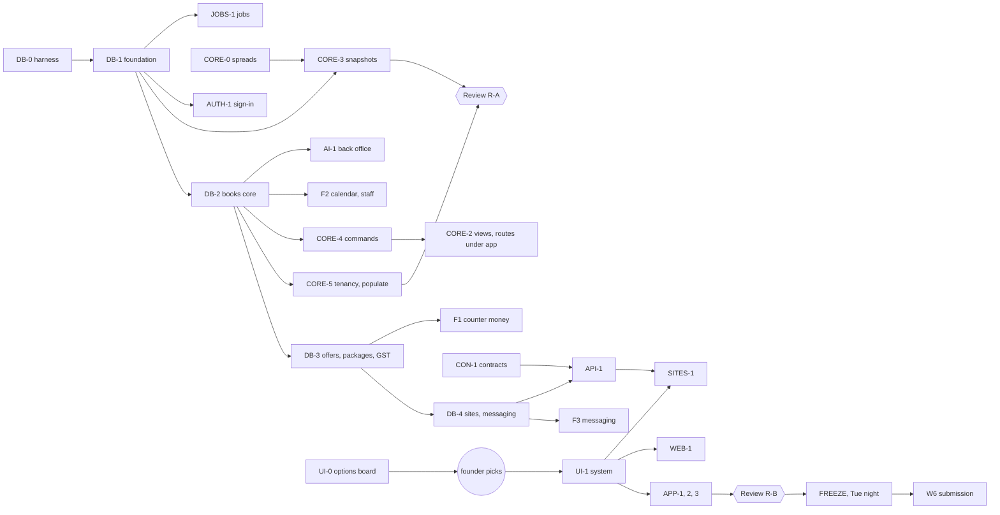

### 10.4 Honest risk, and what falls first

**Risk.** Thirty-one tickets and two guarantee reviews in five days, while Nebius (Fri 30), Paytm (Sat 31, if
shortlisted) and Kaaj (Sun 1) take the founder's attention and part of the agent budget. The serial schema lane is the
critical path: if BP-DB-1 slips a day, every database gate slips a day. Four founder inputs can each stall a wave: the
look pick (W4); the two Supabase projects (BP-OPS-2; the free plan's project count is UNVERIFIED and may already be used
by Munim and Nebius); the GitHub remote (the 15-minute tick); and the Meta key (M0, the re-record, the film). The
merchants' catalogues and GST status decide what the showcase invoices show. Live slot booking, GST rules (no chartered
accountant has checked them) and salary rules are the newest domain logic and the likeliest to carry bugs into review.
The founder ruled "everything by 5 Nov" (D-043) over the recommended cut line, knowing this.

**If time runs short, cut in this order** (each is self-contained, and its tables stay in the baseline, so nothing is
re-migrated later):
1. Instagram posting.
2. The demo's sample-shop sign-up (the demo keeps the picker; sign-up stays on live).
3. Loyalty points.
4. Salary runs (keep the roster, attendance, leave, holidays and advances).
5. The voice note → udhaar draft for the kirana.
6. The package-expiry draft (keep the finding and the reminder).
7. SAM cut-out campaign cards (text campaigns).
8. The developer portal beyond Getting started and the Reference.
9. The shop sites' extra sections and richer motion (keep the home, the menu or catalogue, booking or hold, the story).
10. Bills of supply, if neither merchant is a composition dealer (keep tax invoices).

**Cannot fall** without breaking D-042 and D-043: the database rebuild and its gates, the hosting layer, sign-in and
the fence, the API and SDK the sites use, the hosted sites by slug, the back office core (desks, the finding lifecycle,
the brief, recipes), offers with codes, packages, hold a piece, order on WhatsApp, campaigns (recorded on the demo),
live slot booking, GST tax invoices, and the roster with attendance and leave.

## 11 · Guarantee scan

> Both clauses of the One Guarantee, checked against every channel and every new surface in this design.

> **Nothing changes the books without a named person's approval, and every number shown traces to a ledger row.**

### 11.1 Clause 1: nothing changes the books without a named person's approval

| Channel or surface | How it holds | Gate | Verdict |
|---|---|---|---|
| Database grants | only `munshi_app` holds INSERT on books, and only through `a_write`; no runtime role holds UPDATE or DELETE on books, audit or decisions | G1, G5, J1 | holds |
| The book guard | every insert admitted by a direct command the actor's role holds, or an approved decision of this transaction; draft-only commands only under a decision; each command writes only its tables; children only in the parent's transaction | G2, G3, G11, D1, TRG1 | holds |
| The agent | reads `snap.snapshot` and its views only; proposes through the port; a tainted run proposes only the tapped recipe | G1, A1, B1, AI-1's taint gate | holds |
| The jobs runner | no book grant at all; never sets an actor; purges only ops rows and unpinned snapshots | J1, J2 | holds |
| The public role and `/api/v1` | writes only requests, holds, carts, counters, idempotency rows, inbox rows and delivery status; a secret developer key may only propose | PUB1, S4 | holds |
| Live slot booking | a hold or a request is ops; the customer and the confirmation message are books only through a person's `booking.confirm` | BK1, BK2, booking gates | holds (ruling 4) |
| Hold a piece, carts | ops only; stock and sales change only when a person records the sale | F4's row-count gate | holds |
| Self-serve sign-up | the new owner writes their own tenant, directory row and first-owner login in one transaction, checked by triggers; no SECURITY DEFINER | SIGNUP1, G12 | holds |
| Idempotency replays | a replay returns stored ids and writes nothing; a mismatched body is refused | IDEM1 | holds |
| Messages to people | every send is a book row under an approved draft (draft-only in the database); the delivery is derived, claimed once and rechecked; demo sessions and simulated suppliers always recorded | K2–K5, W1–W8, D1 | holds |
| The webhook | ops only, signature first, no model call | W1, W3 | holds |
| GST invoices | written by the sale's own command in its transaction; numbered by the database; a cancellation is a credit note under `sale.reverse` | INV1, GST1 | holds |
| Salary | draft-only; the owner approves; payments recorded, never processed | SAL1, D1 | holds |
| Recipes and AI drafts | code builds the draft; it waits; approval re-checks every cited cell (stale on change) | C4, AI-1 | holds |
| Imports and the grid | one `grid.apply` draft the owner approves; typed numbers are the person's own cells | GR1–GR4 | holds |
| Reversals | one rule in the guard, one command per book, exact opposites, once | REV1 | holds |
| Supabase Auth | proves identity only; roles and shops from our rows on every request; the local adapter refused on live | AUTH1, AUTH2, F1–F7 | holds |
| Supabase's own roles and keys | `anon`, `authenticated`, `service_role` reach no Munshi schema; the secret key (Storage only) is server-side and scanned out of client bundles | SUPA1, the bundle scan | holds once BP-OPS-2 runs it on Supabase |
| The demo fence | separate projects; class tied to deployment; `via = demo` refused on live tenants and forces recorded sends and no releases | T1, F1, F7, W8, S9 | holds |
| Reset and rebuild | refuse a live deployment and any live tenant; run as the owner, by the operator, never from a route | T3 | holds |

**Residuals, stated:** (1) the owner role and the database admin can disable triggers and rewrite rows; `verify_books`
and the chain now **detect** an edited book row (VB1), but an owner who also re-hashes the chain and the checkpoints is
caught only by the head kept outside the database (§2.7). (2) The actor and `via` settings are trusted from the app's
one module (CLAUDE.md), proved by gate B3, not by the database. (3) On Supabase the agent may still be able to create
unlinked large objects (§2.2): not a table row, not a book. (4) Any role can take advisory locks or NOTIFY: a stall or
a hint, never a write.

### 11.2 Clause 2: every number shown traces to a ledger row

| Channel or surface | How it holds | Gate | Verdict |
|---|---|---|---|
| App screens | every figure is a `<Figure ref>` of a snapshot cell minted from a named read; a component cannot take a bare number | C3, the `<Figure>` type test | holds |
| Snapshot reuse | a reused snapshot holds exactly the rows the read just returned (same sha256) | CORE-3's reuse gate | holds |
| Snapshot purge | anything a draft, finding, answer, brief or release cites is pinned and never purged; an uncited display figure re-mints when its screen loads; a vanished ref shows "Cannot verify" | J2 | holds |
| Model text | answers carry refs, never digits or number words; one detector in core and the agent; empty reads cite `_count` | the validator, the corpus (0/199 clean refused, 157/157 attacks refused) | holds |
| Drafts | every payload number maps to a cell; a person's typed number is their own `ops.member_input` cell, labelled as theirs | C4, approvals gates | holds |
| The public API and shop sites | every figure is a cell of the latest release's `site.*` snapshot, pinned; `GET …/refs/…` shows its source row | S3, PUB1 | holds |
| Cart totals | **derived figures**: code computes them from published cells and returns those refs; labelled "at today's prices · the shop confirms"; the sale re-derives | F4's equality gate | holds as a derived figure (ruling, §8.5) |
| Slot times | come from roster rows (each slot names its shift); they are times, not book amounts | F2's slot gate | holds |
| Invoices, the GST summary, the day report, salary | cells of reads over invoice lines and the journal, each equal to the journal's sums | JR1, GST1 | holds |
| The brief and the ranking | the order is a cell of `brief.ranked`; each line is validated model text or a template | AI-1 | holds |
| Campaign copy | figures are ref tokens to `offer.detail` and `campaign.audience` cells, rendered by code at approval | K3 | holds |
| Voice notes | the model returns spans, never values; core parses each figure from its span; the database re-parses digit spans | EX2, the extract trigger | holds (words and dates by core alone: a stated residual, kept from MERCHANTS-DESIGN) |
| Errors, logs, traces | fixed codes, ids and labels only; never a database message, a value or model text | C2, the log scan, trace label lists | holds |
| Motion | figures never animate their values | the UI review | holds |

**Residuals, stated:** the recorded fixtures are hand-written turns until the Meta key arrives (labelled "Recorded
response"); the shelf-count hash binds the stored response to itself, not to Meta's (LIMITATIONS.md, kept); a staff
member's typed or spoken question and a tapped transcript reach Meta's model as written, with phones masked, as the
privacy notice and the merchant agreement disclose (MERCHANTS-DESIGN §7.1, kept).

## 12 · Open questions for the founder

> What this design cannot decide alone. The orchestrator puts these to the founder.

| # | Question | Why it matters | Recommended |
|---|---|---|---|
| 1 | **Two more Supabase projects (demo and live).** Munim's dev project and the Nebius project may already use the free plan's allowance (the cap and the inactivity pause are UNVERIFIED) | the two-database fence needs two projects; roles are cluster-wide, so one project cannot hold both | check the dashboard; if capped: pause an old project, or put the demo on free now and the live project after 5 Nov (the live track never blocks). A paid plan is a money decision for you |
| 2 | **Create the GitHub repository** (private now, public at submission) | the 15-minute tick runs as a scheduled workflow; private-repo minutes may not cover 96 runs a day (UNVERIFIED) | create it now; the tick runs every 30 minutes while private |
| 3 | **Pick the look** from the options board (BP-UI-0) | every W4 screen waits on it | as soon as the board is up (Thu) |
| 4 | **The merchants' inputs:** catalogues and prices, GST status (regular, composition or unregistered) and GSTINs, logos and photos, the WhatsApp number each site's "Order on WhatsApp" opens, Elite's stylists' names and their permission to be shown | showcase invoices, sites and the calendar are built from them; until then they carry sample values, labelled | send what exists; the demo uses invented stylists until permission arrives |
| 5 | **GST rules:** prices tax-inclusive; the apparel ₹2,500 threshold judged on which price; one GSTIN per tenant; invoice series per branch (`KN`, `KJ`) | the arithmetic in §8.9 is INFERENCE | ask a chartered accountant to check §8.9 once; the golden invoices then come from their worked examples |
| 6 | **Salary rules:** monthly pay − pay ÷ 30 per unpaid day; a half day counts half; paid leave counts; advances recovered in full by default, never past a zero net | they decide what the salary draft proposes | accept for v1; the screen states them |
| 7 | **AI spend caps:** 200 model calls a day per live shop, 60 per demo shop, plus a per-IP limit on the demo's Ask | this is money (Meta API spend) | set your own numbers |
| 8 | **Holds:** a slot held 10 minutes while the customer fills the form; a piece held 48 hours once the shop confirms | customers feel these | accept, adjustable per site |
| 9 | **The demo's sample-shop sign-up** (a synthetic sandbox, no email) | lets judges try onboarding; it is cut second if time runs short | yes |
| 10 | **Roles:** `booking.confirm` by owner and manager (make the receptionist a manager); staff mark their own attendance | salon front desks may be staff | accept |
| 11 | **The severity ladder** for a small shop (critical ≥ ₹10,000 a month, high ≥ ₹2,000, medium ≥ ₹500) | it ranks the brief | accept and tune after a week of real findings |
| 12 | **Fabric by the metre** (a unit `m`) for the suit shop | changes the unit list | ask the shop |
| 13 | **Freeze timing:** if a merchant goes live before Tue 3 Nov night, the freeze moves to before that go-live | D-043: migrations before any real shop's data | accept |
| 14 | Carried from D-038: Vercel Hobby's non-commercial term for the live sites | your risk | unchanged |
| 15 | **An email sender for magic links** (a custom SMTP provider in Supabase), or Google only | Supabase's built-in sender is for testing (UNVERIFIED limits); a sender is a new vendor and key | Google only for 5 Nov; add a sender later |
| 16 | **Supabase keeps signed-in emails in `auth.users`**; erasure deletes the Supabase user (§6.1) | reverses the "no lasting copy of a staff email" promise while a person is a member | accept, and say so in the privacy notice |
| 17 | **Two new readings of "every number traces to a ledger row":** cart totals as derived figures computed by code from published cells (§8.5), and slot times as roster times rather than book figures (§8.8) | they are interpretations of the guarantee, not code details | confirm both |

## 13 · What was verified this session

> The external facts this design relies on, with where each was read. Anything not listed here is INFERENCE or UNVERIFIED.

| Fact | Source (read 28 Oct 2026) | Tag |
|---|---|---|
| A custom role logs in through Supabase's shared pooler as `<role>.<project-ref>`; port 5432 is session mode, 6543 transaction mode | https://supabase.com/docs/guides/database/connecting-to-postgres | FACT |
| The shared pooler is IPv4 on every plan; direct connections are IPv6 on Free | same page | FACT |
| The shared pooler does not support prepared statements in transaction mode | same page | FACT (whether node-postgres's unnamed statements pass is UNVERIFIED, BP-OPS-2's first check) |
| Supabase access tokens can be verified locally against `/auth/v1/.well-known/jwks.json` with asymmetric signing keys; the endpoint is cached about 10 minutes | https://supabase.com/docs/guides/auth/signing-keys | FACT (the exact audience claim value is UNVERIFIED) |
| Vercel Functions: 4.5 MB request and response body limit; Hobby maximum duration 300 s; Hobby 2 GB memory | https://vercel.com/docs/functions/limitations (page dated 24 Aug 2026) | FACT |
| Vercel Hobby cron jobs run at most once a day, fired within the scheduled hour | https://vercel.com/docs/cron-jobs/usage-and-pricing, through a search summary (page dated Jan 2026) | FACT, second-hand |
| `btree_gist` is in Supabase's pre-configured extensions | Supabase extension docs, seen only on mirrors | UNVERIFIED |
| Supabase Storage private buckets use short-lived signed URLs (`createSignedUrl(path, seconds)`) | third-party tutorials only | UNVERIFIED |
| Munim ran custom Postgres login roles with their own passwords through Supavisor on Supabase, and measured about 15 backend connections per role and database | `foodops-intel/deploy/vercel/README.md` | FACT (Munim's own measure is INFERENCE in its notes) |

Not verified this session, and so UNVERIFIED wherever this page relies on them: Supabase's PostgreSQL major version,
the Mumbai region on the free plan, the free plan's project count and inactivity pause, GitHub Actions' free minutes for
private repositories, every GST rate and rule (study B's FACT tags rest on press and EY summaries), the Meta model ids
and Hindi support (M0), the WhatsApp test number's limits (study A).
