# Munshi blueprint (BP-1): the whole project on one page

Status: **PROPOSED, design only (Wed 28 Oct 2026, late; fix cycle 3 on Thu 29 Oct folds the schema review R4 and the
platform spec).** Nothing here is built. This page is the single source the
build lanes follow from 29 Oct, and the content of the founder's "site blueprint" page. Where it and a binding decision
disagree, the decision wins (`../hackathon/_meta/DECISIONS.md` D-037 to D-043, and the orchestrator rulings in
`PLANS-2026-10-28-munshi-hardening.md`). Once code exists, the code wins (`db/schema/*.sql` is the database contract).

Tags: **FACT** (read in this repo, a review, a study, or an official page this session, with its URL), **INFERENCE**
(reasoning), **UNVERIFIED** (not confirmed; it must be checked before anyone relies on it).

## Contents

0. [Check these first](#0--check-these-first)
1. [The suite](#1--the-suite)
2. [The database, v2](#2--the-database-v2)
3. [No migrations while building](#3--no-migrations-while-building)
4. [Core and the hosting layer](#4--core-and-the-hosting-layer)
5. [API v1, the SDK and the developer portal](#5--api-v1-the-sdk-and-the-developer-portal)
6. [Sign-in, onboarding, the superadmin and the demo fence](#6--sign-in-onboarding-the-superadmin-and-the-demo-fence)
7. [The AI back office](#7--the-ai-back-office)
8. [Every merchant feature, end to end](#8--every-merchant-feature-end-to-end)
9. [Design system hooks](#9--design-system-hooks)
10. [Build plan to 5 Nov](#10--build-plan-to-5-nov)
11. [Guarantee scan](#11--guarantee-scan)
12. [Open questions for the founder](#12--open-questions-for-the-founder)
13. [What was verified this session](#13--what-was-verified-this-session)

---

## 0 · Check these first

> The decisions most likely to be wrong, and every place this page changes the reviewed W5 design (MERCHANTS-DESIGN.md)
> because a later ruling forced it. Read this section before any other.

### Fix cycle 1 (29 Oct): the founder's answers (D-045) and the guarantee review, and where each landed

| Item | What changed | Where |
|---|---|---|
| A1 local Postgres now, Supabase at deploy | everything builds, runs and is demoed on local PostgreSQL 17; Supabase (Postgres, Storage, later Auth) only from the deploy wave, behind adapters | §0.1 #11, §1.3, §3.2, §10 |
| A2 email and password before Supabase | our own identity adapter (scrypt, per-user salt, constant-time compare, lockout, owner-issued reset links) in its own schema and role; Supabase Auth replaces that one module later | §0.1 #1, §2.2, §2.10.15, §6 |
| A3 GitHub later | no CI run and no scheduled tick until the repository exists; jobs run after writes and on page loads (the tick route stays) | §4.4, §10 |
| A4 both guarantee readings confirmed | kept, plus the reviewer's condition: carts and slots are recomputable from stored ids with the counter's arithmetic, gated (CART1, SLOT1) | §0.1 #13–14, §8.5, §8.8 |
| A5 AI caps by a superadmin | a platform operator role and console; per-shop AI on or off, call caps (text and media), channel grants, site verification; **new self-serve shops start with AI off**; every change an approved platform draft, audited | §0.1 #15, §2.10.15, §4.6, §6.5 |
| A6 sites hidden until verified; reserved names | public routes 404 until the superadmin verifies the slug; `elite` and `prabhave` reserved; the suit shop is **Prabhave** (spelling to confirm) | §0.1 #16, §2.10.1, §5.1 |
| A7 demo sign-up for judges | a Must, not a Should | §6.6, §10.4 |
| A8 GST | built with the stated rules (GST-inclusive prices, one GSTIN per business, a series per branch, the ₹2,500 rule on the selling price); a chartered accountant checks before real use | §8.9 |
| A9 defaults accepted | salary rules, 10-minute slot hold, 48-hour piece hold, roles, the severity ladder | §7.4, §8.8, §8.10 |
| A10 rebuild until after 5 Nov | no real shop goes live before 5 Nov; the submission links the demo copies; the live deploy, live sites and the freeze move after judging | §0.1 #12, §1.3, §3.5, §10 |
| B1 (rank 1) self-serve shops reached real channels | operator-only `platform.channel_grant` per tenant; no grant means every delivery is recorded; the test recipients are the tenant's own contacts (`ops.channel_recipient`), routed by a keyed hash, never a phone in a platform row; no deploy-wide channel settings | §2.10.7, §2.10.15, §4.3 |
| B2 (rank 1) customers' words in `ai.answer` | answer text moves to erasable `ops.message_text`, purged with its transcript and on erasure; E1 scans `ai.*` | §2.6, §2.10.12 |
| B3 Supabase claims | for the Supabase phase: the sign-in method from `amr`, the provider from `app_metadata`, never `user_metadata`, a confirmed email; deploy-check asserts the project's auth settings. Now: email verified by the invite link before the first sign-in | §6.2, §6.8 |
| B4 Supabase retention and key scope | non-member sign-ins purged; PII3 scans `auth.*`; the secret key's real scope (Storage and the Auth admin API) stated | §4.3, §6.8 |
| B5 self-serve abuse | superadmin verification, reserved merchant names, a confusable-slug check | §2.10.1, §6.3 |
| B6 ops triggers trusted the actor whatever the role | every ops transition checks `current_user`: actor shapes only for the app role, no-actor shapes only for jobs, public shapes only for public and only with the hold token checked in the database | §2.3, §2.10.8 |
| B7 hold squatting | one live public hold per IP, two per stylist and day, Turnstile on every hold; the founder's 10-minute window kept; caps alert the owner, never close intake | §2.10.8, §5.8, §8.8 |
| B8 consent followed a re-link | consent carries the contact it was given by and counts only while that contact is the customer's current link | §2.6, §2.10.3 |
| B9 pay integrity | a staff mark never supersedes an owner's or manager's; wage pay-outs are `wages.pay` (owner, manager), never `payment.record` | §2.10.4, §2.10.6, §8.10 |
| B10 snapshot purge race | reuse only snapshots under a day old; `snap.pin` has a foreign key to its snapshot; the purge skips locked rows; §11.2 corrected | §2.8, §11.2 |
| Rank 3 | credit notes lock their own series; invoice time and financial year from `now()`; backdated sales refused for registered shops; carts use the counter's rounding and show no offer discount; `storage_key` must name the tenant's bucket; a live deployment refuses to boot unless built from migrations; sandbox imports' vision calls capped by the superadmin | §2.10.2, §2.10.9, §4.3, §4.6, §8.5 |

### Fix cycle 2 (29 Oct, the last): the second guarantee review, and where each landed

| Item | What changed | Where |
|---|---|---|
| N1 (rank 1) reset links handed over identities | in-app resets only for a **lower role** in the issuer's own shop, and only for an identity with **one membership and no operator row**; owners' and operators' resets only by the operator's command line; an operator identity can never be bound to a shop; a reset ends **every session of the identity**, in every shop and the console (a per-identity epoch). The database enforces it through `ops.reset_grant` and `ops.subject_summary`, which the idp role may read | §2.10.1, §2.10.15, §6.2 |
| N2 lockout as a denial of service | failures lock per (identity, IP hash), never the identity everywhere; a bot check after three failures on an identity from anywhere; scrypt always runs, locked or not | §2.10.15, §6.2 |
| N3 invites revealed existing accounts | one form and one answer whether or not the email already has an account; `verified_at` stated as proof of link possession, not of email ownership | §6.2 |
| N4 one password-only operator self-approving | a TOTP second factor at operator sign-in and again at approving a channel grant or an operator change | §2.10.15, §6.5 |
| N5 phone routes | their HMAC key is its own secret, guarded like the numbers (Indian mobiles can be brute-forced from it), with a rotation note; what first-come routing allows is stated | §2.10.2, §4.3 |
| N6 the laptop live database | `db:build --live-local` asserts it is talking to the local cluster in `.run/pg-live`; a hosted app refuses any database marked `hosted = false` | §2.10.1, §3.2 |
| N7 one hold per IP blocked customers behind carrier NAT | one live hold per device token, up to three per IP hash, two per stylist-day, a bot check on each | §2.10.8, §5.8, §8.8 |
| Half-closed: the no-actor purges | the database checks each purge's age and balance rule (a contact's year since last activity, computed from the books), not only core | §2.6, §2.10.2 |

### Fix cycle 3 (29 Oct): R4 and the platform spec, and where each landed

The schema review (`hackathon/meta-ai-developer-hackathon/review-2026-10-29/R4-schema-review.md`, 53 findings) and the
approved platform spec (`docs/superpowers/specs/2026-10-29-munshi-platform-design.md`), folded under the orchestrator's
rulings on R4 (`docs/superpowers/plans/2026-10-29-w1-database.md`). Each fix is marked "(R4 id)" where it landed. R4's
ids are not this page's gate ids: R4 M1 is the invoice key, gate M1 is the measurement erase.

| Item | What changed | Where |
|---|---|---|
| R4 B1 (rank 1) the build order broke | `ops.message_text` moves to `05`, right after `ai.run`; a key to a later file's table is added by that file with `alter table` (`ai.answer`'s inbound key in `19`, every order key in `21`); `02` keeps only plpgsql functions with no row-type parameter, and the audit functions move to `08` | §3.1, §2.10.7, §2.10.11, §2.10.12 |
| R4 M1 (rank 1) the invoice key omitted the kind | `invoice_no (tenant_id, shop_id, series, kind, fy, number)`; `max + 1` over the key's first five columns, after the lock, at READ COMMITTED | §2.10.9, §8.9, INV1 |
| R4 S1 (rank 1) snapshots grew without bound | the purge covers evidence snapshots too; a finding moves to a new snapshot only when its row's cells change (`row_sha256`); the jobs role releases only a moved finding's old pin; every other pin stays | §2.6, §2.8, §2.10.11, §2.10.12, §4.4, §7.4, J2 |
| R4 C1 (rank 1) capability switches touch the first files | decision 17: the capability tables in `01`, `ops.capability_switch` in `03`; `ref.business_type` loses its three flags; core checks capabilities, the guard never does; switch-off is refused only under a dependant | §0.1 #17, §2.5, §2.10.1, §2.10.14, §8.13 |
| R4 O1 (rank 1) orders touch the chart, the sale, payments and the taint list | decision 18: orders are books, intake is ops; `customer_advance`; the order keys on sale, sale line, payment and outbound message, added in `21`; `order.confirm` on the taint list; the erasure hold; `order.reverse`, so the reversible order has its one reverse command | §0.1 #18, §2.4, §2.6, §2.9, §2.10.16, §3.1, §7.8, §8.12 |
| R4 N1 stored totals unchecked | `z_sale_total` and `z_purchase_total`, deferred on the header | §2.4, §2.10.4, TOT1 |
| R4 N2 the same tax stored twice | `z_invoice_total` checks each invoice line against its sale line; the line keys to `books.sale_line` | §2.10.9, TOT1 |
| R4 N3 the GST state in two places | the GSTIN prefix check; one registration per state; `shop_guard` refuses a state or series change after the first invoice | §2.9, §2.10.1, §2.10.9 |
| R4 N4 findings and briefs had no shop | `ai.finding.shop_id`, `finding_open_kind`; one brief per shop (`brief_day`) | §2.10.12, §4.4, §7.4, §7.6 |
| R4 N5 no performer on a sale line | `sale_line.staff_id`, `sale_line_staff`; `idle_stylist` reads it | §2.10.4, §2.11, §7.3 |
| R4 N6 a payment's sign encoded twice | amounts positive unless a reversal; at most one party; a purchase payment goes out | §2.9, §2.10.4 |
| R4 N7 no counter discount | `sale_discount.source` gains `manual`, with a reason (use `discount`) | §2.5, §2.9, §2.10.4 |
| R4 K1 effective dates without a tie-break | the type stated per table; one tie-break, `effective_from desc, created_at desc, id desc`; indexes to match | §2.9, §2.10.1, §2.10.3, §2.10.5, §2.10.6, §2.10.15, §2.11 |
| R4 K2 `b_one_live` named no lock | it takes its key's advisory lock first | §2.4, §2.10.4, LIVE1 |
| R4 K3 double pay, double leave | `b_one_live_pay` and `b_leave_overlap` under the per-staff lock; the preview counts distinct days | §2.4, §2.10.6, §8.10, SAL1 |
| R4 K4 reversal children unchecked | every child of an [R] header is [R]; a reversal child's parent is the reversal header; `z_reversal_complete` | §2.1, §2.4, §2.9, §2.10.4, §2.10.6, REV1 |
| R4 K5 the sandbox delete against `a_write` | one DELETE branch: the owner role, a sandbox tenant, a demo deployment; scheduled after 7 days, one transaction per sandbox | §2.4, §3.2, §6.6, §11.1, SANDBOX1 |
| R4 K6 job claims with no lease or purge | a 5-minute lease; `sweep` deletes finished claims after 7 days; `job_claim_done` | §2.6, §2.10.2, §4.4 |
| R4 I1 the purge's key checks scanned | `finding_snapshot`, `grid_batch_snapshot` | §2.10.12, §2.11 |
| R4 I2 sales by the row they name | `sale_booking`, `sale_reservation`, and `sale_order` in place of `sale_cart` (the cart became the order request) | §2.10.4, §2.11 |
| R4 I3 booking reads unserved | `booking_ip_held`, `booking_held_due`, `booking_customer` | §2.10.8, §2.11 |
| R4 I4 the barcode scan | `item_revision_barcode` | §2.10.3, §2.11 |
| R4 I5 platform reads unindexed | `shop_config_latest`, `channel_grant_latest`; both tables key to `ops.tenant` | §2.10.15, §2.11 |
| R4 I6 retention and erasure reads | six partial indexes on rows not yet erased | §2.10.7, §2.10.8, §2.11 |
| R4 I7 the reuse lookup | a partial index on display rows with no run, with `rows_sha256`; `snap_check` stamps `params_sha256` | §2.8, §2.10.11 |
| R4 I8 sums that grow | covering indexes on stock, credit and the journal | §2.10.4, §2.11 |
| R4 W1 the chain lock's write path | reads first, one insert per table, READ COMMITTED, `lock_timeout`; INV1 measured on the pooler | §2.7 |
| R4 G1 traces never purged | a 90-day purge, `trace_age` | §2.6, §2.10.12, §4.4 |
| R4 G2 an event per re-see | `seen` only when the cells change | §2.10.12, §7.4 |
| R4 R1 a Redis cache | decision 19: only immutable or pinned rows; tenant-first keys; idempotency, `allow()`, sessions, hold caps and balances stay in Postgres | §0.1 #19, §4.8, §11, RC1–RC4 |
| R4 N8 keys inside JSON | the brief pins `ranked_snapshot_id` and drops `items`; a booking names `shift_pattern_id` or `shift_change_id`; a release's ids are also its pins. **Not folded for the cart's lines:** the cart is now `ops.order_request`, whose `lines jsonb` the platform spec keeps (the ruling that the spec's orders hold); ORD1 recomputes them | §2.10.8, §2.10.12, §7.6 |
| R4 N9 a reason code's use | `ref.reason_use`, keyed with a generated constant column | §2.1, §2.5, §2.9 |
| R4 N10 a kind repeats the reversal | a check on loyalty and package entries | §2.10.5 |
| R4 N11 a child's currency or customer | composite keys to the header | §2.10.4, §2.10.5, §2.10.9, §2.10.16 |
| R4 N12 settings on an immutable row | `tenant_guard`: an active owner updates `name` and `count_max_age`, audited; no new table (ruling) | §2.10.1 |
| R4 N13 copied terms with no source | `salary_line.terms_id`, `invoice.registration_id` | §2.10.6, §2.10.9 |
| R4 K8 keys not tenant-led | written tenant-first; kind constants on package plans and their lines | §2.10.4, §2.10.5, §2.10.7, §2.10.11 |
| R4 K9 hashes as text | `bytea`, 32 bytes, everywhere | §2.1, §2.10.1, §2.10.2, §2.10.7 |
| R4 K10 overnight hours | **a stated limit** (ruling): no shop hours or shift cross midnight | §2.10.1, §2.10.6 |
| R4 K11 a booking's range bounds | an explicit check | §2.10.8 |
| R4 K12 free-text source tables | `source_rel → ref.book_table`; consent's evidence is an ops row, so a check instead | §2.10.3, §2.10.4 |
| R4 K13 a staff mark racing a manager's | the highest rank present wins, then the latest | §2.10.6, §8.10 |
| R4 K14 cycles, types, lengths | "no cycle across files; the file order keeps it acyclic"; limits on transcripts, ids, origins and subjects; the supplier GSTIN pattern | §2.10.1, §2.10.3, §2.10.7, §2.10.8, §3.1 |
| R4 I9 partly served reads | ten indexes | §2.10.2, §2.10.4, §2.10.8, §2.10.12, §2.11 |
| R4 I10 two sources for indexes | `purchase_line_item` declared in §2.10; no `policy` in `07`; G10 counts the manifest | §2.10.4, §2.11, §3.1 |
| R4 W2 two locks in two orders | the two-key lock form, one class per purpose; the chain lock first; `member_guard` uses the chain lock | §2.7, §2.10.1 |
| R4 W3 per-line deferred checks | `z_balance` and `z_invoice_total` on the header only; `snap_check` set-based | §2.4, §2.8, §2.10.4, §2.10.9 |
| R4 W4 an invoice's time | `clock_timestamp()` after the lock | §2.10.9, §8.9, INV2 |
| R4 W5 key locks on hot rows | **accepted** (ruling): the tenant and `ref` keys stay, stated as a cost | §2.1 |
| R4 W6 `verify_books`'s cost | chunked by table and id range in the `checkpoint` job; the page shows the last count | §2.7, §2.10.11, §4.4 |
| R4 G3 the audit entry's size | `row_digest bytea`; `audit_entity` partial | §2.7, §2.10.11 |
| R4 G4 three tables never purged | sessions and sign-in attempts swept; answer pins kept, as R4 S1 keeps them | §2.2, §2.6, §2.10.1, §2.10.15, §4.4 |
| R4 S2 slots and "as of" labels | a lapsed hold reads as free; the label is the read's time | §2.8, §8.8, §11.2 |
| Spec §1 what Munshi is | unchanged; widgets join the surfaces | §1.2, §5.9 |
| Spec §2 capabilities, packs and switches (amended after R4) | the reference tables, the switch, the item-kind table, `variants` | §0.1 #17, §2.5, §2.10.1, §2.10.14, §7.2, §7.3, §8.13, CAP1–CAP4 |
| Spec §3 orders (amended after R4) | the request, the order, its lines, steps and derived state, measurements, the attach points, the third watcher | §0.1 #18, §2.5, §2.9, §2.10.4, §2.10.7, §2.10.16, §5.1, §7.3, §7.8, §8.5, §8.12, ORD1–ORD5, M1 |
| Spec §4 the API and widgets | the order routes; `packages/widgets` | §1.2, §5.1, §5.6, §5.9 |
| Spec §5 the cache (amended after R4) | decision 19 | §0.1 #19, §4.8, RC1–RC4 |
| Spec §6 the order of work | the build-waves index | §10 |
| Spec §7 the guarantee scan | rows for orders, switches, the cache and the R4 fixes | §11.1, §11.2 |
| Spec §8 open items | GST on advances, Prabhave's measurement points and steps, kirana delivery | §12 |

### 0.1 Nineteen decisions to check first

| # | Decision | Why | Rejected, in one line |
|---|---|---|---|
| 1 | **Our own identity adapter proves who a person is, once, at sign-in:** email and password now (D-045), Supabase Auth after the move. Munshi then opens its own `ops.login_session` row and signed cookie; shop and role come from Munshi's rows on every request. The switch replaces one module, `packages/adapters/identity` | Keeps the session rules already proved (revocation, `via`, expiry, deactivation) and lets the identity provider change without touching sessions, roles or the fence | Carrying a provider's token on every request: refresh logic everywhere, and roles must still come from our tables |
| 2 | **Eight roles, seven of them logins:** owner (no login), migrator, app, **public** (public and webhook routes), **jobs** (background work, no book grant, the only role that may delete a snapshot), agent (read-only), **idp** (password hashes only), **platform** (the superadmin console only) | The public routes stop running as a role that can act as any member (R1 #12); a jobs bug cannot write the books (Munim's `munim_svc` lesson); no app code can read a password hash; platform settings have their own writer | Running jobs as `munshi_app` (the app would need DELETE on snapshots); password hashes in an app table |
| 3 | **Every person lives in the `ops.contact` vault, on every tenant, the synthetic kirana included.** No books table has a name or phone column; `books.party_contact` links a customer, supplier or staff row to a contact by effective-dated rows | One path for real and invented people (R1 #10); a name or phone can be corrected without touching a book row; the `books.pii` trigger disappears because the column it guarded is gone | Names on synthetic books rows (MERCHANTS-DESIGN 0012): two code paths, and the demo never exercises the real one |
| 4 | **Live slot booking is operational, not books.** A public hold or a requested booking blocks the calendar at once (one table, `ops.booking`, a GiST exclusion over `tstzrange`); a person's `booking.confirm` writes the customer and the confirmation message. Shifts, leave, holidays, attendance and salary **are** books | A customer's request is not a book change, exactly like today's `ops.site_request`; the staff calendar and pay are staff records | Bookings as books: the public would write books without a named person |
| 5 | **A GST invoice is written by `sale.record` in the sale's own transaction** when the shop is registered: a gapless number per shop, series and financial year under a lock; a cancellation is a credit note in its own series | A tax invoice is a ledger row like the sale; numbering inside the sale's transaction is what makes it gapless | A separate `invoice.issue` later: gaps on failure, and a sale without its invoice |
| 6 | **One write trigger per books table.** Every books table has exactly `a_write` (admit, stamp, parent transaction, reversal rule), optional table rules named `b_<rule>`, and `z_audit` after insert; a catalog gate holds the set and the order | R1: trigger order must not depend on names nobody checks; lanes can add a table rule in their own file without editing the shared guard | One function with a per-table branch inside: every feature lane would edit the same function |
| 7 | **Foreign keys to the global `ref.*` constants are allowed** (reason codes, accounts, business types, commands). Gate G10's "tenant_id leads every foreign key" applies to foreign keys between tenant tables only | A foreign-key check needs no EXECUTE grant, which was the wip lane's reason for a trigger; codes become a table the reports join | A CHECK calling a function (needs EXECUTE for the app); a trigger per column (more functions to red-prove) |
| 8 | **Snapshots are one row each:** typed cells as one JSON array plus a sha256. A display read reuses the newest identical snapshot; a snapshot cited by a draft, finding, release, answer or decision is pinned; the jobs role purges unpinned display snapshots after 7 days | Ruling (R1 rank 1, R2 #3): about 5× smaller, refs unchanged, storage stops growing on every read | Minting only when the source drawer opens: a figure on screen would have no stored cell behind it until tapped |
| 9 | **The product site, the app, `/developers` and `/api/v1` share one origin** (`apps/web`), with the app under `/app/*`; the hosted shop sites are one app (`apps/sites`) at `/{slug}/…` that reads only the public API | R2: `vercel.app` is a public suffix (no shared cookies across apps); one origin is one sign-in; the sites hold no database login | A separate `apps/site` for marketing (Munim G): a second origin and a sign-in bridge |
| 10 | **The demo deploy has no real sign-in at all.** Its "Sign up" runs the real onboarding screens into a synthetic sandbox shop with no email (a Must, D-045); real sign-in and sign-up exist only on the live deploy, after 5 Nov | Judges can try onboarding, and the demo database still holds no real person | Real accounts on the demo: judges' emails would sit in the demo database |
| 11 | **Local PostgreSQL now; Supabase at the deploy wave** (D-045). The hosted demo moves to one Supabase project at deploy; the live project follows after 5 Nov. Two projects then, as MERCHANTS-DESIGN §8 decided for Neon | Nothing in the build waits on an outside account; roles are cluster-wide, so demo and live cannot share a project; physical separation is the fence | One project, two databases: role names collide (FACT, `create role` is cluster-wide) |
| 12 | **The schema is rebuilt, not migrated, until after 5 Nov** (D-045: no real shop goes live before judging): `db/schema/*.sql` in order, one runner, one populate script; the freeze into migrations happens before the first live shop, after 5 Nov | D-043, D-045 | Freezing on 3 Nov: a migration discipline with no live data to protect yet |
| 13 | **A WhatsApp cart's line totals and total are "derived figures"** (confirmed, D-045): code, never a model, computes them from published price cells with the counter's arithmetic; the cart stores the release id and its lines; a gate recomputes every cart from those stored ids and must match (CART1); the counter re-derives the real price (§8.5). Since decision 18 the cart is an `ops.order_request` on the `site` channel, and CART1 carries over as ORD1 | a cart is built by an anonymous customer, so nothing may be minted for it; its parts are ledger rows | minting a snapshot per cart: anonymous traffic would write `snap.*` rows (MERCHANTS-DESIGN §5.3 rejected that) |
| 14 | **Slot times are roster times, not book figures** (confirmed, D-045): each free slot and each booking names the roster row it comes from; a gate recomputes the slot from that stored row and the bookings (SLOT1); no amount is shown (§8.8) | availability is computed live from the calendar, holds included, and changes by the second | publishing availability in a release: stale within minutes, double bookings |
| 15 | **A superadmin (platform operator) controls spend and reach** (D-045): per-shop AI on or off, daily call caps, channel grants, site verification, reserved names. **New self-serve shops start with AI off**; the demo's shops share a capped default. **Every platform change is an approved draft** (proposed, then approved in a later transaction by a named operator, executed with its audit entry), Munim's R24 pattern | these settings spend money and reach real people, so they get the books' discipline; with one operator a self-approval is allowed but takes two separate steps and is recorded | settings edited in place: no review moment, no history |
| 16 | **A shop's public site stays hidden until the superadmin verifies its slug** (D-045): every public route answers 404 until then; `elite` and `prabhave` are reserved; a confusable-slug check refuses look-alikes | first-come immutable slugs let anyone squat a merchant's name (review B5) | open sites at sign-up |
| 17 | **Capabilities, packs and switches** (D-050, design A; the platform spec §2): a shop starts from its type's pack and switches any capability on or off in `ops.capability_switch` (append-only, latest wins, an active owner only, audited). Switching off refuses that capability's `start` commands and still runs its `finish` commands and every reversal. Core checks capabilities; the book guard never does. Desks, watchers, screens, routes and widgets are keyed by capability; `business_type` only names the starting pack (§8.13) | one codebase serves a kirana, a salon and a boutique without type branches; an open obligation can always be completed; nothing in the books is hidden | refusing switch-off while balances are open (R4 C1's alternative; `finish` commands complete the open balances instead); capability flags on `ref.business_type` (a shop could not differ from its type) |
| 18 | **A confirmed order is a book; intake is ops** (D-050, design A; the platform spec §3; R4 O1): every channel makes an `ops.order_request`; `order.confirm` (a person's own command or an approved draft) writes `books.order`, its lines (each a `books.price` cell or the person's own typed quote) and the first step; each status change is an append-only `books.order_step` under `ref.order_flow`; the advance posts to `customer_advance`; the delivery sale names the order; `ops.order_state` is derived by trigger for the board (§8.12) | an order promises goods or work at a price by a date (§2.1's rule); the cart's derived-figure rule carries over (ORD1) | status as role-shaped ops transitions (a cancel releases a promise and may refund money, so it is a book); a stitching quote as a new price row (it is the person's typed figure, labelled as theirs) |
| 19 | **The cache holds only immutable or pinned rows** (D-049; the platform spec §5, narrowed by R4 R1): a release's pinned snapshots by release id, pinned snapshots by id, and the slug lookup with negative entries; live overlays computed per request; idempotency, `allow()`, sessions, hold caps and balances stay in Postgres; no screen read's result, name or phone is cached (§4.8) | a cached figure must still trace to a stored cell, and a replay must never write twice | caching whole public responses (their overlays change by the second); caching screen reads (reuse is safe only because the read just returned the same rows) |

### 0.2 What changes from MERCHANTS-DESIGN.md, and the ruling that forced it

MERCHANTS-DESIGN.md passed two Opus guarantee reviews. Its guarantee decisions are kept unless a row below changes them.

| Area | MERCHANTS-DESIGN said | This page says | Forced by |
|---|---|---|---|
| Database host | Neon free, two projects | local PostgreSQL 17 for the whole build; Supabase (Postgres, Storage; Auth later) from the deploy wave: the demo project at deploy, the live one after 5 Nov | D-043, D-045 |
| Schema delivery | migrations 0010–0020, append-only | ordered `db/schema/*.sql` rebuilt by one script until after 5 Nov; then one baseline migration | D-043, D-045 |
| Staff sign-in | Google OIDC + PKCE in our code, `ops.member_login` with provider `google` | our identity adapter: email and password now (`idp` schema, scrypt), Supabase Auth after the move; `ops.login` maps the identity's subject to a member; invites and session rows kept | D-043, D-045 |
| Staff emails (B1) | no lasting copy of a staff member's email anywhere | **now:** the password adapter stores no email at all, only a keyed hash for look-up (§2.10.15). **After the Supabase move:** Supabase keeps each signed-in person's email in its own `auth.users`; erasing a member, the 365-day purge, and a 7-day purge of sign-ins that never became members delete the Supabase user through the adapter; PII3 then scans `auth.*` | D-045, review B4 |
| Channels | deploy-wide WhatsApp test phones (`WHATSAPP_TEST_PHONES`, by slug) and one Instagram account | an operator-granted `platform.channel_grant` per tenant (a recipient cap, no phones) and the owner's own `ops.channel_recipient` list; no grant, no real send | review B1 |
| AI spend | the owner's `ai.policy` | the superadmin's `platform.shop_config`, changed only by approved platform drafts; new shops off | D-045 |
| Files | `ops.document_blob` bytea, 25 MB per tenant | Supabase Storage, one private bucket per tenant, short signed links; the database keeps id, sha256 and size; `.run/blobs/` stands in locally | D-043 |
| Hosted sites | one `apps/sites` build per business (`MUNSHI_SITE`), four site projects, a gate scanning for the other business | one app by slug, the look as data in a release, a fixed font palette, two site projects (demo, live); the gate proves the bundle holds **no** business | D-041, R2 #7, ruling "Hosted shop sites" |
| Public API paths | `/api/v1/site`, `/catalogue`… with the tenant from the key | `/api/v1/sites/{slug}/…`; reads need no key; writes need the publishable key `mpk_<slug>_…` | R2, ruling "Hosted shop sites" |
| SDK types | hand-written; OpenAPI a Should | zod contracts → `openapi.json` → SDK types, committed, with a freshness test; the SDK keeps zero runtime dependencies | ruling P3, R2 |
| Public routes' role | `munshi_app` | `munshi_public` (narrow grants, restrictive policies) | ruling "A narrow munshi_public login", R1 #12 |
| Reason codes | wip 0019: a trigger | a foreign key to `ref.reason` | R1 "reason codes in a table"; decision 7 above |
| People in books | names on synthetic rows, vault on showcase/live, `books.pii` trigger | the vault on every tenant, no name or phone column in books, `books.party_contact` revisions | R1 #10, decision 3 |
| Snapshot storage | one row per cell, never deleted | one row per snapshot (JSON + sha256), reuse, pins, purge | ruling "Snapshots" |
| Audit payload | the whole row (`to_jsonb(new)`) | the row's sha256 digest; `audit.verify_books`; checkpoints | ruling "Audit stores a digest" |
| Findings | unique dedupe key forever | one open finding per key, auto-resolve, dismiss, snooze | study H, ruling P5 |
| Reversals | `reverses_id` + reason, amounts unchecked (0005) or exact (0014) | one rule in `a_write` (exact opposite of the declared signed columns, once) and one `*.reverse` command per book | ruling "One reversal rule" |
| Master data | append-only, never changes | `books.item_revision`, `books.staff_terms`, `books.customer_terms` (latest in effect wins, like price) | ruling "Master data" |
| Idempotency | `site_request.idempotency_key` only | `ops.idempotency` for every form and API write, inside the command's transaction | ruling "Idempotency" |
| Services and stock | a service line could write a stock move | `books.stock_move` keys to `(item_id, item_kind)` with `item_kind = 'good'` | ruling "Services never write stock" |
| Phone rules | `+91[6-9]` regex in SQL | SQL checks E.164 shape only; the India mobile rule lives in core's country pack | ruling "Country logic stays out of the schema" |
| Sign-up | operator-only provisioning; the directory written as `munshi_owner` in a second transaction | self-serve: the app writes the directory row in the tenant's own transaction, checked by a trigger on slug, skeleton, reserved names and txid; first-owner binding without an invite; the site hidden and AI off until the superadmin acts; the operator command remains for seeds. Before 5 Nov only the demo's sandbox sign-up is reachable | ruling "Self-serve sign-up", R1 #6, D-045, review B5 |
| Background work | in-request flush, page-load sweeps, a daily cron | one `runDueJobs` in core: after writes and on owner page loads now; the external tick once the GitHub repository exists; the Vercel daily cron once deployed | R2 #2, D-045 |
| Rate-counter cleanup | the public route deletes expired windows | the jobs role deletes them; the public role has no DELETE | decision 2 |
| AI rows | `ops.run`, `ops.run_trace`, `ops.finding` | a schema `ai` (runs, traces, findings, answers, brief, policy, usage) | clarity; the agent's grants become one schema |
| Bookings | a request with a date and a morning/afternoon/evening window | requests stay for shops without a calendar; Elite books live slots per branch and stylist | D-041 |
| GST and staff | unmodelled; attendance only | GST invoices; shifts, attendance, leave, holidays, salary runs and advances | D-041, D-043 ("everything by 5 Nov") |

Unchanged and kept: two deploys on two databases; `data_class` synthetic | showcase | live; `ops.deployment` immutable;
`only_erase` and `fill_once` exactly as fixed in cycle 2; the contact vault's erasure rules and retention defaults
(D-038); consent by double opt-in; the derived, claimed, rechecked outbox; at-most-once sends; no real channel on the
demo; the webhook writes ops only; copy by `text_id` and hash; digit spans parsed in the database; draft-only commands
refused by the guard; release snapshots limited to `site.*` reads of the same transaction; demo request values pinned to
samples; hashed publishable keys answering 404; the AI-output disclosure line written by code.

### 0.3 The wip lane's keep-list, and where each item lands

The paused 0014–0020 work (branch `wip/w5b-schema-draft`, all gates passing) asked for these to be kept.

| Keep | Where it lands | Changed? |
|---|---|---|
| Reason codes checked without the app needing EXECUTE | `ref.reason` foreign key (§2.5) | mechanism changes (FK, not trigger); the property holds; G9's function list does not grow |
| Off the live deployment only the owner role publishes releases | `ops.site_release` `release_check` (§2.10.8); the reset publishes as `munshi_owner` | kept |
| A delivery is real only from a real sign-in | `ops.delivery` derivation (§2.10.7): real only when the deployment is `live` **and** `munshi.via = 'real'` (a password or, later, Supabase sign-in) **and** the tenant holds an operator's channel grant for that channel and recipient (review B1) | `google` becomes `real`; the grant is new |
| Simulated suppliers are always recorded | `ops.delivery` derivation (§2.10.7) | kept |
| Each package entry kind is bound to its command | `b_package_tally` on `books.package_entry` (§2.10.5) | kept |
| Offer items, plan lines and sold sessions accepted only in their parent's transaction | generalised: every child books table names its parent in `ref.book_table`, and `a_write` refuses a child of an earlier transaction (§2.4) | now covers every child table (sale lines, purchase lines, invoice lines, salary lines too) |
| A balance holds even an owner's erasure | the `ops.contact` erase rule (§2.6) | kept; credit, package, loyalty and advance balances and open bookings all hold |
| A STOP's withdrawal must hold its phone; no STOP is erased alone | `ops.inbound_message` `inbound_flow` (§2.6, §2.10.7) | kept |
| Avoid the reserved column name `column` | `ops.grid_change.kind` (`price` \| `new_item`), as the wip lane had it | kept |

## 1 · The suite

> Five surfaces and a small superadmin console on two Next.js apps and seven packages: the product site, the app, the
> developer portal, the console and `/api/v1` on one origin (`apps/web`), and every hosted shop site in one app by slug.

### 1.1 The five surfaces, and the console

| Surface | Who it is for | Where | Signed in? |
|---|---|---|---|
| **Munshi's product website**: landing, how it works, one page per business type (kirana, apparel, salon), for developers, privacy, sign-up, log-in | owners deciding whether to use Munshi | `apps/web` at `/`, `/how-it-works`, `/for/<type>`, `/privacy`, `/terms`, `/sign-up`, `/log-in` | no |
| **The owner and staff app**: home, counter, ask, inbox, office, stock, bills, credit, orders, packages, offers, campaigns, bookings and calendar, staff, invoices, reports, settings (capabilities among them) | the shop's owner, managers and staff, on a phone or the counter browser | `apps/web` at `/app/*` | yes (a member) |
| **Hosted shop sites**: one site per shop, its look as data (§5.5) | the shop's customers | `apps/sites` at `/<slug>/<lang>/…` (a path now; a sub-domain once a domain exists) | no |
| **Public API v1, the SDK and the developer portal** | the shop's own developer, and Munshi's own sites | `apps/web` at `/api/v1/*` and `/developers/*`; the SDK in `packages/sdk` | API reads: no; writes: a publishable key |
| **The AI back office**: desks, findings, the brief, drafts, Ask, the office page and run log | the owner and managers | inside the app (`/app/home`, `/app/inbox`, `/app/office`, `/app/ask`) | yes |
| *The superadmin console* (not a product surface): shops, AI on or off and caps, channel grants, site verification, reserved names, the platform change log | the platform operator (the founder) | `apps/web` at `/platform/*`, 404 to anyone without an operator session (§6.5) | yes (an operator) |

### 1.2 Apps and packages

```
apps/web                    ONE origin per deployment (R2: vercel.app is a public suffix, so no cookie crosses apps)
  app/(site)/               the product website (static where possible)
  app/(auth)/               sign-up, log-in, invite, password reset, choose-shop, onboarding
  app/app/                  the app: every screen under /app/*; no SQL here (gate SQL1)
  app/platform/             the superadmin console (operator session only)
  app/developers/           the developer portal, built from openapi.json and Markdown in docs/kit
  app/api/v1/[...path]/     one catch-all → lib/api (router, keys, origins, limits, idempotency, errors)
  app/api/internal/tick/    the background-jobs tick (CRON_SECRET)
  app/api/webhooks/whatsapp/  the signature-checked webhook (live deploy only)
  app/api/health/           health
  lib/server/               session, pools, adapter wiring; calls packages/core only
apps/sites                  every hosted shop by slug; imports only @munshi/sdk, @munshi/ui and its own files (gate B5)
packages/core               framework-free domain: commands, approvals, snapshots, screen reads (views-*), tenancy,
                            sign-up, jobs runner, country pack (IN), money, time, errors
packages/agent              model roles and adapters, desks, the run loop, photo and voice flows, the validator;
                            imports only @munshi/core/read (gate B1)
packages/contracts          zod schemas for every v1 request, response and error, and every app form input
packages/sdk                fetch client; types from contracts (type-only); zero runtime dependencies
packages/widgets            web components on the SDK and a publishable key: <munshi-order>, <munshi-book> (§5.9)
packages/ui                 calm-ledger tokens and primitives (Figure, SourceSheet, Card, Sheet, Field, Button, Chip,
                            Stamp); brand token sets per surface; no data access
packages/config             one zod schema per process for its environment; secrets redacted in every error
packages/adapters           IO outside the models, each behind one port: identity (password, ours, now | Supabase Auth
                            later), blob (local folder now | Supabase Storage at deploy), channels (recorded | WhatsApp
                            Cloud | Instagram | manual link), bot check (recorded | Turnstile), cache (memory | Redis,
                            §4.8)
db                          schema files, runner, harness, populate script, seeds
```

*Rejected:* R2's list without `adapters` (vendor calls would sit in core, which must stay testable with no network);
Munim G's four apps (a second origin needs a sign-in bridge, the pitfall G names); a separate API service (R2: it adds no
trust boundary on Vercel; the boundary is the database roles).

### 1.3 Deployments and the local stand-ins

| When | Deployment | App | Data | Notes |
|---|---|---|---|---|
| **now, through the build** | local (`pnpm dev`) | `apps/web` and `apps/sites` on the laptop | PostgreSQL 17 in `.run/pg` (`ops.deployment` row absent, which counts as demo): the kirana, Elite and Prabhave, sandboxes | everything is built, gated and demoed here first (D-045) |
| **the deploy wave (W5)** | `munshi-demo` (Vercel) | `apps/web`, `MUNSHI_DEPLOYMENT=demo` | one Supabase project, **demo** (`ops.deployment = demo`) | the demo picker and sample-shop sign-up; no real sign-in; no channel credential at all; what judges, the film and screenshots see; the submission links it |
| the deploy wave | `munshi-shops-demo` | `apps/sites`, API = `munshi-demo` | none (reads the public API) | the shops' demo copies, linked from the submission (D-045); "Sample site · what you type is not stored or sent to the shop" |
| **after 5 Nov** | `munshi` (Vercel) | `apps/web`, `MUNSHI_DEPLOYMENT=live` | a second Supabase project, **live**, built from the frozen migrations | real sign-in, the merchants' live tenants, channel grants |
| after 5 Nov | `munshi-shops` | `apps/sites`, API = `munshi` | none | the merchants' live sites, each visible once the superadmin verifies it |

Every Vercel function runs in `bom1` (Mumbai) and each Supabase project in Mumbai (`ap-south-1`) so a round trip stays
about a millisecond (R1 #11; that the free plan offers Mumbai is UNVERIFIED, Singapore is the fallback). The local
stand-ins are not mocks of the books: the database is real PostgreSQL; only the outside services stand in: the password
identity adapter (the real one until the Supabase move), blobs in `.run/blobs/<bucket>/`, the recorded sender, the
recorded bot check and recorded model turns. Nothing in the build waits on a Supabase account; BP-OPS-2 connects it in
the deploy wave.

### 1.4 Architecture

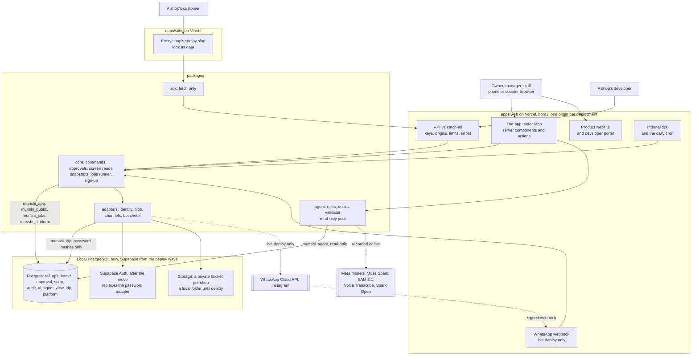

### 1.5 Request flows

**A member opens a screen (one transaction per page).**

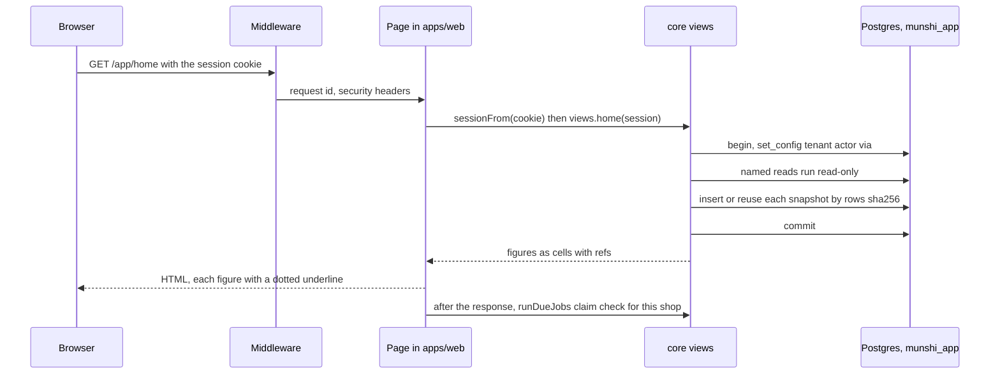

**A counter sale (a person's direct command, idempotent).**

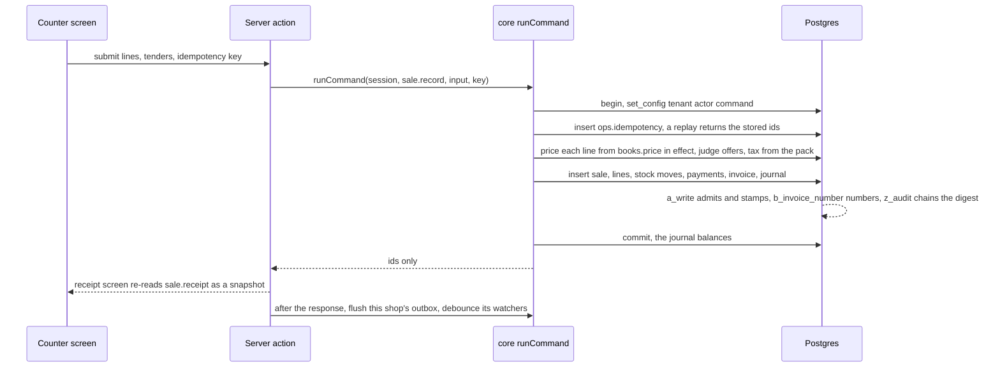

**An approval** (unchanged in kind: one transaction, the approver's identity).

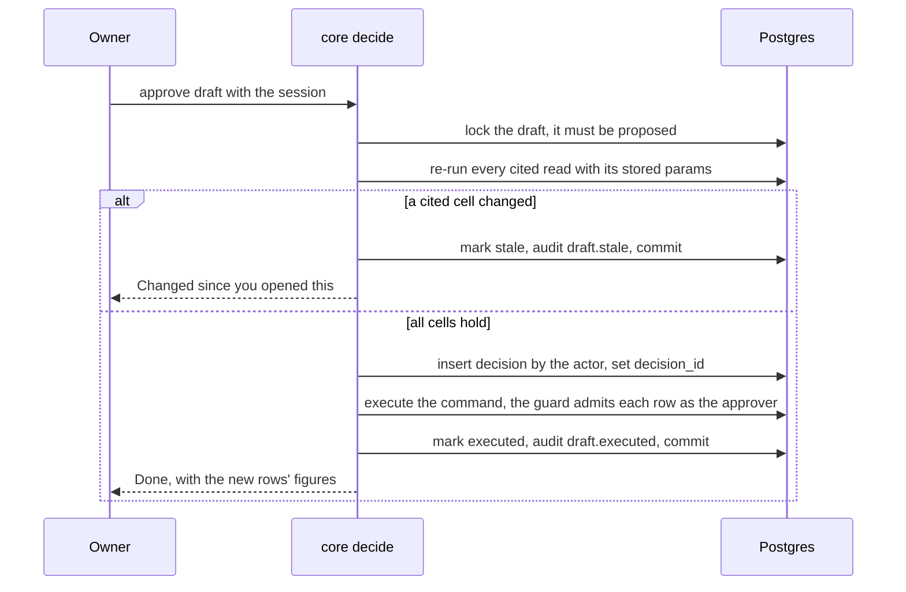

**A public read** (`GET /api/v1/sites/elite/services`): the router parses the slug, finds the tenant in the directory
(public pool), reads the latest release's `site.services` snapshot under that tenant (the restrictive policy lets it see
only release-pinned snapshots), and returns each figure as `{minor, currency, ref}`. `Cache-Control: public,
s-maxage=60`, `ETag` = the release id. Anonymous traffic writes nothing.

## 2 · The database, v2

> One clean, ordered schema with every review fix folded in: ten schemas, eight roles, forced RLS, one write trigger per
> books table, digests in the audit chain, JSON snapshots with pins, effective-dated master data, and a table for every feature.

### 2.1 Shape: schemas, the books/ops split, conventions

| Schema | Holds | Who writes it |
|---|---|---|
| `ref` | global constants: business types, capabilities and their packs, the chart of accounts, reason codes and their uses, commands, who may run them, which book tables each writes and which capability each needs, order steps and their flow, measurement points, the book-table manifest | only the schema files (no runtime role writes) |
| `ops` | tenancy, capability switches, members, sign-in, the contact vault, documents, idempotency, sites and their releases, public requests, bookings, holds, order requests, order state, measurements, campaigns, inbox and outbox, photo evidence, grid batches | app, public and jobs, each on named columns, each refusal held by a trigger |
| `books` | the books: catalogue, prices, parties, sales, purchases, stock, payments, credit, settlements, journal, offers, loyalty, packages, orders and their steps, messages to people, staff records (roster, leave, holidays, attendance, advances, salary), tax registration and invoices | app only, and only through the book guard; append-only |
| `approval` | drafts and decisions | app |
| `snap` | snapshots (the only source of a shown number) and their pins | app (mint), jobs (mint for watchers; purge unpinned display snapshots) |
| `audit` | the per-tenant hash chain and its checkpoints | app (through triggers), jobs (checkpoints) |
| `ai` | runs, traces, findings and their events, answers, the daily brief, the AI policy and usage | app and jobs; the agent reads none of it directly |
| `agent_view` | views of names and ids for the agent (no numbers) | nobody (views) |
| `idp` | the password identity adapter's identities and reset links (global; no email, no tenant) | `munshi_idp` only; removed at the Supabase move |
| `platform` | the superadmin's world: operators and their sessions, platform changes (drafts), per-shop config, channel grants, reserved slugs, the platform audit chain (global) | `munshi_platform`, and only under an approved platform change |

**Book or ops?** The rule, applied to every table below: *a row is a book if it changes what is owed, held, sold,
priced, paid, stocked or promised to a person, or records a staff member's work or pay, or is a message Munshi sends to
a real person.* Everything a member of the public submits, every calendar hold, every piece of evidence and every
setting is ops. A book row is written only by a person's own command or an approved draft (§2.4); an ops row is written
by the role whose job it is, and a trigger decides which columns may change and how.

**Conventions (every table):**
- `tenant_id uuid not null references ops.tenant` is the first column and leads the primary key `(tenant_id, id)`, every
  index and every foreign key **between tenant tables** (gate G10). Foreign keys to `ref.*` are exempt: those rows have
  no tenant (decision 7).
- Ids are UUIDv7 (time-ordered, Munim F). **Every `id` column defaults to `ops.uuidv7()`**, a plpgsql function in
  `02_shared.sql`, because PostgreSQL 17 has no built-in `uuidv7()` (FACT: it arrives in 18); core may pass its own
  UUIDv7. So the tie-break `order by effective_from desc, created_at desc, id desc` holds for every row (R4 K1). A
  column default runs with the inserting role's rights, so every inserting role holds EXECUTE on `ops.uuidv7()`: the
  one function a runtime role executes beyond the audit functions (§2.10.11, G9). No PostgreSQL 18 feature is used
  (Supabase's major version is UNVERIFIED, probably 17); the harness pins 17 (§3).
- RLS enabled **and forced**, one policy `tenant_isolation` on `nullif(current_setting('munshi.tenant_id', true), '')::uuid`;
  the public role has extra **restrictive** policies where it may see less (§2.3).
- An explicit `revoke all … from public, munshi_app, munshi_public, munshi_jobs, munshi_agent, munshi_idp,
  munshi_platform`, then the exact grants.
- Every function: `revoke execute … from public`, `set search_path = pg_catalog, pg_temp`, never SECURITY DEFINER (G9).
  Trigger functions call no other Munshi function (the caller would need EXECUTE); the one exception is
  `ops.uuidv7()`, reached through column defaults, which every inserting role may execute.
- Hashes are `bytea` with `check (octet_length(x) = 32)` everywhere, never hex `text` (R4 K9).
- **An accepted cost** (R4 W5, INFERENCE): `references ops.tenant` on every table and the keys to `ref.*` take KEY SHARE
  locks on a few hot rows (the tenant row, and `ref` rows shared by every tenant) at every sale, which makes MultiXacts
  under concurrency. At this scale that is accepted; both kinds of key stay.
- Money: `<name>_minor bigint` + `currency char(3)`. Quantities: `qty_milli bigint` (milli-units of the item's unit).
  Rates: basis points (`rate_bp`, 500 = 5%). Time: `timestamptz`; business dates `date`; ranges `tstzrange`.
- Phones: `^\+[1-9][0-9]{7,14}$` (E.164 shape) in SQL; which mobiles are valid is the country pack's rule in core.
- Indexes declared one per statement (`create [unique] index <name> on <schema>.<table> (<cols>) [where …];`), each
  asserted in `pg_index` (G10).

Abbreviations used in §2.10: **[T]** the tenant key above; **[S]** the book stamp `created_by uuid not null` (→ member),
`decision_id uuid` (→ decision), `created_txid bigint not null`, `created_at timestamptz not null`, all set by `a_write`
whatever the caller sent; **[R]** reversible: `reverses_id uuid` (→ same table, unique) and `reason text` (a code
allowed for the use `reversal`, keyed to `ref.reason_use`, R4 N9), both or neither; every child of an [R] header is [R]
too (§2.9, R4 K4); **[E]** erasable: `erased_at timestamptz` plus `ops.only_erase(<cols>)`.

### 2.2 Roles, and how they work on Supabase

| Role | Login | Owns / holds | Connects through (hosted) | Used by |
|---|---|---|---|---|
| `munshi_owner` | no | owns every schema, table, view, function | — | nobody logs in as it; the migrator and the hosted reset `SET ROLE` to it |
| `munshi_migrator` | yes, member of owner (NOINHERIT) | nothing directly | Supabase **session** pooler (port 5432) | `pnpm db:build` / migrations; the demo reset |
| `munshi_app` | yes | the grants in §2.10; no DELETE anywhere; no UPDATE on books | **transaction** pooler (6543) | signed-in members' requests (`packages/core`) |
| `munshi_public` | yes | SELECT on published data; INSERT on public requests, holds, order requests, rate counters, idempotency, inbox | transaction pooler | `/api/v1/*` public routes, the WhatsApp webhook |
| `munshi_jobs` | yes | SELECT on books and ops; snapshot mint and **purge**; a moved finding's pin release; findings; outbox claims; retention erasure; trace, session and job-claim purges; checkpoints; **no INSERT on any books table** | transaction pooler | `runDueJobs` (§4.4) |
| `munshi_agent` | yes | SELECT on `snap.snapshot` and `agent_view.*` only | transaction pooler | `packages/agent`'s resolve pool |
| `munshi_idp` | yes | S I U on `idp.*` and D on `idp.attempt` (R4 G4); S on `ops.subject_summary`, on `ops.reset_grant` (under a tenant's context) and on `ops.login`'s subject columns, so the database can check a reset (§2.10.1); nothing else | transaction pooler | the password identity adapter only (`packages/adapters/identity/password`) |
| `munshi_platform` | yes | S I on `platform.*` (writes admitted only under an approved platform change); S on `ops.tenant`, `ops.tenant_directory`, `ai.usage`; no grant on books, approval, snap or audit | transaction pooler | the `/platform` console only |

None is a superuser or has BYPASSRLS (G4). The app and agent roles own nothing (gotcha 3 in Munim). Locally every login
connects to the PostgreSQL in `.run/pg` directly; the pooler notes below apply from the deploy wave.

**On Supabase, from the deploy wave** (FACT, https://supabase.com/docs/guides/database/connecting-to-postgres, read 28 Oct):
- A custom role logs in through the shared pooler as `<role>.<project-ref>`, with its own password. So each URL above
  is the project's pooler host with that user name.
- The shared pooler is IPv4 on every plan; direct connections are IPv6 on Free. Vercel therefore uses the pooler
  (INFERENCE: Vercel functions egress over IPv4).
- The shared pooler does not support prepared statements in transaction mode. `node-postgres` uses unnamed statements
  for parameterised queries; whether Supavisor accepts those in transaction mode is **UNVERIFIED** and is the first gate
  of the connect ticket (BP-OPS-2). `SET LOCAL` (our only context mechanism) is safe in transaction mode.
- Munim ran exactly this pattern on Supabase (custom login roles with passwords through Supavisor, `<role>.<ref>`; FACT,
  `foodops-intel/deploy/vercel/README.md`). It measured about 15 backend connections per (role, database), shared by both
  ports (INFERENCE in Munim's own notes). Pool sizes per Vercel instance: app 3, public 2, jobs 1, agent 2, idp 1, platform 1.

**The bootstrap file on a managed admin** (R1 #4: today's `0001` probably fails there). `db/schema/00_bootstrap.sql`
runs as the project's admin (`postgres` on Supabase, a real superuser locally) and is written for a non-superuser:
1. `create role …` for the eight roles (the admin holds CREATEROLE; on PostgreSQL 16+ it gets ADMIN OPTION on each role
   it creates, INFERENCE from the PostgreSQL docs), then `grant munshi_owner to current_user with inherit false, set true`
   so it may `create schema … authorization munshi_owner` (16+ needs SET on the owner role).
2. `create schema if not exists extensions; create extension if not exists btree_gist with schema extensions;` here, as
   the admin, not in a later file (btree_gist is in Supabase's pre-configured list, UNVERIFIED from the official page).
3. Revokes from PUBLIC: TEMP on the database, CREATE on schema `public`, and EXECUTE on the `pg_catalog` large-object
   functions. **On a non-superuser admin the last one only warns** (the functions belong to the bootstrap superuser).
   So instead of raising, the file records what holds, and the gates measure the outcome:
   - locally (a real superuser) gate G1 requires that the agent can create no large object;
   - on Supabase, `deploy-check` prints `agent_large_objects=possible` if it still can. That is a stated residual (a
     write of unlinked bytes, never a table row, never a book) carried into LIMITATIONS.md, as R1 named it for Neon.
4. Supabase's own roles must reach nothing of ours. `deploy-check` asserts that `anon`, `authenticated`, `service_role`
   and every role with BYPASSRLS except the admin hold no USAGE on any Munshi schema and no privilege on any Munshi
   table (`has_schema_privilege`, `has_table_privilege`), and that the Data API exposes none of our schemas. No Munshi
   object lives in `public`. Red-proof: grant `anon` USAGE on `books` in a scratch database, and deploy-check fails.

### 2.3 Tenant context: RLS and `SET LOCAL`

Every transaction sets its context with `set_config(name, value, true)` (transaction-local) in **one** place, core's
`withTx` (gate B3); a pooled connection returns `''` afterwards, so every reader uses `nullif(…, '')`.

| Setting | Set from | Trusted because |
|---|---|---|
| `munshi.tenant_id` | the session (members), the verified slug and key (public), the job's claimed row (jobs), the run's binding (agent) | RLS uses it; every source is verified before `withTx` |
| `munshi.actor_id` | the signed-in member only | set in one place from the session; the agent and public roles never set it; the jobs role never sets it |
| `munshi.command` | a member's direct command | checked against `ref.command_authority` by the guard |
| `munshi.decision_id` | `decide()` | checked against the decision row, its transaction id and its approver |
| `munshi.via` | the session's origin: `demo` (the demo picker), `sandbox` (a demo sample shop), `real` (a sign-in through the identity adapter) | set beside the actor; forces recorded sends and refuses releases unless `real` |
| `munshi.hold_token` | the public client's hold token, on a hold's conversion or release only | the database compares its sha256 with the hold's (§2.10.8); core never decides it |
| `munshi.reset_token` | a reset link's token, on its use only | the database compares its sha256 with the grant's (§2.10.1) |
| `munshi.operator_id`, `munshi.platform_change_id`, `munshi.totp_at` | the operator's own console session; the approved change being executed; when core last verified the operator's TOTP code | set in the same one module as the actor (gate B3's scope includes them); the platform triggers accept them only as `munshi_platform` and check the change row, its later-transaction approval, the operator's active row and, for channel grants and operator changes, a TOTP time within the last 5 minutes |

Any role can set any custom setting (Munim gotcha 20), so no rule trusts `decision_id` or `command` alone; the actor
and `via` are trusted only because one module sets them and gate B3 proves no other shipped file names them.

**Every ops trigger is role-shaped** (review B6: the public and jobs roles can set `munshi.actor_id` too). Each
transition a trigger admits names the role it belongs to, read from `current_user`, which no setting can change:

| Shape | Admitted only when `current_user` is | Examples |
|---|---|---|
| a person's action (an actor is set and must be an active member with the right role) | `munshi_app` | confirm or decline a booking, a request, an order request or a hold; erase a contact on request; snooze or dismiss a finding; handle an inbox item; publish; switch a capability (owner) |
| a no-actor system action | `munshi_jobs` | the retention purge, hold, reservation and order-request expiry, raise, re-see, resolve or wake a finding, claim and send a delivery |
| a public action (no actor ever) | `munshi_public` | insert a request, a hold, a reservation or an order request (site, widget or webhook); convert or release **its own** hold, checked by the database against `munshi.hold_token`; expire a stale hold after `expires_at`; record a provider status event on a delivery |

A setting that names an actor is ignored, and the write refused, when `current_user` is not `munshi_app`. Gate ROLE1
tries every shape as every role and must see each refused but its own (red-proof: drop the `current_user` check from one
trigger).

**Restrictive policies for `munshi_public`** (it may see less than its tenant): on `snap.snapshot`, only snapshots
pinned by a release; on `ops.document`, only kinds `card` and `art` that a release names; on `ops.site_look`, only looks
a release names. **Column grants** give it exactly what live slots and holds need, ids and times, never a name or an
amount: `books.shift_pattern` and `books.shift_change` (staff, shop, weekday or day, starts, ends, off),
`books.leave` (staff, first and last day, half day, `reverses_id`), `books.holiday` (shop, day, `reverses_id`),
`books.item_revision` (item, duration, sellable, effective from), `ops.shop_hours`, `ops.booking` (shop, stylist,
service, during, state, expiry) and `ops.reservation` (item, state, held until). These are the only books columns any
role but the app, the jobs runner and the owner can read. Gate PUB1 reads as the public role and must find nothing else
(red-proof: drop a restrictive policy; widen a column grant).

### 2.4 The book guard: one write trigger per books table

Every books table has exactly these triggers, and a catalog gate (TRG1) compares each table's set with
`ref.book_table.rules` and fails on any extra, missing or renamed trigger:

| Trigger | When | Does |
|---|---|---|
| `a_write` → `books.write()` | before insert, update, delete | 1. UPDATE always raises `MS001`, and so does DELETE, with one branch: a DELETE is admitted only when `current_user = 'munshi_owner'`, the row's tenant has `sandbox = true` and `ops.deployment.kind = 'demo'` (the scheduled sandbox reset, one transaction per sandbox, never on live; R4 K5). 2. The row is for the current tenant. 3. **Admit** under (a) an approved decision of this transaction by an active member whose role holds the draft's command, or (b) a direct command the acting member's role holds in `ref.command_authority` and that `ref.command` does not mark draft-only; else `MS001`. 4. The admitting command writes this table (`ref.command_table`); else `MS001`. 5. **Stamp** `created_by`, `decision_id`, `created_txid`, `created_at`. 6. **Parent transaction:** if `ref.book_table` names a parent, the parent row must have `created_txid = txid_current()`; else `MS006` (so a committed sale, offer, plan, run or invoice can never gain a line). 7. **Reversal rule** (§2.9) when `reverses_id` is set |
| `b_<rule>` → one function per rule | before insert, after `a_write` (name order, held by TRG1) | a table's own rule: `b_loyalty_tally`, `b_package_tally`, `b_advance_recovery` (balances under a lock), `b_invoice_number` (gapless numbering), `b_one_live` (one live settlement per channel and day, one live purchase per bill; it takes its key's advisory lock first, because the header is the transaction's first insert and its BEFORE trigger runs before the chain lock exists, R4 K2), `b_one_live_pay` and `b_leave_overlap` (no two live salary lines or leave rows overlap for one staff member, under the per-staff lock, R4 K3), `b_offer_cap` (redemption caps), `b_revision_kind` (a revision fits its item's kind), `b_outbound_derive` (the text exists, unerased, with that hash), `b_consent_contact` (consent names the customer's current contact), `b_payment_kind` (staff payments only by `wages.pay` or `advance.give`), `b_attendance_rank` (staff never overwrite an owner's or manager's mark), `b_order_flow` (an order's steps follow `ref.order_flow`, §2.10.16, R4 O1) |
| `z_audit` → `books.audit_row()` | after insert | appends the row's audit entry with its digest (§2.7) |
| `z_balance` → `books.check_balanced()` | deferred constraint trigger on `books.journal_entry` only (R4 W3: lines cannot arrive later, so one check per entry) | each entry has lines and sums to zero per currency at commit (`MS004`). The same kind of deferred header check: `z_invoice_total` (an invoice's totals and each line against its sale line, R4 N2), `z_sale_total` and `z_purchase_total` (a header's total against its lines, R4 N1), and `z_reversal_complete` on every reversal header (each child of the original reversed exactly once, R4 K4) |
| `z_outbound_delivery` | after insert, `books.outbound_message` only | derives the message's `ops.delivery` row (§2.10.7) |
| `z_order_state` | after insert, `books.order_step` only | writes the order's derived `ops.order_state` row (§2.10.16) |

Same-timing triggers fire in name order (FACT, PostgreSQL docs, as 0005 relied on); the `a_`, `b_`, `z_` prefixes make
the order a property TRG1 checks, not an accident (R1 rank 3). A lane adding a book table adds its `b_` function in its
own schema file and its row in `ref.book_table`; nobody edits `books.write()` after the foundation ticket.

**Command authority** lives in three `ref` tables, changed only by the schema files:
`ref.command` (the command and whether it is draft-only), `ref.command_authority` (command × role) and
`ref.command_table` (command × the book tables it writes). G3 keeps them total: every held command writes a book table,
every book table is written by some command. Ops-only actions (erase, publish, keys, invites, deactivation, bookings,
holds, order requests, measurements, capability switches, settings) are **not** commands: core checks the role, and an
ops trigger checks it again where the action is irreversible. **A command's capability** is a fourth `ref` table,
`ref.command_capability` (§2.10.14): core's `runCommand` refuses a `start` command whose capability is off
(`capability_off`) before it opens the write; the book guard never reads a capability, so switching off can never block
a reversal (decision 17, R4 C1).

**Direct commands by role** (the seed of `ref.command_authority`; draft-only commands appear under "approves"):

| Role | Runs directly | Approves (draft-only) |
|---|---|---|
| owner | `item.create`, `item.revise`, `item.alias`, `price.set`, `supplier.create`, `customer.create`, `customer.terms`, `contact.link`, `staff.create`, `staff.terms`, `sale.record`, `sale.reverse`, `purchase.record`, `purchase.reverse`, `stock.count`, `stock.waste`, `stock.reverse`, `reorder.place`, `credit.record`, `credit.reverse`, `payment.record`, `payment.reverse`, `settlement.record`, `settlement.reverse`, `consent.record`, `booking.confirm`, `offer.create`, `offer.end`, `loyalty.rule.set`, `package.plan.create`, `package.redeem`, `shift.pattern.set`, `shift.change`, `leave.record`, `leave.reverse`, `holiday.set`, `holiday.reverse`, `attendance.mark`, `advance.give`, `advance.reverse`, `wages.pay`, `tax.registration.set`, `order.confirm`, `order.step`, `order.reschedule`, `order.cancel`, `order.reverse` | `campaign.send`, `campaign.post`, `message.reply`, `package.expire`, `grid.apply`, `salary.run`, `customer.remind` |
| manager | the owner's list without `price.set`, `item.revise`, `staff.create`, `staff.terms`, `offer.*`, `loyalty.rule.set`, `package.plan.create`, `advance.*`, `tax.registration.set`, `*.reverse` of money (`sale`, `payment`, `credit`, `settlement`, `purchase`) | `message.reply`, `customer.remind` |
| staff | `sale.record`, `payment.record`, `stock.waste`, `consent.record`, `package.redeem`, `attendance.mark` (own row only, checked by core), `order.confirm`, `order.step`, `order.reschedule` | none |

(`journal.post` and `message.send` from 0002 are retired: neither had a core command, both were dormant direct paths.)

### 2.5 Reference data (`ref`)

| Table | Columns | Seeded with |
|---|---|---|
| `ref.business_type` | `code text pk` check `kirana\|apparel\|salon` (the pack a shop starts from; it carries no capability flags: `item_kinds`, `has_variants` and `has_calendar` are gone, R4 C1) | the three types |
| `ref.account` | `code text pk` (`^[a-z_]{2,40}$`); `kind text` check `asset\|liability\|equity\|income\|expense`; `normal text` check `debit\|credit`; `label_key text` | the fixed chart (§2.9), `customer_advance` included |
| `ref.reason` | `code text pk` | `wrong_figure`, `duplicate`, `not_now`, `customer_cancelled`, `entered_in_error`, `returned_goods`, `damaged`, `expired_offer`, `not_relevant`, `already_handled`, `no_show`, `staff_unavailable`, `other` |
| `ref.reason_use` | `code → ref.reason`, `use` check `reversal\|decision\|dismiss\|decline\|discount\|cancel`; pk both (R4 N9: it replaces `used_for text[]`) | the codes allowed for each use, e.g. dismiss: `not_relevant`, `already_handled`, `other` (§7.4); discount (a manual discount, R4 N7): `damaged`, `other`; cancel (an order's cancel or reschedule): `customer_cancelled`, `other` |
| `ref.command` | `command text pk` (`^[a-z]+(\.[a-z_]+)+$`); `draft_only bool` | §2.4 |
| `ref.command_authority` | `command → ref.command`, `role` check `owner\|manager\|staff`; pk both | §2.4 |
| `ref.command_table` | `command → ref.command`, `rel → ref.book_table`; pk both | per command, §2.10.14 |
| `ref.book_table` | `rel text pk` (`^books\.[a-z_]+$`); `parent_rel text → ref.book_table`, `parent_col text` (both or neither); `reversible bool`; `signed_cols text[]` (negated by a reversal); `match_cols text[]` (copied by a reversal); `rules text[]` (its `b_` triggers) | every books table |
| `ref.capability` | `code text pk`; `label_key`; `needs_grant bool` (the superadmin must grant it first) | `counter`, `credit`, `stock`, `buying`, `orders`, `stitching`, `bookings`, `holds`, `cart`, `offers`, `loyalty`, `packages`, `messaging`, `campaigns`, `staff`, `salary`, `gst`, `site`, `api`, `ai`, `variants`; `needs_grant` on `ai`, `messaging`, `site` |
| `ref.capability_requires` | `capability → ref.capability`, `requires → ref.capability`; pk both | `credit→counter`, `gst→counter`, `offers→counter`, `loyalty→counter`, `packages→counter`, `stitching→orders`, `cart→orders`, `cart→site`, `holds→site`, `campaigns→messaging`, `salary→staff`, `bookings→staff`, `variants→stock` |
| `ref.pack_capability` | `business_type → ref.business_type`, `capability → ref.capability`; pk both | kirana: counter, credit, stock, buying, orders, offers, messaging, staff, gst, site, ai. Salon: counter, credit, bookings, packages, offers, loyalty, messaging, campaigns, staff, salary, gst, site, ai. Apparel (shown as "Boutique"): counter, credit, stock, buying, variants, orders, stitching, holds, cart, offers, messaging, campaigns, staff, gst, site, ai |
| `ref.command_capability` | `command → ref.command`, `capability → ref.capability`, `use` check `start\|finish`; pk (command, capability) | every command (gate CAP1), §2.10.14; each books file inserts its own commands' rows |
| `ref.capability_item_kind` | `capability → ref.capability`, `item_kind` check `good\|service\|package`; pk both | counter→good, stock→good, bookings→service, stitching→service, orders→good, packages→package |
| `ref.order_step` | `code text pk`; `kinds text[]` (⊆ goods, stitching, alteration); `terminal bool`; `template_code` (NULL = no customer update); `label_key` (created in `21_orders.sql`) | goods: `confirmed`, `packed`, `ready`, `out_for_delivery`, `delivered`, `cancelled`, `rescheduled`. Stitching and alteration: `confirmed`, `cutting`, `stitching`, `trial`, `ready`, `delivered`, `cancelled`, `rescheduled` |
| `ref.order_flow` | `kind`, `from_step → ref.order_step`, `to_step → ref.order_step`; pk all three (created in `21`) | the allowed transitions (non-negotiable 10, in Munim's form) |
| `ref.measure_point` | `code text pk`, `label_key` (created in `21`) | chest, waist, hip, shoulder, sleeve, length, bottom length, bottom waist, neck (to confirm with Prabhave) |

**A reason column names its use** (R4 N9). A table with a `reason` column also carries a constant generated column
(`reason_use text generated always as ('reversal') stored`, or that table's use), and the pair keys to
`ref.reason_use (code, use)`. So the database refuses a code that exists but is not allowed for that use (INFERENCE:
PostgreSQL accepts a stored generated column in a foreign key).

The app, public, jobs and agent roles hold **no** grant on `ref` beyond SELECT for the app and jobs (core reads the chart
and reasons to render labels); foreign-key checks run with the owner's rights, so the app needs no grant to be checked
against them (INFERENCE from PostgreSQL's RI trigger behaviour; gate R1 red-proves a bad code is refused).

### 2.6 People: the contact vault, erasure, consent

Every person a shop knows (customer, staff member, sole-trader supplier, a requester who gets confirmed) lives in
`ops.contact`. Books point at people by id only (`books.party_contact`), so **no name or phone ever enters a book row,
an audit payload, a draft payload, a decision reason or a snapshot cell** (MERCHANTS-DESIGN decision 4, now on every
tenant).

**`ops.only_erase(cols…)`** (trigger `erase`, before update) and **`ops.fill_once(col, stamp)`**, exactly as fixed in cycle 2:
- a listed column goes to NULL only in the one UPDATE that moves `erased_at` from NULL to `now()` and nulls **every**
  listed column; it never goes from NULL to a value; an erased row never changes again (frozen);
- a fill-once column goes from NULL to a value once, in the UPDATE that sets its stamp from NULL to `now()`; the stamp is
  never cleared; erasure still nulls it through `only_erase`, which then freezes the row; `only_erase` does not apply its
  "never NULL → value" rule to a column `fill_once` governs (the BOARD's 28 Oct clarification);
- identity and recipient columns are never filled after insert (`phone_e164`, `subject`, `to_address`, `from_address`,
  `email`, `name`, `contact_name`, `note`, `text`, `body`, `storage_key`). A changed phone is a new contact, linked by a
  new `books.party_contact` row; a new Google account is a new invite.

**Erasure** (`contact.erase`, owner only; refused on demo tenants by the deny-list):
- **held while any balance is open**, whoever asks (an owner included): credit, an unexpired package holding with value
  or sessions left, loyalty points, an unrecovered staff advance, an open request or a booking still ahead, **an open
  order (its current step not terminal) or an unapplied advance** (§8.12, R4 O1). The request
  waits as `erase_requested_at`; the jobs runner completes it the day the balance clears (wip keep-list);
- in one transaction: the contact's columns, every `site_request`, `booking_contact`, `reservation`, `inbound_message`
  (and its media document), `message_text` (replies, campaign copy addressed to them, an order line's note, and the AI
  answers, glosses and transcripts' texts tied to their messages, review B2), every `measurement` and its values (gate
  M1; order lines keep the id) and `delivery` holding that phone are erased; the audit entry
  `contact.erase` carries `{contact_id}` only. Gate E1 scans every text, jsonb and bytea column of `ops.*`, `ai.*`,
  `approval.*`, `snap.*`, `audit.*` and `platform.*` for the name and phone afterwards;
- **a STOP outlives the purge:** an `opt_out` inbox row is marked handled only in the transaction that writes the
  person's withdrawal (`consent.record`, granted false, naming the message as evidence), and neither the purge nor an
  owner erases it before that while a live contact holds its phone (wip keep-list).

**Retention** (D-038 defaults, run by the jobs role with no actor, reason `retention`): requests and enquiries 90 days
after closed (an open one is closed after 30); inbound messages and voice notes 30 days, **and with them the texts of
every AI answer or gloss made from them**; voice audio once transcribed or 7 days; Ask answers' texts 30 days (a
question can name a person); reply and copy text 30 days after its final status; delivery addresses 30 days after final; unused invites at
expiry; contacts a year after the last activity unless a balance holds them; demo sample rows 7 days; display, watch
and evidence snapshots 7 days unless pinned (R4 S1); traces 90 days (R4 G1); idempotency rows 7 days; rate counters 1
day; finished job claims 7 days (R4 K6); sessions 30 days after expiry, and sign-in attempts a day after the last one
unless locked (R4 G4).

**The database checks each purge's rule, not only core** (review, half-closed). Every no-actor erasure is a
`munshi_jobs` shape (§2.3), and its trigger re-derives the condition from rows: a request, reservation or booking
contact only after its row closed 90 days ago (7 on a demo); an inbound message only after 30 days and never a STOP
without its withdrawal; a message text only 30 days after its delivery's final status, or with its source message; an
invite only after expiry; a member only 365 days after the `member.deactivate` entry; and **a contact only when no
balance is open (credit, package value or sessions, loyalty points, an unrecovered advance, an open request, a booking
ahead, an open order or an unapplied advance) and the latest activity of every customer, staff or supplier row linked
to it (sales, credit entries, package and loyalty entries, outbound messages, bookings, orders and their steps,
attendance, purchases, by `created_at`) is more than a year old, or the owner asked for erasure**. Gate RET1 plants a row one day short of each rule and requires the purge to be
refused, and one day past to be accepted (red-proof: drop the age clause from one trigger).

**Consent** stays a book (`books.customer_consent`), written only by `consent.record`, latest row per (customer, channel,
purpose) by `created_at` wins, by double opt-in (a ticked web box only makes the confirmation ask "Reply YES"). **It
belongs to the person who gave it** (review B8): each row carries the `contact_id` that consented, and it counts only
while that contact is the customer's current `party_contact` link. Re-linking a customer to another contact (a new
phone) leaves them with no consent until the new phone answers YES, so a campaign or reminder never reaches a phone that
never opted in (gate K6, red-proof: key consent on the customer alone).

### 2.7 The audit chain: digests, `verify_books`, checkpoints

- `audit.audit_log` keeps one gapless hash chain per tenant: `hash(n) = sha256(hash(n-1) ‖ canonical(entry n))`, `seq`,
  `prev_hash`, `hash` and `created_at` set by the trigger under a per-tenant advisory lock. An entry names the acting
  member; an entry for a book row needs that row, written by that member under that decision; one entry per book row
  (partial unique index).
- **A book row's entry stores its digest, not the row** (ruling; R1 #5: 913 B per entry against a ~300 B row): the
  column `row_digest bytea`, the 32-byte sha256 of `to_jsonb(row)::text`, with no payload (R4 G3: a hex digest in
  jsonb plus three indexes made an entry about 440 B, INFERENCE). `audit_entity` is partial (`where entity not like
  'books.%'`), and `verify_books` repeats that `like` clause so `audit_book_row` serves it. `jsonb`'s text form is deterministic (keys ordered), but it renders a
  `timestamptz` in the session's time zone (INFERENCE from PostgreSQL's JSON output; 0004 hashed `created_at` as epoch
  seconds for this reason). So `books.audit_row` and `audit.verify_books` both pin `set TimeZone = 'UTC'` and
  `set IntervalStyle = 'postgres'` as function settings, and VB1 writes rows under UTC and verifies them under
  `Asia/Kolkata` (red-proof: drop the setting, and every row reads as a mismatch). Ops entries (`member.add`,
  `contact.erase`, `site.publish`, `draft.executed`…) carry ids and codes only.
- **`audit.verify_books(tenant, rel, from_id, to_id)`** checks one chunk of a table in `ref.book_table` and returns
  `(rel, id, problem)` for each row whose digest no longer matches its entry (`digest_mismatch`), each book row with no
  entry (`no_entry`) and each entry whose row is gone (`no_row`). This closes R1 #5: an owner who disables the triggers
  and edits a sale is caught, because the row's digest stops matching the chain. It re-hashes every book row, so it
  never runs inside a page: the jobs `checkpoint` task walks every table by id range, and *Settings → Books integrity*
  shows the last result (`audit.checkpoint.books_problems`, R4 W6).
- **The chain lock and the write path** (R4 W1). The chain's per-tenant advisory lock is taken at the first audited row
  and held to commit, so a tenant's book writes run one at a time. The critical section starts at the end of the first
  book insert, so every round trip after it lengthens the wait:
  - a command does every read before its first insert (the §1.5 sale flow already does);
  - it sends one INSERT per table (or one writable-CTE statement), never one per row;
  - book commands run at READ COMMITTED (gapless invoice numbering needs it, §2.10.9) with `lock_timeout` set (for
    example 5 s), so a wait fails as a retryable `conflict` instead of holding a pooled backend;
  - BP-OPS-2 measures INV1 on the Supabase pooler. *INFERENCE:* with 1 ms round trips and one insert per table, the
    lock is held about 15–25 ms, about 40–60 sales a second per tenant; a real kirana needs a few hundred a day.
- **One lock order** (R4 W2). Every advisory lock uses the two-key form `pg_advisory_xact_lock(class, hash)`, one class
  per purpose: the chain, an offer, a customer's loyalty, a package holding, a staff member, an invoice series, a
  one-live key, an IP's holds, a stylist's day. Every trigger that takes one takes the tenant's chain lock first (a
  no-op when it is already held), and `member_guard` serialises on the chain lock itself, so no two transactions can
  take two locks in opposite orders (INFERENCE).
- **`audit.checkpoint`** `(tenant_id, seq, hash, made_at)`: the jobs runner verifies the chain from the last checkpoint
  nightly and writes a new one, so `verify_chain(tenant)` checks only the tail by default (R1: 681 ms for 30.6k entries);
  `verify_chain(tenant, full => true)` checks everything.
- **Residual, stated:** the chain is unkeyed. The owner role can rewrite rows *and* re-hash the chain and the
  checkpoints. The latest checkpoint's head is shown in *Settings → Books integrity* so an owner can note it down, and
  the daily job writes it to the structured log (outside the database, kept as long as the host keeps logs; UNVERIFIED
  retention on Hobby). `verify_books` and `verify_chain` both refuse a tenant other than the current one (`MS003`).

### 2.8 Snapshots: JSON cells, reuse, pins, purge

- **One row per snapshot** (ruling): `snap.snapshot` holds `columns` (name, kind, unit or currency column) and `rows`, a
  JSON array of arrays of typed cells, e.g. `{"k":"money","n":"249900","c":"INR"}`, `{"k":"qty","n":"12000","u":"pack"}`,
  `{"k":"text","t":"Amul butter 100 g"}`, `{"k":"date","d":"2026-10-29"}`, `{"k":"null"}`, plus `rows_sha256`. Refs are
  unchanged: `⟨snap:ID·row·col⟩`. Every snapshot also answers `⟨snap:ID·0·_count⟩`, its row count, so an empty read is
  citable ("no overdue credit") (study H: "empty reads uncitable").
- **The database checks the shape** in the `snap_check` trigger (before insert): the row count equals the array length
  and is at most 500, each row has one cell per column, each cell's kind matches its column and carries exactly its
  fields, and `rows_sha256` is the sha256 of `rows::text`; it stamps `created_txid`, `actor_id` and `params_sha256`
  (from `params::text`, so a caller cannot send a mismatched one, R4 I7). It checks the cells set-based
  (`jsonb_array_elements` with `bool_and`), not in a per-cell loop: a 500 × 6 snapshot is about 3,000 cells (R4 W3).
  Snapshots are immutable.
- **Reuse:** a member's display read with no run runs, hashes its rows, and reuses the newest snapshot of that tenant
  with the same `query_name`, params, `rows_sha256` and no run, **made less than a day ago** (so a reused snapshot is at
  least six days from any purge, review B10), returning its id instead of inserting (R2 #3). The lookup is served by the
  partial `snapshot_reuse (tenant_id, query_name, params_sha256, rows_sha256, created_at) where purpose = 'display' and
  run_id is null`, so it never walks evidence or watch rows of the same read (R4 I7). **Agent
  runs, watchers, evidence and releases always insert**, because the validator refuses a cell of another run
  (`not_this_run`, gate A1) and a release must mint in its own transaction (B8). The counter's quote reuses on every
  keystroke that does not change the bill.
- **`created_at` is returned from the insert** (R1), so a screen needs no second read. **The "as of" label is the read's
  own time, never a reused snapshot's `created_at`,** which can be up to a day older than the read (R4 S2).
- **Pins:** `snap.pin (tenant_id, snapshot_id, holder, holder_id)` is written **by triggers** on the citing rows, in their
  own transaction: `approval.draft` (every snapshot in `based_on` and `payload_refs`), `ai.finding`, `ai.answer`,
  `ai.brief`, `ops.site_release`, and `ops.grid_batch` (its base snapshot, which it also names by foreign key). Every row
  that names a snapshot by foreign key is a pin holder, so the purge can never hit a key. **A pin is never deleted, with
  two exceptions:** the owner's scheduled sandbox reset, which deletes a whole sandbox tenant (R4 K5, §6.6); and the jobs
  role's `pin_release` policy, which deletes a finding's pin on a snapshot that finding no longer names (R4 S1). A finding moves to a new snapshot only when its row's cells changed (`row_sha256`, §7.4), and never moves
  back, so the release cannot race a re-pin (INFERENCE). Draft pins (and with them decisions), answer, brief, release
  and grid pins are never deleted.
- **Purge:** the jobs role may DELETE a snapshot only where its policy allows it:
  `purpose in ('display','watch','evidence') and created_at < now() - interval '7 days' and not exists (a pin)`.
  Evidence snapshots go too (up to 8 per agent run), unless cited (R4 S1). The app holds no DELETE. *Why (INFERENCE):*
  a busy shop's open findings re-seen every watcher run would otherwise pin about 240 snapshots a day, about 440 MB a
  year, near Supabase's free database size (UNVERIFIED). **The race is closed in the database** (review B10): `snap.pin` has a foreign key to its snapshot (`on delete
  restrict`), so a pin insert takes a key-share lock on the snapshot row; the purge deletes with `for update skip
  locked`, so it skips a snapshot being pinned, and a pin that loses the race fails its foreign key and the citing write
  retries with a fresh mint. Gate J2: a pinned snapshot survives any purge, and a pin and a purge racing on one snapshot
  never leave a pin without its snapshot (red-proof: drop the pin clause; drop the foreign key). An old figure re-opened
  after a purge re-mints when its screen loads; a ref whose snapshot is gone renders "Cannot verify", never a number.

### 2.9 Drafts, decisions, revisions, reversals, the journal, idempotency

**Drafts and decisions** (kept from 0003/0007/0009, with the decided simplifications): a draft names its command, payload,
`based_on` and `payload_refs` (every payload number → the cell that holds it); `decide()` locks it, re-runs every cited
read (changed → `stale`), inserts the one decision (decider = the actor; draft from an earlier transaction), executes the
command under it, and audits `draft.executed`. New: a person who edits a draft before approving creates a new draft whose
typed numbers are their own `ops.member_input` rows, minted as cells by the `input.values` read and labelled "typed by
<name>"; the original becomes `superseded`. Decisions carry a reason code (`ref.reason`), never words.

**Lifecycle:**

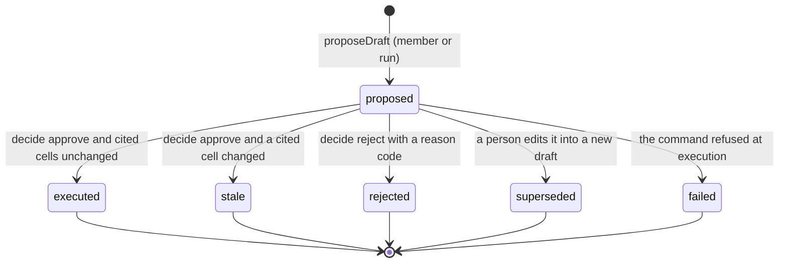

**Effective-dated revisions for master data** (ruling; R1 #3): the identity row never changes; what changes is a new
revision row, and the latest in effect wins, like `books.price` today.

| Identity | Revision | What may change |
|---|---|---|
| `books.item` (kind, unit, parent) | `books.item_revision` | name, category, barcode, variant attributes, service duration, HSN/SAC code, tax class, sellable (discontinued) |
| `books.item` | `books.price` | the selling price |
| `books.customer` | `books.customer_terms` | the credit limit |
| `books.staff` | `books.staff_terms` | home branch, title, pay kind and amount |
| customer / supplier / staff | `books.party_contact` | which `ops.contact` names them |
| tenant, per state | `books.tax_registration` | GST scheme, GSTIN (one per state, R4 N3) |
| staff | `books.shift_pattern` | the weekly roster |

**Which row is in effect** (R4 K1). `effective_from` is `timestamptz` where a figure is priced at an instant (item
revisions, prices, customer terms, party contacts, loyalty rules, platform config) and `date` where the unit is a
business day (staff terms, shift patterns, shop hours, tax registrations). Every reader, a trigger or core, takes the
latest in effect with one tie-break: `order by effective_from desc, created_at desc, id desc`. A table without
`created_at` drops that term; ids are UUIDv7, so they are time-ordered (§2.1). Each such table has an index in that
order. Latest-wins rows need no exclusion constraint; overlap rules belong only where ranges exist (salary periods and
leave, §2.10.6).

**One reversal rule, one trigger, one command per book** (ruling; R1 #8). A reversible table declares in
`ref.book_table` its `signed_cols` and `match_cols`. `a_write` admits a row with `reverses_id` only if: the original
exists in this tenant, is not itself a reversal, has not been reversed before (unique `reverses_id`), every signed
column is the exact negation of the original's, every match column is equal, and the reason is a `ref.reason` code
allowed for the use `reversal` (`ref.reason_use`, R4 N9). Each book gets one `*.reverse` command that writes the
reversal of the header **and** of every row it caused (lines, stock moves, payments, credit, journal, discounts, loyalty
and package entries, invoice → credit note), so the net of the original and its reversal is zero everywhere (gate
REV1). Leave and holidays reverse with no signed columns (match columns only); attendance needs no reversal (the day's
mark is the latest of the highest rank, §2.10.6).
- **Every child of a reversible header is reversible too** (R4 K4): `sale_line`, `sale_discount`, `purchase_line`,
  `journal_line`, `salary_line` and `order_line` are [R], each with a unique `reverses_id`. A reversal child's parent is
  the **reversal** header (so `a_write`'s parent-transaction rule admits it, and the parent column is never a match
  column). A deferred `z_reversal_complete` on each reversal header checks at commit that every child of the original
  has exactly one reversing child. An invoice is not [R]: its reversal is a credit note (`original_invoice_id`), whose
  lines name the reversal sale's lines (§2.10.9).
- **A sign carries meaning only where it is the meaning** (R4 N6). Where another column says what a row is (a
  payment's `direction`, a discount's `source`), the amount is positive unless the row is a reversal:
  `check ((reverses_id is null) = (amount_minor > 0))`. Signed amounts stay where the sign is the fact (a stock move's
  quantity, a credit entry, a journal line, a sale's total).

**The journal, read by reports and GST** (ruling: keep it and read it). Accounts are rows of `ref.account`, referenced
by foreign key:

| Code | Kind | Normal | Written by |
|---|---|---|---|
| `cash`, `upi_clearing`, `card_clearing`, `bank` | asset | debit | tenders of sales and payments |
| `receivable` | asset | debit | credit sales, repayments |
| `inventory` | asset | debit | purchases |
| `staff_advance` | asset | debit | advances given; recovered by salary runs |
| `payable` | liability | credit | purchases on credit, supplier payments |
| `package_liability` | liability | credit | package sales, redemptions, expiries |
| `customer_advance` | liability | credit | an order's advance (`payment.record` naming the order); debited when the delivery sale applies it, when it is refunded, or when it is kept as credit (§8.12, R4 O1) |
| `gst_output_cgst`, `gst_output_sgst` | liability | credit | invoices of a registered shop |
| `wages_payable` | liability | credit | salary runs, wage payments |
| `opening_equity` | equity | credit | opening stock |
| `sales` | income | credit | sales (taxable value), package redemptions |
| `sales_discount` | income (contra) | debit | offer, loyalty and manual discounts (R4 N7) |
| `package_breakage` | income | credit | package expiries |
| `wages_expense` | expense | debit | salary runs |

The day report, the GST summary and the salary page read `books.journal_line` joined to `ref.account`; a gate (JR1)
proves each report figure equals the journal's sum for its accounts over the period, computed independently in the test
from raw lines.

**Idempotency** (ruling; R2 #5): `ops.idempotency (tenant_id, scope, key, command, request_sha256, result, created_at)`,
primary key `(tenant_id, scope, key)`. Every form render and every API write carries a key (the SDK makes one). Inside
the command's own transaction core inserts the key first: a fresh key proceeds; a duplicate waits on the unique index
until the first commits, then returns the stored ids (`result`, ids only) if `request_sha256` matches, or `conflict`
(409) if it does not. A double tap on the counter records one sale (gate IDEM1, red-proof: skip the insert).

### 2.10 Every table

Grant letters: **A** `munshi_app`, **P** `munshi_public`, **J** `munshi_jobs`, **G** `munshi_agent`; `S` select, `I`
insert, `U(cols)` column-pinned update, `D` delete (only where a policy allows). Every books table is `A: S I` and `J: S`
only (plus the public role's column grants listed in §2.3), with `a_write` and `z_audit`; the column "Written by" lists
the commands in `ref.command_table`. A table not listed for a role grants it nothing.

#### 2.10.1 `ops`: tenancy, shops, members, sign-in

| Table | Columns (type, check) | Keys and indexes | Grants | Triggers and rules |
|---|---|---|---|---|
| `ops.deployment` (global) | `one bool pk default true check (one)`, `kind text` demo\|live, **`hosted bool`** (false only for a laptop database), `created_at` | — | A P J: S | inserted only by the owner before any tenant; never updated, deleted or truncated (`MS010`); a hosted app (on Vercel, or with a public URL other than `localhost`) refuses to boot on any database marked `hosted = false`; `db:build --live-local` writes `hosted = false` only after asserting it is connected to the local cluster in `.run/pg-live` (the data directory and a loopback address, as `dev.ts` checks today) |
| `ops.schema_version` (global) | `one bool pk`, `source text` schema\|migrations, `sha256 bytea` (32 bytes, R4 K9), `built_at` | — | A P J: S | written by the build; the app refuses to boot when its compiled-in sha differs (§4.2) |
| `ops.tenant` | `tenant_id uuid pk`, `name text 1..120`, `business_type → ref.business_type` (the pack the shop started from; never changes, §8.13), `data_class text` synthetic\|showcase\|live, `country char(2) default 'IN'`, `currency char(3) default 'INR'`, `time_zone text default 'Asia/Kolkata'`, `count_max_age interval default '6 hours'`, `sandbox bool default false`, `created_txid bigint`, `created_at` | pk | A: S I U(name, count_max_age) · P: S (name, business_type, data_class, currency, time_zone) · J: S | `tenant_class`: `live` exactly on a live deployment; `sandbox` only off live and only `synthetic`; stamps `created_txid`. **`tenant_guard`** (R4 N12): only an active owner of this tenant updates, and only `name` and `count_max_age`; every other column never changes; audited `tenant.update {tenant_id}` |
| `ops.tenant_directory` (global) | `slug text pk` `^[a-z][a-z0-9-]{2,39}$`, `skeleton text unique` (set by the trigger), `tenant_id uuid unique → ops.tenant`, `created_txid`, `created_at` | pk, unique tenant, unique skeleton | A: S I · P: S · J: S · platform: S | `directory_guard`: the tenant row was created in **this** transaction; the slug is not a route word (`app`, `api`, `developers`, `platform`, `sign-in`, `sign-up`, `log-in`, `invite`, `privacy`, `terms`, `demo`, `live`, `www`, `munshi`…); the trigger computes the **skeleton** (lower case, hyphens dropped, look-alikes folded: `0`→o, `1`/`l`→i, `5`→s, `rn`→m, `vv`→w) and refuses one equal to an existing slug's or a `platform.reserved_slug`'s skeleton; a reserved slug itself is taken only by an insert that runs as the owner role (the operator's provisioning and the populate script), never by self-serve sign-up (review B5); never updated. A new tenant's site is hidden until the superadmin verifies it (§2.10.15). The demo picker lists the directory's synthetic and showcase tenants that are not sandboxes, each read under its own context |
| `ops.shop` | [T] `id`, `name 1..80`, `area ≤80`, `address ≤300`, `state_code text ^[0-9]{2}$` (GST state), `invoice_series text ^[A-Z0-9]{1,8}$`, `created_at`, `updated_at` | pk | A: S I U(name, area, address, state_code, invoice_series, updated_at) · P: S(id, name, area) · J: S | `shop_guard`: only an active owner updates; **`state_code` and `invoice_series` are tax facts, so they are refused once the shop has its first invoice** (R4 N3); audited `shop.update {shop_id}` |
| `ops.shop_hours` | [T] `id`, `shop_id`, `weekday smallint 1..7`, `opens time`, `closes time > opens`, `closed bool`, `effective_from date`, `created_by`, `created_at` | `(tenant_id, shop_id, weekday, effective_from desc, created_at desc)` (R4 K1) | A: S I · P: S · J: S | append-only; the latest in effect per shop and weekday wins. **No hours cross midnight** (`closes > opens`): a stated limit for a restaurant open late (R4 K10) |
| `ops.member` | [T] `id`, `display_name ≤80` (NULL once erased), `phone_e164` (NULL once erased), `role` owner\|manager\|staff, `active bool`, `created_at`, `deactivated_at`, [E] | `(tenant_id, active)` | A: S I U(active, deactivated_at, display_name, phone_e164, erased_at) · J: S U(display_name, phone_e164, erased_at) | `member_guard` (first member is the owner adding themself; then owners add owners and managers, owners or managers add staff; serialised per tenant under the tenant's audit-chain lock itself, so the two locks can never be taken in opposite orders, R4 W2); `member_deactivate` (one way, never the last owner, under the same lock); `erase(display_name, phone_e164)` only after deactivation; audited `{member_id, role}` only |
| `ops.member_invite` | [T] `id`, `member_id`, `email ≤254` (NULL once used or expired), `token_sha256 bytea`, `expires_at` (24 h), `created_by`, `created_at`, `used_at`, `used_txid`, [E] | unique `(tenant_id, token_sha256)` | A: S I U(used_at, used_txid, email, erased_at) · J: U(email, erased_at) | `invite_guard`: owner invites anyone, manager invites staff; use is the invited member, before expiry, in one UPDATE that nulls the email |
| `ops.login` (global) | `id uuid pk`, `provider text` password\|supabase, `subject text ≤128` (NULL once erased, R4 K14), `tenant_id`, `member_id`, `invite_id` (NULL only for a first owner), `first_owner bool`, `created_txid`, `created_at`, `revoked_at`, [E] | unique `(provider, subject, tenant_id) where subject is not null`; unique `(tenant_id, member_id, provider) where revoked_at is null and erased_at is null`; `(provider, subject)` | A: S I U(revoked_at, subject, erased_at) | `login_bind`: for the current tenant and the acting member; **either** an invite naming that member was used in this transaction, **or** `first_owner` and the tenant was created in this transaction and the member is its first, an owner (self-serve sign-up, no SECURITY DEFINER); a `password` subject must exist and be verified in `idp.identity` (checked by core through the adapter, and the bind happens in the transaction that used the invite); **an operator's subject is never bound to a shop** (refused when `ops.subject_summary.is_operator`); only `munshi_app` with an actor; no email column |
| `ops.subject_summary` (global) | `provider`, `subject` (pk with provider), `memberships int`, `highest_role` owner\|manager\|staff, `is_operator bool`, `epoch int`, `updated_at` | pk | A: S (and I U from triggers only) · platform: S (and U of `is_operator` from triggers only) · idp: S | kept by triggers on `ops.login` and `platform.operator` (`pg_trigger_depth() > 1`, else refused); `epoch` rises by one each time the identity's password is reset; every session row stores the epoch it was opened under, and `openSession` refuses a session whose epoch is behind, so a reset ends every session of the identity in every shop and the console at once |
| `ops.reset_grant` | [T] `id`, `member_id`, `subject`, `token_sha256 bytea`, `issued_by`, `issued_at`, `expires_at` (24 h), `used_at`, `used_txid` | unique `(tenant_id, token_sha256)` | A: S I · P: S U(used_at, used_txid) · idp: S (under the tenant's context) | `reset_guard` (as `munshi_app`): the issuer is an active owner resetting a manager or staff member, or an active manager resetting staff, **of this shop**; the target's identity has exactly **one** membership, is not an owner anywhere and is not an operator (from `ops.subject_summary`); using it is a public shape (`munshi_public`, once, before expiry, admitted only when `sha256(munshi.reset_token)` equals the row's hash) and bumps the identity's epoch in the same transaction. The idp role then accepts the new password only for a grant used in the last 5 minutes, once (`idp.reset_use`) |
| `ops.login_session` | [T] `id`, `member_id`, `via` demo\|sandbox\|real, `subject_epoch` (real sessions), `created_at`, `expires_at`, `revoked_at` | `(tenant_id, member_id)`; `login_session_expired (tenant_id, expires_at)` | A: S I U(revoked_at) · J: D (policy: `expires_at < now() - interval '30 days'`, R4 G4) | `session_via`: a member opens their own, as `munshi_app`; `demo` only on non-sandbox synthetic or showcase tenants off live; `sandbox` only on a sandbox tenant; `real` only on a live deployment, with a live `ops.login` for the member; ≤ 12 h (demo), ≤ 7 days (sandbox), ≤ 14 days (real); revoked once; the jobs `sweep` deletes a session 30 days after it expired (every demo visit opens one) |
| `ops.capability_switch` | [T] `id`, `capability → ref.capability`, `is_on bool` (the spec's `on`, renamed: `ON` is a reserved word in SQL, INFERENCE), `by` (a member, or NULL inside the tenant's creation transaction), `at`, `created_txid` | `switch_latest (tenant_id, capability, at desc)` | A: S I · J: S | **append-only; the latest row per capability wins** (decision 17, R4 C1). `capability_guard` (role-shaped, §2.3): only an active owner inserts, as `munshi_app`; switching on needs every `ref.capability_requires` row of it to be on; switching off is refused while a capability that requires it is on (`MS019`); a row with no actor is admitted only in the tenant's creation transaction, where sign-up writes the pack's rows; each insert is audited `capability.switch {capability, is_on}`. It never touches a book row; core reads it, the book guard never does |

#### 2.10.2 `ops`: people, files, idempotency, jobs, limits

| Table | Columns | Keys and indexes | Grants | Triggers and rules |
|---|---|---|---|---|
| `ops.contact` | [T] `id`, `name ≤80`, `phone_e164`, `language` hi\|en, `created_by` (a member), `created_at`, `erased_by`, `erase_reason` request\|retention, `erase_requested_at`, [E] | unique `contact_phone (tenant_id, phone_e164) where erased_at is null` | A: S I U(name, phone_e164, erased_at, erased_by, erase_reason, erase_requested_at) · J: S U(same) | `contact_guard` (an active member adds; erasure is the owner's own request or the no-actor purge, and is **held while any balance is open**; the purge shape is admitted only when the database itself finds no open balance and a year without activity on every linked row, §2.6); `erase(name, phone_e164)`; audited `{contact_id}` |
| `ops.document` | [T] `id`, `kind` photo\|bill\|voice\|image\|card\|art\|import, `source` upload\|inbound\|seed, `storage_key text` (`<bucket>/<path>`; NULL once erased), `sha256 bytea` (32 bytes, R4 K9), `mime` (jpeg, png, webp, svg for `art` only, ogg, wav, csv, xlsx), `bytes int 1..4000000`, `uploaded_by` (NULL unless `upload`), `purge_after`, `created_at`, [E] | unique `(tenant_id, sha256)` | A: S I U(storage_key, erased_at) · P: S (restrictive: `card`/`art` named by a release) I (inbound `voice`/`image`) · J: S U(storage_key, erased_at) | `document_check` (an `art` document is SVG ≤ 200 KB, a `card` JPEG; **`storage_key` must start with the tenant's own bucket**, `t-<tenant_id>/`, so no row can point at another shop's file); `erase(storage_key)`; the bytes live in a local folder (`.run/blobs/t-<tenant_id>/`) until the deploy wave, then in Supabase Storage, one private bucket per tenant |
| `ops.channel_recipient` | [T] `id`, `channel` whatsapp, `contact_id` \| `member_id` (exactly one: a consenting test customer, or a member for test sends), `added_by`, `created_at`, `removed_at` | `(tenant_id, channel)` | A: S I U(removed_at) · J: S U(removed_at) | the shop's own test recipients, chosen by an active owner among its own people, at most the grant's `max_test_recipients`; removed when the contact or member is erased; `delivery_derive` makes a WhatsApp send real only for a recipient listed here **and** a live grant |
| `ops.phone_route` (global) | `id`, `phone_hmac bytea` (keyed HMAC of the E.164 number; NULL once erased), `tenant_id`, `recipient_id`, `created_at`, [E] | unique `(phone_hmac) where erased_at is null` | A: S I U(phone_hmac, erased_at) · P: S · J: U(phone_hmac, erased_at) | written with its `channel_recipient` in one transaction for the current tenant; routes an inbound message to one tenant; no plaintext number; erased with its recipient. **The HMAC key is its own secret** (`MUNSHI_PHONE_ROUTE_SECRET`, never logged, never the identity key): India has about 10^10 mobile numbers, so anyone with the key and this table could recover every number in hours, and the key is guarded like the numbers. Rotation means re-hashing every route from its recipient's contact, tenant by tenant (a jobs task). **First-come:** a number already routed to one shop cannot be listed by another (the owner sees "already a test recipient elsewhere", which says only that); the first lister receives that number's inbound messages, which is why only an operator-granted shop can list recipients at all, at most five, each also verified in Meta's console |
| `ops.idempotency` | `tenant_id`, `scope text` `^(member\|site\|webhook):[0-9a-f-]{36}$`, `key text ^[A-Za-z0-9_-]{8,128}$`, `command`, `request_sha256 bytea`, `result jsonb` (ids only), `created_at` | pk `(tenant_id, scope, key)`; `idempotency_age (tenant_id, created_at)` (the purge, R4 I9) | A: S I · P: S I · J: D (older than 7 days) | §2.9 |
| `ops.job_claim` (global) | `job text`, `slot text` (e.g. `watch:<tenant>:2026-10-29T10:15`), `claimed_at`, `finished_at`, `outcome` ok\|skipped\|failed, `error_code` | pk `(job, slot)`; `job_claim_done (finished_at) where finished_at is not null` (R4 K6) | J: S I U(claimed_at, finished_at, outcome, error_code) D (finished more than 7 days ago) | a job runs once per slot however often it is triggered (§4.4); **a claim unfinished after 5 minutes may be re-claimed** by moving `claimed_at`, so a run that died never strands its slot; `sweep` deletes finished claims after 7 days (R4 K6) |
| `ops.rate_counter` (global) | `bucket bytea` (16-byte keyed hash of IP, key or phone plus route class), `window_start`, `hits int` | pk `(bucket, window_start)`; `rate_counter_age (window_start)` (the purge, R4 I9) | P: S I U(hits) · J: D (windows older than a day) | RLS forced with permissive policies; nothing personal |
| `ops.member_input` | [T] `id`, `member_id`, `path text`, `kind` money\|quantity\|integer\|date, `num bigint`, `currency`, `unit`, `day`, `created_txid`, `created_at` | `(tenant_id, member_id, created_at)` | A: S I | the member is the actor; minted by the `input.values` read so a person's typed number in an edited draft, or a stitching quote on an order line (`quote_input_id`, §2.10.16), is a cell labelled as theirs |

#### 2.10.3 `books`: catalogue and parties

| Table | Columns | Keys and indexes | Written by | Rules |
|---|---|---|---|---|
| `books.item` | [T][S] `id`, `kind` good\|service\|package, `unit` piece\|pack\|kg\|g\|l\|ml\|m\|session, `parent_item_id` | unique `(tenant_id, id, kind)` (for composite keys); `item_parent (tenant_id, parent_item_id)` | `item.create`, `package.plan.create`, `grid.apply` | `(kind = 'service') = (unit = 'session')`; a kind only if `ref.capability_item_kind` allows it for one of the shop's switched-on capabilities, and a parent only while `variants` is on (core checks both; the book guard never reads capabilities, §8.13); a variant's parent is a `good` with no parent (one level, core); `m` (fabric by the metre) only if Prabhave needs it (§12) |
| `books.item_revision` | [T][S] `id`, `item_id`, `name 1..120`, `category ≤60`, `barcode ≤64`, `attrs jsonb` (object; values ≤30; variant attributes, non-empty only while `variants` is on, checked by core), `duration_min 5..600`, `hsn_sac ^[0-9]{4,8}$`, `tax_class ^[a-z0-9_]{2,40}$` (a country-pack code), `sellable bool`, `effective_from timestamptz` | `item_revision_latest (tenant_id, item_id, effective_from desc, created_at desc)` (R4 K1); `item_revision_barcode (tenant_id, barcode) where barcode is not null` (R4 I4: a scan keeps only hits that are their item's current revision) | `item.create`, `item.revise`, `package.plan.create`, `grid.apply` | latest in effect wins; `duration_min` set exactly for services (checked against the item by core and by `b_revision_kind`) |
| `books.item_alias` | [T][S] `id`, `item_id`, `alias` (NFKC, trimmed, lower case) | unique `(tenant_id, alias)` | `item.alias` | — |
| `books.price` | [T][S] `id`, `item_id`, `amount_minor ≥0`, `currency`, `effective_from timestamptz` (a figure priced at an instant, R4 K1) | `price_item (tenant_id, item_id, effective_from desc, created_at desc)` (R4 K1) | `price.set`, `package.plan.create`, `grid.apply` | latest in effect wins; prices are tax-inclusive (§8.10, INFERENCE) |
| `books.customer` | [T][S] `id` | pk | `customer.create`, `booking.confirm`, `order.confirm` | an identity only; the person is in the vault |
| `books.customer_terms` | [T][S] `id`, `customer_id`, `credit_limit_minor ≥0`, `currency`, `effective_from timestamptz` | `(tenant_id, customer_id, effective_from desc, created_at desc)` (R4 K1) | `customer.create`, `customer.terms`, `booking.confirm`, `order.confirm` | latest wins |
| `books.supplier` | [T][S] `id`, `is_simulated bool not null` (no default: every supplier states it), `gstin ^[0-9]{2}[A-Z0-9]{13}$` (the tax registration's pattern, R4 K14) | pk | `supplier.create` | a simulated supplier's deliveries are always recorded (§2.10.7) |
| `books.staff` | [T][S] `id`, `member_id` (NULL for staff with no app sign-in) | unique `(tenant_id, member_id) where member_id is not null` | `staff.create` | — |
| `books.staff_terms` | [T][S] `id`, `staff_id`, `shop_id` (home branch), `title ≤40`, `pay_kind` daily\|monthly, `pay_minor ≥0`, `currency`, `effective_from date` (pay is set per business day, R4 K1) | `(tenant_id, staff_id, effective_from desc, created_at desc)` (R4 K1) | `staff.create`, `staff.terms` | latest wins |
| `books.party_contact` | [T][S] `id`, `customer_id` \| `supplier_id` \| `staff_id` (exactly one), `contact_id → ops.contact`, `effective_from timestamptz` | `(tenant_id, contact_id)`; `(tenant_id, customer_id, effective_from desc, created_at desc)`; same for supplier and staff (R4 K1) | `customer.create`, `supplier.create`, `staff.create`, `booking.confirm`, `order.confirm`, `contact.link` | latest wins; the link survives the contact's erasure (an id) |
| `books.customer_consent` | [T][S] `id`, `customer_id`, **`contact_id → ops.contact`** (the person who consented: the customer's link in effect when it was recorded, checked by `b_consent_contact`), `channel` whatsapp\|sms, `purpose` marketing\|service, `granted bool`, `source` in_person\|whatsapp_reply\|in_chat_attested\|import, `evidence_rel` (`check (evidence_rel in ('ops.inbound_message', 'ops.document'))`: the evidence is an ops row, a reply or an imported file, INFERENCE, so it cannot key to `ref.book_table`, R4 K12), `evidence_id` (both or neither), `notice_version` (required when granted), `at ≤ created_at` | `consent_latest (tenant_id, customer_id, channel, purpose, created_at)` | `consent.record` | latest wins, **and counts only while its `contact_id` is still the customer's current link** (review B8); a withdrawal is a new row |

#### 2.10.4 `books`: trade, stock, money, the journal

| Table | Columns | Keys and indexes | Written by | Rules |
|---|---|---|---|---|
| `books.sale` | [T][S][R] `id`, `shop_id`, `sold_at`, `customer_id`, `total_minor`, `currency`, `booking_id → ops.booking`, `reservation_id → ops.reservation`, `order_id → books.order` (its key is added by `21`; it replaces `wa_cart_id`), at most one of the three (`check (num_nonnulls(booking_id, reservation_id, order_id) <= 1)`) | `sale_shop_day (tenant_id, shop_id, sold_at)`; `sale_customer (tenant_id, customer_id, sold_at) where customer_id is not null` (R4 I9); `sale_booking (tenant_id, booking_id) where booking_id is not null`, `sale_reservation (tenant_id, reservation_id) where reservation_id is not null`, `sale_order (tenant_id, order_id) where order_id is not null` (R4 I2); unique `(tenant_id, id, currency)` and `(tenant_id, id, customer_id)` (for its children's keys, R4 N11) | `sale.record`, `sale.reverse` | signed `total_minor`; the total is re-derived by core, a client's total is never read; **`z_sale_total`**, a deferred constraint trigger on the header, checks at commit that `total_minor` = Σ lines' `gross_minor` − Σ discounts (`MS004`, R4 N1) |
| `books.sale_line` | [T][S][R] (a child of a reversible header, R4 K4) `id`, `sale_id` (parent), `line_no`, `item_id`, `item_kind`, `price_id → books.price` (NULL for a line priced by its order line), `order_line_id → books.order_line` (its key is added by `21`), `check (num_nonnulls(price_id, order_line_id) >= 1)`, `staff_id → books.staff` (who performed a service; NULL for goods, R4 N5), `qty_milli ≠0`, `unit_price_minor ≥0`, `gross_minor`, `tax_class`, `tax_rate_bp ≥0`, `tax_minor`, `currency` | unique `(tenant_id, sale_id, line_no)`; `sale_line_item (tenant_id, item_id, created_at)` (R4 I9); `sale_line_staff (tenant_id, staff_id, created_at) where staff_id is not null` (R4 N5); key `(tenant_id, sale_id, currency) → books.sale (tenant_id, id, currency)` (R4 N11) | `sale.record`, `sale.reverse` | composite key `(tenant_id, item_id, item_kind) → books.item (tenant_id, id, kind)` (R4 K8); accepted only in its sale's transaction; a sale naming an order has exactly the order's lines (ORD3) |
| `books.sale_discount` | [T][S][R] `id`, `sale_id` (parent; a reversal row's parent is the reversal sale, R4 K4), `line_no`, `source` offer\|loyalty\|manual, `offer_id`, `loyalty_entry_id` (exactly the source's), `reason → ref.reason` (use `discount`; `check ((source = 'manual') = (reason is not null))`, R4 N7), `amount_minor` (positive unless a reversal, R4 N6), `currency` | `(tenant_id, sale_id)`; `(tenant_id, offer_id)`; key `(tenant_id, sale_id, currency) → books.sale` (R4 N11) | `sale.record`, `sale.reverse` | `b_offer_cap`: under a per-offer lock, live redemptions stay within `max_redemptions` and `per_customer_limit`; a manual discount (a person's "₹50 off") is stamped with the acting member like any book row, and who may give one is `ref.command_authority`'s rule (R4 N7) |
| `books.purchase` | [T][S][R] `id`, `supplier_id`, `bill_no ≤40`, `bill_date`, `document_id`, `bill_read_id → ops.bill_read`, `total_minor`, `currency` | `purchase_supplier (tenant_id, supplier_id, bill_date)`; unique `(tenant_id, id, currency)` (R4 N11) | `purchase.record`, `purchase.reverse` | `b_one_live`: one live purchase per supplier and bill number, **taking a per-bill advisory lock first** (R4 K2, §2.4); **`z_purchase_total`** (deferred, on the header) checks at commit that `total_minor` = Σ lines' cost, each line `qty_milli × unit_cost_minor ÷ 1000` rounded half away from zero as the counter's line function does (`MS004`, R4 N1) |
| `books.purchase_line` | [T][S][R] (R4 K4) `id`, `purchase_id` (parent), `line_no`, `item_id`, `item_kind = 'good'`, `qty_milli`, `unit_cost_minor ≥0`, `currency`, `expires_on`, `bill_line_id → ops.bill_line` | unique `(tenant_id, purchase_id, line_no)`; `purchase_line_item (tenant_id, item_id, created_at)` (`price_creep`, the last price; R4 I9, I10); `purchase_line_expiry (tenant_id, expires_on) where expires_on is not null` (R4 I9); key `(tenant_id, purchase_id, currency) → books.purchase` (R4 N11) | `purchase.record`, `purchase.reverse` | services are never bought into stock |
| `books.stock_move` | [T][S][R] `id`, `item_id`, `item_kind = 'good'`, `qty_milli ≠0`, `kind` opening\|purchase\|sale\|count_adjust\|waste\|return, `source_rel → ref.book_table` (R4 K12), `source_id` (both or neither), `expires_on`, `at` | `stock_item (tenant_id, item_id, at) include (qty_milli)` (R4 I8); `stock_source (tenant_id, source_id)` | `sale.record`, `purchase.record`, `stock.count`, `stock.waste`, `stock.reverse`, `sale.reverse`, `purchase.reverse` | **composite key `(tenant_id, item_id, item_kind) → books.item (tenant_id, id, kind)` with `item_kind = 'good'`: a service or package can never move stock** (ruling; tenant-first, R4 K8) |
| `books.payment` | [T][S][R] `id`, `direction` in\|out, `method` cash\|upi\|card\|bank, `amount_minor` (positive unless a reversal: `check ((reverses_id is null) = (amount_minor > 0))`, so the direction alone carries the meaning, R4 N6), `currency`, `customer_id`, `supplier_id`, `staff_id` (at most one: `check (num_nonnulls(customer_id, supplier_id, staff_id) <= 1)`), `sale_id`, `purchase_id` (`check (purchase_id is null or direction = 'out')`), `order_id → books.order` (an order's advance, or its refund; its key is added by `21`), `reference ^[A-Za-z0-9-]{1,64}$`, `paid_at` | `payment_sale (tenant_id, sale_id) where sale_id is not null`; `payment_order (tenant_id, order_id) where order_id is not null` (the advance balance, §8.12); `payment_day (tenant_id, paid_at)` | `sale.record`, `payment.record`, `payment.reverse`, `advance.give`, `wages.pay`, `sale.reverse` | recorded, never processed; **`b_payment_kind`: a payment naming a staff member is written only by `wages.pay` or `advance.give`** (owner, manager), never by `payment.record`, which staff hold (review B9); an advance posts to `customer_advance` |
| `books.credit_entry` | [T][S][R] `id`, `customer_id`, `amount_minor ≠0` (+ given, − repaid), `currency`, `sale_id`, `payment_id`, `due_on`, `at` | `credit_customer (tenant_id, customer_id, at) include (amount_minor, due_on)` (R4 I8); `credit_sale (tenant_id, sale_id) where sale_id is not null` | `sale.record`, `credit.record`, `payment.record`, `credit.reverse`, `sale.reverse` | balance = sum per customer; an order's advance kept as credit names its advance payment (`payment_id`, §8.12) |
| `books.settlement` | [T][S][R] `id`, `channel` upi\|card, `business_date`, `amount_minor >0`, `currency`, `reference`, `received_on` | `(tenant_id, channel, business_date)` | `settlement.record`, `settlement.reverse` | `b_one_live`: one live settlement per channel and day, under a per-channel-day advisory lock (R4 K2); a reversed one may be recorded again, which 0007's partial index forbade |
| `books.journal_entry` | [T][S][R] `id`, `entry_date`, `memo_code ^[a-z_]{2,40}$` (a code, never words), `source_rel → ref.book_table` (R4 K12), `source_id` | `journal_day (tenant_id, entry_date)`; `journal_source (tenant_id, source_id)` | every money command | `z_balance`, on this header only (R4 W3) |
| `books.journal_line` | [T][S][R] (R4 K4) `id`, `entry_id` (parent), `account → ref.account`, `amount_minor ≠0` (debit +, credit −), `currency` | `(tenant_id, entry_id)`; `journal_account (tenant_id, account) include (amount_minor, currency)` (R4 I8) | every money command | checked by its entry's `z_balance` at commit: lines cannot arrive later (`MS006`), so one check per entry suffices (R4 W3) |

#### 2.10.5 `books`: offers, loyalty, packages

| Table | Columns | Keys | Written by | Rules |
|---|---|---|---|---|
| `books.offer` | [T][S] `id`, `name 1..80`, `kind` percent_off\|amount_off, `percent_bp 1..9000`, `amount_off_minor >0`, `currency`, `scope` all\|category\|items, `category`, `min_spend_minor`, **`code ^[A-Z0-9]{4,16}$`**, **`max_redemptions >0`**, **`per_customer_limit >0`**, `starts_at`, `ends_at > starts_at`, `published bool` | `offer_window (tenant_id, starts_at, ends_at)`; unique `offer_code (tenant_id, code) where code is not null` | `offer.create` | the kind's amount and only it; never drafted by AI |
| `books.offer_item` | [T][S] `id`, `offer_id` (parent), `item_id` | `(tenant_id, item_id)` | `offer.create` | only in the offer's transaction, only for scope `items` |
| `books.offer_end` | [T][S] `id`, `offer_id`, `ended_at`, `reason → ref.reason` | unique `(tenant_id, offer_id)` (R4 K8) | `offer.end` | once per offer |
| `books.loyalty_rule` | [T][S] `id`, `earn_per_100 0..10000`, `point_value_minor ≥1`, `currency`, `min_redeem ≥1`, `effective_from timestamptz` | `(tenant_id, effective_from desc, created_at desc)` (R4 K1) | `loyalty.rule.set` | latest wins |
| `books.loyalty_entry` | [T][S][R] `id`, `customer_id`, `kind` earned\|redeemed\|reversal, `points ≠0`, `seq`, `balance_after ≥0`, `sale_id`, `at` | unique `(tenant_id, customer_id, seq)` | `sale.record`, `sale.reverse` | `check ((kind = 'reversal') = (reverses_id is not null))` (R4 N10); `b_loyalty_tally`: `seq` and `balance_after` set under a per-customer lock; below zero `MS009` |
| `books.package_plan` | [T][S] `id`, `item_id` + `item_kind = 'package'` (key `(tenant_id, item_id, item_kind) → books.item (tenant_id, id, kind)`), `kind` sessions\|value, `value_minor`, `currency`, `validity_days 1..1095` | unique `(tenant_id, item_id)` (R4 K8) | `package.plan.create` | — |
| `books.package_plan_line` | [T][S] `id`, `plan_id` (parent), `line_no`, `item_id` + `item_kind = 'service'` (the same composite key, R4 K8), `sessions 1..100` | unique `(tenant_id, plan_id, line_no)` | `package.plan.create` | only in the plan's transaction |
| `books.package_holding` | [T][S] `id`, `customer_id not null`, `plan_id`, `sale_id` (parent), `starts_on`, `expires_on ≥ starts_on`, `liability_minor ≥0`, `currency` | `(tenant_id, customer_id)`; `(tenant_id, expires_on)`; keys `(tenant_id, sale_id, currency) → books.sale (tenant_id, id, currency)` and `(tenant_id, sale_id, customer_id) → books.sale (tenant_id, id, customer_id)`, so its currency and customer are the sale's (R4 N11) | `sale.record` | only in its sale's transaction |
| `books.package_entry` | [T][S][R] `id`, `holding_id`, `shop_id` (the branch), `item_id` (NULL for value plans), `kind` sold\|redeemed\|expired\|reversal, `sessions`, `value_minor`, `currency`, `seq`, `sessions_after ≥0`, `value_after ≥0`, `at` | unique `(tenant_id, holding_id, seq)` | `sale.record` (sold), `package.redeem`, `package.expire` | `check ((kind = 'reversal') = (reverses_id is not null))` (R4 N10); `b_package_tally`: balances under a per-holding lock (`MS009`), and **each kind bound to its command**: sold only by `sale.record`, redeemed only by `package.redeem`, expired only by an approved `package.expire` (wip keep-list) |

#### 2.10.6 `books`: staff records

| Table | Columns | Keys | Written by | Rules |
|---|---|---|---|---|
| `books.shift_pattern` | [T][S] `id`, `staff_id`, `shop_id`, `weekday 1..7`, `starts time`, `ends time > starts`, `off bool`, `effective_from date` | `(tenant_id, staff_id, weekday, effective_from desc, created_at desc)` (R4 K1) | `shift.pattern.set` | the weekly roster; latest in effect per staff and weekday wins; `off` means no hours. **A shift never crosses midnight** (`ends > starts`): a stated limit, so a restaurant open past midnight cannot roster it yet (R4 K10) |
| `books.shift_change` | [T][S] `id`, `staff_id`, `day`, `shop_id`, `starts`, `ends > starts` (no overnight shift, R4 K10), `off bool` (`off` = no times) | `(tenant_id, staff_id, day, created_at desc)` | `shift.change` | a one-day swap; the latest row for that day wins over the pattern |
| `books.leave` | [T][S][R] `id`, `staff_id`, `kind` paid\|unpaid\|sick, `first_day`, `last_day ≥ first_day`, `half_day bool` (only for one day) | `(tenant_id, staff_id, first_day)` | `leave.record`, `leave.reverse` | a reversal copies the match columns; **`b_leave_overlap`**: under the per-staff lock `b_advance_recovery` takes, refuses a leave row that overlaps a live (unreversed) one for the same staff member, so an unpaid day is never counted twice (R4 K3) |
| `books.holiday` | [T][S][R] `id`, `shop_id` (NULL = every branch), `day`, `name_key ^[a-z_]{2,40}$` | `(tenant_id, day)` | `holiday.set`, `holiday.reverse` | — |
| `books.attendance` | [T][S] `id`, `staff_id`, `shop_id`, `day`, `status` present\|absent\|half_day\|leave\|off, `in_at`, `out_at > in_at`, `marked_by_role` (stamped from the actor's role) | `(tenant_id, staff_id, day, created_at)` | `attendance.mark` | **the day's mark is the latest of the highest rank present** (an owner's or manager's over a staff member's, then by `created_at`), so a staff mark that races a manager's can never win (R4 K13); **`b_attendance_rank`**: a staff member marks only their own row, and a staff mark is refused once an owner or manager has marked that day (review B9: a staff "present" cannot overwrite an owner's "absent") |
| `books.advance` | [T][S][R] `id`, `staff_id`, `amount_minor >0`, `currency`, `given_on` | `(tenant_id, staff_id, given_on)` | `advance.give`, `advance.reverse` | journal: debit `staff_advance`, credit the tender |
| `books.salary_run` | [T][S][R] `id`, `period_start`, `period_end ≥ start`, `shop_id` (NULL = all) | `(tenant_id, period_start)` | `salary.run` (draft-only) | — |
| `books.salary_line` | [T][S][R] (a child of a reversible header, R4 K4) `id`, `run_id` (parent), `staff_id`, `terms_id → books.staff_terms` (the terms used, R4 N13), `pay_kind`, `pay_minor` (copied from those terms), `days_milli`, `gross_minor`, `advance_recovered_minor`, `net_minor` (each ≥0 unless a reversal), `currency` | unique `(tenant_id, run_id, staff_id)`; `salary_line_staff (tenant_id, staff_id)` (R4 I9) | `salary.run` | `net = gross − recovered`; `b_advance_recovery`: recovered ≤ the staff member's outstanding advances, under a per-staff lock (`MS009`); **`b_one_live_pay`**: under the same lock, refuses a line when an unreversed line for this staff member belongs to a run whose period overlaps, so no one is paid twice (R4 K3) |

#### 2.10.7 `books` and `ops`: messages, campaigns, outbox, inbox

| Table | Columns | Keys | Grants / written by | Rules |
|---|---|---|---|---|
| `books.outbound_message` | [T][S] `id`, `channel` whatsapp\|sms\|instagram, `recipient_kind` customer\|supplier\|staff\|public, `recipient_id`, `template_code` (code-composed text, e.g. `booking_confirmed`), `text_id → ops.message_text not null`, `body_sha256 bytea not null`, `campaign_id`, `reply_to_id → ops.inbound_message`, `booking_id → ops.booking`, `order_id → books.order` (the update sent under an order's step; its key is added by `21`) | `(tenant_id, recipient_kind, recipient_id)`; `(tenant_id, campaign_id)` | `reorder.place`, `booking.confirm`, `campaign.send`, `campaign.post`, `message.reply`, `customer.remind`, `order.confirm`, `order.step`, `order.reschedule`, `order.cancel`, `sale.record` (an order's `delivered` update) | `b_outbound_derive` (the text exists, is unerased and has that sha256); `z_outbound_delivery` derives the delivery; `(channel = 'instagram') = (recipient_kind = 'public')`. Every body, templated or written, is an erasable `ops.message_text`; the book keeps its hash |
| `ops.message_text` | [T] `id`, `body ≤4096` (NULL once erased), `body_sha256 bytea` (32 bytes, R4 K9; = sha256 of body while present), `author` member\|run\|template, `created_by`, `run_id → ai.run`, `created_at`, [E] | `message_text_live (tenant_id, created_at) where erased_at is null` (R4 I6) | A: S I U(body, erased_at) · J: U(body, erased_at) | immutable but for erasure; **created in `05_runs.sql`, right after `ai.run`**, because `ai.answer` (in `07`) and the messages here both name it (R4 B1) |
| `ops.campaign` | [T] `id`, `name ≤80`, `channel` whatsapp\|instagram, `offer_id`, `copy_text_id`, `card_document_id`, `segment` bought_within_days\|lapsed_regulars\|package_expiring, `segment_days 1..365`, `status` composing\|proposed\|approved\|rejected\|sent, `created_by`, `created_at`, `updated_at` | `(tenant_id, status)` | A: S I U(status, copy_text_id, card_document_id, updated_at) | the composer's working object; the send is the draft |
| `ops.delivery` | [T] `id`, `message_id` (NULL for a test send), `test_member_id`, `test_text_id`, `channel`, `to_address ≤128` (NULL once erased), `mode` recorded\|pending\|cloud_api\|manual_link\|instagram, `status` queued\|sending\|sent\|delivered\|read\|failed\|needs_window\|blocked\|handed_off\|expired, `claimed_at`, `attempts 0..1`, `provider_message_id ≤128` (R4 K14), `error_code ^[0-9]{1,8}$`, `not_after`, `sent_at`, `final_at`, `created_at`, `updated_at`, [E] | unique `(tenant_id, message_id) where message_id is not null` (R4 K8); `delivery_due (tenant_id, status, not_after)`; unique `(tenant_id, provider_message_id) where provider_message_id is not null`; `delivery_final_live (tenant_id, final_at) where to_address is not null`; `delivery_to (tenant_id, to_address) where to_address is not null` (R4 I6) | A: S I (the insert is the derive trigger's) · J: S U(status, mode, claimed_at, attempts, provider_message_id, error_code, sent_at, final_at, updated_at, to_address, erased_at) · P: U(status, error_code, final_at, updated_at) (webhook statuses) | `delivery_derive`: created only by the message's trigger in its transaction; every field derived (address from the contact; **`mode = recorded` unless** the deployment is `live` **and** `munshi.via = 'real'` **and** the recipient is not a simulated supplier **and** `platform.channel_grant` holds a live grant for this tenant and channel, and, for WhatsApp, the recipient is in this tenant's `ops.channel_recipient` list; review B1); `delivery_status`: forward only, claimed once, so sent at most once, each transition checked against `current_user` (only the jobs role claims and sends, after the approver's response or on a later trigger; the public role only records provider status events); `erase(to_address)` |
| `ops.inbound_message` | [T] `id`, `channel` whatsapp, `provider_message_id ≤128`, `from_address` (insert only), `kind` text\|audio\|image\|other, `text ≤4096`, `media_document_id` + `media_at`, `transcript ≤4096` (R4 K14) + `transcribed_at`, `opt_out bool`, `received_at`, `status` new\|handled\|ignored, `handled_by`, `handled_at`, [E] | unique `(tenant_id, provider_message_id)`; `inbound_from (tenant_id, from_address, received_at)`; `inbound_status (tenant_id, status, received_at)`; `inbound_live (tenant_id, received_at) where erased_at is null` (R4 I6) | P: I U(media_document_id, media_at) · A: S U(status, handled_by, handled_at, transcript, transcribed_at) · J: S U(erase) | `inbound_flow` (arrives with no actor; a STOP is handled only beside its withdrawal); `erase(text, from_address, transcript, media_document_id)`; `fill_once(transcript, transcribed_at)`, `fill_once(media_document_id, media_at)` |
| `ops.inbound_extract` | [T] `id`, `message_id`, `run_id`, `field` amount\|date\|service\|quantity\|item (an order line's item phrase, §8.12), `num`, `day`, `item_id`, `span_start`, `span_end`, `span_sha256`, `parsed_as` digits\|words, `created_at` | `(tenant_id, message_id)` | A: S I | `extract_span`: the span lies inside the live transcript and hashes to `span_sha256`; a digit span is re-parsed by the database and must equal `num` (`MS006`); no quote is stored |

#### 2.10.8 `ops`: sites, public requests, bookings, holds (the cart moved to orders)

| Table | Columns | Keys | Grants | Rules |
|---|---|---|---|---|
| `ops.site` | [T] `id`, `intake` open\|paused, `booking_mode` none\|request\|slots, `origins text[]` (`https://host[:port]`; `http://localhost:<port>` only off live; `cardinality(origins) ≤ 10`, R4 K14), `privacy_version`, `consent_version`, `hold_minutes 2..30 default 10`, `reservation_hours 1..168 default 48`, `created_by`, `created_at`, `updated_at` | unique `(tenant_id)` (one site per tenant, serving every branch) | A: S I U(intake, booking_mode, origins, privacy_version, consent_version, hold_minutes, reservation_hours, updated_at) · P: S | `site_guard`: an active owner; a `booking_mode` other than `none` only while the tenant's latest `bookings` switch is on (R4 C1); while `bookings` is off, core treats the mode as `none` and the booking routes answer 404; audited `site.update` |
| `ops.site_key` | [T] `id`, `site_id`, `key_sha256 bytea`, `prefix` (`mpk_<slug>_` + 4), `created_by`, `created_at`, `revoked_at`, `revoked_by` | unique `(tenant_id, key_sha256)` | A: S I U(revoked_at, revoked_by) · P: S(id, site_id, key_sha256, revoked_at) | revoked once by an active owner, never restored |
| `ops.site_look` | [T] `id`, `site_id`, `tokens jsonb` (≤16 KB; only the fixed token names, colour values `^#[0-9a-f]{6}$`), `font_pair` (a code of the fixed palette, §9), `profile jsonb` (≤32 KB: tagline, story, sections, FAQ, hours note; the merchant's copy, no personal data), `art jsonb` (slot → an `art` document id), `created_by`, `created_at` | `(tenant_id, site_id, created_at)` | A: S I · P: S (restrictive: looks a release names) | append-only revisions; validated by the contract schema in core and by `look_check` |
| `ops.site_release` | [T] `id`, `site_id`, `look_id`, `snapshots jsonb` (read name → snapshot ids; each id is also one of the release's `snap.pin` rows, which carry the foreign key, R4 N8), `published_by`, `published_at`, `created_txid` | `site_release_latest (tenant_id, site_id, published_at)`; `site_release_look (tenant_id, look_id)` (R4 I9) | A: S I · P: S | `release_check`: every snapshot is this tenant's, purpose `release`, a `site.*` read, minted in **this** transaction (B8); the look is this site's; refused when `munshi.via = 'demo'`; **off the live deployment only the owner role publishes** (the reset, wip keep-list); pins its snapshots |
| `ops.staff_public` | [T] `id`, `staff_id`, `shop_id`, `display_name ≤40`, `blurb ≤200`, `art_document_id`, `shown bool`, `consent_at` (the owner attests the person agreed), `created_by`, `created_at`, [E] | `(tenant_id, shop_id)` | A: S I U(shown, display_name, blurb, erased_at) · P: S (shown, unerased) | the only personal data a public page shows, opt-in per person; never in a snapshot cell |
| `ops.site_request` | [T] `id`, `site_id`, `shop_id`, `kind` enquiry\|booking_request, `source` site\|whatsapp, `contact_name ≤80`, `contact_phone_e164`, `item_ids uuid[] ≤3`, `preferred_on`, `time_window` morning\|afternoon\|evening, `note ≤500`, `wa_updates bool`, `notice_version`, `consent_version`, `ip_hash bytea`, `status` new\|confirmed\|declined\|spam\|closed, `handled_by`, `handled_at`, `customer_id`, `created_at`, [E] | `(tenant_id, status, created_at)`; `(tenant_id, contact_phone_e164) where erased_at is null` | P: I · A: S U(status, handled_by, handled_at, customer_id, erase) · J: U(status, erase) | `request_flow`, role-shaped (§2.3): the public inserts `new` with no actor; an active member (`munshi_app`) handles it once; jobs closes a stale one and purges; paused intake refused; versions current; **on a demo deployment the name, phone and note are pinned to the samples** (`Sample customer`, `+910000000000`, NULL); `erase(contact_name, contact_phone_e164, note)` |
| `ops.booking` | [T] `id`, `site_id` (NULL when made in the app), `shop_id`, `staff_id → books.staff`, `service_item_id` + `service_kind = 'service'` (composite key), `during tstzrange` (`check (not lower_inf(during) and not upper_inf(during) and lower_inc(during) and not upper_inc(during) and upper(during) - lower(during) <= interval '8 hours')`, R4 K11), `state` held\|requested\|confirmed\|declined\|cancelled\|expired\|done\|no_show, `source` site\|app\|whatsapp, `expires_at` (holds: 10 minutes, D-045), `hold_token_sha256 bytea`, `ip_hash bytea` and `device_hash bytea` (public holds: a hash of the device token the SDK keeps in the browser), **`shift_pattern_id → books.shift_pattern` or `shift_change_id → books.shift_change`** (the roster row the slot came from, exactly one: `check (num_nonnulls(shift_pattern_id, shift_change_id) = 1)`, so each carries a foreign key, R4 N8), `customer_id`, `handled_by`, `handled_at`, `reason → ref.reason`, `created_at`, `updated_at` | **`booking_no_overlap exclude using gist (tenant_id with =, staff_id with =, during with &&) where (state in ('held','requested','confirmed'))`** (btree_gist); **unique `one_hold_per_device (tenant_id, device_hash) where state = 'held'`**, and at most **three** live holds per IP hash (checked under a per-IP lock: carrier NAT puts many customers behind one address, review N7); the insert path first expires the stale holds of this stylist, this device and this IP, so a lapsed hold never blocks a new one; `(tenant_id, shop_id, state)`; `booking_ip_held (tenant_id, ip_hash) where state = 'held'`, `booking_held_due (tenant_id, expires_at) where state = 'held'`, `booking_customer (tenant_id, customer_id) where customer_id is not null` (R4 I3: PostgreSQL 17 has no skip scan, INFERENCE) | P: S(id, shop_id, staff_id, service_item_id, during, state, expires_at) I U(state, updated_at) · A: S I U(state, customer_id, handled_by, handled_at, reason, updated_at) · J: U(state, updated_at) | `booking_flow`, **role-shaped** (§2.3): *public* inserts `held` only, at most two live public holds per stylist and day (under a per-stylist-day lock), and moves held → requested (before `expires_at`, its contact row in the same transaction) or held → cancelled **only when `sha256(munshi.hold_token)` equals `hold_token_sha256`**, or held → expired after `expires_at`; *the app* (an active owner or manager) moves requested → confirmed (only inside `booking.confirm`) \| declined \| cancelled, and confirmed → done (with a sale naming it) \| no_show \| cancelled, and makes a staff booking (`source = app`); *jobs* moves held → expired after `expires_at`. **Fits the calendar**: inside the named roster row's hours that day at that shop, that row being the one in effect (`shift_change` for the day, else the latest `shift_pattern`), not on leave, not a holiday, inside the shop's hours (`MS015`). **No personal column.** The public role sees ids and times only; an id alone changes nothing, because every public transition needs the token checked here |
| `ops.booking_contact` | `tenant_id`, `booking_id` (pk with tenant), `contact_name ≤80`, `contact_phone_e164`, `note ≤500`, `wa_updates`, `notice_version`, `consent_version`, `ip_hash`, `created_at`, [E] | pk `(tenant_id, booking_id)`; `booking_contact_phone (tenant_id, contact_phone_e164) where erased_at is null` (R4 I6) | P: I · A: S U(erase) · J: U(erase) | inserted only while its booking moves held → requested in the same transaction; demo samples pinned; `erase(contact_name, contact_phone_e164, note)` |
| `ops.reservation` | [T] `id`, `site_id`, `item_id` + `item_kind = 'good'`, `qty_milli >0`, `state` requested\|held\|declined\|released\|expired\|sold, `contact_name`, `contact_phone_e164`, `note`, `notice_version`, `consent_version`, `ip_hash`, `held_until`, `handled_by`, `handled_at`, `reason`, `created_at`, [E] | `(tenant_id, item_id, state)`; `reservation_held_due (tenant_id, held_until) where state = 'held'` (R4 I9); `reservation_phone (tenant_id, contact_phone_e164) where erased_at is null` (R4 I6) | P: S(item_id, state, held_until) I · A: S U(state, held_until, handled_by, handled_at, reason, erase) · J: U(state, erase) | `reservation_flow`, role-shaped (§2.3): the public inserts `requested` only; an active member (`munshi_app`) moves requested → held (setting `held_until`, 48 hours by default, D-045) or declined, held → sold only in the transaction of a sale that names this reservation and sells that item, or → released; jobs moves held → expired after `held_until`; demo samples pinned; `erase(…)` |
| `ops.wa_cart` | **gone:** the site channel of `ops.order_request` replaces it (§2.10.16, decision 18). The request keeps what the cart kept (the release, the lines, the code, no personal data); an offer code still travels as text only; CART1 carries over as ORD1 | — | — | — |

#### 2.10.9 `books`: GST

| Table | Columns | Keys | Written by | Rules |
|---|---|---|---|---|
| `books.tax_registration` | [T][S] `id`, `scheme` regular\|composition\|unregistered, `gstin ^[0-9]{2}[A-Z0-9]{13}$` (required unless unregistered), `state_code ^[0-9]{2}$`, `effective_from date` | `tax_registration_state (tenant_id, state_code, effective_from desc, created_at desc)` (R4 N3) | `tax.registration.set` | `check (gstin is null or left(gstin, 2) = state_code)` (R4 N3); one registration per state, latest in effect wins; **a shop's registration is the one whose `state_code` equals the shop's**, so a branch in another state can be registered (one GSTIN per state, INFERENCE) |
| `books.invoice` | [T][S] `id`, `sale_id` (parent), `shop_id`, `registration_id → books.tax_registration` (the row the GSTIN came from, R4 N13), `kind` tax_invoice\|bill_of_supply\|credit_note, `series`, `fy ^[0-9]{4}-[0-9]{2}$`, `number >0`, `issued_at`, `seller_gstin`, `buyer_gstin`, `place_of_supply ^[0-9]{2}$`, `taxable_minor`, `cgst_minor`, `sgst_minor`, `igst_minor = 0` (v1), `total_minor`, `currency`, `original_invoice_id` (credit notes only) | unique **`invoice_no (tenant_id, shop_id, series, kind, fy, number)`** (R4 M1: each kind numbers its own series from 1, so the key includes the kind); unique `(tenant_id, sale_id)`; key `(tenant_id, sale_id, currency) → books.sale (tenant_id, id, currency)` (R4 N11) | `sale.record`, `sale.reverse` (credit note) | **`b_invoice_number`**: under a lock on **(tenant, shop, series, kind, fy)**, so tax invoices, bills of supply and credit notes each keep their own series, it takes `number = max(number) + 1` over the rows that share the key's first five columns; it then sets `issued_at = clock_timestamp()` and `fy` from it in the shop's zone (the caller's values overwritten; taken after the lock, so a higher number never has an earlier time, R4 W4); it runs at READ COMMITTED, so the `max` sees the last committed number (§2.7); in the sale's own transaction, so a rollback frees the number: **gapless**; **a registered shop's sale must be dated now** (`sold_at` within 10 minutes of `now()`, else `MS016`), so no invoice lands in a closed period; a bill of supply carries no tax; `total = taxable + cgst + sgst` |
| `books.invoice_line` | [T][S] `id`, `invoice_id` (parent), `line_no`, `sale_line_id` (key `(tenant_id, sale_line_id) → books.sale_line`, R4 N2), `description ≤120` (the item's name then), `hsn_sac`, `qty_milli`, `taxable_minor`, `rate_bp`, `cgst_minor`, `sgst_minor`, `total_minor` | unique `(tenant_id, invoice_id, line_no)` | `sale.record`, `sale.reverse` | `z_invoice_total`, a deferred constraint trigger on the invoice header only (lines cannot arrive later, `MS006`; R4 W3), checks at commit that the invoice's totals equal its lines' sums, and that each line's `cgst + sgst` equals its sale line's `tax_minor`, its `total` the sale line's `gross_minor` and its `qty_milli` the sale line's (`MS004`, R4 N2). A credit note's lines name the reversal sale's lines |

#### 2.10.10 `ops`: photo evidence and the grid

Kept from 0008 and wip 0020: `ops.shelf_count` (run, item, photo sha256, phrase, model, raw response, raw sha256,
matches; checks `shelf_count_hashed` and `shelf_count_matches`), `ops.bill_read` (run, supplier, photo sha256, model,
bill number and date as printed, `created_txid`), `ops.bill_line` (bill read, line, text as printed, matched item,
quantity, unit cost, each figure's place on the 0–1000 grid; `bill_line_placed`), `ops.grid_batch` (base snapshot,
source typed\|pasted\|file, document, actor, `created_txid`) and `ops.grid_change` (batch, `line_no 1..500`, `kind`
price\|new_item, item or `add_key`, amount, currency, new item as JSON text). All A: S I, append-only, lines only in
their parent's transaction (`MS006`); the agent reads them only as cells of `count.shelf`, `bill.lines` and `grid.batch`.

#### 2.10.11 `approval`, `snap`, `audit`

| Table | Columns | Keys | Grants | Rules |
|---|---|---|---|---|
| `approval.draft` | [T] `id`, `command → ref.command`, `payload jsonb`, `based_on jsonb` (1..50 refs), `payload_refs jsonb`, `source` member\|run, `proposed_by`, `run_id → ai.run`, `finding_id → ai.finding`, `desk`, `supersedes_id`, `status` proposed\|executed\|rejected\|stale\|failed\|superseded, `created_txid`, `created_at`, `updated_at` | `(tenant_id, status, created_at)`; unique `draft_open_per_finding (tenant_id, finding_id) where status = 'proposed'` | A: S I U(status, updated_at) | `stamp_draft`, `draft_status` (status follows the decision), `draft_pin` |
| `approval.decision` | [T] `id`, `draft_id`, `verdict` approved\|rejected, `decided_by`, `reason → ref.reason`, `created_txid`, `created_at` | unique `(tenant_id, draft_id)` (R4 K8: the key is tenant-led) | A: S I | `stamp_decision` (decider is the actor; draft from an earlier transaction) |
| `snap.snapshot` | [T] `id`, `query_name`, `params jsonb`, `params_sha256` (stamped by `snap_check` from `params::text`; a caller's value is overwritten, R4 I7), `purpose` display\|evidence\|watch\|release, `columns jsonb`, `rows jsonb`, `rows_sha256`, `row_count 0..500`, `actor_id`, `run_id`, `created_txid`, `created_at` | `snapshot_reuse (tenant_id, query_name, params_sha256, rows_sha256, created_at) where purpose = 'display' and run_id is null` (R4 I7); `snapshot_purge (tenant_id, created_at) where purpose in ('display','watch','evidence')` (R4 S1) | A: S I · J: S I D(policy `snapshot_purge`) · G: S · P: S (restrictive: release-pinned) | `snap_check` (§2.8), set-based over the cells (R4 W3); immutable. The purge policy: `purpose in ('display','watch','evidence') and created_at < now() - interval '7 days'` and no pin names it (R4 S1) |
| `snap.pin` | `tenant_id`, `snapshot_id` (foreign key to the snapshot, `on delete restrict`), `holder` draft\|finding\|answer\|brief\|release\|grid, `holder_id`, `created_at` | pk all four | A J: S I (from triggers only) · J: D (policy `pin_release`) · P: S (release pins) | inserted only from a holder's trigger (`pg_trigger_depth() > 1`, else refused). **`pin_release`** (R4 S1): the jobs role may delete a pin only where `holder = 'finding'` and that finding no longer names that snapshot; draft, answer, brief, release and grid pins are never deleted. A finding never moves back to an older snapshot, so the release cannot race a re-pin (INFERENCE) |
| `audit.audit_log` | [T] `seq`, `actor_id`, `decision_id`, `command`, `action`, `entity ^[a-z_]+\.[a-z_]+$`, `entity_id`, `row_digest bytea` (a book row's sha256, `octet_length = 32`; NULL for an ops entry, R4 G3), `payload jsonb` (ids and codes only; NULL for a book row), `created_at`, `prev_hash`, `hash` | pk `(tenant_id, seq)`; `audit_entity (tenant_id, entity, entity_id) where entity not like 'books.%'` (R4 G3); unique `audit_book_row (tenant_id, entity, entity_id) where entity like 'books.%'` | A: S I · J: S | `chain` (§2.7). `verify_books` repeats the `like 'books.%'` clause, so `audit_book_row` serves it |
| `audit.checkpoint` | [T] `seq`, `hash`, `made_at`, `books_problems int ≥0` (the last chunked `verify_books` run's count, R4 W6) | pk `(tenant_id, seq)` | J: S I · A: S | written after a passing chain verification; *Settings → Books integrity* shows the latest |

Functions the roles execute (the three audit functions are created in `08`, after their table, R4 B1):
`audit.entry_hash` (A J), `audit.verify_chain(uuid, boolean)` (A J),
`audit.verify_books(uuid, text, uuid, uuid)` (one chunk: a tenant, a book table and an id range; A J, R4 W6), and
`ops.uuidv7()` (A P J idp platform: a column default runs with the inserting role's rights, so every role that inserts
must execute it; INFERENCE from PostgreSQL's privilege rules). No other function is executable by any runtime role, and
none by PUBLIC (G9).

#### 2.10.12 `ai`

| Table | Columns | Keys | Grants | Rules |
|---|---|---|---|---|
| `ai.run` | [T] `id`, `trigger` question\|voice\|watcher\|brief\|photo\|inbox\|campaign\|recipe, `desk`, `started_by` (a member, or NULL), `started_at`, `ended_at`, `outcome` answered\|abstained\|proposed\|raised\|failed\|budget\|off, `tainted bool`, `model_calls int` | `(tenant_id, started_at)` | A J: S I U(ended_at, outcome, tainted, model_calls) | `run_flow`: `tainted` only false → true (a run that read untrusted text); ends once |
| `ai.trace` | [T] `id`, `run_id`, `seq >0`, `kind` route\|model\|read\|budget\|validate\|answer\|abstain\|propose\|evidence\|watch\|recipe, `label ≤64` (core's fixed list, else `unlisted`), `ids jsonb` (≤16 uuids), `ms ≥0`, `at` | unique `(tenant_id, run_id, seq)`; `trace_age (tenant_id, at)` | A J: S I · J: D (policy `trace_purge`: `at < now() - interval '90 days'`) | ids and labels only, never text; purged after 90 days, while `ai.run` (small, read by the run log) stays (R4 G1) |
| `ai.finding` | [T] `id`, `shop_id → ops.shop` (NULL for a tenant-wide finding, R4 N4), `desk`, `kind`, `dedupe_key ≤200`, `status` open\|snoozed\|dismissed\|resolved, `severity` low\|medium\|high\|critical, `snapshot_id`, `snapshot_row`, **`row_sha256 bytea`** (the sha256 of that row's cells, R4 S1), `impact_col` (the cell holding ₹ at stake per month), `first_run_id`, `last_run_id`, `first_seen_at`, `last_seen_at`, `snoozed_until`, `closed_at`, `closed_by`, `close_reason → ref.reason`, `created_at`, `updated_at` | unique **`finding_one_open (tenant_id, dedupe_key) where status in ('open','snoozed')`**; `(tenant_id, status, severity)`; `finding_open_kind (tenant_id, kind, shop_id) where status in ('open','snoozed')` (R4 N4); `finding_snapshot (tenant_id, snapshot_id)` (R4 I1); `finding_dismissed (tenant_id, dedupe_key, closed_at) where status = 'dismissed'` (R4 I9) | A: S U(status, snoozed_until, closed_at, closed_by, close_reason, updated_at) · J: S I U(status, snapshot_id, snapshot_row, row_sha256, last_run_id, last_seen_at, closed_at, updated_at) | `finding_flow` (§7.4): open ↔ snoozed, → dismissed (a member, a dismiss code), → resolved (jobs, no actor, same kind and shop); dismissed and resolved are final; a key dismissed in the last 30 days is not raised again (`MS012`); **a re-see with the same `row_sha256` changes only `last_seen_at` and `last_run_id`**; a re-see with different cells moves `snapshot_id`, `snapshot_row` and `row_sha256` together and pins the new snapshot (R4 S1, G2); every other change writes `ai.finding_event`; pins its current snapshot |
| `ai.finding_event` | [T] `id`, `finding_id`, `kind` raised\|seen\|snoozed\|woke\|dismissed\|resolved\|drafted, `run_id`, `member_id`, `reason`, `at` | `(tenant_id, finding_id, at)` | A J: S I (from triggers only) | the finding's history; `seen` is written only when the row's cells changed (R4 G2) |
| `ai.answer` | [T] `id`, `run_id`, `kind` ask\|explain\|brief_line\|copy\|gloss, **`text_id → ops.message_text`** (the segments' words, erasable; NULL for an abstention; created in `05`), `refs jsonb` (per segment, the refs only: ids and columns, no words), `inbound_message_id` (a gloss's or a voice-note answer's source message; its key is added by `19`, R4 B1), `verdict` answered\|abstained, `rules text[]`, `created_at` | `(tenant_id, run_id)`; `(tenant_id, inbound_message_id)` | A J: S I | **no words in this table** (review B2): the text lives in `ops.message_text`, erased with its inbound message's transcript (30 days) and on the contact's erasure; Ask answers' texts are purged after 30 days; pins every cited snapshot, and the pins stay after the words go |
| `ai.brief` | [T] `id`, `shop_id → ops.shop`, `business_date`, `run_id`, `ranked_snapshot_id → snap.snapshot` (the `brief.ranked` read, pinned; it replaces `items`, R4 N8), `answer_id`, `created_at` | unique `brief_day (tenant_id, shop_id, business_date)` (R4 N4) | J: S I · A: S | one a day per shop; the order of its findings is the ranked snapshot's cells, never a second copy |
| `ai.usage` | `tenant_id`, `day`, `role` router\|reason\|vision\|segment\|voice\|narrate, `calls ≥0` | pk `(tenant_id, day, role)` | A J: S I U(calls) · platform: S | core's `allow()` increments only while under the shop's caps in `platform.shop_config` (§2.10.15) |

(The first draft's owner-set `ai.policy` is gone: AI on or off and its caps are the superadmin's, D-045.)

#### 2.10.13 `agent_view`

Owned by `munshi_owner`; the agent holds SELECT only; the base tables force RLS, so each view is tenant-scoped.
`item` (id, kind, unit, name, category from the latest revision, sellable) · `shop` (id, name, area) · `customer`,
`supplier`, `staff` (id; `name` from the linked contact **only when the tenant is synthetic or showcase**, NULL on a live
tenant, so no real name reaches a model through the agent) · `finding` (id, desk, kind, status, severity, snapshot_id,
snapshot_row, impact_col). No view has a numeric column (numbers reach the agent only as cells).

#### 2.10.14 Which book tables each command writes (`ref.command_table`), and its capability (`ref.command_capability`)

The third column seeds `ref.command_capability` (decision 17, R4 C1; CAP1 holds that every command has a row). `start` begins
a new use and refuses while the capability is off; `finish` completes or reverses an existing obligation and always
runs (§8.13). A command with several rows checks each against the part of its input that needs it.

| Command | Writes `books.` | Capability · use |
|---|---|---|
| `item.create` | item, item_revision | `counter` · start |
| `item.revise` | item_revision | `counter` · start |
| `item.alias` · `price.set` | item_alias · price | `counter` · start |
| `customer.create` | customer, customer_terms, party_contact | `counter` · start |
| `customer.terms` | customer_terms | `credit` · start |
| `contact.link` | party_contact | `counter` · start |
| `supplier.create` | supplier, party_contact | `buying` · start |
| `staff.create` | staff, staff_terms, party_contact | `staff` · start |
| `staff.terms` | staff_terms | `staff` · start |
| `sale.record` | sale, sale_line, sale_discount, stock_move, payment, credit_entry, loyalty_entry, package_holding, package_entry, invoice, invoice_line, journal_entry, journal_line; order_step (`delivered`) and outbound_message (its update) for a sale naming an order | `counter` · start; `credit`, `offers`, `loyalty`, `packages` · start (an udhaar amount, a code, points, a package line); `orders`, `holds`, `bookings` · finish (a sale naming an order, a reservation or a booking) |
| `sale.reverse` | the same set but order_step and outbound_message (reversal rows, a credit note) | `counter` · finish |
| `purchase.record` · `purchase.reverse` | purchase, purchase_line, stock_move, journal_entry, journal_line | `buying` · start · finish |
| `stock.count` · `stock.waste` · `stock.reverse` | stock_move | `stock` · start · start · finish |
| `credit.record` · `credit.reverse` | credit_entry, journal_entry, journal_line | `credit` · start · finish; `credit.record` also `orders` · finish (an order's advance kept as credit) |
| `payment.record` · `payment.reverse` | payment, credit_entry, journal_entry, journal_line | `counter` · start · finish; `payment.record` also `credit`, `buying`, `orders` · finish (a repayment, a supplier payment, an order's advance or refund) |
| `settlement.record` · `settlement.reverse` | settlement, journal_entry, journal_line | `counter` · start · finish |
| `consent.record` | customer_consent | `messaging` · finish (a withdrawal must always run) |
| `booking.confirm` | customer, customer_terms, party_contact, outbound_message | `bookings` · start |
| `reorder.place` | outbound_message | `buying` · start |
| `campaign.send` · `campaign.post` | outbound_message | `campaigns` · start |
| `message.reply` · `customer.remind` | outbound_message | `messaging` · start |
| `offer.create` · `offer.end` | offer, offer_item · offer_end | `offers` · start · finish |
| `loyalty.rule.set` | loyalty_rule | `loyalty` · start |
| `package.plan.create` | item, item_revision, price, package_plan, package_plan_line | `packages` · start |
| `package.redeem` · `package.expire` | package_entry, journal_entry, journal_line | `packages` · finish |
| `shift.pattern.set` · `shift.change` | shift_pattern · shift_change | `staff` · start |
| `leave.record` · `leave.reverse` · `holiday.set` · `holiday.reverse` | leave · holiday | `staff` · start · finish · start · finish |
| `attendance.mark` | attendance | `staff` · start |
| `advance.give` · `advance.reverse` | advance, payment, journal_entry, journal_line | `staff` · start · finish |
| `wages.pay` | payment, journal_entry, journal_line (debit `wages_payable`, credit the tender) | `salary` · finish |
| `salary.run` | salary_run, salary_line, journal_entry, journal_line | `salary` · start |
| `tax.registration.set` | tax_registration | `gst` · start |
| `grid.apply` | item, item_revision, price | `counter` · start |
| `order.confirm` | order, order_line, order_step (`confirmed`), outbound_message; customer, customer_terms, party_contact (a new customer, as `booking.confirm` does) | `orders` · start; `stitching` · start (a stitching or alteration order) |
| `order.step` · `order.reschedule` · `order.cancel` | order_step, outbound_message | `orders` · finish |
| `order.reverse` | order, order_line | `orders` · finish |

#### 2.10.15 `idp` (the password identity adapter) and `platform` (the superadmin)

**`idp`**, global, reachable only by `munshi_idp` from `packages/adapters/identity/password`; dropped at the Supabase move.

| Table | Columns | Keys | Rules |
|---|---|---|---|
| `idp.identity` | `subject uuid pk` (random), `email_hmac bytea unique` (HMAC-SHA256 of the NFKC, lower-cased email under `MUNSHI_IDENTITY_SECRET`: **no plaintext email is stored**), `password_hash bytea` (scrypt), `salt bytea` (16 random bytes, per identity), `params jsonb` (N, r, p, key length, so they can be raised later), `verified_at` (set when the identity was created from an invite link, before any sign-in: proof that the person holds the owner's link, **not** proof that they own the mailbox), `password_changed_at`, `created_at`, `erased_at` | pk, unique `email_hmac` | `identity_guard`: a hash is never readable by any other role; a password changes only on creation, by the person's own change with the old password, or by a reset whose `ops.reset_grant` (read through the idp role's narrow grant) was used in the last 5 minutes, once; erasure nulls the hash and the email HMAC and freezes the row |
| `idp.attempt` | `email_hmac`, `ip_hash` (pk both), `failures int`, `locked_until`, `last_at` | pk | **lockout per (identity, IP hash)** (review N2): five failures lock that pair for 15 minutes, doubling up to a day, so nobody can lock a known owner or operator out from elsewhere; three failures on one email across any IPs in an hour require a bot check on that email's next attempts; works the same for an email with no identity. The adapter deletes a row a day after `last_at` unless it is still locked (idp: D, R4 G4) |
| `idp.reset_use` | `grant_id uuid pk`, `subject`, `used_at` | pk | a reset grant sets a password at most once |

**`platform`**, global (no tenant policy; listed in `globalTables`), written by `munshi_platform` only, and only under an
approved platform change.

| Table | Columns | Rules |
|---|---|---|
| `platform.operator` | `id`, `subject` (an identity), `display_name ≤40`, `totp_secret_enc bytea` (the TOTP secret, encrypted under `MUNSHI_PLATFORM_SECRET`), `totp_last_step bigint` (a code is never accepted twice), `active`, `created_at` | `platform_guard`'s one exception: while no operator exists, the owner role (`pnpm platform:operator`, no route) inserts the first, chained as `operator.seed`; later ones only by an approved change with a fresh TOTP; **refused for a subject with any shop membership** (`ops.subject_summary`), and sets `is_operator` there, so an operator identity is never a member |
| `platform.operator_session` | `id`, `operator_id`, `created_at`, `expires_at` (2 h), `revoked_at` | its own cookie (`munshi_operator`), never a member session |
| `platform.change` | `id`, `kind` shop_config\|channel_grant\|site_verify\|reserved_slug\|default_config\|operator, `tenant_id`, `payload jsonb` (ids, codes and numbers only), `proposed_by`, `proposed_at`, `proposed_txid`, `decided_by`, `decided_at`, `verdict` approved\|rejected, `decided_txid`, `decided_totp_at` (required within 5 minutes of the decision for `channel_grant` and `operator` changes) | **the draft and decision of the platform** (Munim R24): a change is proposed, then decided in a **later transaction** by an active operator (in v1 the same operator may approve, in two separate steps; both recorded); `platform_guard` on every other platform table admits a write only under an approved change decided in this transaction (`munshi.platform_change_id`, checked against the row like the book guard checks a decision) whose kind and tenant match the row (`MS017`); core writes the row from the change's payload, never from the request |
| `platform.shop_config` | `id`, `tenant_id → ops.tenant`, `ai_enabled bool`, `ai_daily_calls 0..2000` (text roles), `media_daily_calls 0..500` (vision, segment, voice), `site_verified bool`, `effective_from timestamptz`, `change_id` | latest wins (`order by effective_from desc, id desc`), read through `shop_config_latest (tenant_id, effective_from desc, id desc)` on every public read and every `allow()` (R4 I5, K1); **no row means AI off and the site hidden**, the state of every new self-serve shop (D-045) |
| `platform.default_config` | `id`, `scope` demo_shops, `ai_enabled`, `ai_daily_calls`, `media_daily_calls`, `sandbox_media_daily_calls_total` (one cap across all sandboxes), `effective_from timestamptz`, `change_id` | applies only to synthetic and showcase tenants on a demo deployment: the demo's sample shops keep AI with a cap, and sandbox imports' vision calls share one daily ceiling (the money note) |
| `platform.channel_grant` | `id`, `tenant_id → ops.tenant`, `channel` whatsapp\|instagram, `granted bool`, `max_test_recipients 0..5` (WhatsApp), `account_ref` (which configured Instagram account), `effective_from timestamptz`, `change_id` | latest per tenant and channel wins, read by every `delivery_derive` through `channel_grant_latest (tenant_id, channel, effective_from desc, id desc)` (R4 I5, K1); **no grant, no real send** (review B1); **holds no phone number**: the change payload and the platform chain carry ids and counts only, so nothing personal enters a global, permanent row |
| `platform.reserved_slug` | `slug pk`, `skeleton`, `note`, `change_id` | seeded with `elite` and `prabhave`; checked by `directory_guard` |
| `platform.audit_log` | `seq`, `operator_id`, `change_id`, `action`, `entity`, `entity_id`, `payload` (ids and codes), `created_at`, `prev_hash`, `hash` | one global hash chain, the same construction as §2.7; every proposal, decision and executed write is an entry |

Grants: `munshi_platform` S I on `platform.*` (no UPDATE but `operator_session.revoked_at` and the change's decision
columns), S on `ops.tenant`, `ops.tenant_directory`, `ai.usage`; `munshi_app` and `munshi_jobs` S on
`platform.shop_config`, `default_config`, `channel_grant`, `reserved_slug`; `munshi_public` S on `shop_config`
(`site_verified` only) and `reserved_slug`; the agent nothing. `ops.tenant` and `ai.usage` force RLS, so the console
lists shops by walking the directory and reading each under that tenant's own `SET LOCAL` context, as the demo picker
does; it never sets an actor.

#### 2.10.16 `books` and `ops`: orders (`21_orders.sql`, decision 18)

A confirmed order is a promise to a person, so it is a book (R4 O1); intake is ops. The flow is in §8.12.

| Table | Columns | Keys and indexes | Grants / written by | Triggers and rules |
|---|---|---|---|---|
| `ops.order_request` | [T] `id`, `shop_id`, `code ^ORD-[A-Z0-9]{4,6}$`, `channel` site\|widget\|whatsapp\|instagram\|voice\|photo, `kind` goods\|stitching\|alteration, `release_id → ops.site_release` + `lines jsonb` (site and widget only, both or neither: ≤ 20 of `{itemId, qtyMilli}`), `inbound_message_id → ops.inbound_message` (message channels only), `contact_id → ops.contact`, `state` new\|drafted\|confirmed\|declined\|expired, `draft_id → approval.draft`, `order_id → books.order` (its key is added once `books.order` exists, §3.1), `handled_by`, `handled_at`, `reason → ref.reason` (use `decline`), `created_at`, `expires_at` (7 days) | unique `(tenant_id, code)`; `order_request_open (tenant_id, state, created_at)` | P: I (the site and widget routes; the webhook for messages) · A: S I U(state, draft_id, order_id, handled_by, handled_at, reason) · J: S U(state) | `order_request_flow`, role-shaped (§2.3): the public inserts `new` only, with no actor; an active member (`munshi_app`) moves new → drafted (naming its draft), new or drafted → confirmed (only in the transaction of the `books.order` naming this request) or declined (with a reason); jobs move new or drafted → expired after `expires_at`. **Holds no personal data** (a contact id at most). It replaces `ops.wa_cart` (the `site` channel). Its route answers 404 while `orders` is off (core) |
| `books.order` | [T][S][R] `id`, `shop_id`, `request_id → ops.order_request` (NULL for an order staff took themselves), `customer_id → books.customer`, `kind` goods\|stitching\|alteration, `code ^ORD-[A-Z0-9]{4,6}$` (the request's, or a new one), `currency` | `order_customer (tenant_id, customer_id)`; unique `order_code (tenant_id, code) where reverses_id is null`; unique `(tenant_id, id, currency)` (for its lines' key, R4 N11) | `order.confirm`, `order.reverse` | an immutable header; a reversal voids an order entered in error (§2.9) |
| `books.order_line` | [T][S][R] `id`, `order_id` (parent), `line_no`, `item_id` + `item_kind` (key `(tenant_id, item_id, item_kind) → books.item (tenant_id, id, kind)`), `price_id → books.price` or `quote_input_id → ops.member_input`, exactly one (`check (num_nonnulls(price_id, quote_input_id) = 1)`), `qty_milli` and `gross_minor` (positive unless a reversal, §2.9), `unit_price_minor ≥0`, `measurement_id → ops.measurement` (stitching), `note_text_id → ops.message_text` (erasable) | unique `(tenant_id, order_id, line_no)` | `order.confirm`, `order.reverse` | `unit_price_minor` equals the cited row's amount: the `books.price` row, or the member input's `num` (a `money` input typed by the acting member, shown "typed by <name>"); `gross_minor` by the counter's line function (ORD1); only in its order's transaction (G11) |
| `books.order_step` | [T][S] `id`, `order_id → books.order` (not a parent: steps arrive in later transactions), `step_no >0`, `step → ref.order_step`, `due_on date`, `trial_on date` (set on `confirmed` and `rescheduled`; stitching and alteration only), `message_id → books.outbound_message` (the customer's update, when the step's template has one), `reason → ref.reason` (use `cancel`; cancel and reschedule only), `at` | unique **`(tenant_id, order_id, step_no)`**; `order_step_latest (tenant_id, order_id, step_no desc)` | `order.confirm` (`confirmed`), `order.step`, `order.reschedule` (`rescheduled`), `order.cancel` (`cancelled`), `sale.record` (`delivered`) | **`b_order_flow`**: `step_no` is the latest + 1; the first step is `confirmed`; (the latest step → this step) is in `ref.order_flow` for the order's kind; no step follows a terminal one; `delivered` only inside the transaction of a sale naming the order; `cancelled` only by `order.cancel`; else `MS019`. Two taps race on the unique key: one wins, the other gets `23505` (`conflict`). **`z_order_state`** (after insert) writes the order's `ops.order_state` row |
| `ops.order_state` | `tenant_id`, `order_id → books.order` (pk with tenant), `step → ref.order_step`, `step_no`, `due_on`, `trial_on`, `updated_at` | pk `(tenant_id, order_id)`; `order_state_board (tenant_id, step, due_on)` | A: S I U(step, step_no, due_on, trial_on, updated_at), the trigger's writes only · J: S | **a derived row, not a book**: written only by `z_order_state`, an after-insert trigger on `books.order_step` (the `z_outbound_delivery` pattern), which inserts it on the first step and updates it on each later one; `due_on` and `trial_on` carry over from the latest step that set them. **No direct write:** a trigger runs with the inserting role's rights and is never SECURITY DEFINER (G9), so the app holds the grant and `order_state_guard` refuses any insert or update unless `pg_trigger_depth() > 1` (INFERENCE from PostgreSQL's trigger rules). The board reads it; ORD2 recomputes it from the steps |
| `ops.measurement` | [T] `id`, `contact_id → ops.contact`, `taken_by` (a member), `taken_at`, `note ≤200`, `created_txid`, [E] | `measurement_contact (tenant_id, contact_id, taken_at desc)` | A: S I U(note, erased_at) · J: S U(note, erased_at) | `measurement.take`, an ops action by any active member (not a command, §2.4); body data about a person, so it lives on the vault side (R4 O1): erased with its contact, every value row included (M1); an order line keeps the id; `erase(note)` |
| `ops.measurement_value` | `tenant_id`, `measurement_id`, `point → ref.measure_point`, `mm int 1..3000` (NULL once erased), [E] | pk `(tenant_id, measurement_id, point)` | A: S I U(mm, erased_at) · J: U(mm, erased_at) | one row per point (normalised, not JSON); inserted only in its measurement's transaction (`MS006`); `erase(mm)` with its measurement |

**What orders change in earlier files** (each column declared in its own file; its key added here by `alter table`,
R4 B1's pattern):
- `books.sale.order_id` (a sale names at most one of a booking, a reservation or an order);
- `books.sale_line.order_line_id`, with `price_id` now nullable and
  `check (num_nonnulls(price_id, order_line_id) >= 1)`;
- `books.payment.order_id` (an order's advance, or its refund);
- `books.outbound_message.order_id` (the updates sent under each step);
- `ref.account` gains `customer_advance`; `ops.inbound_extract.field` gains `item`; `ops.wa_cart` is gone;
- a contact's erasure is held while its customer has an open order or an unapplied advance (§2.6, §8.12).

### 2.11 Indexes for every real read path

Each is declared in the schema file and asserted in `pg_index` (G10); the read it serves is named so a reviewer can
check it is used (R1 rank 1 #2 measured a missing one at 1.85 s for 6,000 sales). **§2.10 is the one source:** every
index below is declared in its table's row there, and G10 counts against the manifest, never this table (R4 I10).

| Read path | Index |
|---|---|
| payments of a sale (receipt, day report) | `payment_sale (tenant_id, sale_id) where sale_id is not null` |
| a customer's sales, credit and packages | `sale_customer (tenant_id, customer_id, sold_at) where customer_id is not null` (R4 I9), `credit_customer`, `package_holding (tenant_id, customer_id)` |
| the people behind a contact (erasure, STOP) | `party_contact (tenant_id, contact_id)` |
| recipients of messages | `outbound (tenant_id, recipient_kind, recipient_id)` |
| purchases from a supplier, the last price | `purchase_supplier (tenant_id, supplier_id, bill_date)`; `purchase_line_item (tenant_id, item_id, created_at)` (R4 I9, I10) |
| credit raised by a sale | `credit_sale (tenant_id, sale_id) where sale_id is not null` |
| stock moves caused by a row (reversal) | `stock_source (tenant_id, source_id)` |
| on-hand, credit balances, account balances (sums that grow) | covering indexes, so each sum is an index-only scan on an append-only table (R4 I8): `stock_item (tenant_id, item_id, at) include (qty_milli)`, `credit_customer (tenant_id, customer_id, at) include (amount_minor, due_on)`, `journal_account (tenant_id, account) include (amount_minor, currency)` |
| the price and revision in effect | `price_item (tenant_id, item_id, effective_from desc, created_at desc)`, `item_revision_latest (tenant_id, item_id, effective_from desc, created_at desc)` (R4 K1) |
| a barcode scan at the counter | `item_revision_barcode (tenant_id, barcode) where barcode is not null`, keeping only hits that are their item's current revision (R4 I4) |
| a day's sales per branch (watchers, day report) | `sale_shop_day (tenant_id, shop_id, sold_at)`, queried with timestamp bounds computed in core from the shop's zone, never `(sold_at at time zone tz)::date` (R1 rank 3) |
| a sale by the row it names (unbilled bookings, the booking and reservation flows, an order's delivery) | `sale_booking`, `sale_reservation`, `sale_order`, each partial on the column not null (R4 I2) |
| a stylist's sale lines (`idle_stylist`) | `sale_line_staff (tenant_id, staff_id, created_at) where staff_id is not null` (R4 N5) |
| the journal by day (reports, GST) | `journal_day (tenant_id, entry_date)` |
| a staff member's calendar | `shift_pattern (tenant_id, staff_id, weekday, effective_from)`, `shift_change (tenant_id, staff_id, day)`, `leave (tenant_id, staff_id, first_day)`, `holiday (tenant_id, day)`, the GiST index behind `booking_no_overlap` |
| live holds per IP and device, due hold expiries, a contact's bookings | `booking_ip_held (tenant_id, ip_hash) where state = 'held'`, `booking_held_due (tenant_id, expires_at) where state = 'held'`, `booking_customer (tenant_id, customer_id) where customer_id is not null` (R4 I3) |
| holds on a piece | `reservation (tenant_id, item_id, state)`, `reservation_held_due (tenant_id, held_until) where state = 'held'` (R4 I9) |
| due deliveries, open requests, the inbox | `delivery_due`, `site_request (tenant_id, status, created_at)`, `inbound_status`, `inbound_from` |
| retention and erasure by age or phone | `message_text_live`, `inbound_live`, `delivery_final_live`, `delivery_to`, `booking_contact_phone`, `reservation_phone`, each partial on rows not yet erased, so they shrink as rows are erased (R4 I6) |
| open findings by severity, kind and branch; dismissed keys | `finding_one_open`, `(tenant_id, status, severity)`, `finding_open_kind (tenant_id, kind, shop_id) where status in ('open','snoozed')` (R4 N4), `finding_dismissed (tenant_id, dedupe_key, closed_at) where status = 'dismissed'` (R4 I9) |
| snapshot reuse and purge, and the purge's key checks | `snapshot_reuse`, `snapshot_purge` (R4 I7, S1); `finding_snapshot (tenant_id, snapshot_id)`, `grid_batch_snapshot (tenant_id, base_snapshot_id)`, so deleting a snapshot never scans either table (R4 I1) |
| traces by age; finished job claims | `trace_age (tenant_id, at)` (R4 G1); `job_claim_done (finished_at) where finished_at is not null` (R4 K6) |
| watcher and sweep reads | `sale_line_item (tenant_id, item_id, created_at)`, `purchase_line_expiry (tenant_id, expires_on) where expires_on is not null`, `salary_line_staff (tenant_id, staff_id)`, `idempotency_age (tenant_id, created_at)`, `rate_counter_age (window_start)`, `site_release_look (tenant_id, look_id)` (R4 I9) |
| platform config in effect (every public read, `allow()`, `delivery_derive`) | `shop_config_latest (tenant_id, effective_from desc, id desc)`, `channel_grant_latest (tenant_id, channel, effective_from desc, id desc)` (R4 I5) |
| the tax registration for a shop's state | `tax_registration_state (tenant_id, state_code, effective_from desc, created_at desc)` (R4 N3) |
| capabilities in effect | `switch_latest (tenant_id, capability, at desc)` |
| the order board; requests waiting; a contact's measurements | `order_state_board (tenant_id, step, due_on)`; `order_request_open (tenant_id, state, created_at)`; `measurement_contact (tenant_id, contact_id, taken_at desc)` |
| drafts waiting | `draft (tenant_id, status, created_at)` |

### 2.12 ER diagrams

Keys and relations only; full columns are in §2.10. Every relation also carries `tenant_id` (omitted below).

**Tenancy, sign-in and people**

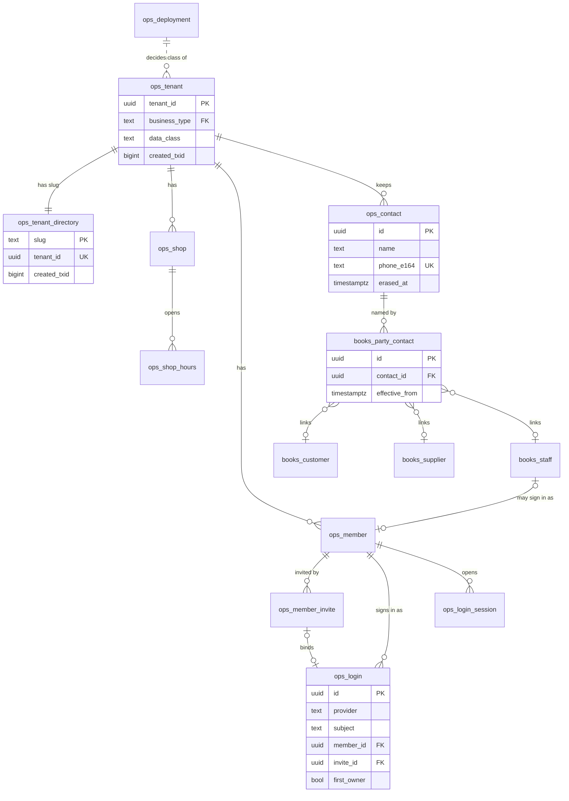

**The books: catalogue, trade, money**

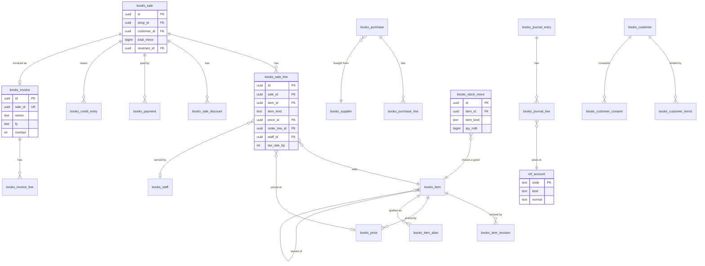

**The books: offers, loyalty, packages**

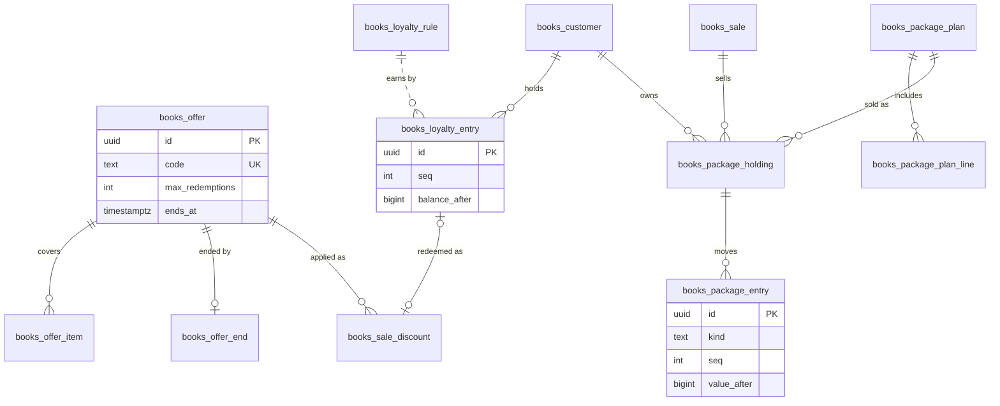

**Staff, calendar and bookings**

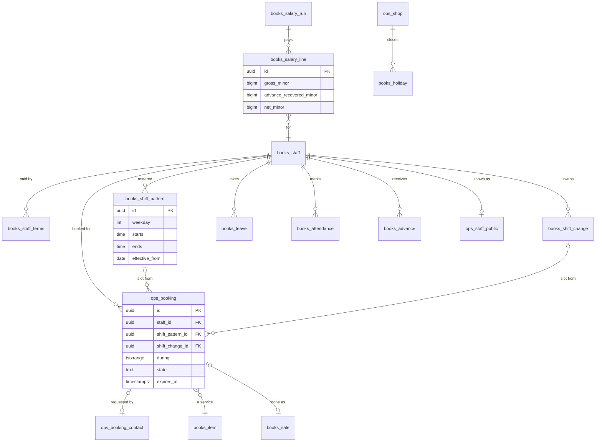

**Sites, public requests, messages**

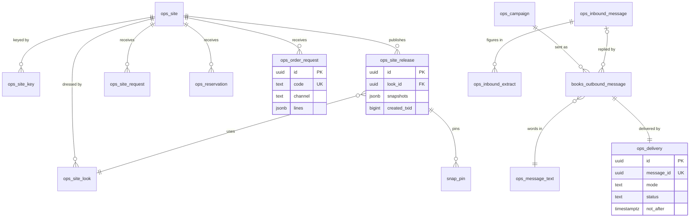

**Approvals, snapshots, audit, the AI back office**

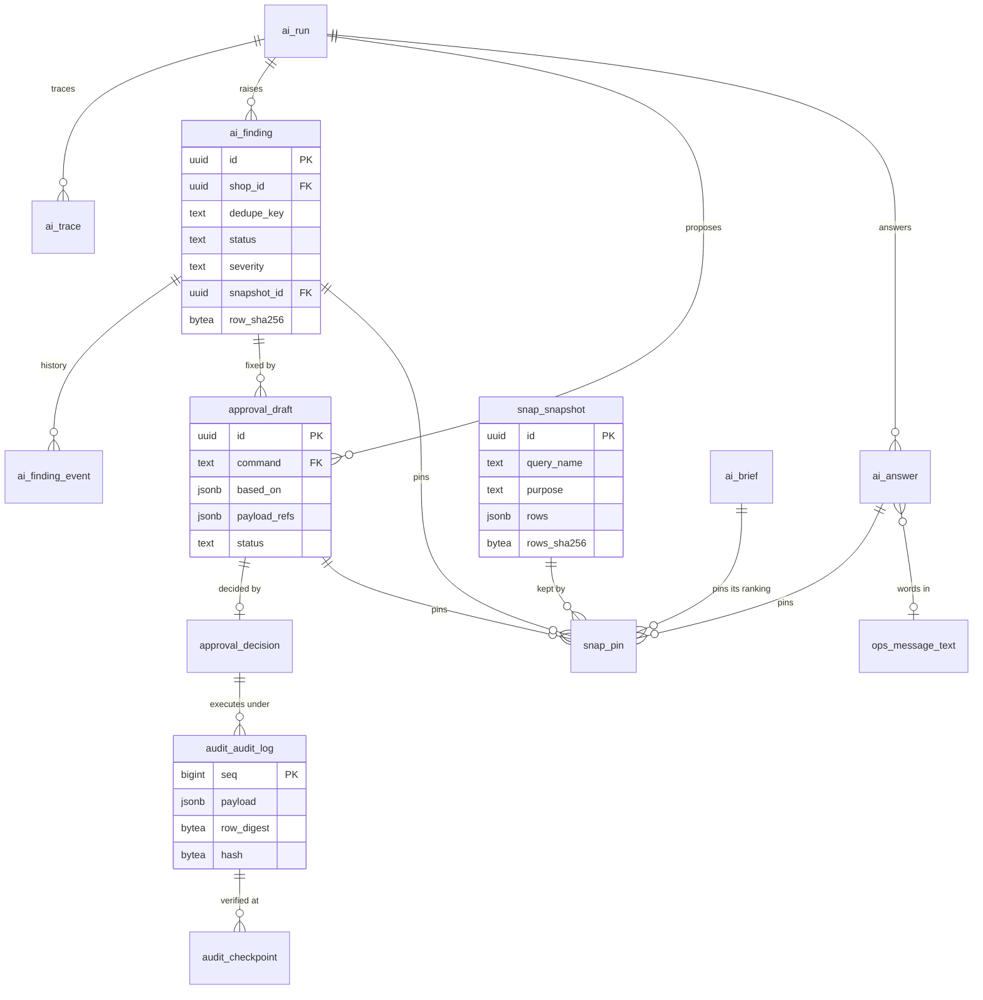

**Orders** (§2.10.16, decision 18)

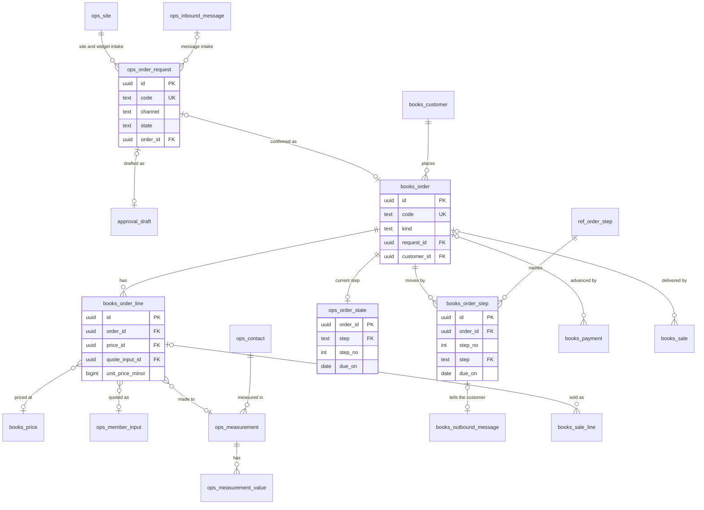

**Packs, capabilities and switches** (§2.5, §2.10.1, decision 17)

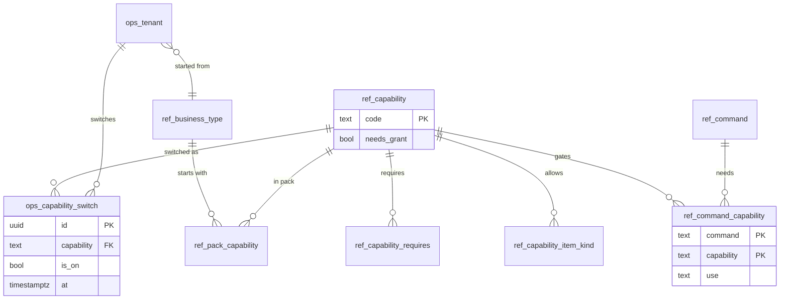

### 2.13 Error codes and gates

| Code | Meaning | Core maps to |
|---|---|---|
| `MS001` | book write refused (the guard) | `refused` |
| `MS002` | draft or decision refused | `refused` |
| `MS003` | verify for another tenant | `refused` |
| `MS004` | a journal entry does not balance | `unbalanced` |
| `MS005` | audit entry refused | `refused` |
| `MS006` | a child after its parent's transaction; a span or cell that does not hold | `refused` |
| `MS007` | who may do it: member, contact, invite, login, session, site, key, request, booking | `refused` |
| `MS009` | a balance would go below zero (loyalty, package, advance) | `invalid` |
| `MS010` | tenant class or deployment mismatch; an immutable row changed | `refused` |
| `MS011` | an erase-only or fill-once column changed other than allowed | `refused` |
| `MS012` | a finding change not allowed (a dismissed key raised again within 30 days) | `conflict` |
| `MS013` | a reversal that is not the exact opposite, or a second reversal | `invalid` |
| `MS015` | a booking outside the calendar (no shift, leave, holiday, closed, expired hold) or past a hold cap | `invalid` |
| `MS016` | a backdated sale for a GST-registered shop | `invalid` |
| `MS017` | a platform write without an approved platform change of this transaction | `refused` |
| `MS018` | a write shape not allowed for this role (`current_user`), or a hold token that does not match | `refused` |
| `MS019` | a capability switch or an order step not allowed: a requirement off, a dependant still on, a step `ref.order_flow` does not allow, `delivered` outside its sale | `invalid` |
| `23P01` | two bookings overlap (the exclusion) | `conflict` ("That time was just taken") |
| `23505`, `42501` | duplicate; no privilege or a row outside the tenant | `conflict`; `refused` |

(`MS008`, personal data in the books, is retired: no books column can hold a name or phone any more.)

**Gates kept and retargeted to `db/schema/`** (same meaning, new targets; §3 says how): G1 (the agent cannot write;
counts from the manifest), G2 (guard), G3 (command authority, totality), G4 (isolation over every tenant table, every
role), G5 (append-only), G6 (balance), G7 (chain), G8 (a failing run exits non-zero), G9 (functions: none executable by
PUBLIC; none SECURITY DEFINER; search_path pinned), G10 (indexes in `pg_index`; tenant_id leads every key and every
tenant-to-tenant FK), G11 (children only in the parent's transaction, now every child table), G12 (members), G13 (global
tables), T1–T3 (class, deployment, reset as owner), OE1 (erase and fill rules, every exploit path), F4–F7 (invites,
logins, sessions, the `via` rule), PII2/PII3 (no planted name or phone in cells, views, traces, audit, drafts, global
tables), E1 (erasure leaves nothing), K1–K5 (consent, double opt-in, whole-audience recheck), W1–W8 (webhook, outbox),
S1–S10 (API), D1–D2 (draft-only), L1–L2, P1–P4, O1–O2 (loyalty, packages, offers), GR1–GR4 (grid), C1–C7, H1–H3, A1,
B0–B4 (core, hero chain, agent, boundaries).

**New gates** (each red-proved, each with a positive expected count from an independent source):

| Gate | Holds | Red-proof |
|---|---|---|
| TRG1 | every books table has exactly its declared triggers, in `a_`, `b_`, `z_` order | add a stray trigger; rename `a_write` |
| J1 | the jobs role holds no INSERT on any books table and every attempt is refused | grant one |
| J2 | snapshot purge never deletes a pinned or recent snapshot; deletes an old unpinned display, watch or evidence one; a finding re-seen with the same cells keeps its snapshot and adds no pin; the jobs role deletes only a moved finding's old pin, never a draft, answer, brief, release or grid pin (R4 S1) | drop the pin clause; let the pin-release policy match any holder |
| PUB1 | the public role reads only release-pinned snapshots, published looks and documents, and the allowed columns | drop a restrictive policy |
| VB1 | `verify_books` finds a book row edited with triggers disabled (as the owner), a deleted row and a row with no entry | skip the digest compare |
| REV1 | a reversal must be the exact opposite, once; each `*.reverse` nets to zero everywhere; at commit each child of the original has exactly one reversing child, whose parent is the reversal header (`z_reversal_complete`, R4 K4) | allow a partial amount; reverse a header without its lines |
| IDEM1 | a replayed key returns the stored ids; a different body under the same key is 409 | skip the key insert |
| INV1 | 20 concurrent sales on one series get numbers 1..20 with no gap and no repeat; a rolled-back sale leaves no gap; the first credit note after tax invoice 1 is credit note 1 and is accepted (R4 M1) | drop the lock; drop `kind` from `invoice_no` |
| BK1 | overlapping holds or bookings for one stylist are refused (`23P01`); an expired hold frees its slot | drop the exclusion |
| BK2 | a booking outside the shift, on leave, on a holiday or after its hold expired is refused | drop the calendar check |
| SAL1 | a salary run's journal balances; recovered advances never exceed outstanding; a second live run whose period overlaps a staff member's live line, and overlapping live leave, are refused (R4 K3) | drop the recovery lock; drop `b_one_live_pay` |
| GST1 | golden invoices: a salon service at 5%; apparel at 5% up to ₹2,500 a piece and 18% above; a composition shop's bill of supply carries no tax; CGST + SGST = the line's tax; values from a hand-worked key | change a rate in the pack |
| SIGNUP1 | a directory row or a first-owner login is accepted only in the transaction that created the tenant | insert one a transaction later |
| SUPA1 | (deploy-check, hosted) `anon`, `authenticated`, `service_role` hold nothing on any Munshi schema; our schemas are not exposed by the Data API; the large-object residual is printed | grant `anon` USAGE in a scratch database |
| PG17 | the schema builds on PostgreSQL 17 (the harness's pinned major); no PostgreSQL 18-only function appears; every `id` column defaults to `ops.uuidv7()` | use the built-in `uuidv7()` |
| JR1 | the day report, the GST summary and the salary page equal the journal's sums, computed in the test from raw lines | report from `sale.total_minor` instead |
| SWEEP1 | each jobs purge removes exactly the planted due rows in every tenant (a positive count) and keeps every pinned or recent one (§4.4) | run a job without its per-tenant loop |
| VB1-TZ | (part of VB1) digests written under UTC verify under `Asia/Kolkata` (§2.7) | drop the functions' `TimeZone` setting |
| ROLE1 | every ops transition admitted only for its role: actor shapes only as `munshi_app`, no-actor shapes only as `munshi_jobs`, public shapes only as `munshi_public`; a public or jobs session that sets `munshi.actor_id` is refused (§2.3) | drop the `current_user` check from one trigger |
| CH1 | without a live `platform.channel_grant`, every delivery is `recorded`, even from a real session on a live deployment; a WhatsApp recipient not in the tenant's `ops.channel_recipient` list is recorded; a number routes to one tenant only; a self-serve shop's approved `campaign.post` posts nothing; no phone number in any `platform.*` row (a scan) | derive `pending` without the grant |
| CART1 | retired into ORD1: the cart is now a site order request (§8.5); ORD1 recomputes every one from its release's cells and its lines, and no request shows an offer discount | — |
| SLOT1 | every free slot, and every booking, recomputes from the roster row it names plus the bookings; a booking naming a roster row not in effect that day is refused | accept any shift row |
| HOLD1 | a second live hold from one device, a fourth from one IP hash, or a third on one stylist's day, is refused; an IP whose earlier hold on another stylist has lapsed can hold again; a hold converts or cancels only with its token, checked in the database; an expired hold frees its slot | check the token in core only; expire only the target stylist's holds |
| K6 | a customer re-linked to a new contact drops out of every audience and reminder until the new phone consents (§2.6) | key consent on the customer alone |
| PAY1 | `payment.record` cannot pay a staff member; a staff attendance mark after an owner's or manager's for that day is refused; staff mark only their own row | drop `b_payment_kind` |
| IDP1 | passwords: scrypt with a per-identity salt; a wrong password and an unknown email take the same path and time band; five failures lock the identity (15 minutes, doubling to a day); per-IP limits; no password or hash in any log, error, trace or other table (a scan); an identity not verified by its invite link cannot sign in | log the request body |
| RESET1 | an in-app reset is refused for an owner, for a peer or higher role, for an identity with a second membership, for an operator, and across shops; a used reset ends every session of the identity in every shop and the console; the idp side refuses a password change with no freshly used grant, or a second use | let a manager reset an owner; bump no epoch |
| LOCK1 | five failures from one IP lock only that (identity, IP) pair: the owner signs in from another IP at once; three failures across IPs require the bot check; a locked or unknown email still runs scrypt (timing band asserted) | lock the identity everywhere; skip scrypt when locked |
| AUTH3 | an invite opened for an email that already has an account and one that does not give byte-identical pages and the same answers for right and wrong passwords | answer differently |
| TOTP1 | an operator signs in only with a valid, unused TOTP code; a channel grant or operator change is approved only with a code verified in the last 5 minutes; a replayed code is refused | accept a code twice |
| ROUTE1 | a number routes to one shop; a second shop listing it is refused; no route survives its recipient's erasure; the route key is not the identity key | share the keys |
| RET1 | every no-actor purge is refused one day short of its rule and accepted one day past, including a contact's year since last activity computed from the books (§2.6) | drop one age clause |
| PLAT1 | no platform table accepts a write without an approved change decided in this transaction, in a later transaction than its proposal; every change is in the platform chain, which verifies | insert a `shop_config` row directly |
| VERIFY1 | every public route of a shop without `site_verified` answers 404, byte-identical to an unknown slug; verification makes them answer | serve unverified sites |
| SLUG1 | a self-serve slug equal to a reserved one, or whose skeleton matches a reserved or existing slug (`e1ite`, `prabhav-e`), is refused | drop the skeleton check |
| BUCKET1 | a document whose `storage_key` names another tenant's bucket is refused | drop the prefix check |
| INV2 | credit notes number in their own series; `issued_at` and the financial year come from `clock_timestamp()` after the series lock, so a higher number never has an earlier time (R4 W4); a backdated sale for a registered shop is refused (`MS016`) | take `issued_at` from the caller; take it from `now()` |
| BOOT1 | a **hosted** live deployment refuses to boot unless `ops.schema_version.source = migrations`, and `db:build` refuses a hosted live database; the single exception is the laptop's live-shaped database (`hosted = false`, at `.run/pg-live`, public URL `localhost`), which is built from the schema so real sign-in, People and the live fence can be run and screenshotted before the freeze; `--live-local` refuses any database that is not the local cluster in `.run/pg-live` | allow `schema` on a hosted live database; boot a `hosted = false` row on a public URL or on Vercel; point `--live-local` at another server |
| TOT1 | a sale whose total differs from its lines' gross less its discounts, a purchase whose total differs from its lines' cost, and an invoice line whose tax, total or quantity differs from its sale line's, are each refused at commit (`MS004`, R4 N1, N2) | drop `z_sale_total`; drop the line check from `z_invoice_total` |
| LIVE1 | two concurrent `purchase.record` calls for one supplier's bill, and two settlements for one channel and day, record one row and refuse the other (R4 K2) | drop the lock in `b_one_live` |
| CAP1 | every command in `ref.command` has a `ref.command_capability` row, and each row names a known command and capability | delete one row |
| CAP2 | with a capability off, each of its `start` commands refuses (`capability_off`) and each `finish` command runs, every `*.reverse` included | drop the check in `runCommand` |
| CAP3 | the desk, watcher, screen and route registries cover every capability, and none names a business type | add a type literal |
| CAP4 | a switch-on with a requirement off, and a switch-off while a dependant is on, are refused (`MS019`); only an active owner switches; a row with no actor is admitted only in the tenant's creation transaction | drop the dependency check |
| ORD1 | every order line's unit price equals its cited `books.price` row or member input, and every line amount and total recomputes from stored ids with the counter's function; every site request recomputes from its release's cells and its lines and equals what the API returned, with no offer discount (CART1 carried over) | change the line function in one place |
| ORD2 | steps follow `ref.order_flow` (`MS019`); two concurrent taps produce one step and one refusal; `ops.order_state` equals every order's latest step and refuses a direct write | drop the unique `(order_id, step_no)`; drop `order_state_guard` |
| ORD3 | a sale naming an order has the order's lines and writes `delivered` in its transaction; `delivered` anywhere else is refused | let `sale.record` skip the line match |
| ORD4 | an AI-drafted order's quantities are spans the database re-parses; a free digit in the draft is refused | accept a quantity without a span |
| ORD5 | the public and webhook roles cannot write `books.order*`; a request never becomes an order without a person | grant INSERT to the public role |
| M1 | erasing a contact erases its measurements and their values, and order lines keep the id; the erasure is held while the contact's customer has an open order or an unapplied advance | skip the measurement erase; drop the order clause from the hold |
| RC1 | every cache key starts with a tenant id (the branded type and a source scan) | build one key without the tenant |
| RC2 | a public response built from the cached release plus the live overlays (held flags, offers in effect, slots) equals one built fresh for the same release, refs included | cache a whole response, overlays included |
| RC3 | a request for tenant B never reads a key planted for tenant A | drop the tenant prefix |
| RC4 | with Redis stopped, every page and API route still answers | let a cache error throw |

## 3 · No migrations while building

> Until the freeze, the database is rebuilt from ordered SQL files under `db/schema/` plus a populate script; every gate
> and red-proof runs on that build. It freezes into one baseline migration before any real shop's data lives in a database.

### 3.1 The files

Each file is one concern, applied in name order, each in one transaction, and each sits beside a hand-written manifest
fragment `NN_name.manifest.json` (its tables, global tables, books tables with their expected triggers, views,
functions). The runner merges the fragments; the gates count against the merged manifest, an independent source that is
not read from the catalog. No two lanes share a file (the build-waves index, §10).

| File | Concern | Runs as |
|---|---|---|
| `00_bootstrap.sql` | the eight roles (idempotent `do` blocks), `grant create on database … to munshi_owner`, the admin's SET on the owner role, schema `extensions` + `btree_gist`, the PUBLIC revokes (§2.2) | the admin, once per database (`pnpm db:bootstrap`) |
| `01_ref.sql` | the ten schemas (`authorization munshi_owner`), the `ref` tables, the chart of accounts (with `customer_advance`), reason codes and their uses (`ref.reason_use`, R4 N9), business types, and the capability tables (`ref.capability`, `ref.capability_requires`, `ref.pack_capability`, `ref.command_capability`, `ref.capability_item_kind`) with their seeds (R4 C1) | migrator → `set local role munshi_owner` (every file from here) |
| `02_shared.sql` | `ops.uuidv7()` (plpgsql: PostgreSQL 17 has no built-in `uuidv7()`, FACT: it arrives in 18), `ops.only_erase`, `ops.fill_once`, `books.write`, `books.audit_row`, `books.check_balanced`, `audit.chain`, `snap.snap_check`, the pin and event guards. **Only plpgsql functions with no row-type parameter:** a `language sql` function, or one with a row-type parameter, is created in its table's file (R4 B1) | |
| `03_tenancy.sql` | deployment, schema version, tenant and its `tenant_guard` (R4 N12), directory, shop, hours, member, invite, login, session, subject summary, reset grant, the capability switch (`ops.capability_switch`, R4 C1) | |
| `04_ops_infra.sql` | contact, document, idempotency, job claim, rate counter, member input | |
| `05_runs.sql` | `ai.run`, `ai.trace`, then `ops.message_text` (its `run_id` names `ai.run`; it serves answers, replies and campaign copy, so `07` and `19` both find it, R4 B1) | |
| `06_snap.sql` | `snap.snapshot`, `snap.pin`, the purge and pin-release policies (R4 S1), the reuse index (R4 I7) | |
| `07_ai.sql` | findings and events, answers, brief, usage (R4 I10: no `policy`); `ai.answer.inbound_message_id`'s key is added by `19` | |
| `08_approval_audit.sql` | draft, decision, audit log, checkpoint; `audit.entry_hash`, `audit.verify_chain`, `audit.verify_books` (they take the audit table's row type or read it, so they come after it, R4 B1) | |
| `09_idp_platform.sql` | `idp.identity`, `idp.attempt`, `idp.reset_use`; the `platform` tables, the platform guard and chain; seeds `elite` and `prabhave` as reserved | |
| `10_catalogue.sql` | item, revision, alias, price, and their commands' `ref` rows | |
| `11_parties.sql` | customer, terms, supplier, staff, staff terms, party contact, consent | |
| `12_staff_records.sql` | shift pattern and change, leave, holiday, attendance, advance, salary run and lines | |
| `13_evidence.sql` | shelf count, bill read and lines | |
| `14_sites_public.sql` | site, key, look, release, staff public, request, booking and its contact, reservation (the cart is gone: the site channel of `ops.order_request` in `21` replaces it) | |
| `15_trade_journal.sql` | sale, lines, purchase, lines, stock move, payment, credit, settlement, journal; the `order_id` and `order_line_id` columns are declared here and their keys are added by `21` | |
| `16_offers_loyalty.sql` | offer, items, end, sale discount, loyalty rule and entries | |
| `17_packages.sql` | plan, lines, holding, entries | |
| `18_gst.sql` | tax registration, invoice, lines | |
| `19_messaging.sql` | outbound message, campaign, delivery, inbound, extract, channel recipients, phone routes (the message text moved to `05`); adds `ai.answer`'s key to `ops.inbound_message` (R4 B1); `outbound_message.order_id`'s key is added by `21` | |
| `20_grid.sql` | grid batch and changes | |
| `21_orders.sql` | order request, order, lines, steps, `ops.order_state` and its `z_order_state` trigger, measurement and its values, `ref.order_step`, `ref.order_flow`, `ref.measure_point` and their seeds; then the keys from earlier files by `alter table` (`books.sale.order_id`, `books.sale_line.order_line_id`, `books.payment.order_id`, `books.outbound_message.order_id`) and the request's own `order_id` key (decision 18, R4 O1) | |
| `30_agent_views.sql` | the agent's views | |
| `90_seal.sql` | asserts the build: every manifest table exists with RLS enabled and forced; every books table has its `ref.book_table` row; every command in `ref.command` writes a table and has a `ref.command_capability` row (CAP1); raises otherwise | |

Each books file inserts its own `ref.command`, `ref.command_authority`, `ref.command_table`, `ref.command_capability`
and `ref.book_table` rows, so the foundation file never changes when a feature lands.

**No reference cycle across files; the file order keeps the keys acyclic** (R4 K14). A key points into its own file or an earlier
one, in either direction between books and ops: a sale names its booking and reservation, and a booking names its
stylist, service and customer, a reservation its item, a campaign its offer and a public profile its staff row, each in
an earlier file. **A key to a later file's table is never declared at `create table`** (R4 B1): the column is declared
in its own file, and the later file adds the foreign key by `alter table`, for example:
```sql
alter table ai.answer add constraint answer_inbound
  foreign key (tenant_id, inbound_message_id) references ops.inbound_message (tenant_id, id);
```
Before writing each file, the migrator lists its columns that name a later table. Known cases:
`ai.answer.inbound_message_id` (07 → 19) and every `order_id` and `order_line_id` (15, 19 → 21). The one two-way pair
is inside `21`: `ops.order_request.order_id` and `books.order.request_id` name each other, so the request is created
first and its key is added once `books.order` exists.

### 3.2 The scripts

| Command | Does | Refuses |
|---|---|---|
| `pnpm db:bootstrap` | `00_bootstrap.sql` as the admin (`ADMIN_DATABASE_URL`) | — |
| `pnpm db:build` | drops the ten Munshi schemas (as the owner role), applies `01`–`90`, writes `ops.schema_version` (the sha256 of the files) and the `ops.deployment` row | a hosted database whose `ops.deployment` says `live` (live is built once, then only migrated after the freeze); `--live-local` builds the laptop's live-shaped database at `.run/pg-live` only (`hosted = false`) |
| `pnpm db:populate` | provisions the three tenants through core's real paths (§3.3) | any tenant that is not synthetic or showcase; a live deployment |
| `pnpm db:reset` | build + populate on the local database (`.run/pg`), in about the time `pnpm reseed` takes today | any database that is not the local one or an embedded test database |
| `pnpm db:reset-demo` | the same against the hosted demo (from the deploy wave), by the operator from a laptop, as the migrator; `--sandboxes` (on a schedule) instead deletes each sandbox older than 7 days, one per transaction, through the guards' sandbox branch (§2.4, R4 K5) | a live deployment, any live tenant (T3, run as `munshi_owner`); `--sandboxes` refuses a non-sandbox tenant |
| `pnpm platform:operator` | seeds the first superadmin (an identity, a `platform.operator` row and its TOTP secret, shown once as a QR code) as the owner role; no route does this | an existing operator; a subject with a shop membership |
| `pnpm identity:reset --subject …` | the only reset path for an owner, a multi-shop identity or an operator: the operator runs it after checking the person out of band; it prints a one-time link, bumps the epoch and is chained in the platform log | — |
| `pnpm dev` | starts the local Postgres (pinned to 17), runs `db:reset` if the schema sha changed, then the app with env from `.run/dev.env`, plus a local ticker that calls the tick route every 5 minutes (dev only) | — |

Nothing above needs Supabase until the deploy wave: every URL is the local PostgreSQL's, and `db:bootstrap` runs as the
local superadmin. At the deploy wave the same scripts take the Supabase URLs (§2.2) and nothing else changes.

### 3.3 The populate script and the three tenants

`db/seed/populate.ts` creates each tenant the way a real owner would (the self-serve path: tenant, directory row and
first owner in one transaction, §6.3), then writes everything else through core's commands as that tenant's members.
Ids are derived from the slug and a fixed namespace, so a rebuild keeps them and the recorded fixtures stay valid.

| Tenant (slug) | Class | Type | Holds |
|---|---|---|---|
| Sharma General Store (`sharma-kirana`) | synthetic | kirana | today's seed: the catalogue, a month of sales, purchases from simulated suppliers, credit, settlements; the five planted situations and near-miss controls with the hand-worked answer key (`db/seed/kirana.answers.json`); its people now through the vault |
| Elite Unisex Salon & Academy (`elite`) | showcase | salon | two shops (Kirti Nagar, Kalkaji), the service menu with durations, packages, stylists with weekly rosters and one-day changes, holidays, bookings across both branches, invented customers, package holders, staff attendance and one salary month; a planted package expiry, an idle stylist and a lapsing regular |
| Prabhave (`prabhave`), the suit shop in Kirti Nagar | showcase | apparel | suits as parents with size and colour variants, stock, a Diwali offer with a code, two pieces on hold, a site order request (the old WhatsApp cart), invented customers and udhaar; a planted dead-stock line and an expiring hold. The apparel pack has no `credit`, so the populate script switches it on as the owner (§8.13) |

The showcase catalogues come from `db/seed/merchants/<slug>/` (the wip branch has both catalogues as JSON); real
catalogue values replace them when the merchants send theirs. A test checks every planted situation against its key.

### 3.4 How the gates and the red-proof harness retarget

- **The harness** builds one template database per test run from `db/schema/` (bootstrap as the embedded superuser,
  files `01`–`90` as `munshi_migrator`), then clones it per test file (`CREATE DATABASE … TEMPLATE`, copying the ACL as
  today). Building as the migrator in every run replaces the separate MS-13 migrator test: if any file needs a superuser,
  every suite fails.
- **embedded-postgres is pinned to major 17** to match Supabase (UNVERIFIED major; checked first in BP-OPS-2). Gate PG17
  fails on a PostgreSQL 18-only function.
- **Gate counts** come from the merged manifest. G1, G4, G9, G10 and G13 iterate it; their expected numbers rise by
  exactly the new entries.
- **Sabotage entries** (`db/test/sabotage.ts`) stay keyed by gate. Entries that name a renamed object are rewritten:
  `guard` → `a_write`, `guard_audit` → `z_audit`, `ops.run`/`ops.run_trace`/`ops.finding` → `ai.*`,
  `snap.snapshot_cell` → `snap.snapshot.rows`, `books.pii` → removed (its gate PII1 becomes "no books column can hold a
  name or phone", checked against the catalog). A sabotage that does not apply is still an ERROR, never a red (kept).
  The file is split per area (R3 #12: 1,535 lines) so lanes own their entries.
- **The kirana's recorded model turns** are keyed by the sha256 of the request, which carries handles and data blocks,
  never ids or the storage format, so most survive; any that change are re-recorded by the ticket that changed them.

### 3.5 The freeze (D-043)

The rebuild ends **before any real shop's data lives in a database**, which D-045 places **after 5 Nov**: no real shop
goes live before judging, so the demo keeps rebuilding through the submission, and the freeze is the first step of the
live track after judging. The feature freeze on Tue 3 Nov night stops features, not the rebuild.
1. `pnpm db:freeze` writes `db/migrations/0000_bootstrap.sql` (the admin file) and `0001_baseline.sql` (files `01`–`90`
   concatenated, unchanged), records each file's sha256 in `db/migrations/manifest.json`, and deletes `db/schema/`.
2. The runner returns to append-only mode: an applied migration that changes is refused; changes are new numbered files.
   CLAUDE.md's "append-only" rule returns with it.
3. **Gate FREEZE1** builds one database from the migrations and one from the last `db/schema` commit and compares a
   normalised catalog dump (tables, columns, constraints, indexes, triggers, functions, policies, grants). Any difference
   fails. Red-proof: edit one schema file after the freeze.
4. The demo keeps its rebuild (`db:reset-demo` drops and re-applies the migrations, then populates) until after 5 Nov;
   the live database is created once from the baseline and only ever migrated.

## 4 · Core and the hosting layer

> Everything a hosted deploy needs that a laptop hid: config from the environment only, screen reads in core, one
> transaction per page, one background-jobs runner with four triggers, logs, headers, health, AI caps, photo limits and
> the cache.

### 4.1 Screen reads live in core

Every screen's data comes from `packages/core/src/views-<area>.ts` (`viewHome`, `viewCounter`, `viewCalendar`…). A view
takes the session and its params and returns figures as cells with refs, names from `people.ts` (masked by role,
§6.7) and fixed labels. `apps/web/lib/server/*` calls views and commands only. **Gate SQL1** scans `apps/` for SQL
(`select … from`, `insert into`, `update … set`, a schema-qualified Munshi table name) and for any import of `pg`; any
hit fails (red-proof: plant a query in a server file). This moves the ~50 raw SQL references R2 #4 counted, and the
three VIEW maps that disagreed become one.

### 4.2 One transaction per page

`withPage(pool, session, fn)` opens one transaction, sets the context once, and runs every read the page needs, each in
a read-only savepoint, with snapshot inserts or reuse in the same transaction (R1 #11: 8–12 transactions per page
today). Pools are small (app 3, idle timeout 10 s) because Vercel runs many instances. The `set_config` call stays its
own round trip: with the function and the database both in Mumbai a round trip is about a millisecond (INFERENCE), so
folding it into the first statement (R1's option) is not worth the complexity.

### 4.3 Config from the environment only

`packages/config` holds one zod schema per process (`web`, `jobs`, `dev`) and is the only reader of `process.env`
(R2: ten files read it today). The app reads **no file under `.run/` at runtime**: `pnpm dev` generates the dev secrets
into `.run/dev.env` and starts the app with them as environment variables (R2 #1, the deploy blocker). Fixtures are found
relative to the agent package (`import.meta.url`), never through `repoRoot()`. At boot the app refuses to serve unless:
every required name is set; `MUNSHI_DEPLOYMENT` equals `ops.deployment`; the schema sha compiled into the build equals
`ops.schema_version`; each pool connects as its own role with no superuser, no BYPASSRLS and no membership of the owner
(as `db.ts` checks today, now for all six pools); a demo deployment names no channel credential; and **a live deployment
was built from migrations** (`ops.schema_version.source = 'migrations'`, gate BOOT1).

**Environment names this design needs** (proposed; the founder adds them to `.env.example`, no lane edits it).
*Now:* `MUNSHI_DEPLOYMENT`, `MUNSHI_PUBLIC_URL`, `MUNSHI_SESSION_SECRET`, `MUNSHI_IDENTITY_SECRET` (the key of the email
HMAC), `MUNSHI_PHONE_ROUTE_SECRET` (the key of the phone routes, a separate secret, §2.10.2), `MUNSHI_PLATFORM_SECRET`
(encrypts operators' TOTP secrets), `MUNSHI_RATE_SECRET`, `MUNSHI_AI`, `MUNSHI_SEND_MODE`, `PUBLIC_DATABASE_URL`, `JOBS_DATABASE_URL`,
`IDP_DATABASE_URL`, `PLATFORM_DATABASE_URL` (beside the existing `DATABASE_URL`, `AGENT_DATABASE_URL`,
`MIGRATOR_DATABASE_URL`, `ADMIN_DATABASE_URL`); locally `pnpm dev` generates every secret into `.run/dev.env`.
*From the deploy wave:* `CRON_SECRET`, `TURNSTILE_SECRET_KEY`, `NEXT_PUBLIC_TURNSTILE_SITE_KEY`, `SUPABASE_URL`,
`SUPABASE_SECRET_KEY`. **The secret key's real scope** (review B4): it bypasses Storage's policies **and** opens
Supabase's Auth admin API (create users, issue sign-in links), so it is as sensitive as the session secret; only the
blob adapter (and, after the move, the identity adapter) reads it; a gate scans every client bundle for it.
*After 5 Nov, live only:* `SUPABASE_PUBLISHABLE_KEY` (Auth, browser-safe), `WHATSAPP_ACCESS_TOKEN`,
`WHATSAPP_PHONE_NUMBER_ID`, `WHATSAPP_APP_SECRET`, `WHATSAPP_VERIFY_TOKEN`, `INSTAGRAM_ACCESS_TOKEN` (keyed by the
grants' `account_ref`). **No deploy-wide test-phone list:** a shop reaches only the recipients its owner listed under an
operator's grant, in the database, keyed by tenant id (review B1). Each site project: `MUNSHI_API_BASE`.

### 4.4 The background-jobs runner

One function, `runDueJobs(pools, now, only?)` in `packages/core/src/jobs.ts`, runs as `munshi_jobs`. It has no actor,
imports no command runner (a source gate, as R2 asked), and writes no book row (it has no grant to).

| Job | Slot (runs once per) | Does |
|---|---|---|
| `outbox` | every trigger, per shop | claims queued deliveries and sends each once (§8.6) |
| `holds` | every trigger | expires slot holds past `expires_at` and reservations past `held_until` |
| `watch` | 15 minutes per shop, only if the shop's audit seq moved since the last run | the watchers of the shop's switched-on capabilities (§7.3); raises, re-sees and resolves findings (§7.4) |
| `brief` | a day per shop, from 07:00 shop time | ranks the shop's open findings into its own `ai.brief` (R4 N4); narrates high and critical ones if AI is on and under its cap |
| `retention` | a day per shop | the D-038 purges (§2.6), held erasures that can now complete, traces older than 90 days (R4 G1) |
| `snapshots` | a day | deletes unpinned display, watch and evidence snapshots older than 7 days, and first releases each finding's pin on a snapshot that finding no longer names (R4 S1) |
| `sweep` | an hour | old idempotency rows, rate-counter windows, expired invites, storage objects of erased documents, finished job claims older than 7 days (R4 K6), sessions 30 days past expiry (R4 G4) |
| `checkpoint` | a day per shop | verifies the chain from the last checkpoint and writes the next; runs `verify_books` in chunks by table and id range, never inside a page, and records the problem count in the checkpoint (R4 W6) |

Each job first claims `ops.job_claim (job, slot)` with `insert … on conflict do nothing`, so however many triggers fire,
a slot's work runs once (Munim's tick-claim lesson). **A claim has a lease** (R4 K6): a run that died leaves its slot
unfinished, so a later trigger may take it over once the claim is 5 minutes old:
```sql
update ops.job_claim set claimed_at = now()
  where job = $1 and slot = $2 and finished_at is null and claimed_at < now() - interval '5 minutes';
```
A run stops taking new work after 20 s and leaves the rest for the next trigger. **Every job that touches tenant tables iterates the directory and works one tenant at a time under that
tenant's `SET LOCAL` context**: forced RLS would otherwise make a purge silently delete nothing (the B7 lesson). Gate
SWEEP1 plants old rows of each kind (display, watch and evidence snapshots, released finding pins, traces, idempotency
keys, rate windows, finished and lapsed job claims, expired sessions, expired holds, retention-due requests) in two
tenants and asserts the exact count each job removes, a positive number, and that a pinned or recent row
survives (red-proof: run a job without the tenant loop).

**The triggers, by phase** (D-045: no GitHub repository, so no CI run and no scheduled tick, until the founder creates it):

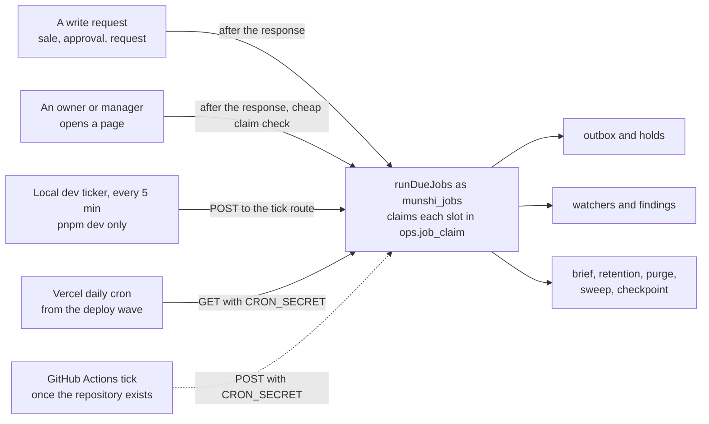

- **Now:** after every write and on owner and manager page loads (Next's `after()`, which runs after the response inside
  the function's time limit), plus a dev-only ticker in `pnpm dev`. A finding then waits for the next owner page load at
  worst; the daily brief is written on the first owner page load after 07:00.
- **From the deploy wave:** the Vercel daily cron as a last resort (Hobby crons run at most once a day, fired somewhere
  in the scheduled hour; FACT, https://vercel.com/docs/cron-jobs/usage-and-pricing, via search, page dated Jan 2026).
- **Once the repository exists:** a scheduled workflow calls the tick route every 30 minutes while the repository is
  private (free minutes UNVERIFIED) and every 15 once public. The tick route (`/api/internal/tick`) is built now and
  simply has no scheduled caller yet.

### 4.5 Logs, request ids, headers, health

- **Structured logs:** one module, `log(event, fields)`, writes one JSON line: time, level, a fixed event label, the
  request id, route, tenant id, duration, a `CoreError` code. Never a body, a name, a phone, a key, a token or model
  text. A source scan fails on any `console.` outside it (the three empty `catch {}` blocks R2 found become logged codes).
- **Request ids:** middleware takes Vercel's request id (or makes one), sets `x-request-id` on the response, and core
  reads it from async context for logs and for the API error body.
- **Security headers:** a nonce-based Content-Security-Policy on every page (`default-src 'self'`, scripts by nonce,
  images from self, `data:`, `blob:` and the Storage host, Turnstile's host on the sites' forms, `frame-ancestors
  'none'`); `Strict-Transport-Security`; `X-Content-Type-Options: nosniff`; `Referrer-Policy:
  strict-origin-when-cross-origin`; `Permissions-Policy: camera=(self), microphone=(self), geolocation=()`. API and
  media responses carry `Content-Security-Policy: default-src 'none'` (an SVG served there cannot run a script).
- **`GET /api/health`:** `{ok, deployment, schema (sha prefix), source (schema or migrations), region, modelMode,
  sendMode, ai}`. No counts, no secrets. The capture guard and the deploy check read it.

### 4.6 AI off switch and caps (the superadmin's, D-045)

- `MUNSHI_AI=off` turns every model call off for the deployment. Per shop, AI is on only where the superadmin's
  `platform.shop_config` says so; **no row means off**, which is how every new self-serve shop starts. The demo's sample
  shops (synthetic and showcase, including sandboxes) take `platform.default_config`: AI on with a cap.
- Caps are database config set by approved platform changes, separately for text roles (`ai_daily_calls`: router,
  reason, narrate) and media roles (`media_daily_calls`: vision, segment, voice), plus **one daily media ceiling shared by
  all sandboxes** (`sandbox_media_daily_calls_total`), because a sandbox's catalogue import by photo calls the vision
  model and the demo is public and passwordless (the money note). Proposed starting values, for the superadmin to set:
  the demo's sample shops 60 text and 20 media calls a day, sandboxes 200 media calls a day in all.
- Core's `allow(tenant, role)` is an atomic increment of `ai.usage` that refuses at the shop's cap (and the shared
  sandbox ceiling). The agent calls it through its port before every model call, so the count is kept by core, not the
  agent. The console shows each shop's usage against its caps.
- Off or over the cap, every AI surface degrades to template text or hides (Ask hides its box; findings show their
  template line; drafts from recipes still work, since recipes use no model). Nothing shows an error. The demo's Ask
  also has a per-IP limit in `ops.rate_counter`.

### 4.7 Photos, voice and deadlines

- **Photos are downscaled in the browser** before upload: longest side ≤ 1600 px, JPEG at about 0.8 quality, re-encoded
  through a canvas (which drops EXIF). The server refuses a body over 4 MB: Vercel's limit for a function's request body
  is 4.5 MB (FACT, https://vercel.com/docs/functions/limitations, read 28 Oct; R2 #6 had it UNVERIFIED).
- **Voice** stays 16 kHz mono WAV, at most 60 seconds (about 1.9 MB). An inbound WhatsApp voice note goes to Storage and
  is transcribed only on a person's tap.
- **Whole-flow deadlines:** a shelf count 55 s, a bill read 45 s, an Ask 45 s (the existing budget), each passed down as
  an abort signal; each route sets `maxDuration = 60` (Hobby allows up to 300 s, FACT, same page). A flow past its
  deadline abstains or says "Try again", never hangs.

### 4.8 The cache (W4, decision 19)

Redis holds only what is immutable or pinned, so a cached figure still traces to a stored cell (R4 R1). No table is
needed.

| Item | Design |
|---|---|
| Port | `packages/adapters/cache`, with two adapters: `memory` (tests) and `redis`. Locally, `redis-server` (installed, FACT) on a Unix socket under `.run/`. Deployed, a hosted Redis chosen in the deploy wave (Upstash on Vercel is the likely one; its free tier and Mumbai region are UNVERIFIED) |
| Keys | built only by core's `cacheKey(tenantId, kind, …)`, from the verified context (the session's tenant or the slug's tenant), never from request input: `munshi:<deployment>:t:<tenant_id>:<kind>:<id>`. The first argument has the branded `TenantId` type, and a source scan refuses any Redis call outside the adapter. RLS does not protect Redis, so a key without the tenant would leak across shops |
| Cached | (1) a release's pinned `site.*` snapshots, by release id; (2) a pinned snapshot, by its id; (3) the slug → tenant, latest release id and `site_verified` lookup, with a short TTL, dropped on publish and on verify. **Negative entries are cached the same way**, so an unverified shop and an unknown slug still answer the same byte-identical 404 (VERIFY1) |
| Computed per request, over the cached release | the live overlays: `held` flags, offers in effect, slots. Never cached |
| Stays in Postgres | idempotency (it commits in the command's own transaction, so a replay cannot write a second sale); `allow()` (an atomic increment of `ai.usage`); sessions (a reset or a deactivation ends them at once); hold caps (the database enforces them); every balance, stock or day figure; rate counters (`ops.rate_counter`, unchanged) |
| Never in the cache | a screen read's result (reuse is safe only because the read just returned the same rows, and a cached result skips that check); a name or a phone number (E1 scans the database, not Redis, so a cached name would outlive its erasure) |
| A purged snapshot | only pinned snapshots are cached, and a pin is released only for a finding that moved (§2.8), which no release names; a ref that no longer resolves still renders "Cannot verify" |
| Failure | Redis down or slow (a 50 ms budget): the read goes to Postgres, with no error shown (non-negotiable 11's spirit) |
| Gates | RC1–RC4 (§2.13) |

## 5 · API v1, the SDK and the developer portal

> A small public API that serves only what a person published, takes requests only with a publishable key, and never
> executes anything; zod contracts generate the OpenAPI file the SDK types and the portal are built from.

### 5.1 Resources

All paths are under `/api/v1`. "Release" means the response is built from the latest `ops.site_release`'s cells, so
every figure is a book row a person published. A **Figure** is `{"minor": 249900, "currency": "INR", "ref":
"⟨snap:…·12·price⟩"}` for money or `{"value": 45, "ref": "…"}` for an integer. **Every `/sites/{slug}/…` route answers
404, byte-identical to an unknown slug, until the superadmin has verified that shop's site** (`platform.shop_config.
site_verified`, D-045, gate VERIFY1); the demo's showcase shops are verified by the populate script's approved change.

| Method and path | Auth | Returns or takes | Writes | Cache |
|---|---|---|---|---|
| `GET /sites/{slug}` | none | name, business type, the label from `data_class` ("Sample site" on demo), shops (id, name, area, hours), booking mode, intake, the notice and consent versions, the look (tokens, font pair, profile, art URLs), release id and time | nothing | `s-maxage=60`, `ETag` = release id |
| `GET /sites/{slug}/catalogue?category=&cursor=&limit=` | none | goods: parents with variants and attributes; each price a Figure; `held: true` on a variant with a live hold (no stock count is ever shown) | nothing | `s-maxage=60` |
| `GET /sites/{slug}/services` | none | services with duration and price Figures, and the branches that offer each | nothing | `s-maxage=60` |
| `GET /sites/{slug}/packages` | none | plans with their lines, sessions, validity and price Figures | nothing | `s-maxage=60` |
| `GET /sites/{slug}/offers` | none | published offers still in effect, with codes the owner chose to publish, as Figures | nothing | `s-maxage=60` |
| `GET /sites/{slug}/stylists?shop=` | none | the opted-in public profiles (display name, blurb, art) | nothing | `s-maxage=60` |
| `GET /sites/{slug}/slots?shop=&service=&date=&stylist=` | none | free start times per stylist for that day, each naming the roster row it comes from (`shiftRel`, `shiftId`), so the slot is recomputable (SLOT1) | nothing | `no-store` |
| `GET /sites/{slug}/media/{id}.jpg` and `.svg` | none | a `card` or `art` document a release names, streamed from Storage (Instagram's fetcher sends no key) | nothing | `max-age=3600` |
| `GET /sites/{slug}/refs/{snapshot}/{row}/{col}` | none | one published cell and the book table and row id it came from ("tap for source" on a shop site) | nothing | `s-maxage=60` |
| `POST /sites/{slug}/holds` | publishable key, Origin, Idempotency-Key, bot check | `{shopId, stylistId, serviceId, start, shiftRel, shiftId, botToken}` + header `X-Munshi-Device` (a random token the SDK keeps in the browser) → `201 {holdId, holdToken, expiresAt}` (10 minutes); `409 slot_taken`; `429 hold_limit` (one live hold per device, three per IP, two per stylist and day) | one `ops.booking` (held) | — |
| `DELETE /sites/{slug}/holds/{id}` | key, Origin, `X-Hold-Token` | releases the hold | the booking's state | — |
| `POST /sites/{slug}/bookings` | key, Origin, Idempotency-Key, bot check | `{holdId, holdToken, name, phone, note?, whatsappUpdates, noticeVersion, consentVersion, botToken, website}` → `202 {id, received}` | the booking (requested) and its `ops.booking_contact` | — |
| `POST /sites/{slug}/booking-requests` | key, Origin, Idempotency-Key, bot check | for shops in request mode: `{shopId, name, phone, serviceIds ≤3, preferredOn, timeWindow, note?, …}` → 202 | one `ops.site_request` | — |
| `POST /sites/{slug}/enquiries` | key, Origin, Idempotency-Key, bot check | `{name, phone, itemId?, message, …}` → 202 | one `ops.site_request` | — |
| `POST /sites/{slug}/reservations` | key, Origin, Idempotency-Key, bot check | hold a piece: `{itemId, name, phone, note?, …}` → 202 | one `ops.reservation` (requested) | — |
| `POST /sites/{slug}/orders` | key, Origin, Idempotency-Key | the site cart or a widget (it replaces `/carts`): `{lines: [{itemId, qtyMilli}] ≤20, offerCode?}` → `201 {code, lines (each price a Figure), total, message, waLink}`; the line totals and total are derived with the counter's arithmetic and **no offer discount** (a code travels as text, "to be checked at the shop") (§8.5); 404 while `orders` is off | one `ops.order_request` (`site` or `widget`, state `new`) | — |
| `GET /sites/{slug}/orders/{code}` | none (the code is a capability token) | the order's step labels so far and its current step; no personal data, no amount; a bad code answers 404, compared timing-safe, never logged (§8.12) | nothing | `no-store` |
| `GET /findings`, `GET /drafts`, `POST /drafts` | **secret key `msk_<slug>_…` (specified, not built for 5 Nov)** | server-to-server: read findings and drafts as ids, codes and Figures; propose a draft whose every number cites a ref; **never** decide or execute | `approval.draft` (proposed) | — |
| `POST /api/internal/tick` | `Authorization: Bearer <CRON_SECRET>` (timing-safe; anything else 404) | runs `runDueJobs` | jobs only | — |
| `GET, POST /api/webhooks/whatsapp` | Meta's verify token; `X-Hub-Signature-256` over the raw body before parsing (MERCHANTS-DESIGN §4.4, kept) | stores inbound messages and status events; live deploy only (404 on demo) | `ops.inbound_message`, delivery status | — |
| `GET /api/health` | none | §4.5 | nothing | `no-store` |

### 5.2 Auth modes

| Mode | Format | Grants | Rules |
|---|---|---|---|
| none | — | published reads by slug | the tenant comes from the slug in the path, never the payload; a slug that is unknown, or a sandbox, is 404 |
| publishable key | `mpk_<slug>_<43 base64url chars>` in `Authorization: Bearer` | the public writes above, for that slug's site | only its sha256 and a display prefix are stored; compared timing-safe under the slug's tenant; bad, revoked or wrong-origin → **404** with the same body and headers as an unknown route (Munim gotcha 16); never in a URL, never logged |
| secret developer key (deferred) | `msk_<slug>_<43 chars>`, shown once, scopes `read:catalogue`, `read:findings`, `read:drafts`, `propose:drafts` | server-to-server reads and proposals | never sent to a browser (a request with an `Origin` header and a secret key is refused); propose only, the draft waits for a person; per-key limits; revocable. Its table (`ops.developer_key`, hashed like `ops.site_key`) arrives as a migration after the freeze, when it is built |
| member session | the app's cookie | nothing under `/api/v1` | `/api/v1` never reads the session cookie (R2), so a logged-in browser cannot be made to act through it |

**Origins and CORS** (kept from MERCHANTS-DESIGN §5.4): a request with an `Origin` must match the site's allow-list; a
POST must carry one; a GET without one (a server render) is allowed; preflight answers permissively but the real request
is the one checked; credentials never allowed. The hosted shop app's own origin is always on its site's list.

### 5.3 Errors

One body for every error: `{"error": {"code": "<code>", "message": "<fixed text>", "fields": ["path", …],
"requestId": "<id>"}}`. Never a database message, a value, or model text (gate C2's pattern, extended to every route).

| Code | Status | When |
|---|---|---|
| `invalid` | 400 | the body fails its contract; unknown fields (strict schemas) |
| `idempotency_key_required` | 400 | a POST or DELETE without `Idempotency-Key` |
| `stale_notice` | 400 | `noticeVersion` or `consentVersion` differs from the site's current one (the SDK refetches) |
| `bot_check` | 400 | the Turnstile token fails, or was solved on another site's hostname |
| `unauthenticated` | 401 | only the webhook's bad signature |
| `not_found` | 404 | unknown route, slug, key, origin, hold token; a revoked key |
| `slot_taken` | 409 | another hold or booking overlaps (`23P01`) |
| `idempotency_mismatch` | 409 | the same key with a different body |
| `gone` | 410 | a retired route after its `Sunset` date |
| `payload_too_large` | 413 | a body over 4 KB |
| `unsupported_media_type` | 415 | anything but JSON |
| `rate_limited` | 429 | with `Retry-After` |
| `hold_limit` | 429 | a second live hold from one device, a fourth from one IP, or a third on one stylist's day |
| `intake_paused` | 503 | the owner paused the site's forms (GETs still work) |
| `internal` | 500 | anything else, logged by code and request id |

### 5.4 Idempotency, pagination, versioning

- **Idempotency:** every POST and DELETE carries `Idempotency-Key` (8–128 of `A–Z a–z 0–9 _ -`); the SDK makes one per
  form render. Stored in `ops.idempotency` under the scope `site:<site id>`, inside the write's transaction (§2.9). A
  replay returns the original status and body; a different body under the same key is 409.
- **Pagination:** cursor pages on every list: `?limit=` (default 50, at most 100) and `?cursor=` (opaque base64url of
  the sort key and id); responses are `{data: […], next: "<cursor>" | null}`. Nothing silently stops at 500 any more
  (R2 rank 2).
- **Versioning:** the major version is in the path. Within v1 only additive changes (new fields, new routes, new error
  codes); every response carries `Munshi-Api-Version: 1`; a retired route sends `Sunset` first, then 410; a breaking
  change is `/api/v2` and a new SDK major. Dated versions are deferred (two consumers; Munim deferred them too, G).

### 5.5 Look as data, and the hosted shop app

- A shop's look is an `ops.site_look` revision: theme tokens (the fixed token names of §9, with values), one font pair
  from the fixed palette, profile copy (tagline, story, sections, FAQ, the hours note), and drawn SVG art documents for
  named slots (hero, section dividers, icons). Publishing a release pins one look and the `site.*` snapshots together.
- `apps/sites` renders `/{slug}/{lang}/…` at request time from `GET /sites/{slug}` and the other reads (server render,
  revalidated every 60 s). Tokens become CSS variables on `<html>`; the font pair selects from the fonts the app bundles
  (every shop can use them; fonts are not business material); art is `` from the media route, so an SVG never
  enters the page as markup (Munim gotcha 15), and is checked at upload (an allow-list of elements and attributes; no
  script, no `foreignObject`, no external reference).
- The page structure is the Munim storefront family (D-040): a huge display wordmark, one line-art hero, branch cards
  with status chips, a menu with category chips, a marquee band, item cards, a story page; Elite adds stylists,
  before-and-after, reviews, map and hours, FAQ; Prabhave adds lookbook, new arrivals, size guide, visit us (D-041).
  Which sections a shop shows is profile data.
- **Gate BUNDLE1 flips** (ruling): after `next build`, the output (client and server chunks, static assets, source maps),
  which must be newer than every source, is scanned for every seeded tenant's slug, name, profile strings and art
  hashes, and the kirana's name. **Any hit fails**: the bundle holds no business at all. Red-proof: import a seed
  profile into a page. A second gate holds `apps/sites`'s import closure to `@munshi/sdk`, `@munshi/ui` and its own files.
- A test renders two shops from one build and asserts neither page carries the other's name, art or prices (D-041:
  "a page never carries another shop's material").

### 5.6 Contracts → OpenAPI → SDK

1. `packages/contracts/src/v1/<resource>.ts` defines every request, response and error with zod (registered with ids);
   the route table (method, path, auth mode, request, response) sits beside them.
2. `pnpm contracts` writes `packages/contracts/openapi.json` (zod's JSON Schema output plus the route table) and, from
   it, `packages/sdk/src/schema.gen.ts` (types only). Both are committed; a freshness test fails when either is older than
   its inputs or differs from a fresh generation (Munim gotcha 13).
3. Route handlers parse with the same zod schemas; a type test asserts the handlers' outputs equal the generated types
   both ways.
4. `packages/sdk` is hand-written `fetch` over those types: `createClient({baseUrl, key?})` with `site()`,
   `catalogue()`, `services()`, `packages()`, `offers()`, `stylists()`, `slots()`, `hold()`, `releaseHold()`, `book()`,
   `requestBooking()`, `enquire()`, `reserve()`, `order()`, `orderStatus()`, `ref()`, plus `formatMoney(figure, locale)` (integers only,
   Indian grouping) and `MunshiError {status, code, requestId}`. **No runtime dependencies** (gate: `dependencies` is
   empty). Shipped as a versioned tarball with its sha256 from `/developers/sdk` (not npm), as Munim did (G).

### 5.7 The developer portal (`/developers`)

| Page | Holds |
|---|---|
| Overview | what the API is for; the One Guarantee as it applies to developers ("every figure you get is a ledger row; nothing you send changes the books until the shop approves it") |
| Getting started | a key, install the SDK, the first call against the sandbox shop, a booking widget in 30 lines |
| Authentication and errors | the modes (§5.2), origins and CORS, the error table, rate limits, idempotency |
| Figures and refs | the Figure shape, refs, `GET …/refs/…`, "Prices from the shop's books · published <date>" |
| Guides | booking widget with live slots; catalogue page; order on WhatsApp; hold a piece; offers with codes |
| Reference | every route from `openapi.json`, searchable, with examples recorded from the demo's showcase shops |
| Sandbox | the demo deployment's showcase shops with a public sandbox key (sample values only are ever stored, §6.6) |
| SDK | downloads with sha256, the changelog |

The pages are built at build time from `openapi.json` and Markdown in `docs/kit/` (Munim's portal is the reference for
sections only, G).

### 5.8 Abuse protection (kept from MERCHANTS-DESIGN §9, adjusted)

Per IP 5 POSTs per 10 minutes and 120 GETs a minute; per key 300 POSTs and 20,000 GETs a day; per phone 3 open requests
or bookings per site; per shop 500 stored requests a day. **Holds** (reviews B7, N7): one live hold per device token,
three per IP hash and two per stylist and day, all held by the database (§2.10.8), a Turnstile token on every hold, and
the founder's 10-minute window kept (D-045: the form asks for a name, a phone and consent, which a 3-minute window would
rush). *Why three per IP and a device token:* Indian mobile carriers put many customers behind one address (carrier
NAT), so one hold per IP would refuse a second real customer nearby; a device token alone is free to rotate, so it is
paired with the per-IP allowance and the bot check, and the stylist-day cap bounds the damage whatever an attacker
rotates: at most two of a stylist's slots held at once, for ten minutes. Hitting a cap never closes
intake: the jobs runner raises a `hold_pressure` finding for the owner (holds that expired unconverted, by stylist and
day), and the owner decides whether to pause. Counters in `ops.rate_counter`
(hashed buckets, one statement per hit). Cloudflare Turnstile on every form that stores a person's details, verified
server-side with its hostname checked against the site's origins (the field name is UNVERIFIED); a honeypot answers 202
and stores nothing. Bodies ≤ 4 KB, JSON only, strict schemas; names ≤ 80, notes ≤ 500; phones normalised to E.164 and
checked by the country pack's mobile rule; dates within today and 60 days. The public routes start no agent run and log
fixed labels and ids only.

### 5.9 Widgets (W3, the platform spec §4)

- `packages/widgets` holds web components built on the SDK and a publishable key, with the same origin allow-list as
  the sites: `<munshi-order>` (catalogue and order, for 5 Nov) and `<munshi-book>` (slots, if time allows).
- A widget for a capability that is switched off renders nothing. Every figure in a widget carries its ref, and "tap for
  source" works as on the sites.
- Proof for the judges: one plain HTML page that embeds `<munshi-order>` for the kirana.
- After 5 Nov: merchant API keys (server-side, scoped per capability), the back-office endpoints, and the other widgets.

## 6 · Sign-in, onboarding, the superadmin and the demo fence

> Our own identity adapter (email and password now, Supabase Auth after the move) proves who a person is at sign-in;
> Munshi's own tables decide shop and role on every request. The demo has no real sign-in; a superadmin gates spend and reach.

### 6.1 The identity port: one module to switch

`packages/adapters/identity` exposes one port, and nothing else in the code base knows which provider is behind it:

```ts
type Identity = { provider: 'password' | 'supabase'; subject: string };   // no email, no name, no role
interface IdentityPort {
  signIn(input: SignInInput, ctx: RequestCtx): Promise<Identity | null>;        // null for every failure, one shape
  createFromInvite(invite: InviteProof, email: string, secret: string): Promise<Identity>;  // a new person
  // a person who already has an identity and is invited to another shop calls signIn on the invite page instead
  resetWithLink(link: string, newSecret: string): Promise<Identity | null>;
  issueResetLink(subject: string, by: { tenantId: string; memberId: string }): Promise<string>;
  erase(subject: string): Promise<void>;
}
```

- **Now: `password`** (D-045), ours, in `packages/adapters/identity/password.ts` with its own pool as `munshi_idp` and its
  own schema `idp` (§2.10.15). No other module reads `idp`; no other role can.
- **After the move: `supabase`**, in `packages/adapters/identity/supabase.ts` (§6.8). The switch is a config value and
  that file; sessions, `ops.login`, invites, the tenant picker, roles and the fence do not change (decision 1). At the
  move every member is re-invited once (the password adapter keeps no email to carry over), and the `password` logins
  are revoked.
- Munshi then opens its own `ops.login_session` and signed cookie; every request re-reads the member's role and active
  flag (`openSession`). No provider ever holds a role: no custom claims (Munim gotcha 11), no `auth.uid()` in any policy.

### 6.2 Email and password (now)

| Concern | Rule |
|---|---|
| Storage | `idp.identity` keeps a scrypt hash, a 16-byte random salt per identity, the scrypt parameters, and an **HMAC of the email** (keyed by `MUNSHI_IDENTITY_SECRET`) for look-up: **no plaintext email is stored anywhere once an invite is used** (MERCHANTS-DESIGN B1 holds) |
| Hashing | `node:crypto` scrypt, N = 2^17, r = 8, p = 1, a 64-byte key (the OWASP password-storage minimum as remembered, UNVERIFIED this session; BP-AUTH-1 measures the time on a function and may raise N), parameters stored per row so they can be raised and re-hashed at the next sign-in |
| Comparing | `timingSafeEqual` on equal-length buffers; an unknown email runs the same scrypt against a fixed dummy hash, and **scrypt runs on every attempt, locked or not**, so a wrong password, an unknown account and a locked one take the same path and time band and return the same `null` (review N2) |
| Lockout | **per (identity, IP hash)** (`idp.attempt`): five failures lock that pair for 15 minutes, doubling up to a day, so nobody can lock an owner or an operator out from another network; three failures on one email from anywhere within an hour require a Turnstile check on that email's next attempts; a success resets the pair; per-IP limits on the route (10 attempts per 10 minutes) in `ops.rate_counter` |
| Passwords | 10 to 128 characters, not the email, not the shop's name; never logged, never in an error, a trace or a URL; the sign-in and reset bodies never reach the logger (a scan holds it) |
| Email verified before the first sign-in | an identity is created **only from an invite link** (an owner invite from the operator's provisioning, a staff invite from the owner or manager): the person types the email the invite was sent for (it must match, case-folded) and sets a password in the same step, which stamps `verified_at`; the invite's email is then nulled. **What `verified_at` proves:** that the person holds the link the owner sent (review B3, local phase), not that they own the mailbox; the owner vouches for who receives it |
| Reset (review N1) | **in the app, only downward and only for a one-shop identity:** an owner may reset a manager's or a staff member's password, a manager a staff member's, of their own shop, and only when that identity belongs to no other shop and is not an operator; the database enforces it (`ops.reset_grant`, `ops.subject_summary`). The link is single-use, 24 hours, shown once and sent by the issuer from their own WhatsApp; **the issuer can use a link they issued**, which is why it reaches only someone they already manage in one shop. Using it first ends **every session of the identity**, in every shop and the console (the epoch), then sets the new password. **Because the issuer could sign in as that person** (orchestrator spot-check), the session opened from a reset stores `reset_grant_id`, and every decision made in it is chained with the grant's issuer beside the approver, so the audit reads "approved by Y, signed in through a reset X issued"; the person's next own sign-in clears nothing from that record. **An owner's, a multi-shop identity's or an operator's password is reset only by the operator's command line** (`pnpm identity:reset`), after checking the person out of band |
| A second shop, and no existence leak (review N3) | the invite page has **one** form: the invite's email and a password ("your existing Munshi password if you already use Munshi, otherwise a new one"). A new email creates the identity; an existing email with its right password binds it; every failure, either way, shows the same words; the page, timings and answers are identical whether or not the email has an account (gate AUTH3) |
| Two pools, retried | the identity is created on the `idp` pool, then the invite is used and the login bound on the app pool; they cannot share a transaction. If the bind fails, the invite is still unused, so reopening the link takes the "already have an account" path and binds; identities that no login names after 7 days are erased by the jobs runner through the adapter |

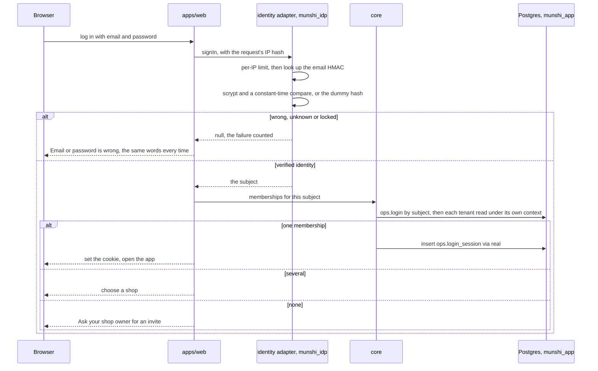

**Where it runs:** real sign-in is offered only on a live-kind deployment (`MUNSHI_DEPLOYMENT=live`): the gates build a
live-kind test database with invented people, and `pnpm dev --live` runs the laptop's live-shaped database
(`.run/pg-live`, `ops.deployment.hosted = false`, built by `db:build --live-local`, the one schema-built live database
BOOT1 allows), labelled "Local live-shaped test database · invented people". On the demo, `/log-in` shows the demo picker and the sample-shop sign-up instead (§6.6).

### 6.3 Onboarding, self-serve and assisted

The same four screens serve a real owner (live, after 5 Nov) and a judge's sample shop (demo, now):

1. **Your business:** type (kirana, clothing, salon), shop name, web address (the slug, suggested from the name; refused
   if reserved, look-alike or taken, §2.10.1). On *Next*, one transaction creates the tenant, its directory row (the
   trigger checks the tenant was created in this transaction), the first shop, the owner member, the first-owner login,
   the session and the site. **No platform config row is written, so AI is off and the site is hidden** until the
   superadmin acts (D-045); intake stays paused until the first publish. No SECURITY DEFINER, no operator login (R1 #6).
   Limits: three shops per identity, five sign-ups per IP a day.
2. **Branches:** more shops (name, area, GST state), each with opening hours.
3. **Catalogue:** a photo of a price list (the vision model reads it into a draft list, every figure placed on the photo;
   media calls count against the caps, §4.6), an Excel or CSV file, the spreadsheet table, or a starter list for the
   type. Every path ends as one `grid.apply` draft the owner approves (imports are drafts; nothing auto-applies).
4. **Staff:** invite by name, role and email (optional; later from *Settings → People*).

**Real self-serve sign-up needs a verified email**, which the password adapter can only get from an invite link. So
until the Supabase move (whose confirmation emails do it), a real shop is onboarded **assisted**: the operator's
`pnpm provision --slug … --type … --owner-email …` (no route) creates the tenant and prints a one-time owner invite; the
owner opens it, sets a password, and continues from screen 2. Invites are kept from MERCHANTS-DESIGN §6.2: 32 random
bytes stored as sha256, 24 hours, single use, sent by the owner from their own WhatsApp.

### 6.4 The tenant picker and branches

- `/choose-shop` lists the person's memberships (name and role). A session belongs to one tenant; switching shops goes
  back through the picker.
- Branches are inside a tenant: Elite is one tenant with two shops, and the app's branch switcher (Kirti Nagar |
  Kalkaji) filters screens by `shop_id`; packages and loyalty stay tenant-wide (MERCHANTS-DESIGN §1.1, kept). Staff are
  tenant-wide in v1; a stylist's home branch is in `books.staff_terms`, and the roster says where they work each day.

### 6.5 The superadmin console (D-045)

- **Who:** platform operators (`platform.operator`), each with an identity through the same adapter. The first is
  seeded from the command line (`pnpm platform:operator`); there is no sign-up for operators.
- **Sign-in:** `/platform/log-in` with the password **and a TOTP code** (RFC 6238, 30-second steps, one step of drift,
  a code never accepted twice; review N4), its own cookie (`munshi_operator`), a 2-hour session in
  `platform.operator_session` that stores the identity's epoch, revocable. Every `/platform/*` route answers 404 without
  one. **An operator identity is never a shop member** (the database refuses either binding). An operator session is never a member session: it holds
  no tenant, reaches the database only as `munshi_platform` (no grant on books, approvals, snapshots or the audit chain),
  and cannot act inside a shop (gate CONSOLE1).
- **What it does:** lists every shop (name, class, business type, created, verified, AI state, today's usage against its
  caps); proposes changes (turn AI on or off, set text and media caps, grant or revoke a channel with its recipient cap or Instagram account,
  verify a site, reserve a slug, set the demo shops' defaults); approves or rejects proposals; shows the platform change
  log and verifies its chain.
- **Changes are approved drafts** (decision 15): a proposal is one `platform.change` row; approval happens in a later
  transaction (a second click, after the console shows exactly what will change); the execution writes the config row
  and the chain entries in that same transaction, under the approving operator. With one operator a self-approval is
  allowed and recorded; **approving a channel grant or an operator change needs a fresh TOTP code** (within 5 minutes,
  `decided_totp_at`), so a stolen password alone can neither open a real channel nor add an operator; a two-operator
  rule can be switched on later. *Rejected:* editing settings in place (these
  settings spend money on model calls and reach real people, so they get the books' discipline).

### 6.6 The demo deploy and the fence

- **The demo picker** (`/demo`, demo deploy only; 404 on live): shop cards for the directory's synthetic and showcase,
  non-sandbox tenants, each read under its own context, then the chosen shop's active members; the session is
  `via = demo`.
- **Sample shops for judges (a Must, D-045):** the demo's *Sign up* runs the onboarding screens with no email and no
  password (the identity is a random subject kept only in a signed cookie, 7 days) into a `synthetic` tenant with
  `sandbox = true`, which the picker never lists; the session is `via = sandbox`. Sandboxes take the demo's default AI
  config and share one daily media ceiling (§4.6). **Their public sites stay hidden** (no verification is ever granted
  to a sandbox): a judge sees their shop's site as an in-app preview rendered with the same components under their own
  session, because a public page on Munshi's domain with a stranger's copy and art would be an abuse channel. The
  operator's `db:reset-demo --sandboxes`, run on a schedule, deletes each sandbox 7 days after its creation (the sandbox
  cookie's life), one sandbox per transaction, as `munshi_owner`, never on live. It deletes through the one DELETE branch
  the guards admit (owner role, sandbox tenant, demo deployment; §2.4), never by disabling triggers (R4 K5). Every other
  guard that refuses a DELETE (the audit chain, pins, drafts and decisions, the erase-only rules) admits the same
  three-condition branch, or the reset cannot remove the sandbox (INFERENCE, for the migrator to confirm).
- **Demo shop sites store sample values only:** on a demo deployment the database pins every public request's name,
  phone and note to `Sample customer`, `+910000000000` and NULL (bookings, reservations and enquiries alike), and the
  form says so.
- **The four layers, each red-proved** (MERCHANTS-DESIGN §6.4, kept):
  1. *Where the data lives:* separate databases (locally, a separate live-shaped database; hosted, separate Supabase
     projects); `ops.deployment` decides, and `tenant_class` refuses a live tenant in a demo database and any other
     class in a live one (T1).
  2. *Which deploy this is:* the app refuses to boot when `MUNSHI_DEPLOYMENT` disagrees with `ops.deployment`; the demo
     picker and sandbox sign-up answer 404 on live; real sign-in answers 404 on demo; the demo holds no channel
     credential (a boot check refuses one).
  3. *Every request:* `openSession` refuses `via = demo` or `sandbox` for a live tenant, and the `session_via` trigger
     refuses to store one (F1, F7).
  4. *Nothing real leaves a demo session:* only `via = real` on a live deployment **with an operator's channel grant**
     can make a delivery real (W8, CH1); a demo or sandbox session never publishes a release (S9).

### 6.7 Session rules and who sees what

- Cookie `munshi_session` v2: `v2.<tenant>.<member>.<session>.<via>.<expires>.<HMAC>`, HttpOnly, Secure, SameSite=Lax,
  secret from `MUNSHI_SESSION_SECRET`. Real sessions last 14 days (absolute), sandbox 7 days, demo 12 hours.
  `sessionFrom` (still the one place a Session is made) checks the signature timing-safe, the expiry, that the session
  row exists and is not revoked, that the member is active, and the `via` rule. Sign-out revokes the row; *Settings →
  People* signs a member out everywhere; deactivation and a password reset end every session at once.
- **Who sees a person's details** (MERCHANTS-DESIGN §7.5, kept): owner and manager see names and full phones; staff see
  names and the last four digits; the agent sees ids only; on the demo deploy every screen masks every phone. Masking
  happens in core's views, which take the session (gate V1 scans a staff page's HTML for a full phone).

### 6.8 After the move: Supabase Auth (live, after 5 Nov)

Kept from the first draft and tightened by the review (B3, B4); none of it is needed before the deploy of the live
project.
- **Verify locally** against the project's JWKS (`/auth/v1/.well-known/jwks.json`; FACT,
  https://supabase.com/docs/guides/auth/signing-keys, read 28 Oct): signature, issuer, audience, expiry. Then **trust
  only server-set claims**: the sign-in method from `amr` (`oauth` for Google, `otp` for a magic link; `password` only
  with a confirmed email), the provider from `app_metadata.provider` (`google` or `email`), and refuse an anonymous user
  (`is_anonymous`); **never read `user_metadata`**, which the user can edit. Then sign the person out of Supabase and keep
  no Supabase token. (Claim names are from Supabase's JWT documentation as remembered: UNVERIFIED this session; the
  gate uses recorded tokens.)
- **The project's auth settings are part of the guarantee:** anonymous sign-ins off, email confirmation on, only the
  Google and email providers on, public sign-ups as decided then. `deploy-check` reads them and fails on any other
  (UNVERIFIED which API exposes them; the founder confirms in the dashboard otherwise).
- **Emails held by Supabase:** `auth.users` (and `auth.identities`; and possibly `auth.audit_log_entries`, UNVERIFIED)
  keep a signed-in person's email. Erasing a member, the 365-day purge, and a **7-day purge of sign-ins that never
  became members** delete the Supabase user through the adapter's admin call; the jobs runner retries until it is gone;
  PII3 scans `auth.*` on the live project. The privacy notice says the email sits with Supabase while the person is a
  member.
- **Magic links need an email sender:** Supabase's built-in sender is meant for testing and rate-limited (UNVERIFIED
  limits); production magic links need a custom SMTP provider, a founder decision at that time. Google first.
- The secret key's scope is stated in §4.3: Storage **and** the Auth admin API.

**Gates:** F1–F7 retargeted; **IDP1** (§2.13); **AUTH1** (real sign-in refused on a demo deployment, at boot and by
`session_via`; in the Supabase phase, a token signed by another key, expired, for another audience, anonymous, carrying
an unexpected `amr` or provider, or whose only proof is `user_metadata`, is refused; red-proof each); **AUTH2** (a
sign-in with no matching invite or membership writes nothing); **SANDBOX1** (a sandbox cannot exist on live, is never
listed, and the reset deletes only sandboxes; a book-row DELETE is admitted only as `munshi_owner` on a sandbox tenant on
a demo deployment, and refused as any other role, on a non-sandbox tenant or on live, R4 K5; red-proof: drop the sandbox
clause); **CONSOLE1** (`/platform/*` is 404 without an operator session; an
operator session reaches no tenant's books, approvals or snapshots).

## 7 · The AI back office

> Desks per capability, deterministic watchers, findings ranked by rupees at stake times age, one open finding per
> key that resolves itself, recipes that turn a finding into a draft, a daily brief, and an office page with a run log.

### 7.1 Shape (kept, extended from study H)

One agent with desks, not many agents (Munim dropped parallel agents because shared state could leak untrusted text).
It runs inside `apps/web`'s server on the read-only `munshi_agent` pool; it holds no writer; the tenant is never a model
argument (tools close over the run's port). The router (role `router`) picks one desk unless the question starts with
`@Desk`; the desk's tool loop (role `reason`) calls named reads only, at most 8 per run inside a 45 s budget; `narrate`
writes at most six short segments with refs; the validator decides answer or "Cannot verify". **Watchers are plain SQL**
in core and run in the jobs runner; the model only explains a finding when a person asks, and narrates the brief's
high and critical lines. **Recipes are code:** a finding becomes a draft by a fixed mapping, never by the model; a model
drafts only when a person asks a desk by name (Munim's rule). Nothing auto-applies.

### 7.2 Desks per capability

The registry is `packages/agent/src/desks.ts`, keyed by `ref.capability` (decision 17). A shop sees a desk when the
capability that opens it is on (§8.13), and each desk owns only the parts whose capability is on. A totality test fails
when a capability lacks a registry entry; a source scan fails on a capability literal outside the registry and the
seeds, and on any business-type literal there (CAP3).

| Desk | Opened by | Owns (the capability each part needs) |
|---|---|---|
| **Stock** | `stock` | on-hand, counts, expiry, dead stock; bills and reorders (`buying`); variants by size and colour (`variants`); holds on pieces (`holds`) |
| **Sales & Money** | `counter` | sales by day, item and branch; settlements; udhaar (`credit`); offer codes and their redemptions (`offers`); GST (`gst`) |
| **Orders** | `orders` | requests waiting, the board, late orders, advances; measurements and trials (`stitching`) |
| **Bookings** | `bookings` | the calendar, idle chairs, no-shows, unbilled bookings, hold pressure |
| **Packages** | `packages` | holdings, redemptions, expiry, liability |
| **Customers** | `messaging` | regulars, consent, the inbox; campaigns (`campaigns`); loyalty (`loyalty`) |
| **Staff** | `staff` | roster, attendance, leave, advances; salary (`salary`) |

With their packs (§2.5) the kirana opens Stock, Sales & Money, Orders, Customers and Staff; Elite opens Sales & Money,
Bookings, Packages, Customers and Staff; Prabhave opens Stock, Sales & Money, Orders, Customers and Staff.

### 7.3 Watchers per capability

Each is a `watch.*` named read with timestamp bounds computed in core from the shop's zone (R1 rank 3), returning one
row per situation with a key, the figures, and an **impact cell**: the rupees at stake per month, computed in SQL from
book rows. Thresholds are the country pack's defaults (INFERENCE, to be tuned with the founder). A watcher runs for a
shop only while the capability it needs is on (§8.13). There are **17**.

| Watcher | Needs | Raises when | Impact cell | Recipe (§7.5) |
|---|---|---|---|---|
| `shrinkage` | `stock` | a shelf count is short of the books | the missing units × last cost | `reorder.place` (exists) |
| `price_creep` | `buying` | a bill's unit cost is above the last one paid | the rise × monthly quantity | explain only |
| `expiry` | `stock` | stock expires within 7 days | the expiring units × cost | explain only |
| `overdue_credit` | `credit` | udhaar past its due date | the overdue balance | `customer.remind` |
| `short_settlement` | `counter` | a UPI or card payout is short of the day's receipts | the shortfall | explain only |
| `dead_stock` | `stock` (by size and colour with `variants`) | no sale for 45 days with stock on hand | the stock's cost | explain; links "Create an offer" (offers are the owner's alone) |
| `unrecovered_advance` | `staff` | a staff advance outstanding over 30 days | the outstanding amount | explain; the next salary run recovers it |
| `hold_expiring` | `holds` | a held piece expires within 24 h | the piece's price | explain; links "Extend or release" (ops actions) |
| `regulars_lapsing` | `campaigns` | a customer with 3 or more visits has none in 60 days | their average monthly spend | `campaign.send` (segment `lapsed_regulars`, template copy) |
| `package_expiry` | `packages` | a holding expires within 14 days with value left | the value left | `customer.remind` before expiry; `package.expire` after it |
| `idle_stylist` | `bookings` | 40% or more of a stylist's rostered hours in the next 3 days are unbooked | the idle hours × the stylist's average service price, from sale lines naming the stylist (`sale_line.staff_id`, walk-ins included, R4 N5) | `campaign.send` (segment `lapsed_regulars`, "slots open this week") |
| `stylist_absent_booked` | `bookings` | a stylist on leave or marked absent has confirmed bookings | the bookings' prices | explain; links the day's calendar |
| `unbilled_booking` | `bookings` | a booking whose time has passed is still `confirmed`, with no sale naming it | the service's price | explain; links "Record the sale" |
| `hold_pressure` | `bookings` | in the last hour, holds on one stylist's day expired unconverted three or more times, or hold caps refused requests (review B7) | the held slots' service prices | explain; links "Pause online booking" (the owner decides; intake never closes by itself) |
| `order_unanswered` | `orders` | a request older than 30 minutes is still `new` or `drafted` | its derived total, when it has lines | the draft itself |
| `order_late` | `orders` | `due_on` has passed and the order's current step (`ops.order_state`) is not `ready` or terminal | the order's total | explain; links the order |
| `advance_unapplied` | `orders` | an advance on a cancelled or delivered order is neither refunded nor applied (§8.12) | the unapplied advance | explain; links the order |

The five existing kirana watchers and their answer key are unchanged (C5 must still find 5 of 5 kinds and nothing else);
each new watcher gets planted situations and near-miss controls in its tenant's seed, checked against a hand-worked key.

### 7.4 The finding lifecycle

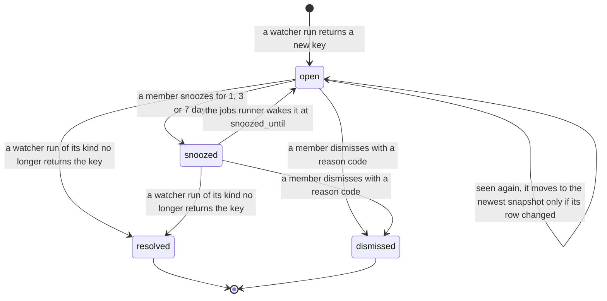

- **One open finding per key** (`finding_one_open`, a partial unique index over open and snoozed). A situation that
  resolves and later recurs raises a new finding (study H: Munshi's key was unique forever, so a recurring situation
  never re-raised; Munim's findings never closed).
- **Auto-resolve** happens only in a watcher run of the same kind, for the same shop (`ai.finding.shop_id`, NULL for a
  tenant-wide finding, R4 N4), with no actor: a person never "resolves" by hand; they dismiss or act.
- **Dismissed keys rest for 30 days** (`MS012` on a new raise), Munim's anti-noise rule; a dismissal needs a reason code
  with `dismiss` in its use (`not_relevant`, `already_handled`, `other`).
- **A re-see changes nothing unless the row changed** (R4 S1, G2). The finding stores the sha256 of its row's cells
  (`row_sha256`). A run that sees the same cells updates only `last_seen_at` and `last_run_id`: no new snapshot pin and
  no `seen` event. A run that sees different cells moves the finding to the new snapshot, pins it, writes `seen`, and
  lets the jobs role release the old pin (§2.8). Every other change writes `ai.finding_event`.
- The finding pins the snapshot whose row holds its numbers, so its figures stay traceable however old it is.
- **Ranking:** severity from the country pack's ladder on the impact cell (IN defaults for a small shop, INFERENCE:
  critical ≥ ₹10,000 a month, high ≥ ₹2,000, medium ≥ ₹500, low below); the order is `|impact| × (1 + 0.05 ×
  min(days open, 14))`, ties by severity then age, computed in the `brief.ranked` read so the order itself is a cell.

### 7.5 Recipes: finding → draft

Code in `packages/agent/src/recipes.ts`, one function per kind, run when a person taps *Draft the fix*. Each builds a
payload whose every number is a cell of the finding's row or of an undated current-state read (MERCHANTS-DESIGN §3.2's
rules), proposes it through the port, and the draft waits.

| Recipe | Draft | Its numbers cite |
|---|---|---|
| shrinkage → reorder | `reorder.place` to the item's last supplier (simulated) | the latest bill line's quantity; the item's current `stock.on_hand` |
| overdue credit → reminder | `customer.remind` (template `credit_due`) to the customer, by WhatsApp or a manual link | the customer's current `credit.balance` |
| package expiring → reminder | `customer.remind` (template `package_expiring`) | `package.balance` (value and sessions left), `expires_on` |
| package expired → expiry | `package.expire` | `package.balance` (a redemption after it makes it stale) |
| lapsing regulars or an idle stylist → campaign | `campaign.send` with segment `lapsed_regulars` and the template copy for the type; AI copy only if the owner asks the Customers desk | `campaign.audience` (the whole audience set rechecked at approval, K5) |

### 7.6 The daily brief

At 07:00 shop time the jobs runner writes one `ai.brief` per shop (R4 N4): the top five open findings by rank, as the
pinned `brief.ranked` snapshot (`ranked_snapshot_id`; the brief keeps no list of its own, R4 N8), and yesterday's
figures per branch (sales, bookings today, packages expiring this week, credit overdue) as cells of `brief.*` reads. If AI is on and
under its cap, `narrate` writes one line per high or critical finding, validated like any answer; otherwise each finding
shows its template line. The brief opens Home; it is never sent anywhere.

### 7.7 Screens

| Screen | Shows |
|---|---|
| **Home** (`/app/home`) | *What needs you* (drafts waiting, requests and bookings to confirm), *What Munshi noticed* (the top three findings with ₹ at stake, desk and age), today's figures, the brief's line; every figure tappable |
| **Inbox** (`/app/inbox`) | findings (explain, draft the fix, snooze, dismiss with a reason) and drafts (approve, edit, reject with a reason), filtered by desk and branch |
| **The office** (`/app/office`) | one card per desk: what it owns, open findings, drafts waiting, its track record (drafts executed and rejected, as cells); and *What Munshi did*: the run log (trigger, desk, outcome, model calls, trace labels and timings; ids and labels only, never text). No pixel office (study H) |
| **Ask** (`/app/ask`) | typed or spoken questions; `@Stock`, `@Bookings`… forces a desk; answers in cited segments; "Cannot verify" in fixed words; hidden when AI is off |

### 7.8 Cite-or-abstain, untrusted text, model roles

- **The validator** is unchanged in its rules (free digits, number words in English, Hindi and romanised Hindi, other
  scripts, handle glue, scale and unit words, unknown or foreign refs) and runs one number detector shared with core
  (MS-22b). New: an empty read is citable through `⟨snap:ID·0·_count⟩`; a draft's numeric leaves must be refs; an
  abstention shows its rule names in fixed words.
- **Untrusted text is quarantined.** Inbound WhatsApp text and transcripts, bill text and the shop's own catalogue names
  reach a model only inside escaped `<data>` blocks; the vision call is offered no tools. A run that read inbound or
  bill text is **tainted** (`ai.run.tainted`): the port then refuses any proposal except the one recipe the person's tap
  started (`booking.confirm`, `message.reply`, `credit.record`, `purchase.record` or `order.confirm`, §8.12, R4 O1). Untrusted text never enters a
  trace, a log, a finding or a snapshot cell; phone-shaped digit runs become "[phone]" before any model call (PII2).
- **Answers' words are erasable** (review B2): `ai.answer` keeps refs and verdicts only; the words of an Ask answer, a
  brief line or a transcript's gloss live in `ops.message_text`, which the retention purge erases (with its inbound
  message's transcript for a gloss; after 30 days for an Ask answer, whose question may have named a person) and a
  contact's erasure erases. E1 scans `ai.*` as well.
- **AI is off for a new self-serve shop** until the superadmin turns it on (D-045); every AI surface then shows its
  template or hides, exactly as when the cap is reached (§4.6).
- **Meta model roles** (unchanged; ids from config, Standard ids only, gate AI1; none confirmed live until M0):

| Role | Model | Used for |
|---|---|---|
| router | Muse Spark (`muse-spark-1.3`) | picks a desk |
| reason | Muse Spark | the desk's tool loop; campaign copy in Hinglish; the intent and spans of a voice note |
| vision | Muse Spark | names products on a shelf photo; copies a bill or a price list (no tools) |
| segment | SAM 3.1 (`sam-3.1`) | counts one product per request; cuts a product out of the shop's own photo for a campaign card |
| voice | Muse Voice Transcribe (`muse-voice-transcribe-1.0`) | owner questions and inbound voice notes (Hindi support UNVERIFIED until M0) |
| narrate | Muse Spark Open on Baseten (open weights) | answer segments, the brief's lines, a transcript's English gloss |

Muse Image is never used (barred in India, FACT per study A). Every AI-drafted message ends with the disclosure line
written by code from i18n (MERCHANTS-DESIGN K4, kept).

**After 5 Nov:** investigations, fan-out across desks, Ask threads, negotiation, a richer office view.

## 8 · Every merchant feature, end to end

> Twelve features, each with its data, commands, drafts, screens and its own One Guarantee ruling: what is a book, who
> approves, and which ledger row every figure traces to.

Each feature's **Guarantee** line answers three questions: is it a book; who writes or approves it; where each figure it
shows comes from.

### 8.1 Offers with codes

- **Data:** `books.offer` with `code`, `max_redemptions`, `per_customer_limit`; `offer_item`, `offer_end`,
  `sale_discount` (§2.10.5).
- **Commands:** `offer.create`, `offer.end` (owner only). At the counter, staff type or scan a code; `sale.quote_offers`
  previews the bill; `sale.record` takes `offerCodes` (≤ 3) and **re-judges each at `sold_at`**: in effect, in scope,
  minimum spend met on the eligible gross, caps not exceeded (`b_offer_cap` under a per-offer lock; a per-customer cap
  needs a named customer). The best eligible percentage per line wins, offers never stack, an amount-off applies once
  per sale up to the eligible gross, package lines take none (MERCHANTS-DESIGN §3.3, kept).
- **Screens:** `/app/offers` (list, create, end, redemptions so far as cells); the counter's code field; the shop site
  shows published offers, with the code when the owner ticks "show the code".
- **Guarantee:** an offer is a price, so a book, created only by the owner's own command; no AI draft ever creates one
  (Munim D). Every discount on a bill is a `sale_discount` row naming its offer; a campaign's "20% off" is a cell of
  `offer.detail`; the public sees only offers in the published release.

### 8.2 Packages (prepaid packs and memberships)

- **Data:** `books.package_plan`, `package_plan_line`, `package_holding`, `package_entry` (§2.10.5).
- **Commands:** `package.plan.create` (owner: the item, its price, the plan and its lines in one transaction);
  `sale.record` sells a package line (needs a customer) and creates the holding and its `sold` entries; `package.redeem`
  (owner, manager, staff) at either branch; `package.expire` (draft-only, owner approves; recipe in §7.5).
- **Journal:** a sale credits `package_liability`; a redemption moves the session's share (remaining value ÷ remaining
  sessions, integer paise, the last session takes the remainder) to `sales`; an expiry moves what is left to
  `package_breakage`.
- **Screens:** `/app/packages` (plans; holders with balance per holding and expiry; tap-for-source on every balance);
  the counter's "Redeem a session" with the holder's balance cell beside it.
- **Guarantee:** books throughout. Balances are set by the database under a per-holding lock and never go below zero;
  each entry kind is bound to its command; an expiry needs a person's approval and goes stale if a redemption lands first.

### 8.3 Loyalty points

- **Data:** `books.loyalty_rule` (owner), `loyalty_entry` (earned and redeemed in `sale.record`; `b_loyalty_tally`).
- **Flow:** a named customer earns `floor(net × earn_per_100 / 10000)` points per sale; redeeming at least `min_redeem`
  points writes a `redeemed` entry and a `loyalty` discount, never more than the net after offers.
- **Screens:** the customer page and the counter show the balance as a cell of `loyalty.balance`.
- **Guarantee:** books; the balance is the database's, under a per-customer lock; a client's points are never read.

### 8.4 Hold a piece (Prabhave)

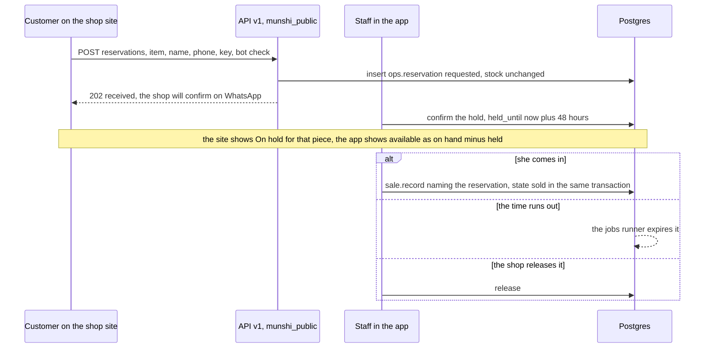

- **Data:** `ops.reservation` (§2.10.8). The app's stock screen shows *available* = on hand − held, both cells
  (`stock.available` reads the books and the holds).
- **Guarantee:** a hold is ops, not a book: nothing owed, sold or moved changes until a person records the sale. The
  site shows "On hold", never a stock number. The customer's details are erasable and pinned to samples on the demo.

### 8.5 Order on WhatsApp (a site order request, no online payment)

1. The shop site keeps a cart in the browser; *Order on WhatsApp* posts it to `POST /sites/{slug}/orders`.
2. Core checks every line against the **latest release** (the item is published, the price is its cell), computes each
   line with **the counter's own line function** (`lineAmount`: quantity in milli-units × unit price, rounded half away
   from zero to the paisa) and adds the lines in integer paise, stores an `ops.order_request` on the `site` channel (the
   release id, item ids and quantities only, a code like `ORD-7K2Q`; it replaces `ops.wa_cart`, §8.12), and returns the
   message text and a `wa.me` link to the shop's public WhatsApp number.
3. The message reads, in the shop's language: "Order ORD-7K2Q from Prabhave: 2 × Anarkali suit (M, maroon) at ₹2,499 …
   Total ₹4,998 at today's prices. Please confirm." **An offer code travels as text only** ("Code DIWALI10 to be
   checked at the shop"): an anonymous cart cannot judge an offer's scope, minimum spend or caps, so it shows no discount.
   The customer sends it from their own WhatsApp.
4. Staff open `ORD-7K2Q`. Confirming it is `order.confirm`, which re-prices every line from the books **now** and fixes
   the promised price (§8.12). The sale that hands it over names the order (`sale.record`, `order_id`) and judges any
   code then.

- **Guarantee ruling (confirmed, D-045):** the request is ops and holds no personal data. Each line price is a
  published cell; the line totals and the total are **derived figures**: code (never a model) computes them from those
  cells with the counter's arithmetic, the response carries the refs they came from, and the message says "at today's
  prices · the shop confirms". **They are recomputable from stored ids:** gate ORD1 (which carries CART1 over) takes
  every stored site request, reads its release's cells for its lines, recomputes every figure with the same function,
  and must match what the API returned. The book numbers are the order's and the sale's own, re-derived from the books;
  a request's total is never read back as a price.

### 8.6 Campaigns on the WhatsApp test number, the inbox and voice notes

Kept from MERCHANTS-DESIGN §4 (consent by double opt-in, the derived and claimed outbox, the send-time recheck, the
24-hour window decided at send time, the webhook writing ops only, voice note → spans → draft), with Storage instead of
blobs, `via = real` instead of `google`, and **an operator's channel grant per tenant instead of deploy-wide test
phones** (review B1): a shop sends for real only once the superadmin has granted it WhatsApp and its owner has
listed its test recipients (each also verified in Meta's console); inbound messages find their shop through
`ops.phone_route`; until then, and on the demo always, every send is recorded. Before 5 Nov every send is recorded (D-045: no live
shop); the real WhatsApp path is built and gated on the recorded sender and switched on with the live deploy.

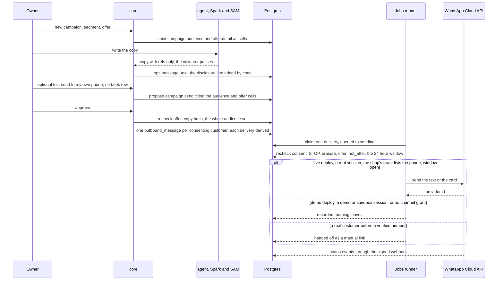

- **Commands:** `campaign.send`, `message.reply`, `customer.remind` (draft-only); ops actions: compose, test send,
  transcribe, handle an inbox item.
- **Screens:** `/app/campaigns` (composer, audience count with its source, copy with "insert figure" chips, card,
  channel line "WhatsApp · sent to consenting test phones" or "Recorded · nothing is sent"), `/app/inbox` (messages:
  Transcribe, Draft a reply, a booking, an udhaar entry).
- **Guarantee:** each message to a person is a book written only under an approved draft; the words are erasable text
  whose hash the book keeps; the audience count and every figure in the copy are cells; a send happens at most once and
  only after the recheck; a demo session can never reach a real phone.

### 8.7 Instagram (Should)

An approved `campaign.post` puts the card on a professional Instagram account (tester role, dev mode; UNVERIFIED
specifics, study A), from the live deploy and a real session only, **and only for a tenant the superadmin has granted
Instagram, naming which configured account** (`platform.channel_grant.account_ref`, review B1: without it, a stranger's
self-serve shop could approve its own post onto the founder's account). After 5 Nov. The card is served as JPEG from
`/api/v1/sites/{slug}/media/{id}.jpg`. **Guarantee:** a public post is a book (`recipient_kind = public`) under an
approved draft; its caption passes the same number detector; without a grant, and always on the demo, it is recorded.

### 8.8 Live slot booking with the stylist calendar (Elite)

- **Data:** the roster (`books.shift_pattern`, `shift_change`), leave and holidays, shop hours, the services' durations
  (`item_revision.duration_min`), the opted-in stylist profiles, and `ops.booking` with its contact row (§2.10.6, §2.10.8).
- **Free slots** come from one core read, `slots(shop, service, day, stylist?)`: each stylist working at that shop that
  day (the day's change, else the pattern), minus leave, holidays and closed hours, minus every requested or confirmed
  booking and every hold with `expires_at > now()`, offered on a 15-minute grid where the service's whole duration fits.
  A GET writes nothing, so a lapsed hold may still be stored as `held`; the read treats it as free (R4 S2). Each slot carries the roster
  row it comes from (`shiftRel`, `shiftId`); the hold stores it, and the database checks the booking against that row
  (the one in effect that day). **Confirmed reading (D-045):** slot times are roster times; gate SLOT1 recomputes every
  offered slot and every booking from its stored roster row and the bookings, and must match.
- **Holds are capped** (reviews B7, N7): 10 minutes each (D-045), one live hold per device, three per IP hash, two per
  stylist and day, a bot check on each; a squatter is bounded to those, and the owner gets a `hold_pressure` finding instead of the shop
  closing its booking page.

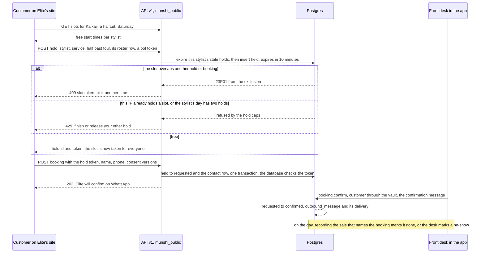

- **Commands:** `booking.confirm` (owner, manager: the customer and the confirmation message); ops actions: decline with
  a reason, cancel, no-show, a staff-made booking for a walk-in or a phone call (`source = app`, confirmed in one step);
  `shift.pattern.set`, `shift.change`, `leave.record`, `holiday.set` (owner, manager).
- **Screens:** `/app/calendar` (per branch, a column per stylist, day and week views, holds shown faint and expiring,
  requests waiting, tap an empty slot to book), `/app/requests` (confirm or decline), the stylist's own day for staff;
  the site's booking page (branch → service → stylist or "anyone" → day → time → details).
- **Guarantee:** a hold and a request are ops: they block the calendar but change no book. A named person confirms; the
  confirmation message is a book under their command. Prices on the booking page are release cells; slot times trace to
  roster rows. The exclusion constraint, not the application, makes double-booking impossible (BK1).

### 8.9 GST invoices

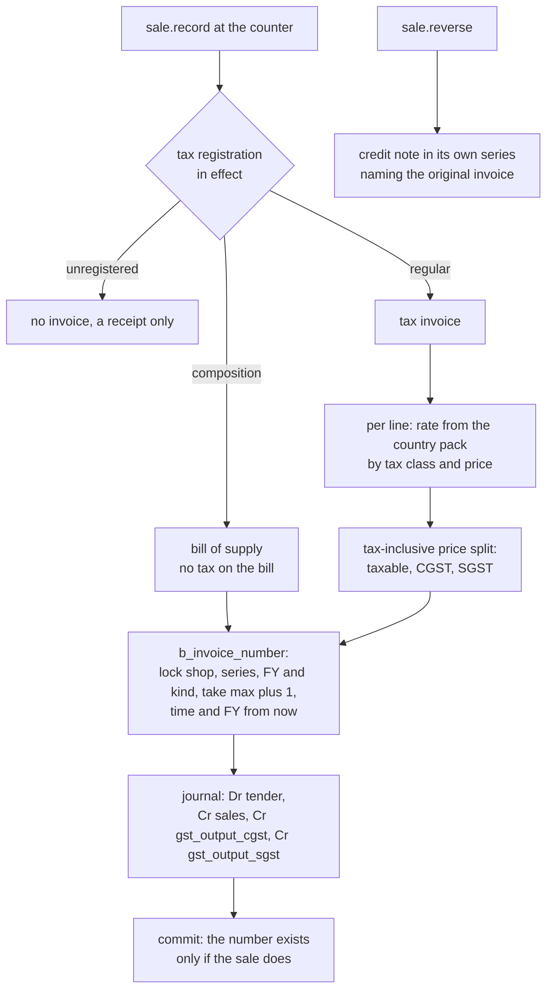

- **Data:** `books.tax_registration`, `invoice`, `invoice_line`; `ops.shop.invoice_series` (e.g. `KN`, `KJ` for Elite's
  branches); the accounts `gst_output_cgst`, `gst_output_sgst`.
- **The rules as decided (D-045)**, built as stated; **a chartered accountant checks them before any real use**: prices
  include GST; one GSTIN per business; an invoice series per branch; the apparel ₹2,500 rule is judged on the
  **selling price** of the piece.
- **The country pack** (`packages/core/src/packs/in.ts`, data with effective dates, never in SQL) holds the tax classes:
  salon services 5% without input credit from 22 Sep 2025 (per press, study B); apparel 5% when a piece's selling price
  is at most ₹2,500 and 18% above it (per EY, study B; the notification itself was not read); a general 5%, 18% and
  exempt. The financial year runs April to March in the shop's time zone. Composition dealers issue a bill of supply and
  collect no tax (study B).
- **Arithmetic:** per line, `taxable = round(gross × 10000 ÷ (10000 + rate_bp))` half away from zero, `tax = gross −
  taxable`, `cgst = floor(tax ÷ 2)`, `sgst = tax − cgst`; intra-state only in v1 (the place of supply is the shop's
  state). GST1's golden invoices come from a hand-worked key; the CA's worked examples replace it when they arrive.
- **Numbering and dates** (review, rank 3): tax invoices, bills of supply and credit notes each lock and number their own
  series per shop and year, and the unique key includes the kind, so credit note 1 and tax invoice 1 can both exist
  (R4 M1); `issued_at` and the financial year are the database's `clock_timestamp()` taken after the lock, never the
  caller's, so a later number never carries an earlier time (R4 W4); a registered shop cannot record a backdated sale
  (`MS016`), so no invoice lands in a period already reported.
- **Screens:** the invoice (A4 and 80 mm thermal print), `/app/invoices` (by branch and month), the GST summary by rate
  and month, read from `invoice_line` and the journal (JR1). The fields printed follow the tax-invoice rules as
  summarised by study B; the exact mandatory list is UNVERIFIED.
- **Guarantee:** an invoice is a book written by the sale's own command in the sale's transaction; its number is set by
  the database, gapless per shop, series and year; every figure on it is a cell of `invoice.detail`; a cancellation is
  a credit note, never an edit.

### 8.10 Staff management

| Part | Book rows | Who | Screen |
|---|---|---|---|
| Roster | `shift_pattern` (weekly), `shift_change` (one day) | owner, manager | `/app/staff/roster`: a week grid per branch |
| Attendance | `attendance` (the day's mark is the latest of the highest rank present, so a staff mark never overrides an owner's or manager's for that day, R4 K13) | owner, manager; staff mark only their own in and out | `/app/staff/today` |
| Leave | `leave` (paid, unpaid, sick; reversible) | owner, manager | the roster grid and the staff page |
| Holidays | `holiday` (one branch or all) | owner, manager | `/app/staff/holidays`; the calendar and slots honour it |
| Advances | `advance` (+ payment out, journal) | owner | the staff page with the outstanding balance as a cell |
| Salary | `salary_run`, `salary_line`, journal; wages paid by **`wages.pay`** (owner, manager; never `payment.record`, which staff hold) | owner approves the run (draft-only) | `/app/staff/salary`: the month's preview, then the draft |

**A salary run:** the owner taps *Prepare October*. Core's `salary.preview` read computes, per staff member, from the
terms in effect, attendance, leave and holidays, counting each distinct day once (R4 K3): daily pay × days present (a
half day counts half, paid leave counts);
monthly pay − (pay ÷ 30) × unpaid days; and advance recovery up to the outstanding balance, never past a zero net (the
rules are stated on the screen and accepted, D-045; commission was not chosen, D-041). The preview's every figure is a
cell; *Make the draft* proposes `salary.run` citing them; the owner approves; recording the wages paid is `wages.pay`
per person, by the owner or a manager. **Guarantee:** staff records are books; pay changes only through an approved run
whose every number is a cell, and never twice for the same staff member and days (`b_one_live_pay`, R4 K3); a staff member can neither overwrite a manager's attendance mark nor pay wages (review B9,
gate PAY1); payments are recorded, never processed; staff names stay in the vault and never enter the audit chain.

### 8.11 Booking requests (the general feature, D-037)

Shops whose site is in `request` mode (or any shop on WhatsApp) take a request (`ops.site_request`: services, a day and
a morning, afternoon or evening window); staff confirm it with `booking.confirm` (which then creates a confirmed
`ops.booking` if the shop keeps a calendar) or decline it. Kept from MERCHANTS-DESIGN §5, through `/api/v1/sites/{slug}`.

### 8.12 Orders: goods, stitching and alteration (decision 18)

A confirmed order promises goods or work at a price by a date, so by §2.1's rule it is a book (R4 O1). Intake is ops.

```mermaid
flowchart LR
  subgraph intake["Intake: ops, no books"]
    cart["Site cart or widget"]
    chat["WhatsApp or Instagram text"]
    voice["Voice note"]
    photo["Photo of a list or a product"]
  end
  phone["Staff types a phone order"]
  req["ops.order_request"]
  ai["AI drafts the order<br/>quarantined, spans, catalogue match"]
  draft["approval.draft order.confirm"]
  ord["books.order and lines<br/>prices from books.price"]
  steps["books.order_step<br/>a staff tap, the customer's update"]
  ostate["ops.order_state<br/>written by z_order_state"]
  adv["books.payment naming the order<br/>the advance, recorded"]
  sale["sale.record naming the order<br/>the invoice, the delivered step"]
  cart --> req
  chat --> req
  voice --> req
  photo --> req
  req --> ai --> draft
  phone --> ord
  draft -- "a named person approves" --> ord
  ord --> steps --> ostate
  ord --> adv
  steps --> sale
```

- **Data:** `ops.order_request`, `books.order`, `books.order_line`, `books.order_step`, `ops.order_state`,
  `ops.measurement` and `ops.measurement_value` (§2.10.16); `ref.order_step`, `ref.order_flow`, `ref.measure_point`
  (§2.5); the liability account `customer_advance` (§2.9).
- **Intake.** Any channel makes an `ops.order_request`: a site cart or widget (`POST /sites/{slug}/orders`, §8.5), or
  an inbound WhatsApp or Instagram message (text, a voice note, a photo of a list or a product). A message that carries a
  request's code (`ORD-7K2Q`) is linked to it by code, never by a model. Staff typing a phone order skip the request and
  confirm the order as their own command.
- **The AI drafts** only when AI is on and under its cap (§4.6), and only on a person's tap. A voice note is
  transcribed first. The model reads the text or photo with no tools, inside `<data>` blocks, and returns each line as
  spans (the item phrase and the quantity phrase). Code matches the item phrase to the catalogue by exact name or alias;
  an unmatched line shows "Not in your catalogue — choose", and the person's choice is a member input. Core re-parses
  each quantity span, and the database re-parses it again (`ops.inbound_extract`, field `item` or `quantity`). Each
  line's price is the `books.price` cell in effect; line amounts and the total come from the counter's line function.
  The draft is `order.confirm`, carrying the customer's reply (the total and the code) as code-composed template text. The
  run is tainted (§7.8), so the port refuses any other proposal.
- **Confirm.** A named person approves the draft, or a staff member records an order they took. `order.confirm` writes
  `books.order`, its lines and the first step (`confirmed`, with the due date and, for stitching, the trial date), and
  the confirmation message under that decision. Prices are re-derived from `books.price` at that moment, so **the
  order fixes the promised price**. A stitching or alteration line with no catalogue price carries the person's typed
  quote, an `ops.member_input` cell labelled as theirs (`quote_input_id`).
- **Steps.** Each status change is a staff tap, `order.step`, the person's own command. It inserts the next
  `books.order_step` only if `ref.order_flow` allows it from the current step, and the unique `(order_id, step_no)` key
  lets only one of two taps win. When the step's template has one, it writes the customer's update
  (`books.outbound_message`) in the same transaction; consent and the 24-hour window are rechecked at send (§8.6). With
  `messaging` off or not granted, no message is written and the app offers a manual WhatsApp link. `z_order_state`
  keeps the order's current row in `ops.order_state`, which the board reads.
- **Advance.** `payment.record` naming the order (recorded, never processed) posts to `customer_advance`.
- **Finish.** `sale.record` naming the order. Its lines equal the order's lines (item, quantity and the promised unit
  price, gate ORD3); the advance is applied (a debit to `customer_advance`) and the rest is paid or goes on udhaar; the
  GST invoice is written in the sale's transaction (decision 5), and so is the `delivered` step.
- **Cancel.** `order.cancel` (owner or manager, with a reason) writes the `cancelled` step. The advance is refunded
  (`payment.record`, direction out, naming the order) or kept as customer credit (`credit.record` naming the advance
  payment). `order.reverse` voids an order entered in error (§2.9's one reversal per book).
- **An unapplied advance** is the order's advance balance: its payments in, less refunds out, less the delivery sale's
  debit to `customer_advance`, less credit entries naming its advance payments. It holds a contact's erasure (§2.6)
  and raises `advance_unapplied` on a cancelled or delivered order (§7.3).
- **Commands:**

  | Command | Who | Notes |
  |---|---|---|
  | `order.confirm` | owner, manager, staff | draftable; the only recipe a tainted chat run may propose |
  | `order.step` · `order.reschedule` | owner, manager, staff | |
  | `order.cancel` · `order.reverse` | owner, manager | a reason code |

  `sale.record`, `payment.record` and `credit.record` gain the order. `measurement.take` (members) is an ops action,
  not a command (§2.4): it writes no book.
- **Screens.** `/app/orders`: requests waiting, each AI draft shown line by line against its source span; then a board
  by step from `ops.order_state`. Each card shows the customer, the kind, the due date, the total and the advance (cells)
  and one button for the next step, with the customer's update written under it. Stitching cards also show the
  measurements (cells) and the trial date. The customer's status page, `GET /sites/{slug}/orders/{code}`, shows step
  labels only, with no personal data; the code is a capability token (a bad code answers 404, compared timing-safe,
  never logged, Munim gotcha 16).
- **Watchers:** `order_unanswered`, `order_late`, `advance_unapplied` (§7.3).
- **Guarantee:** a request is ops; the public and webhook roles cannot write `books.order*` (ORD5); an order enters the
  books only by `order.confirm` under a person's own command or an approved draft; every step, advance, cancellation
  and the final sale is a person's own command. Prices are `books.price` cells or the person's own quote cell;
  quantities are spans the database re-parses, member inputs or a site request's stored lines; line amounts and totals
  recompute from stored ids (ORD1); advances are book cells; measurements are cells of a read over
  `ops.measurement_value`, erased with the contact (M1).

### 8.13 Packs and switches (decision 17)

- **Data:** `ref.capability`, `ref.capability_requires`, `ref.pack_capability`, `ref.command_capability`,
  `ref.capability_item_kind` (§2.5); `ops.capability_switch` (§2.10.1). A shop starts from its type's pack (kirana,
  salon, apparel shown as "Boutique") and then switches any capability on or off (R4 C1).
- **What a shop can use:** a capability whose latest switch is on **and**, for one marked `needs_grant`, whose
  superadmin grant is on (`platform.shop_config` for `ai` and `site`; `platform.channel_grant` for `messaging`). Core
  computes `can(session, capability)` once per request, inside the page's one transaction.
- **Switching on** needs every capability it requires to be on. **Switching off** is refused while a capability that
  requires it is on (CAP4). It is **not** refused while balances are open: open package holdings, loyalty points, open
  orders and live holds stay, and are finished by `finish` commands.
- **When a capability is off:** its `start` commands refuse (`capability_off`); its `finish` commands still run, so an
  open package, order, booking or hold can be completed and every `*.reverse` runs; its screens, desks, watchers, API
  routes and widgets hide or answer 404 (public routes, gotcha 16). **Nothing in the books is ever deleted or hidden
  from reports.**
- **Core checks capabilities; the book guard never does,** so switching off can never block a reversal of an existing
  book row (R4 C1).
- **Item kinds and variants:** the kinds a shop may create are those `ref.capability_item_kind` allows for its on
  capabilities (counter and stock: goods; bookings and stitching: services; orders: goods; packages: packages). Variant
  attributes and variant parents need `variants`, which requires `stock` and is in the boutique pack. Core checks both
  at `item.create`, `item.revise` and `grid.apply`.
- **A site's booking mode** other than `none` needs `bookings` (`site_guard`, §2.10.8).
- **`ops.tenant.business_type` stays fixed:** it names the pack the shop started from. Desks (§7.2), watchers (§7.3),
  screens and the API are keyed by capability; the source scan that refused a type literal outside the registry now
  refuses a capability literal outside it.
- **Screen:** *Settings → Capabilities* (owner only): each switch, what it requires and what requires it, and "Needs
  the platform's approval" on a capability marked `needs_grant`.
- **Guarantee:** a switch is the owner's own audited ops row (`capability.switch {capability, is_on}`); it cannot write
  or delete a book row; platform grants stay approved platform drafts (decision 15).

## 9 · Design system hooks

> The calm-ledger component system with tokens for Munshi's own brand and each shop's brand, tap-for-source on every
> traceable figure, a fixed font palette and motion rules. Colours and type stay placeholders until the options board.

### 9.1 One component system, many brands (D-042)

`packages/ui` holds the calm-ledger primitives and the token names; a **brand** is a set of values for those names.

| Brand | Dresses | Values |
|---|---|---|
| Munshi | the product site, sign-in, onboarding, the developer portal, the console, the synthetic kirana's app | **reopened** (D-044: indigo + saffron no longer fixed; round 2 of the options board running); the calm feel and tap-for-source stand |
| Elite | Elite's app screens and its shop site | **picked: elite-A "Matte black & champagne", with a light mode too** (D-044); Elite's slogan stays off public pages until its permission letter is signed |
| Prabhave (the suit shop; festive) | its app screens and its shop site | *round 2 of the options board* (D-044: all four round-1 options rejected) |
| A new shop | its app and site | the business type's default, until the owner picks |

A shop's brand lives in one place: the tokens of its latest `ops.site_look`, which may carry a light and a dark set
(Elite has both, D-044). The app themes from the latest look, the public site from the published one, so the two never
drift. A test computes the contrast of every token pair used for
text in every brand and fails below 4.5:1.

**Token names** (values are placeholders): `--ground`, `--surface`, `--ink`, `--ink-muted`, `--hairline`, `--accent`,
`--accent-ink`, `--signal` (needs-you), `--ok`, `--warn`, `--danger`, `--radius-card`, `--radius-chip`, `--space-1` …
`--space-8`, `--figure-xl`, `--figure-l`, `--figure-m`, `--font-display`, `--font-text`, `--font-figures`,
`--font-deva-display`, `--font-deva-text`, `--motion-quick`, `--motion-sheet`. The feel is fixed (D-042): warm
off-white ground, ink text, one deep accent, hairline borders, soft rounded cards, no hard shadows or thick outlines, big
clear figures with tabular numerals, more air.

### 9.2 Tap-for-source

- `<Figure ref>` renders a traceable figure with a faint dotted underline; tapping opens `<SourceSheet>`: the read in
  words ("Price set on 12 Oct"), the book table and row it came from, when the snapshot was taken, and *Open the record*.
  A derived figure (a cart total, a line amount) shows its parts and the rule ("2 × ₹2,499").
- A figure with no ref cannot be rendered by `<Figure>` (its prop is a ref, not a number; a type test holds it); an
  unresolvable ref renders "Cannot verify" in fixed words.
- The figure is a button with an accessible name ("₹2,499, source: price set 12 Oct"). This replaces the chip after
  every number (D-042).

### 9.3 The fixed font palette

The fonts both apps bundle, OFL-licensed, files already in the repo with their licences (FACT, `apps/sites/fonts`,
`apps/sites/businesses/*/fonts`): a Latin display serif (Cormorant), a festive display (Rozha One), a Devanagari display
(Tiro Devanagari Hindi), a text sans (Inter) and a Devanagari text face (Noto Sans Devanagari). A look picks one
`font_pair` code from this palette; no shop uploads a font. *The final pairs per brand are chosen from the options board.*

### 9.4 Motion rules

- Motion shows a change of state, never decoration in the app: a sheet rising (`--motion-sheet`, about 300 ms), a draft
  stamped approved, a new finding arriving (`--motion-quick`, about 180 ms, ease-out).
- **A figure never animates its value** (no count-up, no rolling digits): every frame of a count-up would show a number
  no cell holds.
- Shop sites may be richer (D-041): a line-art hero drawn on, a marquee band, cards easing in; prices still never
  animate. Everything honours `prefers-reduced-motion`.
- Inputs are at least 16 px (iOS zoom) and tap targets at least 48 px (Munim gotcha 18).

### 9.5 Labels that are part of the feature

From data, never hard-coded (MERCHANTS-DESIGN §1.2): "Synthetic data" (synthetic), "Real shop · sample prices and
synthetic customers" (showcase), none (live); "Simulated supplier"; "Recorded response"; "Recorded · nothing is sent";
"Sample site · what you type is not stored or sent to the shop"; "Written with AI". EN and HI for every string, with a
completeness test.

## 10 · Build plan to 5 Nov

> The waves, tickets, territories and done-when gates live in one place, the build-waves index. This section only
> points there.

- **The index:** `docs/superpowers/plans/2026-10-29-munshi-build-waves.md`. It holds the waves (W0 to W8, the surfaces
  and the deploy), each ticket's tier, territory and done-when gates, the cut order and what cannot fall.
- **The database wave, step by step:** `docs/superpowers/plans/2026-10-29-w1-database.md` (W0, DB-0 to DB-6).
- **This page stays the design.** A ticket cites the section that specifies its tables, rules and gates (§2–§8). Gate
  ids are listed in §2.13.
- The ticket tables, ground rules, cut order and risk note that stood here until 29 Oct are in the commit before W0.
  The index's "as BLUEPRINT" rows refer to them until they are copied into the index.

## 11 · Guarantee scan

> Both clauses of the One Guarantee, checked against every channel and every new surface in this design.

> **Nothing changes the books without a named person's approval, and every number shown traces to a ledger row.**

### 11.1 Clause 1: nothing changes the books without a named person's approval

| Channel or surface | How it holds | Gate | Verdict |
|---|---|---|---|
| Database grants | only `munshi_app` holds INSERT on books, and only through `a_write`; no runtime role holds UPDATE or DELETE on books, audit or decisions | G1, G5, J1 | holds |
| The book guard | every insert admitted by a direct command the actor's role holds, or an approved decision of this transaction; draft-only commands only under a decision; each command writes only its tables; children only in the parent's transaction | G2, G3, G11, D1, TRG1 | holds |
| The agent | reads `snap.snapshot` and its views only; proposes through the port; a tainted run proposes only the tapped recipe | G1, A1, B1, AI-1's taint gate | holds |
| The jobs runner | no book grant at all; never sets an actor; purges only ops rows, old traces and unpinned snapshots, tenant by tenant, each purge's age and balance rule re-checked by the database; deletes a pin only when it is a finding's pin on a snapshot that finding no longer names (R4 S1) | J1, J2, SWEEP1, RET1 | holds |
| Role-shaped ops triggers | every ops transition checks `current_user`, so a public or jobs session that sets an actor can do nothing a person can (review B6) | ROLE1 | holds |
| The public role and `/api/v1` | writes only requests (order requests included), holds, counters, idempotency rows, inbox rows and delivery status; a secret developer key may only propose | PUB1, S4, ORD5 | holds |
| Live slot booking | a hold or a request is ops; the customer and the confirmation message are books only through a person's `booking.confirm`; a hold changes only with its token, checked by the database; holds are capped per device, per IP and per stylist-day | BK1, BK2, HOLD1, ROLE1 | holds (ruling 4) |
| Hold a piece | ops only; stock and sales change only when a person records the sale | F4's row-count gate | holds |
| Orders (§8.12) | a request from the public, the webhook or a run is ops (`ops.order_request`); the public and webhook roles hold no grant on `books.order*`; an order enters the books only by `order.confirm`, a person's own command or a draft a named person approved; every step, advance, cancellation and the final sale is a person's own command, with the customer's update written under it; a tainted chat run may propose only `order.confirm`; `ops.order_state` is written only by the `z_order_state` trigger | ORD2, ORD5, ROLE1, AI-1's taint gate | holds (decision 18) |
| Capability switches (§8.13) | a switch is the owner's own audited ops row; it never writes, deletes or hides a book row; switching off refuses only `start` commands, so `finish` commands and every `*.reverse` still run; the book guard never reads a capability (core does) | CAP2, CAP4 | holds (decision 17) |
| The cache (§4.8) | writes nothing to Postgres; idempotency, `allow()`, sessions, hold caps and balances stay in Postgres, so a replay cannot write twice | RC1, RC3, IDEM1 | holds (decision 19) |
| Sandbox deletion | the only DELETE `a_write` admits: as `munshi_owner`, on a sandbox tenant, on a demo deployment, in one transaction per sandbox; never on live (R4 K5) | SANDBOX1 | holds |
| Self-serve sign-up | the new owner writes their own tenant, directory row and first-owner login in one transaction, checked by triggers; no SECURITY DEFINER; reserved and look-alike slugs refused; AI off and the site hidden until the superadmin acts; before 5 Nov only the demo's sandbox is reachable | SIGNUP1, SLUG1, VERIFY1, G12 | holds |
| The superadmin | platform config is written only under an approved platform change, proposed and approved in separate transactions, executed with its chain entry; sign-in and approving a channel grant or an operator change need a TOTP code; an operator is never a shop member; the operator's role has no grant on any shop's books | PLAT1, CONSOLE1, TOTP1 | holds (decision 15) |
| Idempotency replays | a replay returns stored ids and writes nothing; a mismatched body is refused | IDEM1 | holds |
| Messages to people | every send is a book row: a message in a member's or a run's own words (a campaign, a reply, a reminder) only under an approved draft (draft-only in the database); a person's own direct command (a reorder, a booking or order update, a delivery) sends only its fixed template composed by code, refused otherwise (MS002, D-061); the delivery is derived, claimed once and rechecked; **real only with an operator's channel grant and a recipient the owner listed**, so a self-serve shop reaches no one (review B1); demo and sandbox sessions and simulated suppliers always recorded; consent counts only for the contact that gave it (review B8) | K2–K6, W1–W8, CH1, D1 | holds |
| The webhook | ops only, signature first, no model call | W1, W3 | holds |
| GST invoices | written by the sale's own command in its transaction; numbered and dated by the database, each kind in its own series; a backdated sale refused; a cancellation is a credit note under `sale.reverse` | INV1, INV2, GST1 | holds |
| Salary and attendance | the run is draft-only and the owner approves; wages paid only by `wages.pay` (owner, manager); a staff mark never overrides a manager's; payments recorded, never processed | SAL1, PAY1, D1 | holds |
| Recipes and AI drafts | code builds the draft; it waits; approval re-checks every cited cell (stale on change) | C4, AI-1 | holds |
| Imports and the grid | one `grid.apply` draft the owner approves; typed numbers are the person's own cells | GR1–GR4 | holds |
| Reversals | one rule in the guard, one command per book, exact opposites, once | REV1 | holds |
| Sign-in (the identity port) | proves identity only; roles and shops from our rows on every request. Now: scrypt hashes readable only by `munshi_idp`, scrypt on every attempt, lockout per identity and IP, the link verified by the invite, one answer whether an account exists; resets only downward, one shop, never an owner or operator, ending every session of the identity. After the move: only server-set Supabase claims, never `user_metadata` | IDP1, RESET1, LOCK1, AUTH1–AUTH3, F1–F7 | holds |
| Supabase's own roles and keys (from the deploy wave) | `anon`, `authenticated`, `service_role` reach no Munshi schema; the secret key (Storage **and** the Auth admin API) is server-side only and scanned out of client bundles | SUPA1, the bundle scan | holds once BP-OPS-2 runs it on Supabase |
| The demo fence | separate databases; class tied to deployment; `via = demo` or `sandbox` refused on live tenants; only `real` with a grant can send; no release from a demo or sandbox session | T1, F1, F7, W8, CH1, S9 | holds |
| Reset and rebuild | refuse a live deployment and any live tenant; run as the owner, by the operator, never from a route | T3 | holds |

**Residuals, stated:** (1) the owner role and the database admin can disable triggers and rewrite rows; `verify_books`
and the chain now **detect** an edited book row (VB1), but an owner who also re-hashes the chain and the checkpoints is
caught only by the head kept outside the database (§2.7). (2) The actor and `via` settings are trusted from the app's
one module (CLAUDE.md), proved by gate B3, not by the database. (3) On Supabase the agent may still be able to create
unlinked large objects (§2.2): not a table row, not a book. (4) Any role can take advisory locks or NOTIFY: a stall or
a hint, never a write. (5) With one operator, a platform change's approval is a self-approval in a second step: recorded
and reviewable, but not a second person (decision 15).

### 11.2 Clause 2: every number shown traces to a ledger row

| Channel or surface | How it holds | Gate | Verdict |
|---|---|---|---|
| App screens | every figure is a `<Figure ref>` of a snapshot cell minted from a named read; a component cannot take a bare number | C3, the `<Figure>` type test | holds |
| Snapshot reuse | a reused snapshot holds exactly the rows the read just returned (same sha256); its "as of" label is the read's time, never the reused row's `created_at` (R4 S2) | CORE-3's reuse gate | holds |
| Snapshot purge | anything a draft, decision, finding, answer, brief, release or grid batch cites is pinned, and the pin's foreign key makes a purge of it impossible; a pin racing a purge either makes the purge skip the row or fails and is retried with a fresh mint; reuse takes only snapshots under a day old; unpinned display, watch and evidence snapshots go after 7 days; a finding moves to a new snapshot only when its row's cells change, and only then is its old pin released, so a finding's *current* snapshot is always pinned (R4 S1); an uncited display figure re-mints when its screen loads; a vanished ref shows "Cannot verify" | J2 with the race and release cases | holds (corrected, review B10, R4 S1) |
| Stored totals | a sale's and a purchase's total equal their lines at commit; an invoice line's tax, total and quantity equal its sale line's, so the receipt and the GST summary cannot disagree (R4 N1, N2) | TOT1 | holds |
| Model text | answers carry refs, never digits or number words; one detector in core and the agent; empty reads cite `_count` | the validator, the corpus (0/199 clean refused, 157/157 attacks refused) | holds |
| Drafts | every payload number maps to a cell; a person's typed number is their own `ops.member_input` cell, labelled as theirs | C4, approvals gates | holds |
| The public API and shop sites | every figure is a cell of the latest release's `site.*` snapshot, pinned; `GET …/refs/…` shows its source row | S3, PUB1 | holds |
| Site order totals (the cart's, §8.5) | **derived figures** (confirmed, D-045): code computes them from published cells with the counter's line function and returns those refs; no offer discount; labelled "at today's prices · the shop confirms"; recomputable from the request's stored release and lines; the order re-prices and the sale re-derives | ORD1 (was CART1) | holds as a derived figure (§8.5) |
| Orders (§8.12) | each line's price is a `books.price` cell, or a person's typed quote, their own `ops.member_input` cell labelled as theirs; quantities are spans the database re-parses, member inputs, or a site request's stored lines; line amounts and totals are derived figures recomputed from stored ids; advances are book rows' cells; the board's step and dates are cells of a read over `ops.order_state`, which only the steps' trigger writes; measurements are cells of a read over `ops.measurement_value` | ORD1, ORD3, ORD4, M1 | holds |
| The cache (§4.8) | holds only a release's pinned snapshots, pinned snapshots by id and the slug lookup; live overlays (held flags, offers in effect, slots) are computed per request; a screen read's result is never cached, so every figure still comes from rows the read just returned; a cached ref whose snapshot is gone renders "Cannot verify" (R4 R1) | RC2, RC3 | holds (decision 19) |
| Slot times | roster times (confirmed, D-045): each slot and each booking names its roster row; recomputable from it and the bookings; no amount | SLOT1 | holds (§8.8) |
| Invoices, the GST summary, the day report, salary | cells of reads over invoice lines and the journal, each equal to the journal's sums | JR1, GST1 | holds |
| The brief and the ranking | the order is a cell of `brief.ranked`, whose snapshot the brief pins (`ranked_snapshot_id`); the brief keeps no second copy of the order (R4 N8); each line is validated model text or a template | AI-1 | holds |
| Campaign copy | figures are ref tokens to `offer.detail` and `campaign.audience` cells, rendered by code at approval | K3 | holds |
| Voice notes | the model returns spans, never values; core parses each figure from its span; the database re-parses digit spans | EX2, the extract trigger | holds (words and dates by core alone: a stated residual, kept from MERCHANTS-DESIGN) |
| Errors, logs, traces | fixed codes, ids and labels only; never a database message, a value, a password or model text | C2, the log scan, IDP1's scan, trace label lists | holds |
| AI answers' words | refs and verdicts in `ai.answer`; the words in erasable text, purged with their source message and on erasure (review B2) | E1 over `ai.*` | holds |
| Motion | figures never animate their values | the UI review | holds |

**Residuals, stated:** the recorded fixtures are hand-written turns until the Meta key arrives (labelled "Recorded
response"); the shelf-count hash binds the stored response to itself, not to Meta's (LIMITATIONS.md, kept); a staff
member's typed or spoken question and a tapped transcript reach Meta's model as written, with phones masked, as the
privacy notice and the merchant agreement disclose (MERCHANTS-DESIGN §7.1, kept).

## 12 · Open questions for the founder

> What this design cannot decide alone, after the founder's answers of 29 Oct (D-045). The orchestrator puts these to
> the founder; everything else that §12 asked before is now decided.

| # | Question | Why it matters | Recommended |
|---|---|---|---|
| 1 | **Prabhave's spelling and Hindi rendering** (D-044: not found online as Prabhave, Prabhav or Prabhaav) | the slug `prabhave` is reserved, and the name appears on the site, the app and every invoice | confirm with the shop before BP-CORE-5 seeds it; a slug can never change once a tenant holds it |
| 2 | **Fabric by the metre** (a unit `m`) for Prabhave | changes the unit list in `books.item` | ask the shop |
| 3 | **The merchants' inputs:** catalogues and prices, GST status (regular, composition or unregistered) and GSTINs, logos and photos under the signed permission, the WhatsApp number each site's "Order on WhatsApp" opens, and Elite's stylists' names with each person's permission to be shown | the showcase invoices, sites and calendar are built from them; until then they carry labelled sample values and invented stylists | send what exists; nothing blocks the build |
| 4 | Carried from D-038: **Vercel Hobby's non-commercial term** for the merchants' live sites (after 5 Nov) | the founder's risk | unchanged |
| 5 | **GST on a stitching advance** (a service): GST may fall due when the advance is received, with a receipt voucher (INFERENCE) | a wrong tax point on Prabhave's orders | for 5 Nov the advance is recorded and the invoice written at completion, with a labelled note; a chartered accountant decides |
| 6 | **Prabhave's measurement points and order steps** (§2.5's defaults) | the stitching cards and the board | confirm with the shop |
| 7 | **Kirana home delivery:** whether a kirana's orders take `out_for_delivery` | the goods flow in `ref.order_flow` | yes, the default |

Not a question now, noted so it is not lost: the deploy wave needs **one** Supabase project (the demo) and the Vercel
account; the live project, the GitHub repository, an email sender for magic links and the chartered accountant's GST
check all belong to the live track after 5 Nov.

## 13 · What was verified this session

> The external facts this design relies on, with where each was read. Anything not listed here is INFERENCE or UNVERIFIED.

| Fact | Source (read 28 Oct 2026) | Tag |
|---|---|---|
| A custom role logs in through Supabase's shared pooler as `<role>.<project-ref>`; port 5432 is session mode, 6543 transaction mode | https://supabase.com/docs/guides/database/connecting-to-postgres | FACT |
| The shared pooler is IPv4 on every plan; direct connections are IPv6 on Free | same page | FACT |
| The shared pooler does not support prepared statements in transaction mode | same page | FACT (whether node-postgres's unnamed statements pass is UNVERIFIED, BP-OPS-2's first check) |
| Supabase access tokens can be verified locally against `/auth/v1/.well-known/jwks.json` with asymmetric signing keys; the endpoint is cached about 10 minutes | https://supabase.com/docs/guides/auth/signing-keys | FACT (the exact audience claim value is UNVERIFIED) |
| Vercel Functions: 4.5 MB request and response body limit; Hobby maximum duration 300 s; Hobby 2 GB memory | https://vercel.com/docs/functions/limitations (page dated 24 Aug 2026) | FACT |
| Vercel Hobby cron jobs run at most once a day, fired within the scheduled hour | https://vercel.com/docs/cron-jobs/usage-and-pricing, through a search summary (page dated Jan 2026) | FACT, second-hand |
| `btree_gist` is in Supabase's pre-configured extensions | Supabase extension docs, seen only on mirrors | UNVERIFIED |
| Supabase Storage private buckets use short-lived signed URLs (`createSignedUrl(path, seconds)`) | third-party tutorials only | UNVERIFIED |
| Munim ran custom Postgres login roles with their own passwords through Supavisor on Supabase, and measured about 15 backend connections per role and database | `foodops-intel/deploy/vercel/README.md` | FACT (Munim's own measure is INFERENCE in its notes) |

Not verified this session, and so UNVERIFIED wherever this page relies on them: the OWASP scrypt parameters (§6.2,
from memory; BP-AUTH-1 measures and may raise them), Supabase's JWT claim names (`amr`, `app_metadata`,
`is_anonymous`) and which API exposes its auth settings (§6.8), Supabase's PostgreSQL major version,
the Mumbai region on the free plan, the free plan's project count and inactivity pause, GitHub Actions' free minutes for
private repositories, every GST rate and rule (study B's FACT tags rest on press and EY summaries), the Meta model ids
and Hindi support (M0), the WhatsApp test number's limits (study A).
