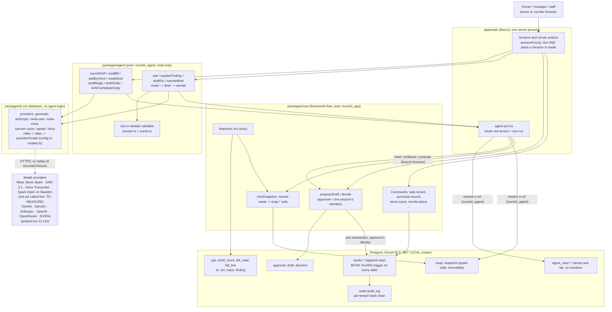

# Architecture diagram

Mermaid source (GitHub renders it). The prose is in [ARCHITECTURE.md](ARCHITECTURE.md). Boxes are code or database
objects at `c30c079`; the one dashed box is the only thing outside this repository.

Reading the arrows. Nothing in `packages/agent` has an arrow to `books` or to a writer: its only way to change anything
is `propose`, which becomes a row in `approval.draft` that waits for a person. The only arrows into `books` are a
person's own command and `decide()` run on an approver's request; the guard trigger on the table checks both.
