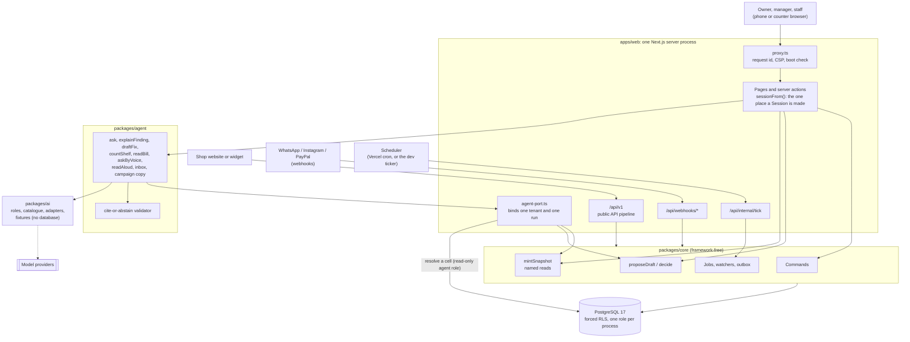
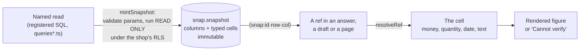
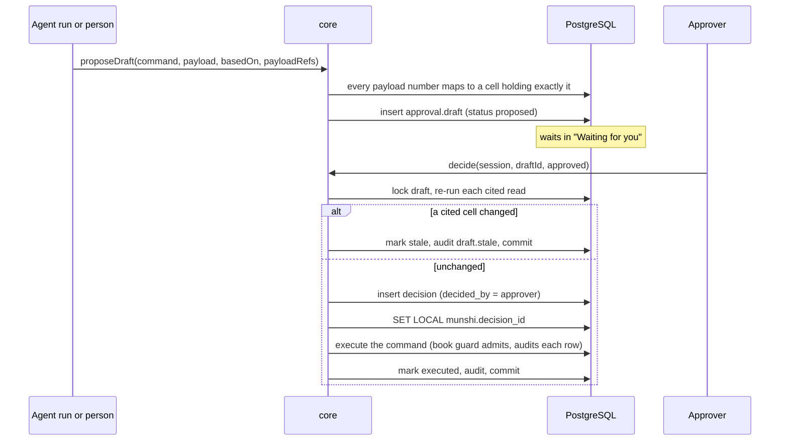
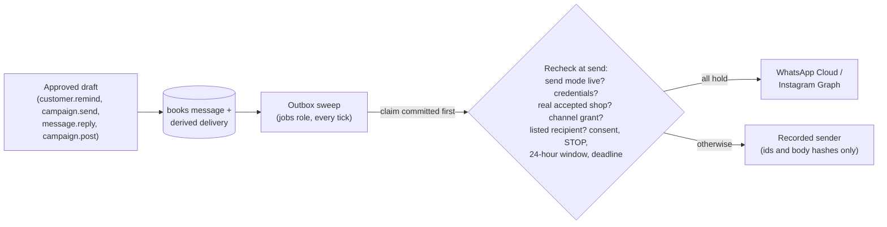
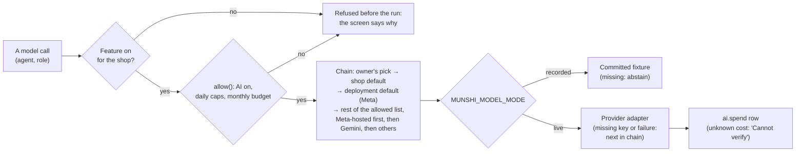

# Architecture

How Munshi is built, and how the code holds its One Guarantee: *nothing changes the books without a named person's
approval, and every number shown traces to a ledger row.* Where this page and the code disagree, the code wins; every
section names the files to read.

- [The parts](#the-parts)
- [Package boundaries](#package-boundaries)
- [The database](#the-database): schemas, roles, row-level security, context, the book guard, the audit chain
- [Snapshots and cells](#snapshots-and-cells)
- [Drafts and decisions](#drafts-and-decisions)
- [Request flows](#request-flows): a page, an Ask question, an approval, an outbound message, a webhook, the jobs tick
- [The agent layer](#the-agent-layer)
- [Model routing](#model-routing)
- [Caching and the PWA](#caching-and-the-pwa)
- [Channels and payments](#channels-and-payments)
- [The public API and the shop sites](#the-public-api-and-the-shop-sites)

## The parts



There is one server process and no separate API service. The agent runs inside it, so the shop and the person always
come from the authenticated session, never from a model argument. No tool schema has a tenant field.

## Package boundaries

| Package | Owns | May not |
|---|---|---|
| [`apps/web`](../apps/web) | Screens, server actions, route handlers, the request hook, the agent's port | Hold domain rules; components call core |
| [`packages/core`](../packages/core) | Money, time, sessions (`withTx`), commands, approvals, named reads and snapshots, watchers, jobs, the platform, AI switches, caps and spend. Holds the app pool (`createAppPool`, role `munshi_app`) | Import the agent or a framework |
| [`packages/agent`](../packages/agent) | The agent flows, tools, recipes and the cite-or-abstain validator | Import any core writer, the app pool or the database URL. It imports only `@munshi/core/read` |
| [`packages/ai`](../packages/ai) | Roles, the model catalogue, provider adapters, transport (timeouts, retries, redaction), recorded fixtures, prices | Import any `@munshi` package, a database driver or the app |
| [`packages/adapters`](../packages/adapters) | Channels, payments, identity, cache, media store, bot check: each behind a small port | Hold domain rules |
| [`packages/config`](../packages/config) | The only reader of `process.env`; boot checks; errors that name settings, never values | |
| [`packages/contracts`](../packages/contracts) | API v1 as zod schemas, `openapi.json`, the SDK's generated types | |
| [`packages/sdk`](../packages/sdk), [`packages/widgets`](../packages/widgets) | The dependency-free API client, and an order widget built on it | Reach anything but the public API |
| [`apps/sites`](../apps/sites), [`apps/elite`](../apps/elite), [`apps/prabhave`](../apps/prabhave) | The shop websites: the shared code, and one thin app per business | Hold a figure of their own; they read only through the SDK |

These lines are tests, not conventions. Source-scanning gates in
[`packages/core/test/boundary.test.ts`](../packages/core/test/boundary.test.ts) follow every import of every agent file
and fail on any path to a core writer, a computed `import()`, or `createRequire` (B1, B2); hold that only `withTx` names
the acting-member setting (B3) and only `mintSnapshot` writes `snap.*` (B4); and keep `packages/ai` free of any
`@munshi` package or database driver (B6).

## The database

PostgreSQL 17. The schema is the ordered files [`db/schema/00_bootstrap.sql`](../db/schema/00_bootstrap.sql) to
[`90_seal.sql`](../db/schema/90_seal.sql), built from scratch by [`db/src/build.ts`](../db/src/build.ts); each file runs
in its own transaction and has a `.manifest.json` listing its tables, grants, policies and indexes, which the gates hold
the built database to. `90_seal.sql` asserts the whole: every function's search path pinned, no function executable by
PUBLIC, every security-definer function on its list, every command writing a books table and every books table written
by a command.

### Schemas

| Schema | Holds |
|---|---|
| `ref` | Global constants (commands, which roles hold them, which tables each writes), written only by schema files |
| `ops` | Tenancy, members, documents, sign-in, inbound messages, orders and other operational rows |
| `books` | The books: guarded and append-only |
| `approval` | Drafts and decisions |
| `snap` | Snapshots: the only source of a number on screen |
| `audit` | The per-shop hash chain |
| `ai` | Runs, traces, findings, answers, briefs, usage and spend |
| `agent_view` | The agent's views: names and ids, no numbers |
| `idp` | The password identity adapter's tables |
| `platform` | The superadmin's world: operators, platform changes, model lists, grants |

### Roles

Created by `00_bootstrap.sql`. None is a superuser, none bypasses row-level security, none creates roles or databases.

| Role | Used by | Notes |
|---|---|---|
| `munshi_owner` | Owns every schema, table, view and function | Cannot log in |
| `munshi_migrator` | The build | May `SET ROLE munshi_owner` without inheriting it |
| `munshi_app` | Members' requests (`packages/core`) | The only role the book guard admits |
| `munshi_agent` | The agent's reads | SELECT on `snap` and the `agent_view` views; nothing else |
| `munshi_jobs` | The jobs tick, watchers, the outbox | Writes findings and briefs, never a book row |
| `munshi_public` | `/api/v1`, webhooks, sign-in rate counters | Sets its own shop context per request |
| `munshi_idp` | The password identity adapter | Its own `idp` tables |
| `munshi_platform` | The superadmin console | No grant on any shop's books, approvals, snapshots or audit chain |

At boot, the web app checks that each of its six pools connects as its own role and that none is a superuser or
bypasses RLS ([`apps/web/lib/server/db.ts`](../apps/web/lib/server/db.ts)); it also refuses a database built from
different schema files than the ones compiled into the build. Until boot passes, every route answers 503
([`apps/web/proxy.ts`](../apps/web/proxy.ts)).

### Row-level security and context

`tenant_id` leads every key. RLS is enabled **and forced** on every tenant table, so even the owner, and therefore
every view, sees only the current shop. A transaction with no shop context sees no rows, as any role (gate G4).

Context is set only with `SET LOCAL` (in code, `set_config(name, value, true)`), inside the transaction, in exactly one
function: `withTx(pool, scope, fn)` in [`packages/core/src/session.ts`](../packages/core/src/session.ts). It sets:

| Setting | Meaning |
|---|---|
| `munshi.tenant_id` | The shop |
| `munshi.actor_id` | The acting member; empty for a system scope (a watcher, an agent run) |
| `munshi.command` | A direct command the member is running, such as `sale.record` |
| `munshi.via` | How the session was opened: demo, sandbox or real |
| `munshi.decision_id` | Set by `decide()` alone, for the approved decision being executed |

Policies and triggers read `nullif(current_setting(k, true), '')`, because a pooled connection returns `''`, not NULL,
after a `SET LOCAL` transaction ends. A `Session` is a branded type that only core can make, so a hand-built
`{ tenantId, memberId }` from a request body does not type-check
([`packages/core/test/types.ts`](../packages/core/test/types.ts)).

### The book guard

`books.write()` in [`db/schema/02_shared.sql`](../db/schema/02_shared.sql) runs before every insert, update or delete on
every books table:

1. UPDATE is refused; DELETE is refused (the one exception: the owner role resetting a sandbox shop).
2. Only `munshi_app` writes; the row must be for the current shop, and the shop must be open (accepted, or a sample).
3. The insert is admitted under **either**
   - **an approved decision of this transaction:** `munshi.decision_id` names a decision that exists, is approved,
     belongs to this shop, was created in this transaction (`created_txid = txid_current()`, stamped by a trigger), and
     was made by the acting member, who is active and whose role may approve the draft's command; **or**
   - **a direct command:** `munshi.command` is a command the acting member's role holds and that is not draft-only.
4. The admitting command must write this table (`ref.command_table`): holding `sale.record` admits a sale, not a price.
5. The guard stamps `created_by`, `decision_id`, `created_txid` and `created_at`, whatever the caller sent.
6. A child row is accepted only in its parent's transaction, so a committed bill never gains a line.
7. A reversal must be the exact negation of an unreversed original, once; a deferred check at commit makes sure every
   child of the original is reversed too.

Anything else raises `MS001` (or `MS006`, `MS013`, `MS020` for the specific rules). Journal entries must balance per
currency at commit (a deferred constraint trigger, `MS004`). An AFTER trigger writes every book row's audit entry in
the same statement, so no book row exists without an entry naming its person (gates G2, G3, G5, G6, G7, G11).

### The audit chain

`audit.audit_log` is append-only and hash-chained per shop: `hash(n) = sha256(hash(n-1) ‖ canonical(entry n))`. The
insert trigger assigns the sequence, the previous hash and the hash, under a per-shop advisory lock. Entries carry ids
and codes only, never free text or numbers. `audit.verify_chain(tenant)` recomputes the chain and returns the first
broken entry. The chain is unkeyed; see [security.md](security.md#residual-risks).

## Snapshots and cells

Every number on screen renders from a stored snapshot cell.



- **Named reads only.** [`packages/core/src/queries.ts`](../packages/core/src/queries.ts) is the registry; nothing
  registers a read at run time, and an unknown name is refused. `mintSnapshot` (in
  [`snapshots.ts`](../packages/core/src/snapshots.ts)) runs the read inside a savepoint set `READ ONLY`, so even a
  registered read cannot write, and stores at most 500 rows.
- **Typed cells.** Integer, money (minor units and currency), quantity (milli-units and unit), text, date, timestamp.
  The database checks the shape and stamps the snapshot's shop, transaction and actor. A stored snapshot never changes.
- **References.** A ref `⟨snap:ID·row·col⟩` resolves to one cell
  ([`packages/core/src/read.ts`](../packages/core/src/read.ts)). Model prose carries refs, never free digits.
- **Who may read what.** One map from role to named read,
  [`packages/core/src/read-roles.ts`](../packages/core/src/read-roles.ts), is enforced wherever a snapshot is minted
  or loaded back, so screens, Ask, Why?, recipes and read-aloud pass the same gate. Office-only columns (unit cost,
  stock value, value at risk, loss) are cut from rows sent to counter staff.
- **Retention.** A snapshot cited by a draft, finding, answer, brief or site release is pinned; the jobs role purges
  unpinned display, watch and evidence snapshots after seven days.

## Drafts and decisions



- **Propose** ([`packages/core/src/approvals.ts`](../packages/core/src/approvals.ts)). The command must be one core
  implements and the payload must parse against its schema. `basedOn` must cite stored cells of this shop, and
  `payloadRefs` must map the JSON path of **every** number in the payload to a cell holding exactly that number. A
  command that moves stock or money must also cite the current on-hand cell of each item it names. A typed amount is
  refused.
- **Decide.** The approver is the session's member; there is no other parameter for it. A decision is made once per
  draft and admits writes only in the transaction that made it, so it cannot be replayed later or by another shop.
  Rejecting or marking stale takes the same authority as approving.
- **Results carry ids only.** A command returns the ids of the rows it wrote, never a number; a number to show is
  minted from the books as a snapshot cell.

## Request flows

### A page

1. `proxy.ts` gives the request an id and a content-security policy with a fresh nonce, and serves nothing until boot
   passes.
2. The page calls `sessionFrom(cookies)` ([`apps/web/lib/server/session.ts`](../apps/web/lib/server/session.ts)): it
   verifies the cookie's HMAC (timing-safe) and expiry, then core checks the session row is live and the member active.
3. A loader such as [`apps/web/lib/server/home.ts`](../apps/web/lib/server/home.ts) calls a core view
   (`viewHome`, [`packages/core/src/views-home.ts`](../packages/core/src/views-home.ts)) inside one `withPage`
   transaction as that member. The view mints or loads snapshots and returns cells.
4. The page renders each figure from its cell, with its source a tap away
   ([`SourceDrawer.tsx`](../apps/web/components/SourceDrawer.tsx), [`WhyChain.tsx`](../apps/web/components/WhyChain.tsx)).

A direct command from a form ([`apps/web/lib/server/act.ts`](../apps/web/lib/server/act.ts)) takes the person from
the session (never the form), requires the form's idempotency key, and calls core's `runCommand`, which runs under a
`member` scope with `munshi.command` set.

### An Ask question

```mermaid
sequenceDiagram
  participant U as Person
  participant W as apps/web
  participant G as packages/agent
  participant M as Model (via packages/ai)
  participant C as core / PostgreSQL
  U->>W: question (typed, or a WAV)
  W->>C: start ai.run for this member; build the port
  G->>M: router: pick a desk (JSON schema)
  loop at most 8 tool calls, 45 s budget
    G->>M: reason, with that desk's tools
    M-->>G: call a named read by handle
    G->>C: port.read: mint an evidence snapshot
  end
  G->>M: narrate: short segments with cell refs
  G->>C: validator: resolve every ref under RLS
  alt any rule fails
    G-->>W: "Cannot verify" + rule names
  else
    G-->>W: answer rendered from cells
  end
```

- The router picks one desk the person's role may use: stock, sales or credit
  ([`packages/agent/src/tools.ts`](../packages/agent/src/tools.ts), `ASK_DESKS` in `read-roles.ts`).
- Tools are named reads only. The model never sees a uuid: ids appear as handles (`item:3`), and a tool accepts back
  only a handle this run showed. Reads and notes reach a model only inside delimited data blocks with control and
  bracket characters escaped.
- The validator ([`packages/agent/src/answer.ts`](../packages/agent/src/answer.ts)) refuses a free digit, a number
  word in English or Hindi, another script, a unit or currency glued to text, an unknown handle, an id used as a
  number, or a cell from another run or shop. Any failure fails the whole answer.
- Traces store kinds, fixed labels, ids and timings; never the question, model text, a name or bill text.

A voice question is transcribed (the voice role) and then asked like a typed one
([`voice.ts`](../packages/agent/src/voice.ts)). A shelf photo ([`shelf.ts`](../packages/agent/src/shelf.ts)) has the
vision role name the products against the catalogue and the segment role count boxes per product; plain code compares
the count cell with the on-hand cell. A bill ([`bill.ts`](../packages/agent/src/bill.ts)) is read into a
`purchase.record` draft whose numbers are cells of the stored bill. Each of these ends in a draft or an answer, never a
book row.

### An approval

1. The tray card posts `decideDraft` ([`apps/web/app/actions.ts`](../apps/web/app/actions.ts)) with the draft id and a
   verdict. The approver comes from `sessionFrom`, never the form.
2. `decide()` runs as described in [Drafts and decisions](#drafts-and-decisions).
3. If the decision queued a message, the app flushes the outbox once as the jobs role, so a recorded send shows at once
   instead of at the next tick.

### An outbound message



A message to a customer or supplier is a book: it is written only by a person's command or an approved draft, and the
database derives its delivery in that transaction. The sweep
([`packages/core/src/outbox.ts`](../packages/core/src/outbox.ts)) claims each delivery once, commits the claim before
any provider call, rechecks everything at send time, and hands it to the sender its mode names. A delivery that cannot
be sent waits and lapses at its deadline, so a late send stays inside the window its approval gave. Outside WhatsApp's
24-hour window, only an approved template whose exact wording is configured is sent.

### A webhook

| Route | Checks before parsing | Stores |
|---|---|---|
| [`/api/webhooks/whatsapp`](../apps/web/app/api/webhooks/whatsapp/route.ts) | `X-Hub-Signature-256` over the raw body, timing-safe | Inbound messages and delivery statuses as `ops` rows, for a number a shop listed |
| [`/api/webhooks/instagram`](../apps/web/app/api/webhooks/instagram/route.ts) | The same signature, under the Instagram app secret; 404 when not configured | Direct messages as `ops` rows, for the one shop whose grant names the account |
| [`/api/webhooks/paypal`](../apps/web/app/api/webhooks/paypal/route.ts), and the same handler at [`/api/webhooks/payments`](../apps/web/app/api/webhooks/payments/route.ts) | PayPal's own verify-webhook-signature call for the configured webhook id | The payment event, which a watcher raises as a finding |

A bad or missing signature gets an empty 404. A webhook runs as `munshi_public` with no actor, so the database lets it
insert a new, unhandled message and nothing else; it never writes a book row and never calls a model. A shop waiting
for the operator's acceptance stores no inbound message at all.

### The jobs tick

[`/api/internal/tick`](../apps/web/app/api/internal/tick/route.ts) admits only `Authorization: Bearer <CRON_SECRET>`
(compared as hashes, timing-safe; anything else is a 404 that opens no database connection). It runs, as
`munshi_jobs` with no actor:

- the back office ([`brief-schedule.ts`](../packages/core/src/brief-schedule.ts)): the watchers, at most once an hour
  per shop, and the morning brief once the shop's day reaches its hour;
- the registered jobs ([`jobs.ts`](../packages/core/src/jobs.ts)): the outbox, PayPal link sweeps, holds, order
  requests, snapshot purges, retention, and the purge of real-shop sign-ups not accepted in 14 days.

Each job's slot is claimed in `ops.job_claim`, so two ticks never run one twice. Watchers
([`watchers.ts`](../packages/core/src/watchers.ts)) snapshot a `watch.*` named read and raise one finding per row; the
dedupe key is the kind plus the read's key columns, so a situation is raised once however often they run.

How often the tick runs is the scheduler's choice: locally the dev ticker calls it every minute; the hosted cron in
[`vercel.json`](../vercel.json) calls it once a day, so on that deployment watchers and the brief run daily. Sends do not
wait for the tick: an approval that queues a message, and a PayPal link's approval, flush the outbox (and the PayPal
sweep) for that shop at once.

## The agent layer

The agent ([`packages/agent`](../packages/agent)) holds no pool. The app builds its port for each run
([`apps/web/lib/server/agent-port.ts`](../apps/web/lib/server/agent-port.ts)), bound to one shop and one run:

| Port method | Runs as | Does |
|---|---|---|
| `read` | the member, through core | Mints an evidence snapshot of a named read the member may read |
| `resolve` | `munshi_agent`, read-only transaction | Returns a stored cell under the shop's RLS |
| `finding` | the member, through core | A finding's state and the cells of its row |
| `propose` | the member, through core | `proposeDraft` for this run: a draft that waits for a person |
| `recordCount`, `recordBill` | the member, through core | Store a photo's count or a read bill as evidence |
| `models`, `allow` | core | The model chain for this agent and role; the caps check before each call |
| `trace` | the member | Kind, fixed label, ids and timing only |

Flows: `ask`, `explainFinding`, `draftFix` (fixed recipes, no model:
[`recipes.ts`](../packages/agent/src/recipes.ts)), `narrateBrief`, `countShelf`, `readBill`, `askByVoice`,
`readAloud`, `draftReply`, `draftOrder` and `writeCampaignCopy`
([`index.ts`](../packages/agent/src/index.ts)). Keeper's memory notes (a person's own words from a past decision)
reach a prompt only when models answer live.

## Model routing

Agents ask for a **role**, never a model. Roles: `router`, `reason`, `vision`, `segment` (counting boxes in a photo),
`voice` (speech to text), `narrate` and `speak` (text to speech).



- **The catalogue.** [`packages/ai/src/models.ts`](../packages/ai/src/models.ts) maps short aliases to a provider and
  model id, listing each non-Meta alias only for the roles it passed a live probe in (Meta's aliases follow Meta's documentation, as no live Meta call has been made yet); [`config.ts`](../packages/ai/src/config.ts)
  holds the defaults per role, provider base URLs and key names. The database stores aliases only, never a provider's
  model id.
- **Defaults.** Meta's models for every role Meta serves: Muse Spark for router, reason and vision; SAM 3.1 for
  segment; Muse Voice Transcribe for voice; Muse Spark Open (on Baseten) for narrate. Meta has no text-to-speech model,
  so speak defaults to Sarvam's Bulbul. A PDF bill goes to Sarvam's document reader, which the allow-list does not
  govern.
- **Fallback.** Meta-hosted models stay first in a chain; Gemini is the first fallback after them, then the other
  allowed providers (Anthropic, OpenAI, OpenRouter, NVIDIA, and Sarvam for reason, narrate and voice). In live mode a
  missing key or a failing provider moves the call on. Segment has no other provider: without Meta's key, the shelf
  count marks items as uncounted instead of guessing.
- **Per-shop router.** The operator approves the deployment's allowed aliases per role, and may narrow the list for one
  shop and set its default per role; the owner picks one model per agent from that list
  ([`packages/core/src/models.ts`](../packages/core/src/models.ts)). Every call follows one order, so the model the AI
  staff page names is the model called.
- **Switches, caps and spend.** The operator switches each shop's AI features (ask, photos, voice, read-aloud,
  narration, campaign copy, inbox drafts, memory) on or off; a switched-off feature is refused before any run or call,
  and the database refuses its writes too. `allow()` ([`allow.ts`](../packages/core/src/allow.ts)) checks the
  deployment's switch (`MUNSHI_AI`), the shop's switch, the shop's daily cap, the deployment's daily ceiling and the
  shop's monthly budget before every call. Every answered call writes an `ai.spend` row
  ([`spend.ts`](../packages/core/src/spend.ts)) priced from
  [`packages/ai/src/prices.ts`](../packages/ai/src/prices.ts); a call with no price or no reported usage has an unknown
  cost, never zero. Every list, switch and budget is an approved platform change.
- **Recorded mode.** `MUNSHI_MODEL_MODE=recorded` (the default) answers every call from a fixture keyed by the sha256
  of the request's canonical form ([`providers/fixtures.ts`](../packages/ai/src/providers/fixtures.ts)), under
  `apps/web/fixtures`, `packages/agent/fixtures` and `packages/ai/fixtures`. A missing fixture is a model error, which
  the flow turns into an abstention or a template, never an error screen. A question's prompt names the business date
  it is asked as of, so the recorded answers hold for one day: the jobs tick then keeps each sample shop's watchers and
  brief on the day its seed ran them as of (`holdSampleDay`, [`brief-schedule.ts`](../packages/core/src/brief-schedule.ts)),
  and the pages, which read as of the latest watcher run, stay on that day and say so. A real shop follows the clock.
- **Secrets.** Provider keys are read by name and scrubbed from every error message, along with any bearer token
  ([`providers/redact.ts`](../packages/ai/src/providers/redact.ts)).

## Caching and the PWA

**Cache.** The cache port ([`packages/adapters/cache`](../packages/adapters/cache)) has two adapters: an in-process
memory cache and Redis (spoken over a socket, no client library). Today it holds only the public site's reads
([`packages/core/src/cache-keys.ts`](../packages/core/src/cache-keys.ts)): the slug-to-shop lookup and a site's latest
release (10 seconds), and releases and pinned snapshots, which never change (a day). Every key starts with the
deployment and the shop id the server resolved, never request input. Each call has a 50 ms budget; a slow or absent
cache falls back to PostgreSQL. Live overlays, balances, sessions, idempotency and rate counters are never cached.

The schema also keeps a per-shop data version, `ops.tenant_version`
([`db/schema/26_version_push.sql`](../db/schema/26_version_push.sql)), raised once by every transaction that writes the
shop's state, for keying cached screen reads. No screen read is cached yet.

**PWA.** A hand-written service worker ([`apps/web/public/sw.js`](../apps/web/public/sw.js)) keeps the app shell, the
build's static files and images. It never handles a non-GET request, a server action, `/api/*`, sign-in, `/platform`
or the shop sites. Offline, an `/app` page falls back to a read-only view of the last Home and stock list, rendered
from cells stored on the device ([`apps/web/app/offline`](../apps/web/app/offline/page.tsx)). Nothing can be recorded
offline.

## Channels and payments

| Integration | Adapter | In the app |
|---|---|---|
| WhatsApp Cloud API | [`packages/adapters/channels/whatsapp.ts`](../packages/adapters/channels/whatsapp.ts) | Inbound to the inbox; approved reminders, replies and campaigns out |
| Instagram | [`packages/adapters/channels/instagram.ts`](../packages/adapters/channels/instagram.ts) | Direct messages into the inbox; an approved campaign's picture and caption posted. The approval binds the picture's id and sha256; a picture changed since makes the draft stale |
| Recorded sender | [`packages/adapters/channels/recorded.ts`](../packages/adapters/channels/recorded.ts) | Every send that is not live: ids and body hashes only |
| PayPal (sandbox) | [`packages/adapters/payments/paypal.ts`](../packages/adapters/payments/paypal.ts), [`packages/core/src/payments-paypal.ts`](../packages/core/src/payments-paypal.ts) | A payment link for an overdue balance or an open invoice, as an approved draft; its WhatsApp message is a separate draft. A paid notice writes no book row; it becomes a finding whose fix drafts `payment.record` |
| Payments feed (simulated) | [`packages/core/src/payments-feed.ts`](../packages/core/src/payments-feed.ts) | Payout batches previewed against the books, then recorded by a person as one settlement import |

Payments are recorded, never processed: Munshi never moves money. `PAYPAL_ENV` may only be `sandbox`.

## The public API and the shop sites

`/api/v1` ([`apps/web/app/api/v1`](../apps/web/app/api/v1), [`apps/web/lib/api/pipeline.ts`](../apps/web/lib/api/pipeline.ts))
serves a verified, published shop site by its slug. Every request passes, in order: the IP's rate limit; the path
parameters; the site lookup (an unknown slug, an unverified site and a bad parameter all get the same 404); the Origin
against the site's list; and for a write, the site's publishable key, the key's own limit, an `Idempotency-Key`, JSON
only, at most 4 KB, and a strict body. Each answer is parsed against the contract's response schema before it is sent.

Reads come from the shop's latest published release, as cells with refs; `GET …/refs/{snapshot}/{row}/{col}` says
which book row a figure came from. Writes are requests (an order, a booking request, a hold, an enquiry) that a person
at the shop confirms. The contract lives in [`packages/contracts`](../packages/contracts) and generates
[`openapi.json`](../packages/contracts/openapi.json) and the SDK's types.

The shop sites share their code ([`apps/sites`](../apps/sites)) and build as one thin app per business
([`apps/elite`](../apps/elite), [`apps/prabhave`](../apps/prabhave)), each holding only its own business, and read the
shop only through the SDK at request time. Deployed, they are services of the web app's Vercel project, served at
`/s/<slug>` on its domain: a site's server reads the API over its binding to the web app, and its browser calls
`/api/v1` on the page's own origin.
