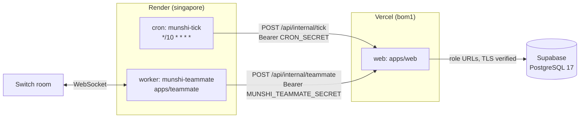

# Munshi on Render

Munshi's web app runs on Vercel and its database on Supabase ([deployment.md](deployment.md)). Two pieces need something
a serverless function can't give them: a clock that fires often, and a process that never stops. Those two run on
[Render](https://render.com), from the Blueprint [`render.yaml`](../render.yaml) at the repository root.

## What runs where

| Where | What | Why there |
|---|---|---|
| Vercel | The owner app, the API (`/api/v1`), the shop sites under `/s/<slug>`, the tick route `/api/internal/tick` | Next.js, and the services layout that routes the sites |
| Supabase | PostgreSQL 17: the books, with row-level security and the approval guard | The only place a number comes from |
| Render cron `munshi-tick` | Every 10 minutes, one authenticated call to the tick route | The agents' schedule (below) |
| Render worker `munshi-teammate` | The chat relay (`apps/teammate`): one Switch room's WebSocket, held open | A socket that must answer pings every few seconds |

### The cron: the agents' schedule

The tick route runs, for every shop, the jobs that are due, the watchers that look for leaks, and each branch's morning
brief, which the agents narrate. The watchers are meant to run hourly and each brief once its branch's morning has
come, and each call stops taking new work after about 20 seconds (for the jobs, and again for the watchers and
briefs), leaving the rest to the next call. Vercel's cron in
`vercel.json` fires once a day, so on its own the agents run once a day and a busy day's work may not finish. Render's
cron calls the same route every 10 minutes. The route decides what is due: every job, watcher run and brief claims its
slot first, so however many calls arrive, each runs once, and a call that finds nothing due does almost nothing.
Vercel's daily cron can stay as a fallback.

Each run exits non-zero on any answer but 200, so a wrong secret (404) or an unconfigured jobs database (503) shows as a
failed run on the cron's Runs page. Render runs at most one at a time.

**Why a cron job and not a Render Workflow:** Render Workflows can't schedule runs on their own (Render's docs say to
trigger them from a cron job), and the tick route already runs every shop in one call, so a workflow would only add a
second service around the same request.

### The worker: Munshi in the staff chat

The relay ([switch.md](switch.md)) keeps one Switch room's WebSocket open and passes each message addressed to Munshi to
the web app's teammate route, which decides what the sender may do. It runs as one instance: a second connection takes
the room over and the first exits. Stop any relay running elsewhere (a laptop's `pnpm teammate`) before starting this
one, or the two take the room from each other in turn.

The worker builds `apps/teammate`. If the branch Render deploys doesn't have that app, delete the worker from
`render.yaml` (or skip it when creating the Blueprint) and deploy the cron alone.

### What neither service holds

Neither Render service has a database URL, a model key or a PayPal key. Each reaches Munshi only through one route of
the web app, with one bearer secret, and the books change only as they do from the app: through a person's own command
or an approval under the approver's name. Calling the tick more often changes what runs only in timing: its jobs run
as the jobs role, which has no grant on the books and names no actor, and the watchers and briefs write findings and
briefs, never a book row.

## Settings

Every value is `sync: false` in the Blueprint: Render asks for it when the Blueprint is created, and it never appears
in the repository.

| Service | Name | Value |
|---|---|---|
| `munshi-tick` | `MUNSHI_APP_URL` | The web app's stable production origin, `https://<domain>` (the domain, not a per-deployment URL) |
| `munshi-tick` | `CRON_SECRET` | The same value as `CRON_SECRET` in the Vercel project |
| `munshi-teammate` | `SWITCH_URL` | The Switch server's address, reachable from Render (not `localhost`) |
| `munshi-teammate` | `SWITCH_AGENT_ID`, `SWITCH_AGENT_KEY` | From `pnpm teammate:register` (saved in `.env.switch`) |
| `munshi-teammate` | `SWITCH_ROOM_ID` | The room's id |
| `munshi-teammate` | `MUNSHI_TEAMMATE_SECRET` | From `pnpm teammate:register`; the same value must be set in the Vercel project, or the route answers 404 |
| `munshi-teammate` | `MUNSHI_TEAMMATE_SHOP` | The shop's slug |
| `munshi-teammate` | `MUNSHI_TEAMMATE_URL` | The web app's origin, as for `MUNSHI_APP_URL`. Unset, the relay calls `localhost` and every reply is "can't reach the shop's books" |

Node is the version `.nvmrc` names. The worker's build enables Corepack, which installs the pnpm version `package.json`
pins, and installs only the relay and the workspace packages it uses. The worker starts with `node` directly, so pnpm is
needed only at build time.

## Deploy

1. Deploy the web app first ([deployment.md](deployment.md)), and note its domain and its `CRON_SECRET`.
2. Sign in to Render with the GitHub account that holds the repository.
3. **New**, then **Blueprint**. Pick the repository and the branch to deploy. Render reads `render.yaml` and lists
   `munshi-tick` and `munshi-teammate`.
4. Enter each value from the table above, then **Apply**.
5. Check the cron: on `munshi-tick`, **Trigger Run**. The run's log must end with `tick: 200` and the route's summary
   (job names and outcomes only). A `tick: 404` means `CRON_SECRET` differs from the Vercel project's.
6. Check the worker: its log shows `relay.connected`. Post `@munshi brief` in the room.

A push to the deployed branch rebuilds both services, and a change to `render.yaml` reaches them on the next sync (on
each push while the Blueprint's auto sync is on).

## How it is tested

The Blueprint validates against Render's published schema (`https://render.com/schema/render.yaml.json`). The cron's
command (`startCommand` in `render.yaml`) exits 1 when `MUNSHI_APP_URL` or `CRON_SECRET` is unset, on any answer but
200, and when the app does not answer; it exits 0 on a 200 and never prints the secret.

The worker's build relies on `corepack enable` installing the pnpm version `package.json` pins. The relay connects to
whichever Switch server `SWITCH_URL` names; it must be reachable from Render.
