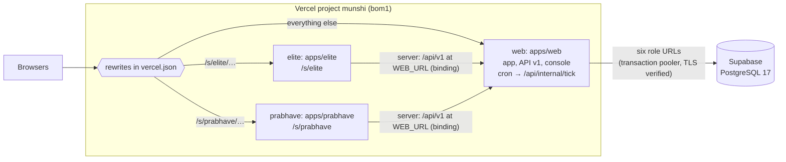

# Deployment

The hosted shape is **Supabase** (PostgreSQL 17) for the database and **Vercel** for the apps: one Vercel project with
three services, the owner app and the two shop sites, on one domain. The hosted demo is
https://munshi-sable.vercel.app. Locally, `pnpm dev` needs neither (see the [README](../README.md#quick-start)).

The detailed references are [`deploy/supabase.md`](../deploy/supabase.md) (the database, step by step, with what each
step checks) and [`deploy/vercel.md`](../deploy/vercel.md) (the project, its services, files and settings). This page
gives the overview and the exact order to deploy in. The pieces that need a frequent clock or an always-on process (the
jobs tick every 10 minutes and the chat relay) run on Render: [deploy-render.md](deploy-render.md).

## The shape



- The root [`vercel.json`](../vercel.json) defines the three services, each with its own folder, a filtered install and
  `pnpm build`, and routes `/s/elite` and `/s/prabhave` to the sites and everything else to the web app. The region
  (Mumbai) and the daily cron are set once, at the top level.
- Each site is a thin Next.js app (`apps/elite`, `apps/prabhave`) over the shared site code in `apps/sites`, with its
  business and base path fixed in its own `next.config.ts`. Its server reads the API at `WEB_URL`, which its binding to
  the web app provides; its browser calls `/api/v1` on the page's own origin, the same domain.
- The web app connects through six URLs, one per runtime role (`DATABASE_URL`, `PUBLIC_DATABASE_URL`,
  `JOBS_DATABASE_URL`, `AGENT_DATABASE_URL`, `IDP_DATABASE_URL`, `PLATFORM_DATABASE_URL`), each a different login with
  its own password. Every runtime pool sets its context only inside a transaction, so Supabase's transaction pooler is
  safe for all six. The sites open no database connection: they read only the public API. (The project's variables
  reach every service, so the site services' environment holds the URLs too; the site code never reads them.)
- Every process verifies the database server's certificate against `MUNSHI_DB_CA` (Supabase's root, shipped as
  [`deploy/supabase-root-2021.crt`](../deploy/supabase-root-2021.crt)). Verification is never turned off.

## Deploy, step by step

Run each command from the root of the main checkout (the one holding `.env` and, once the database is rebuilt,
`.env.production`), unless the step says otherwise. Never paste a value from either file into a chat, a commit or a
log. `<ref>` is the Supabase project's ref. `<domain>` is the project's stable production domain
(`https://munshi-sable.vercel.app` for the hosted demo, or the one on the project's Domains page): the "Aliased" line
of `vercel deploy --prod`, never the per-deployment URL printed above it, which Vercel's deployment protection may put behind a Vercel sign-in.
Before using `<domain>` anywhere, check it from a signed-out browser or shell: `curl -s <domain>/api/health` must answer
JSON, not a sign-in page.

After a deploy, run the checks in step 7 and in
[`deploy/vercel.md`, "Checking a deployment"](../deploy/vercel.md#checking-a-deployment).

### Before you start: the CLI, a clean clone and the database

```
npm install -g vercel@latest
vercel --version
vercel login
git clone <path to the main checkout> ~/munshi-deploy
git -C ~/munshi-deploy checkout <commit>
```

Deploy from a clean clone of the commit being deployed: it holds no `.env`, `.env.production` or `.run`.

Then rebuild the hosted database from the current schema. This reuses the existing Supabase project, wiped first.
Every command refuses unless `--confirm` names the project in its connection string, and the wipe and the build both
refuse a live deployment. `.env` must hold the project's `SESSION_POOL_CONNECTION_STRING` (the admin,
`postgres.<ref>`, port 5432) and `TRANSACTION_POOL_CONNECTION_STRING` (port 6543).

```
# a. What the wipe would drop: the ten Munshi schemas, anything else a munshi_* role owns, the eight roles. Changes nothing.
node db/src/hosted-wipe.ts --env=.env --confirm=<ref> --dry-run
# b. The wipe, in one transaction. It never touches Supabase's own schemas (auth, storage, realtime and the rest) or
#    its extensions, and refuses if a Munshi role owns anything in one of them.
node db/src/hosted-wipe.ts --env=.env --confirm=<ref>
# c. The roles again (00_bootstrap.sql), a fresh password for each login, and .env.production (mode 0600). Secrets
#    already in .env.production are kept; delete the file first to rotate them all.
node db/src/supabase-roles.ts --env=.env --out=.env.production --confirm=<ref>
# d. The schema, as the migrator, recording a hosted demo.
node --env-file=.env.production db/src/build.ts --deployment demo
# e. The demo's shops: seeded in a throwaway local PostgreSQL 17, then copied in one transaction. Prints
#    MUNSHI_DEMO_TENANT_ID and writes the first operator's sign-in to .run/hosted-operator.json (0600), replacing the
#    file from an earlier seed: that operator was dropped with the wipe. Both shop sites are published, read-only until
#    step 4 lists their origin. The demo runs live (Meta's models first, Gemini as the fallback), so seed live: that
#    dates the shops today. (If <domain> is already known, add --elite-origin=<domain> --prabhave-origin=<domain> and
#    skip step 4.)
MUNSHI_MODEL_MODE=live node --env-file=.env.production db/seed/hosted-copy.ts --confirm=<ref>
# f. The check: must print "deploy-check: ok".
node --env-file=.env.production scripts/deploy-check.ts
```

If the wipe stops on `drop role` (an admin that may not drop the roles), run it again with `--keep-roles`. Step c checks the kept roles and rotates their passwords.

Storage and email sign-up. The bucket for uploaded pictures needs `SUPABASE_URL`, `SUPABASE_SECRET_KEY` and
`SUPABASE_STORAGE_BUCKET` in `.env`. The script creates the bucket private, leaves an existing private one alone, and
refuses a public one:

```
node --env-file=.env deploy/storage-bucket.ts
```

Turning storage on sets `SUPABASE_URL`, and boot then requires `SUPABASE_PUBLISHABLE_KEY` and `MUNSHI_APP_URL` too, so
real shops' email sign-up comes on with it. Before step 5, configure Supabase Auth in the dashboard (URL configuration,
both email templates, a custom SMTP sender): [`deploy/supabase.md`](../deploy/supabase.md), step 8.

### 1. Connect the repository once, letting Vercel detect the services

In the Vercel dashboard: Add New, Project, import the Git repository. Leave the Root Directory at the repository root:
`vercel.json` there defines the services, and Vercel builds each from its own folder. Set Node.js 22.x. The import
screen should list `web`, `elite` and `prabhave`.

If the `munshi` project already exists from earlier trials, reuse it: in Settings, Build and Deployment, clear its Root
Directory (it was `apps/web`) and any build or install command override. The `munshi-elite` and `munshi-prabhave`
projects of the three-project layout are not used; delete them if they were created.

Then link the clean clone (remove any `.env.local` this writes, unread):

```
vercel link --yes --project munshi --cwd ~/munshi-deploy
```

### 2. Push the environment

The demo runs with live models: Meta's first, Gemini as the fallback (`packages/ai/src/config.ts`). So `.env` must hold
`META_MODEL_API_KEY` and `GEMINI_API_KEY` (any other provider's key is optional), and the push sets
`MUNSHI_MODEL_MODE=live`.

```
# From the main checkout: database URLs, secrets, model keys and the console's key.
node deploy/vercel-env.ts --project=munshi --cwd=$HOME/munshi-deploy --with-console \
  --set MUNSHI_DEMO_TENANT_ID=<id printed by the seed> --set MUNSHI_MODEL_MODE=live
```

One project means one list of variables: every service sees every name (the list is in
[`deploy/vercel.md`](../deploy/vercel.md#production-environment-names)). The sites need no address: `WEB_URL` comes
from their binding. If the project was used before, list its variables (`vercel env ls production --cwd
~/munshi-deploy`) and remove the three-project names with `vercel env rm <NAME> production --cwd ~/munshi-deploy`:
`MUNSHI_SITE`, `MUNSHI_SITE_KEY`, `MUNSHI_SITES_*`, `NEXT_PUBLIC_MUNSHI_SITES_BASE_PATH`, `MUNSHI_API_URL`,
`MUNSHI_PUBLIC_API_URL`, and `NEXT_PUBLIC_MUNSHI_SITE_SAMPLE` (the sites present as the shops' own; `1` would label
every page a sample).

### 3. Deploy

```
cd ~/munshi-deploy
vercel deploy --prod
```

(or push the commit to the production branch, once the repository is connected). Note `<domain>` from the "Aliased"
line, and check `curl -s <domain>/api/health` from a signed-out shell.

### 4. List the domain as both sites' origin

The sites are served on `<domain>` under `/s/elite` and `/s/prabhave`, so their browser writes carry that origin. List
it for both and issue each site's publishable key, on the seeded database:

```
node --env-file=.env.production db/src/site-origins.ts --confirm=<ref> \
  --elite-origin=<domain> --prabhave-origin=<domain>
```

It refuses unless the database is a hosted demo and both sites are the showcase tenants'. It writes the keys to
`.run/hosted-site-keys.json` (0600) and prints only the file's path. Run again, it issues new keys and the earlier
ones keep working.

### 5. Push the keys and the domain

The site keys come from `.run/hosted-site-keys.json` without being shown, and the project's own origin is its
`MUNSHI_APP_URL`. Re-sending the step 2 names is harmless (`--force`):

```
node deploy/vercel-env.ts --project=munshi --cwd=$HOME/munshi-deploy --with-console \
  --set MUNSHI_DEMO_TENANT_ID=<id> --set MUNSHI_MODEL_MODE=live --set MUNSHI_APP_URL=<domain> \
  --set MUNSHI_SITE_KEY_ELITE="$(node -p "require('./.run/hosted-site-keys.json').MUNSHI_SITE_KEY_ELITE")" \
  --set MUNSHI_SITE_KEY_PRABHAVE="$(node -p "require('./.run/hosted-site-keys.json').MUNSHI_SITE_KEY_PRABHAVE")"
```

The script refuses a key under the other business's name. Then the Supabase names, by hand (`vercel-env.ts` refuses
every `SUPABASE_*` name); each `vercel env add` asks for the value:

```
vercel env add SUPABASE_URL production --project munshi --cwd ~/munshi-deploy
vercel env add SUPABASE_PUBLISHABLE_KEY production --project munshi --cwd ~/munshi-deploy
vercel env add SUPABASE_SECRET_KEY production --project munshi --cwd ~/munshi-deploy --sensitive
vercel env add SUPABASE_STORAGE_BUCKET production --project munshi --cwd ~/munshi-deploy
```

### 6. Redeploy

Variables apply to the next deployment:

```
cd ~/munshi-deploy && vercel deploy --prod
```

### 7. Check the deployment

```
curl -s <domain>/api/health                   # {"ok":true,…,"deployment":"demo"}; a 503 names its refusal code
```

- **Sign-in:** `<domain>/sign-in` opens, and `<domain>/demo` lists the sample shops and opens the kirana.
- **The console:** `<domain>/platform/sign-in` with the email and password in `.run/hosted-operator.json`, and a code
  from the authenticator app holding that file's `otpauth` URI. The page must not be linked from anywhere on the site.
- **The sites:** `<domain>/s/prabhave` renders the catalogue with its figures (so its server read the API over the
  binding), and `<domain>/s/elite` and `<domain>/s/elite/hi` render too, with their styles and fonts (assets under
  `/s/<slug>/_next`). A booking request on `<domain>/s/elite/book` and a hold on a Prabhave piece are accepted; before
  step 4 and 5 they are refused, and the pages still render. On a preview URL they are refused (it is not listed).
- **The tick cron:** call it once by hand, without printing the secret, and expect `200`:

  ```
  node --env-file=.env.production -e 'fetch(process.argv[1] + "/api/internal/tick", { headers: { authorization: "Bearer " + process.env.CRON_SECRET } }).then((r) => console.log(r.status))' <domain>
  ```

  Then confirm the next day that the cron's own run (06:11 IST) logged a 200 in the project's Cron Jobs tab.

## Settings a hosted deployment needs

The full list is in [`deploy/vercel.md`](../deploy/vercel.md#production-environment-names); every name, with comments,
is in [`.env.example`](../.env.example).

## How the tooling is tested

The deploy tooling has offline tests: the wipe against a private PostgreSQL 17 with a non-superuser admin and planted
Supabase schemas (WIPE1, `db/test/v2/deploy/hosted-wipe.test.ts`); the bootstrap and build as that admin (SUPA1,
[`db/test/v2/gates/00-bootstrap.test.ts`](../db/test/v2/gates/00-bootstrap.test.ts)); the deploy check's refusals; the
bucket script against a stand-in for Storage's API, which answers a missing bucket with 400 or 404, both handled
(BUCKET1); `vercel-env.ts` (VERCEL-ENV1-2), which prints FAILED for each name it could not set and exits 1; the
services layout (`db/test/v2/deploy/vercel.test.ts`); and the hosted seeds, which publish both sites and, given the
origins, list each site's origin and issue its key (HOSTSITES, `db/test/v2/core/seed/hosted-sites.test.ts`). The three
services' production builds run locally from only the files `.vercelignore` uploads, each after its own filtered
install, with only Vercel's build environment set.

The Redis adapter does not speak TLS, so a hosted deployment uses the in-process cache.
