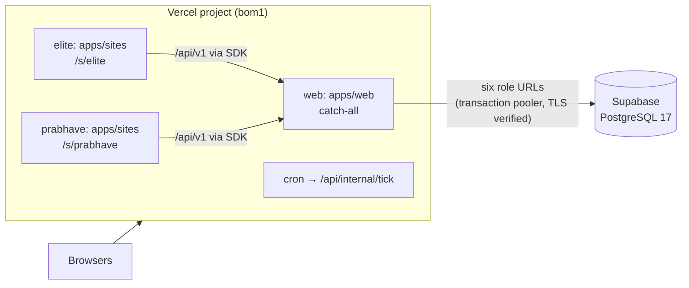

# Deployment

The hosted shape is **Supabase** (PostgreSQL 17) for the database and **Vercel** for the app, with one Vercel project
serving the owner app and both shop sites. Locally, `pnpm dev` needs neither (see the [README](../README.md#quick-start)).

The step-by-step runbooks, with every command and check, are [`deploy/supabase.md`](../deploy/supabase.md) and
[`deploy/vercel.md`](../deploy/vercel.md). This page is the overview.

## The shape

- [`vercel.json`](../vercel.json) defines three services from one repository: `web` (`apps/web`) and two builds of
  `apps/sites`, one per shop, under `/s/elite` and `/s/prabhave`. The site rewrites come before the web catch-all. A
  daily cron calls the jobs tick.
- The app connects through six URLs, one per runtime role (`DATABASE_URL`, `PUBLIC_DATABASE_URL`, `JOBS_DATABASE_URL`,
  `AGENT_DATABASE_URL`, `IDP_DATABASE_URL`, `PLATFORM_DATABASE_URL`), each a different login with its own password.
  Every runtime pool sets its context only inside a transaction, so Supabase's transaction pooler is safe for all six.
- Every process verifies the database server's certificate against `MUNSHI_DB_CA` (Supabase's root, shipped as
  [`deploy/supabase-root-2021.crt`](../deploy/supabase-root-2021.crt)); verification is never turned off.

## Steps

1. **Create the database.** A Supabase project in Mumbai, then check: PostgreSQL 17, `btree_gist` available, and that
   the transaction pooler accepts node-postgres's parameterised queries and transaction-local settings.
2. **Bootstrap and set passwords** as the admin: [`db/src/supabase-roles.ts`](../db/src/supabase-roles.ts) applies
   `00_bootstrap.sql`, sets a fresh password for each of the seven logins, and writes a git-ignored
   `.env.production` with each role's URL, the TLS root and fresh deploy secrets. It prints names, never values.
3. **Build** as the migrator: `node --env-file=.env.production db/src/build.ts --deployment demo`. This applies every
   schema file and records the deployment's kind in the database, which the app checks at boot.
4. **Seed** the sample shops: `node --env-file=.env.production db/seed/hosted.ts --confirm=<project ref>` (or
   `db/seed/hosted-copy.ts`, which seeds locally and copies in one transaction, far faster over the network). It refuses
   unless the ref matches the URL, the database is a hosted demo and no shop exists yet. It also enrols the first
   platform operator, whose sign-in it writes to a mode-0600 file, never to the terminal.
5. **Check** from a clean checkout of the commit to deploy:
   `node --env-file=.env.production scripts/deploy-check.ts` must print `deploy-check: ok`. It refuses a missing or
   shared URL or password, a login that is not its role, a superuser or BYPASSRLS login, a database built from other
   schema files, and Supabase API roles that can reach a Munshi schema ([`db/src/deploy-check.ts`](../db/src/deploy-check.ts)).
6. **Set Vercel's variables** with [`deploy/vercel-env.ts`](../deploy/vercel-env.ts). It sends the role URLs, the
   deploy secrets and any model keys, printing names only. It never sends the migrator's or admin's URL, and refuses
   channel and Supabase settings, which are set by hand only on a deployment meant to use them. The superadmin
   console's key is sent only with `--with-console`.
7. **Deploy** from the same commit, then check `GET /api/health` answers `{"ok": true, …}` (a 503 names its refusal
   code) and that the cron's first run gets a 200 from `/api/internal/tick`.

## Settings a hosted deployment needs

| Setting | Purpose |
|---|---|
| The six role URLs, `MUNSHI_DB_CA` | Database connections, one role each, TLS verified |
| `MUNSHI_DEPLOYMENT` | `demo` or `live`; must match the database's own record, or boot refuses |
| `MUNSHI_SESSION_SECRET` | Signs the session cookie (32 random bytes as hex) |
| `MUNSHI_IDENTITY_SECRET`, `MUNSHI_RATE_SECRET` | Real sign-in (email HMAC key) and the IP-hash key for rate limits |
| `CRON_SECRET` | The jobs tick's bearer secret |
| `MUNSHI_DEMO_TENANT_ID` | The demo shop the demo sign-in lists (printed by the seed) |
| `MUNSHI_MODEL_MODE`, the model keys | `recorded` by default; `live` with keys |
| `MUNSHI_API_URL`, `MUNSHI_SITE_KEY_ELITE`, `MUNSHI_SITE_KEY_PRABHAVE` | The shop sites' API origin and publishable keys |
| `SUPABASE_URL`, `SUPABASE_PUBLISHABLE_KEY`, `MUNSHI_APP_URL` | Real-shop sign-up by verified email; unset, the site offers no real sign-up |
| `SUPABASE_SECRET_KEY`, `SUPABASE_STORAGE_BUCKET` | A private bucket for campaign pictures |
| `MUNSHI_PLATFORM_SECRET` | The superadmin console's key; unset, every `/platform` page is 404. A live deployment requires it |
| `MUNSHI_SEND_MODE`, `MUNSHI_AI`, `MUNSHI_CACHE_URL` | Sends stay recorded unless `live`; `MUNSHI_AI=off` stops every model call; the cache falls back to memory |

The full list with comments is [`.env.example`](../.env.example).

## Not yet verified

The deploy tooling is tested offline against local PostgreSQL 17 clusters (for example, the bootstrap on a
non-superuser admin and the deploy check's refusals, in [`db/test/v2/deploy`](../db/test/v2/deploy) and
[`db/test/v2/gates/00-bootstrap.test.ts`](../db/test/v2/gates/00-bootstrap.test.ts)). A complete hosted run of every
step is not yet recorded. Open points:

- Supabase: the free plan's region, the pooler's handling of node-postgres's statements, and the admin's behaviour on
  the bootstrap.
- Vercel: packaging two builds of one app from one root, which earlier previews built but failed to package. The
  fallback is one Vercel project per app.
- The Redis adapter does not speak TLS, so a hosted deployment uses the in-process cache.
