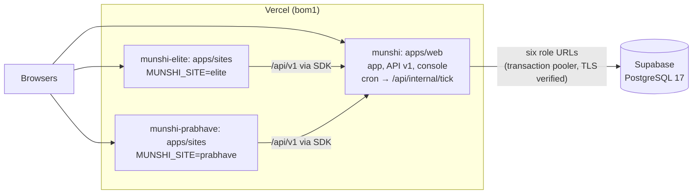

# Deployment

The hosted shape is **Supabase** (PostgreSQL 17) for the database and **Vercel** for the apps: three Vercel projects,
one for the owner app and one for each shop site. Locally, `pnpm dev` needs neither (see the
[README](../README.md#quick-start)).

The detailed references are [`deploy/supabase.md`](../deploy/supabase.md) (the database, step by step, with what each
step checks) and [`deploy/vercel.md`](../deploy/vercel.md) (the projects, their files and their settings). This page
gives the overview and the exact order to deploy in.

## The shape



- Each project's Root Directory is its app; each app's `vercel.json` sets a filtered install, Mumbai and, for the web
  app, the daily cron. The two site projects share `apps/sites/vercel.json`; the project's `MUNSHI_SITE` picks the
  business. There is no `vercel.json` at the root.
- The web app connects through six URLs, one per runtime role (`DATABASE_URL`, `PUBLIC_DATABASE_URL`,
  `JOBS_DATABASE_URL`, `AGENT_DATABASE_URL`, `IDP_DATABASE_URL`, `PLATFORM_DATABASE_URL`), each a different login with
  its own password. Every runtime pool sets its context only inside a transaction, so Supabase's transaction pooler is
  safe for all six. The sites hold no database URL: they read only the public API.
- Every process verifies the database server's certificate against `MUNSHI_DB_CA` (Supabase's root, shipped as
  [`deploy/supabase-root-2021.crt`](../deploy/supabase-root-2021.crt)). Verification is never turned off.

## Deploy, step by step

Run each command from the root of the main checkout (the one holding `.env` and, after step 4, `.env.production`),
unless the step says otherwise. Never paste a value from either file into a chat, a commit or a log. `<ref>` is the
Supabase project's ref. `<web>`, `<elite>` and `<prabhave>` are the three projects' stable production domains
(`https://<project>.vercel.app`, or the one on the project's Domains page): the "Aliased" line of `vercel deploy --prod`,
never the per-deployment URL printed above it, which Vercel's deployment protection may put behind a Vercel sign-in.
Before using `<web>` anywhere, check it from a signed-out browser or shell: `curl -s <web>/api/health` must answer
JSON, not a sign-in page. Steps marked UNVERIFIED have not yet been run against the real accounts.

### 1. Upgrade the Vercel CLI

```
npm install -g vercel@latest
vercel --version
```

The commands below were checked against the help of CLI 60.1.3 (`project update --root-directory`, `env add --force
--project`, `link --yes --project`).

### 2. Sign in

```
vercel login
```

If the projects belong to a team, add `--scope <team>` to the `vercel project` commands in step 3.

### 3. Create the three projects and make a clean clone to deploy from

```
vercel project add munshi
vercel project add munshi-elite
vercel project add munshi-prabhave
vercel project update munshi          --root-directory apps/web   --framework nextjs --node-version 22.x --yes
vercel project update munshi-elite    --root-directory apps/sites --framework nextjs --node-version 22.x --yes
vercel project update munshi-prabhave --root-directory apps/sites --framework nextjs --node-version 22.x --yes
```

`munshi` may already exist from the one-project trials. Then `project add` fails for it: skip that line, keep the
`update`, and after step 5 list its variables (`vercel env ls production` in the clean clone, linked to `munshi`).
Remove any that the web project does not take (the `MUNSHI_SITE*` names, `MUNSHI_SITES_*`,
`NEXT_PUBLIC_MUNSHI_SITES_BASE_PATH`, `MUNSHI_API_URL`, `MUNSHI_PUBLIC_API_URL`) with `vercel env rm <NAME> production`.
They do no harm, but leaving them makes it unclear which names each project actually uses.

In the dashboard, for `munshi`: Settings, Build and Deployment, Root Directory. Keep "Include files outside the root
directory in the Build Step" on, because the web build reads `../../db/schema` (UNVERIFIED: this is the default for a new project).

Deploy from a clean clone of the commit being deployed. A clean clone holds no `.env`, `.env.production` or `.run`:

```
git clone <path to the main checkout> ~/munshi-deploy
git -C ~/munshi-deploy checkout <commit>
```

### 4. Rebuild the hosted database from the current schema

This reuses the existing Supabase project, wiped first. Every command refuses unless `--confirm` names the project in its
connection string, and the wipe and the build both refuse a live deployment. `.env` must hold the project's
`SESSION_POOL_CONNECTION_STRING` (the admin, `postgres.<ref>`, port 5432) and `TRANSACTION_POOL_CONNECTION_STRING`
(port 6543).

```
# a. What the wipe would drop: the ten Munshi schemas, anything else a munshi_* role owns, the eight roles. Changes nothing.
node db/src/hosted-wipe.ts --env=.env --confirm=<ref> --dry-run
# b. The wipe, in one transaction. It never touches Supabase's own schemas (auth, storage, realtime and the rest) or
#    its extensions, and refuses if a Munshi role owns anything in one of them.
node db/src/hosted-wipe.ts --env=.env --confirm=<ref>
# c. The roles again (00_bootstrap.sql), a fresh password for each login, and .env.production (mode 0600). Secrets
#    already in .env.production are kept; delete the file first to rotate them all.
node db/src/supabase-roles.ts --env=.env --out=.env.production --confirm=<ref>
# d. The schema, as the migrator, recording a hosted demo.
node --env-file=.env.production db/src/build.ts --deployment demo
# e. The demo's shops: seeded in a throwaway local PostgreSQL 17, then copied in one transaction. Prints
#    MUNSHI_DEMO_TENANT_ID and writes the first operator's sign-in to .run/hosted-operator.json (0600), replacing the
#    file from an earlier seed: that operator was dropped with the wipe. Both shop sites are published.
#    The demo runs live (Meta's models first, Gemini as the fallback), so seed live: that dates the shops today.
#    With the sites' origins (<elite> and <prabhave>, see below) each site lists its own and gets a publishable key,
#    written to .run/hosted-site-keys.json (0600), never printed. Without them the sites stay read-only until step 5's
#    site-origins.ts.
MUNSHI_MODEL_MODE=live node --env-file=.env.production db/seed/hosted-copy.ts --confirm=<ref> \
  --elite-origin=<elite> --prabhave-origin=<prabhave>
# f. The check: must print "deploy-check: ok".
node --env-file=.env.production scripts/deploy-check.ts
```

`<elite>` and `<prabhave>` are known once each site project has been deployed to production (step 6). On a first
deploy, leave the two origin flags out of step 4e; the seed then says the sites stay read-only, and step 5 adds the
origins and keys once the sites have their domains.

If the wipe stops on `drop role` (an admin that may not drop the roles: UNVERIFIED on Supabase), run it again with
`--keep-roles`. Step c checks the kept roles and rotates their passwords.

Storage and email sign-up. The bucket for uploaded pictures needs `SUPABASE_URL`, `SUPABASE_SECRET_KEY` and
`SUPABASE_STORAGE_BUCKET` in `.env`. The script creates the bucket private, leaves an existing private one alone, and
refuses a public one:

```
node --env-file=.env deploy/storage-bucket.ts
```

Turning storage on sets `SUPABASE_URL`, and boot then requires `SUPABASE_PUBLISHABLE_KEY` and `MUNSHI_APP_URL` too, so
real shops' email sign-up comes on with it. Before step 5's second pass, configure Supabase Auth in the dashboard (URL
configuration, both email templates, a custom SMTP sender): [`deploy/supabase.md`](../deploy/supabase.md), step 8.

### 5. Push each project's environment

The web project comes first: its origin is the sites' API origin, and it is also its own `MUNSHI_APP_URL`. The demo
runs with live models: Meta's first, Gemini as the fallback (`packages/ai/src/config.ts`). So `.env` must hold
`META_MODEL_API_KEY` and `GEMINI_API_KEY` (any other provider's key is optional), and the push sets
`MUNSHI_MODEL_MODE=live`.

```
# Link the clean clone to the web project (remove any .env.local this writes, unread).
vercel link --yes --project munshi --cwd ~/munshi-deploy
# From the main checkout: database URLs, secrets, model keys and the console's key.
node deploy/vercel-env.ts --project=munshi --cwd=$HOME/munshi-deploy --with-console \
  --set MUNSHI_DEMO_TENANT_ID=<id printed in step 4e> --set MUNSHI_MODEL_MODE=live
```

Deploy the web project once (step 6) to learn `<web>`. Then make the second pass, which sets the origin and the
Supabase names by hand (`vercel-env.ts` refuses every `SUPABASE_*` name). Each `vercel env add` asks for the value:

```
node deploy/vercel-env.ts --project=munshi --cwd=$HOME/munshi-deploy --with-console \
  --set MUNSHI_DEMO_TENANT_ID=<id> --set MUNSHI_MODEL_MODE=live --set MUNSHI_APP_URL=<web>
vercel env add SUPABASE_URL production --project munshi --cwd ~/munshi-deploy
vercel env add SUPABASE_PUBLISHABLE_KEY production --project munshi --cwd ~/munshi-deploy
vercel env add SUPABASE_SECRET_KEY production --project munshi --cwd ~/munshi-deploy --sensitive
vercel env add SUPABASE_STORAGE_BUCKET production --project munshi --cwd ~/munshi-deploy
```

Then each site, once `<web>` is known. Its publishable key comes from `.run/hosted-site-keys.json` (written by step 4e,
or by `site-origins.ts` below) without being shown:

```
vercel link --yes --project munshi-elite --cwd ~/munshi-deploy
node deploy/vercel-env.ts --project=munshi-elite --cwd=$HOME/munshi-deploy --set MUNSHI_API_URL=<web> \
  --set MUNSHI_SITE_KEY_ELITE="$(node -p "require('./.run/hosted-site-keys.json').MUNSHI_SITE_KEY_ELITE")"
vercel link --yes --project munshi-prabhave --cwd ~/munshi-deploy
node deploy/vercel-env.ts --project=munshi-prabhave --cwd=$HOME/munshi-deploy --set MUNSHI_API_URL=<web> \
  --set MUNSHI_SITE_KEY_PRABHAVE="$(node -p "require('./.run/hosted-site-keys.json').MUNSHI_SITE_KEY_PRABHAVE")"
```

The sites present as the shops' own: `NEXT_PUBLIC_MUNSHI_SITE_SAMPLE` is not set (`1` would label every page a sample).
An earlier runbook pushed it, so check each site project, in the clone linked to it, and remove it if it is listed. It
is read at build time, so the site's next deploy (step 6) is what drops the label:

```
vercel link --yes --project munshi-elite --cwd ~/munshi-deploy
vercel env ls production --cwd ~/munshi-deploy
vercel env rm NEXT_PUBLIC_MUNSHI_SITE_SAMPLE production --cwd ~/munshi-deploy   # only if listed
```

and the same for `munshi-prabhave`.

If step 4e ran without the origins (a first deploy), push each site with `MUNSHI_API_URL` alone, deploy it (step 6) to
learn `<elite>` and `<prabhave>`, then list the origins and issue the keys on the seeded database, and push each site's
key as above and deploy the site again:

```
node --env-file=.env.production db/src/site-origins.ts --confirm=<ref> \
  --elite-origin=<elite> --prabhave-origin=<prabhave>
```

It refuses unless the database is a hosted demo and both sites are the showcase tenants'. It writes the keys to
`.run/hosted-site-keys.json` (0600) and prints only the file's path. Run again, it issues new keys and the earlier
ones keep working.

### 6. Deploy each project to production

From the clean clone, linked to the project being deployed:

```
cd ~/munshi-deploy
vercel link --yes --project munshi && vercel deploy --prod
vercel link --yes --project munshi-elite && vercel deploy --prod
vercel link --yes --project munshi-prabhave && vercel deploy --prod
```

In practice, the web project is deployed twice (before and after step 5's second pass), and each site is deployed after
its environment is pushed (twice on a first deploy: again once its key is pushed). The project's Root Directory picks the app, so always deploy from the clone's root.

### 7. Check the deployment

```
curl -s <web>/api/health                   # {"ok":true,…,"deployment":"demo"}; a 503 names its refusal code
```

- **Sign-in:** `<web>/sign-in` opens, and `<web>/demo` lists the sample shops and opens the kirana.
- **The console:** `<web>/platform/sign-in` with the email and password in `.run/hosted-operator.json`, and a code from
  the authenticator app holding that file's `otpauth` URI. The page must not be linked from anywhere on the site.
- **A site page:** `<prabhave>/en` renders the catalogue with its figures, and `<elite>/en` renders too. The
  sites' browser writes (booking requests, holds) are accepted once each site has its origin and key; before that they
  are refused, and the pages still render.
- **The tick cron:** call it once by hand, without printing the secret, and expect `200`:

  ```
  node --env-file=.env.production -e 'fetch(process.argv[1] + "/api/internal/tick", { headers: { authorization: "Bearer " + process.env.CRON_SECRET } }).then((r) => console.log(r.status))' <web>
  ```

  Then confirm the next day that the cron's own run (06:11 IST) logged a 200 in the project's Cron Jobs tab.

## Settings a hosted deployment needs

The full list, per project, is in [`deploy/vercel.md`](../deploy/vercel.md#production-environment-names-per-project);
every name, with comments, is in [`.env.example`](../.env.example).

## Not yet verified

The deploy tooling is tested offline: the wipe against a private PostgreSQL 17 with a non-superuser admin and planted
Supabase schemas (WIPE1, `db/test/v2/deploy/hosted-wipe.test.ts`); the bootstrap and build as that admin (SUPA1,
[`db/test/v2/gates/00-bootstrap.test.ts`](../db/test/v2/gates/00-bootstrap.test.ts)); the deploy check's refusals; the
bucket script against a recorded stand-in for Storage's API (BUCKET1); `vercel-env.ts` per project (VERCEL-ENV1-2); and
the three production builds, run locally on 3 Nov from only the files `.vercelignore` uploads, after each app's own
filtered install, with only Vercel's build environment set. No complete hosted run of these steps is recorded yet.
Open points:

- Supabase: whether its `postgres` admin may drop the munshi roles (else `--keep-roles`); the pooler's handling of
  node-postgres's statements; the Storage API's answer for a missing bucket (400 or 404, both handled).
- Vercel: the three projects' first remote builds; that the web build sees `db/schema` outside its Root Directory; that
  the CLI applies the root `.vercelignore` when a Root Directory is set; that `vercel env add --force` takes the value
  from stdin without a prompt (`vercel-env.ts` prints FAILED for each name it could not set, and exits 1).
- The shop sites on the hosted demo: the hosted seeds publish both sites and, given the origins, list each site's
  origin and issue its key (HOSTSITES, `db/test/v2/core/seed/hosted-sites.test.ts`, against a local database). Not yet
  run against the hosted project: `db/src/site-origins.ts` over the transaction pooler, and a booking from a deployed
  site.
- The Redis adapter does not speak TLS, so a hosted deployment uses the in-process cache.
