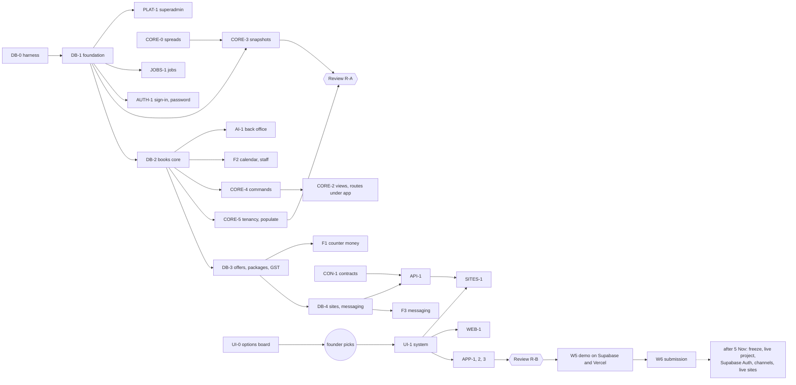

# Appendix: the ticket rows of BLUEPRINT §10 (before W0)

`docs/BLUEPRINT.md` §10 became a pointer in W0. The waves index (`2026-10-29-munshi-build-waves.md`) and the W1 plan
cite these rows ("as the appendix"). They are carried here unchanged from commit `2eb21b3`.

**The dates in them are history.** The order of work is the waves index (D-049). Where a row and the folded
BLUEPRINT §2–§9 differ (a table, a gate, a rule), **BLUEPRINT wins**.

## §10 · Build plan to 5 Nov

> Six waves of tickets with non-overlapping file territories, model tier, size and done-when gates that can fail; local
> first, Supabase only in the deploy wave, the live track after 5 Nov. Feature freeze Tue 3 Nov night; the cut order is stated.

### 10.1 Ground rules for every ticket

- **Not planned again:** the P0 lane already running (lint green including `.tsx`/`.css`, CI running `pnpm check`, one
  TypeScript version, error, loading and not-found pages, fake clocks instead of timing tests, ticket noise out of
  comments). No ticket below touches its files (`biome.json`, `.github/workflows/ci.yml`, the root and package
  `package.json` catalogs, `apps/*/app/{error,loading,not-found}.tsx`) until it lands. If P0 also did the config module,
  BP-CORE-1 shrinks to the boot checks.
- **Local first (D-045).** No ticket before the deploy wave (W5) needs Supabase, a GitHub repository or a channel
  credential: the database is local PostgreSQL 17, sign-in is the password adapter, files go to `.run/blobs/`, sends
  and the bot check are recorded, and jobs run after writes, on page loads and from the dev ticker.
- **Done when (every ticket, beyond its own line):** `pnpm check` green; `pnpm redproof` green with the ticket's new
  gates shown red, then green, in its report; a failing run exits non-zero (G8); the kirana suite and its answer key
  unchanged; UI tickets screenshot every state at 390 and 1280 px into `.screenshots/<ticket>/`.
- **Territories never overlap.** MS-22a made the command and read registries spreads of per-area files; BP-CORE-0 does
  the same once for the rest (`packages/core/src/index.ts`, `apps/web/lib/server/`, i18n, `db/test/sabotage.ts`) and
  moves every `sale.*` command and read, unchanged, into `commands-sale.ts` and `queries-sale.ts`, so after it each lane
  owns whole files: BP-F1 owns the sale, BP-CORE-4 everything else in commands. A conflict means skip and report.
- **At most six Munshi agents at once.** The founder's cap is eight agents in all, shared with Nebius (until Fri 30) and
  Kaaj (until Sun 1). W3 therefore runs in two halves: W3a (BP-CORE-4, BP-F1, BP-F2, BP-API-1, BP-AI-1) while the
  migrator finishes, then W3b (BP-CORE-2, BP-F3, BP-F4) as lanes free up; in W2, BP-PLAT-1 starts when the first W2
  lane frees. Reviews count against the cap too.
- **One schema lane.** `db/schema/` has one owner, an Opus migrator, working file by file in order (§3.1): a rebuild
  breaks for everyone if a half-written file lands, so schema work is serial while the TypeScript lanes run in parallel
  against this blueprint and pick up each file as it lands.
- **Model tier:** Opus for the schema, the guarantee, sign-in, the API, money, messaging and the agent; Sonnet for
  screens, the portal, the product site, seed data entry and deploy docs (the BOARD's cost ruling).
- **Sizes:** S ≤ half a lane-day, M ≈ 1, L ≈ 2. Measured agent time is far shorter (D-037); the binding constraints are
  the founder's inputs, review depth and spend.

### 10.2 Waves and tickets

**W1 · Foundation (Thu 29 Oct)**

| Ticket | Tier, size | Territory | Done when (with red-proofs) |
|---|---|---|---|
| **BP-DB-0** runner and harness | Opus, M | `db/src/{bootstrap,build,reset,populate-cli}.ts`, `db/test/harness/**`, `db/package.json` scripts, the `db/test/sabotage/` split | an empty set builds; the template is built as `munshi_migrator`, and a file that needs a superuser fails every suite (red-proof); embedded PostgreSQL pinned to 17; the merged manifest drives G1, G4, G9, G10, G13; G8 still red-proved |
| **BP-DB-1** foundation schema `00`–`09`, `90` | Opus migrator, L | those files and fragments, their gates | G1–G13 over these tables; TRG1, J1, J2 (with the pin race), VB1 with VB1-TZ, SIGNUP1, SLUG1, OE1, ROLE1 for these tables, PLAT1, the database parts of F4–F7, IDP1 and IDEM1; the bootstrap runs as a non-superuser admin in a test (the residual printed, not raised) |
| **BP-CORE-0** per-area spreads | Sonnet, S | `packages/core/src/index.ts` and area index files, `commands-sale.ts` and `queries-sale.ts` (the `sale.*` code moved unchanged), `apps/web/lib/server/` split, i18n per area | every existing gate unchanged; each area file exists |
| **BP-CORE-1** hosting layer | Sonnet + Opus review, M | `packages/config/**`, `packages/core/src/{log,context}.ts`, `apps/web/middleware.ts`, `apps/web/next.config.ts` (headers), `apps/web/app/api/health/**`, `apps/web/lib/server/{config,db}.ts`, `db/src/dev.ts` (the env file) | boot refuses a missing name, a wrong deployment, a stale schema sha, a wrong role on each pool (each red-proved); no `.run/` read at runtime (scan); no `console.` outside `log` (scan); the CSP present on every route (a test fetches each) |
| **BP-CON-1** contracts and SDK skeleton | Opus, M | `packages/contracts/**`, `packages/sdk/**` | `pnpm contracts` writes `openapi.json` and `schema.gen.ts`; the freshness test fails on a stale file (red-proof); the SDK has no dependencies; type equality both ways |
| **BP-UI-0** the options board | Sonnet and Opus design lanes (premium-UI skills), S | `design/options/**` only | round 1 done (D-044: Elite picked elite-A with a light mode; Munshi reopened; Prabhave's four rejected); **round 2 running** for the Munshi site, the Munshi app and Prabhave; nothing built until the founder picks |

**W2 · Books and core (Thu 29 night – Fri 30)**

| Ticket | Tier, size | Territory | Done when |
|---|---|---|---|
| **BP-DB-2** books core `10`–`13`, `15` | Opus migrator, L | those files | G2, G3, G5, G6, G11 over them; the stock composite key refuses a service (red-proof); `b_one_live`; REV1's database part; K6's and PAY1's database parts; every index in `pg_index` |
| **BP-DB-3** `16`, `17`, `18` | Opus migrator, M | those files | L1, L2 and the database parts of P1–P4; `b_offer_cap`; INV1 (20 concurrent sales, no gap; red-proof: drop the lock) and INV2 |
| **BP-DB-4** `14`, `19`, `20`, `30` | Opus migrator, M | those files | BK1, BK2, HOLD1, PUB1, BUCKET1, ROLE1 for these tables, CH1's database part, W6, S9, S10, the demo sample pins, K2's database part, the STOP rule, the extract digit parse, E1 over `ai.*` |
| **BP-CORE-3** snapshots v2 | Opus, M | `packages/core/src/{snapshots,read}.ts`, `apps/web/lib/server/agent-port.ts`, the agent's resolve tests | refs unchanged; `_count` citable; reuse returns the same id for identical rows; pins written; purge keeps every pinned one (J2 end to end); C3 and A1 green |
| **BP-CORE-5** tenancy, sign-up core, populate | Opus, M | `packages/core/src/{tenancy,signup,members}.ts`, `db/seed/**`, `db/src/provision.ts` | the three tenants (the kirana, Elite, Prabhave) built through real paths with deterministic ids; every planted situation matches its key; the showcase sites verified and the demo default config set through approved platform changes by the seeded operator; sign-up atomic, AI off and site hidden for a new shop (SIGNUP1 end to end); T3 as `munshi_owner` |
| **BP-JOBS-1** the jobs runner | Opus, M | `packages/core/src/jobs*.ts`, `apps/web/app/api/internal/**`, `scripts/dev-ticker.ts` (started by `pnpm dev`) | each job runs once per slot under concurrent triggers (red-proof: drop the claim); SWEEP1 (per-tenant loops, positive counts); the jobs pool cannot write books (J1); no command import (scan); a bad `CRON_SECRET` is 404. The Vercel cron entry and the GitHub workflow wait for W5 and the repository |
| **BP-AUTH-1** sign-in and the fence | Opus, L | `packages/adapters/identity/**` (the port and the `password` implementation), `apps/web/app/(auth)/**`, `apps/web/app/demo/**`, `apps/web/lib/server/session.ts`, `packages/core/src/{session,logins}.ts` | IDP1 end to end; F1–F7; AUTH1 (real sign-in refused on demo), AUTH2; SANDBOX1 and the sample-shop sign-up (a Must); invites verify the link before the first sign-in; RESET1, LOCK1, AUTH3; the epoch ends every session on a reset; `pnpm identity:reset`; the Supabase implementation is **not** built now (§6.8) |
| **BP-PLAT-1** the superadmin console | Opus, M | `packages/core/src/platform*.ts`, `apps/web/app/platform/**`, `db/src/platform-operator.ts` | PLAT1, CONSOLE1 and TOTP1 end to end; an operator identity can never be bound to a shop; a proposal executes only when approved in a later transaction, and the console shows exactly what will change; caps and on/off take effect in `allow()` at once; VERIFY1 end to end; the platform chain verifies; every screen screenshotted |

**Review R-A** (Opus guarantee review, read-only) of the foundation, the books core and W2's core work, both clauses;
at most two fix cycles. Fri 30.

**W3 · Features in core, and the API (Fri 30 – Sat 31; in two halves, §10.1)**

| Ticket | Tier, size | Territory | Done when |
|---|---|---|---|
| **BP-CORE-4** commands v2 | Opus, L | `packages/core/src/{commands,commands-catalogue,commands-people,commands-trade,approvals,idempotency}.ts` (`commands.ts` is the registry only; `commands-trade.ts` holds purchases, stock, payments, credit, settlements; not `commands-sale.ts`) | C1, C4, C7 green; every person through the vault; revisions; one `*.reverse` per book netting to zero (REV1); idempotency inside `runCommand` for every command |
| **BP-CORE-2** screen reads in core, routes under `/app` | Opus, M | `packages/core/src/{views-*,page}.ts`, `apps/web/lib/server/*` (not `session.ts`, `agent-port.ts`, `config.ts` or `db.ts`), the move of `apps/web/app/*` screens to `apps/web/app/app/*` | SQL1 (red-proof: plant a query); one transaction per page (a test counts `begin`s per render); the web suite green |
| **BP-F1** the counter's money | Opus, L | `packages/core/src/{commands-sale,queries-sale,commands-offers,commands-packages,queries-offers,queries-packages,queries-invoice}.ts`, `packages/core/src/packs/in.ts` | `sale.record` and `sale.reverse` on v2 (the vault, the stock key, invoices); O1, O2, codes and caps, P1–P4, L1; GST1's golden invoices against a hand-worked key; credit notes; JR1 for the GST summary; IDEM1 at the counter (a double tap records one sale) |
| **BP-F2** calendar, bookings, staff | Opus, L | `packages/core/src/{slots,booking,commands-staff,queries-staff,salary}.ts` | slots against a hand-worked roster; SLOT1; BK1, BK2 and HOLD1 end to end; `booking.confirm` writes the customer and the message; SAL1 and PAY1; leave and holidays remove slots |
| **BP-F3** messaging | Opus, L | `packages/adapters/channels/**`, `packages/core/src/{commands-messaging,outbox,inbox,queries-campaigns}.ts`, `apps/web/app/api/webhooks/**`, and the agent side in `packages/agent/src/{copy,inbox}.ts` with their fixtures (it uses BP-AI-1's port; it does not edit `run.ts`) | K2–K6 and W1–W8 on the recorded sender and the local blob folder; CH1 end to end (no grant, no real send; a self-serve shop's post goes nowhere); test sends write no book row; at most once under two sweeps (red-proof); copy carries refs only (K3, K4); a voice note's figures come from spans parsed by core (EX2); the WhatsApp and Instagram adapters exist and are switched on only with the live deploy |
| **BP-F4** hold a piece and carts | Sonnet + Opus review, M | `packages/core/src/{reservations,carts}.ts` | a hold changes no book (row counts); expiry by jobs; CART1 (every cart recomputes from its stored release and lines with the counter's function; no offer discount in a cart); the sale re-derives |
| **BP-API-1** `/api/v1` | Opus, L | `apps/web/app/api/v1/**`, `apps/web/lib/api/**`, `packages/core/src/{site-api,public,rate}.ts`, `packages/adapters/botcheck/**` | S1–S10 retargeted to slug paths; PUB1 end to end; the error table on every route (C2's pattern); cursor pages; idempotency replays |
| **BP-AI-1** the back office | Opus, L | `packages/agent/src/{desks,recipes,run,port}.ts`, `packages/core/src/{watchers*,queries-watch-*,findings,brief}.ts` | C5 unchanged for the kirana; each new watcher (with `hold_pressure`) against its planted key; auto-resolve and re-raise; the 30-day rest; the ranking is a cell; recipes' drafts cite cells; `allow()` against the platform config, text and media caps and the shared sandbox ceiling, and the kill switch (red-proof each); answers' words only in erasable text (E1 over `ai.*`); a tainted run's other proposals refused |

**W4 · Surfaces (Sat 31 – Mon 2), after the founder picks the look**

| Ticket | Tier, size | Territory | Done when |
|---|---|---|---|
| **BP-UI-1** the calm-ledger system and shell | Opus, M | `packages/ui/**`, `apps/web/app/app/layout.tsx`, `apps/web/components/shell/**` | `<Figure>` takes refs only (type test); the contrast test for every brand; tap-for-source; the per-tenant brand from the look |
| **BP-WEB-1** product website, onboarding screens | Sonnet, M | `apps/web/app/(site)/**`, `apps/web/components/site/**`, the onboarding screens' presentation | every page at 390 and 1280; sign-up and log-in in the nav; the demo's "Try the demo" and sample-shop paths |
| **BP-SITES-1** the hosted shop app | Sonnet + Opus for the gates, L | `apps/sites/**` | two shops from one build; BUNDLE1 red-proved; the import closure; Elite's live slots and Prabhave's holds and cart against the demo API; every page and state screenshotted |
| **BP-DEV-1** developer portal | Sonnet, M | `apps/web/app/developers/**`, `docs/kit/**` | every route in the reference from `openapi.json`; examples recorded from the demo; the SDK download with its sha256 |
| **BP-APP-1** counter, offers, packages, loyalty, invoices | Sonnet, L | `apps/web/app/app/{counter,offers,packages,invoices,customers}/**` and their components | every state; V1; labels from data |
| **BP-APP-2** calendar, requests, staff, salary | Sonnet, L | `apps/web/app/app/{calendar,requests,staff}/**` | every state, both branches |
| **BP-APP-3** home, inbox, office, ask, campaigns, settings | Sonnet, L | `apps/web/app/app/{home,inbox,office,ask,campaigns,settings}/**` | every AI surface's answered, "Cannot verify", off and over-cap states; the look editor and *Publish*; People and sessions; Developer kit |
| **BP-OPS-1** deploy kit | Sonnet, M | `deploy/**`, `docs/DEPLOY.md`, `scripts/{deploy-check,capture-guard}.ts` | SUPA1 against a scratch database (red-proof); BOOT1; the capture guard's two modes and four red-proofs; a demo config naming a channel credential is refused; the Vercel project settings for the two demo projects |

**Review R-B** (Opus guarantee review of everything, both clauses), Mon 2; at most two fix cycles.

**W5 · The deploy wave, and fixes (Mon 2 – Tue 3); feature freeze Tue night**

| Ticket | Who | Done when |
|---|---|---|
| **BP-OPS-2** the demo on Supabase and Vercel | the founder (**one** Supabase project, the demo; the admin URL; the Vercel account) + Opus | the bootstrap on Supabase; the pooler accepts node-postgres in transaction mode (checked first); the major version, btree_gist and the Mumbai region confirmed; the blob adapter switched to Storage; the demo built and populated; `munshi-demo` and `munshi-shops-demo` deployed from a clean checkout; `deploy-check` ok; SUPA1 green; the Vercel daily cron on |
| R-A and R-B fix cycles | the lanes | each finding closed by a red-proved gate |

The schema keeps rebuilding through the submission (D-045); the freeze moves to the live track below.

**W6 · Submission (Wed 4 Nov; due Thu 5 Nov 07:30 IST).** P7 as planned: the M0 smoke and the SAM rack go/no-go (as
soon as the Meta key arrives, not on Wednesday), the live re-record, the demo deployed from a clean checkout (Munim
gotchas 42, 43), the film re-cut on the new look, the README with measured counts, the form and the X post. The submission links
the demo and the shops' demo copies (D-045).

**After 5 Nov · the live track (not in this plan's dates).** BP-FREEZE (`db:freeze`, FREEZE1 red-proved, CLAUDE.md's
append-only rule restored by the orchestrator); the live Supabase project built from the baseline; the Supabase Auth
adapter (§6.8) replacing the password module, members re-invited; real self-serve sign-up with confirmed emails; the
merchants' live tenants by assisted provisioning; their channel grants (the WhatsApp test number, Instagram) and site
verification by the superadmin; the live sites; the GitHub repository with CI and the scheduled tick; the chartered
accountant's GST check before any real invoice.

### 10.3 Order and dependencies

### 10.4 Honest risk, and what falls first

**Risk.** Thirty-one tickets and two guarantee reviews in five days, while Nebius (Fri 30), Paytm (Sat 31, if
shortlisted) and Kaaj (Sun 1) take the founder's attention and part of the agent budget. The serial schema lane is the
critical path: if BP-DB-1 slips a day, every database gate slips a day. D-045 removed most outside dependencies from the
build (local first, no GitHub tick, no live track before 5 Nov); three founder inputs can still stall a wave: the look
picks (round 2, W4), one Supabase project and the Vercel account for the demo (W5; the free plan's project count is
UNVERIFIED and Munim and Nebius may use it), and the Meta key (M0, the re-record, the film). The merchants' catalogues
and GST status decide what the showcase invoices show. Live slot booking, GST rules (no chartered
accountant has checked them) and salary rules are the newest domain logic and the likeliest to carry bugs into review.
The founder ruled "everything by 5 Nov" (D-043) over the recommended cut line, knowing this.

**If time runs short, cut in this order** (each is self-contained, and its tables stay in the baseline, so nothing is
re-migrated later):
1. Instagram posting (it is after 5 Nov for real posts anyway; the recorded draft can stay).
2. Loyalty points.
3. Salary runs (keep the roster, attendance, leave, holidays and advances).
4. The voice note → udhaar draft for the kirana.
5. The package-expiry draft (keep the finding and the reminder).
6. SAM cut-out campaign cards (text campaigns).
7. The developer portal beyond Getting started and the Reference.
8. The console's screens (the same approved platform changes through `pnpm platform:*` commands; the database rules stay).
9. The shop sites' extra sections and richer motion (keep the home, the menu or catalogue, booking or hold, the story).
10. Bills of supply, if neither merchant is a composition dealer (keep tax invoices).

**Cannot fall** without breaking D-042, D-043 and D-045: the database rebuild and its gates, the hosting layer,
password sign-in and the fence, the demo's sample-shop sign-up, the platform config and its rules (AI off for new shops,
caps, hidden sites), the API and SDK the sites use, the hosted sites by slug, the back office core (desks, the finding
lifecycle, the brief, recipes), offers with codes, packages, hold a piece, order on WhatsApp, campaigns (recorded on the
demo), live slot booking, GST tax invoices, and the roster with attendance and leave.

