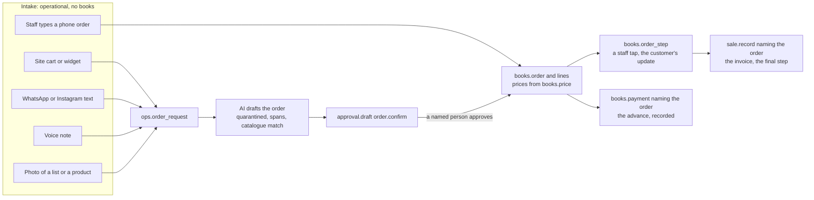

# Munshi as a platform: orders, packs and switches, widgets, cache, and the order of work

The brainstorm's spec (superpowers:brainstorming), Thu 29 Oct 2026. It **adds to** `docs/BLUEPRINT.md` and does not
replace it. It folds into the blueprint together with the schema review
(`hackathon/meta-ai-developer-hackathon/review-2026-10-29/R4-schema-review.md`). The founder's decisions behind it are
D-047 to D-050 in `hackathon/_meta/DECISIONS.md`. Tags: **FACT**, **INFERENCE**, **UNVERIFIED**.

---

## 1 · What Munshi is

- **One service, many capabilities.** All of the backend lives with Munshi. A shop takes the capabilities it needs and
  uses them in three ways:
  - Munshi's own app (owner and staff);
  - a Munshi-hosted shop site;
  - or its own website, through the API and embeddable widgets.
- **Pack, then switch.** A shop starts from a starter pack for its type (kirana, salon, boutique), then switches any
  capability on or off.
- **The goal is the Meta hackathon (D-048).** The judged story is **one shop day** that passes through the four AI
  moments:
  1. a customer's WhatsApp chat or voice note becomes a draft order;
  2. the owner asks by voice in Hindi;
  3. a photo becomes books (a shelf count, a bill);
  4. the back office finds lost money.

  Each moment ends with a named person's tap.
- **The One Guarantee is unchanged** and holds for every addition below (§7).

---

## 2 · Capabilities, packs and switches (D-050, design A)

### 2.1 Reference data

| Table | Columns | Seeded with |
|---|---|---|
| `ref.capability` | `code text pk`; `label_key`; `needs_grant bool` (the superadmin must grant it first) | `counter`, `credit`, `stock`, `buying`, `orders`, `stitching`, `bookings`, `holds`, `cart`, `offers`, `loyalty`, `packages`, `messaging`, `campaigns`, `staff`, `salary`, `gst`, `site`, `api`, `ai`; `needs_grant` on `ai`, `messaging`, `site` |
| `ref.capability_requires` | `capability → ref.capability`, `requires → ref.capability`; pk both | `credit→counter`, `gst→counter`, `offers→counter`, `loyalty→counter`, `packages→counter`, `stitching→orders`, `cart→orders`, `cart→site`, `holds→site`, `campaigns→messaging`, `salary→staff`, `bookings→staff` |
| `ref.pack_capability` | `business_type → ref.business_type`, `capability → ref.capability`; pk both | kirana: counter, credit, stock, buying, orders, offers, messaging, staff, gst, site, ai. Salon: counter, bookings, packages, offers, loyalty, messaging, campaigns, staff, salary, gst, site, ai. Apparel (shown as "Boutique"): counter, stock, orders, stitching, holds, cart, offers, messaging, campaigns, staff, gst, site, ai |
| `ref.command_capability` | `command → ref.command`, `capability → ref.capability`, `use text` start\|finish; pk (command, capability) | every command (gate CAP1). `start` begins new use (`order.confirm`, `package.sell`, `campaign.send`); `finish` completes an open obligation (`order.step`, `package.redeem`, `sale.record` naming an order or a hold) |

The code `apparel` is kept (it is already in the blueprint and the seeds); the label reads "Boutique".

### 2.2 The switch

| Table | Columns | Keys | Grants | Rules |
|---|---|---|---|---|
| `ops.capability_switch` | [T] `id`, `capability → ref.capability`, `on bool`, `by` (a member, or NULL inside the tenant's creation transaction), `at`, `created_txid` | `switch_latest (tenant_id, capability, at desc)` | A: S I · J: S | **append-only; the latest row per capability wins.** `capability_guard`: only an active owner inserts. Switching on needs every `requires` to be on. Switching off is refused while a capability that depends on it is on. Sign-up inserts the pack's rows in the tenant's creation transaction (`by` NULL, admitted only then). Each insert is audited `capability.switch {capability, on}` |

- **What a shop can use** = its latest switch is on **and**, for a `needs_grant` capability, the superadmin's grant is
  on. That grant is `platform.shop_config` for AI and the site, and `platform.channel_grant` for messaging. Core
  computes it once per request as `can(session, capability)`, inside the page's one transaction.
- **When a capability is off:**
  - its `start` commands refuse (a new error code, `capability_off`);
  - its `finish` commands still run, so an open package balance, an open order or a live hold can be completed;
  - its screens, desks, watchers, API routes and widgets hide or answer 404 (public routes; gotcha 16);
  - **nothing in the books is ever deleted or hidden from reports.**
- **`ops.tenant.business_type` stays fixed.** It now means the pack the shop started from. Desks (§7.2 of the
  blueprint), watchers (§7.3), screens and the API are keyed by capability, not by type. The blueprint's "type literal
  outside the registry" scan becomes "capability literal outside the registry".

### 2.3 Gates

| Gate | Holds | Red-proof |
|---|---|---|
| CAP1 | every command has a `ref.command_capability` row | delete one row |
| CAP2 | with a capability off, each `start` command refuses and each `finish` command runs | drop the check in `runCommand` |
| CAP3 | the desk, watcher, screen and route registries cover every capability, and none names a business type | add a type literal |
| CAP4 | switch-on with a missing dependency, and switch-off under a dependant, are refused | drop the dependency check |

---

## 3 · Orders (D-050, design A)

### 3.1 The flow

1. **Intake.** Any channel makes an `ops.order_request`:
   - a site cart or widget (`POST /sites/{slug}/orders`, which absorbs today's `ops.wa_cart`);
   - an inbound WhatsApp or Instagram message (text, a voice note, a photo of a list or a product);
   - staff typing a phone order (which can skip the request and go straight to step 3 as the staff member's own
     command).

   An inbound message that carries a request's code (`ORD-7K2Q`) is linked to it by code, never by a model.
2. **The AI drafts** (only when AI is on and under its cap, §4.6 of the blueprint).
   - A voice note is transcribed (Voice Transcribe).
   - Spark reads the text or the photo with no tools, inside `<data>` blocks.
   - It returns each line as **spans**: the item phrase and the quantity phrase, as offsets into the transcript or the
     message.
   - Code matches the item phrase to the catalogue by exact name or alias. An unmatched line is shown as "Not in your
     catalogue — choose", and the person's choice is a member input.
   - Code re-parses each quantity span (the one number detector). The database re-parses it again
     (`ops.inbound_extract`, field `item` or `quantity`).
   - Each line's price is the `books.price` cell in effect. The line amounts and the total are derived figures,
     computed by the counter's own line function.
   - The draft is `order.confirm`. It carries the reply to the customer, with the total and the code, as
     code-composed template text.
   - A run that read inbound text is tainted (§7.8 of the blueprint), so the port refuses any proposal except this
     recipe.
3. **Confirm.** A named person approves the draft, or a staff member records an order they took themselves.
   - This writes `books.order`, its `books.order_line` rows and the first `books.order_step` (`confirmed`, with the
     due date and, for stitching, the trial date).
   - It writes the confirmation message as a book under that decision.
   - Prices are re-derived server-side from `books.price` at that moment. **The order fixes the promised price.**
4. **Steps.** Each status change is a staff tap: `order.step`, the person's own command.
   - It inserts the next `books.order_step`, allowed only by `ref.order_flow` from the current step.
   - It is conditional: a unique `(order_id, step_no)` key means two taps cannot both win.
   - When the step's template has one, it writes the customer's update (`books.outbound_message`) in the same
     transaction. Consent and the WhatsApp 24-hour window are rechecked at send (blueprint §8.6). On the demo every send
     is recorded.
   - With `messaging` off or not granted, the step writes no message, and the app offers the update as a manual
     WhatsApp link.
5. **Advance.** `payment.record` naming the order (recorded, never processed). It posts to a new liability account,
   `customer_advance`.
6. **Finish.** `sale.record` naming the order.
   - The sale's lines must equal the order's lines: item, quantity and the promised unit price (gate ORD3).
   - The advance is applied and the rest is paid or goes on udhaar.
   - The GST invoice is written in the sale's own transaction (blueprint decision 5).
   - The final step (`delivered`) is written in the same transaction.
7. **Cancel.** `order.cancel` (owner or manager, with a reason) writes the `cancelled` step. An advance is either refunded
   (`payment.record`, direction out, naming the order) or kept as customer credit (`credit.record`).

### 3.2 Tables

| Table | Columns | Keys | Written by | Rules |
|---|---|---|---|---|
| `ops.order_request` | [T] `id`, `shop_id`, `code ^ORD-[A-Z0-9]{4,6}$`, `channel` site\|widget\|whatsapp\|instagram\|voice\|photo, `release_id` + `lines jsonb` (site and widget only: ≤ 20 of `{itemId, qtyMilli}`, as `wa_cart` today), `inbound_message_id → ops.inbound_message`, `contact_id → ops.contact`, `kind` goods\|stitching\|alteration, `state` new\|drafted\|confirmed\|declined\|expired, `draft_id`, `order_id`, `handled_by`, `handled_at`, `reason → ref.reason`, `created_at`, `expires_at` (7 days) | unique `(tenant_id, code)`; `(tenant_id, state, created_at)` | the public role (site, widget), the webhook (messages), members | `request_flow`, role-shaped: the public inserts `new` only; members move it on; jobs expire it. **Holds no personal data** (a contact id at most) |
| `books.order` | [T][S][R] `id`, `shop_id`, `request_id`, `customer_id → books.customer`, `kind` goods\|stitching\|alteration, `code`, `currency` | `(tenant_id, customer_id)`; unique `(tenant_id, code)` | `order.confirm` | immutable header; a reversal voids an order created in error |
| `books.order_line` | [T][S] `id`, `order_id` (parent), `line_no`, `item_id` + `item_kind`, `price_id → books.price`, `qty_milli >0`, `unit_price_minor ≥0`, `gross_minor`, `measurement_id → ops.measurement` (stitching), `note_text_id → ops.message_text` (erasable) | unique `(tenant_id, order_id, line_no)` | `order.confirm` | `unit_price_minor` equals the cited price row; `gross` by the counter's line function |
| `books.order_step` | [T][S] `id`, `order_id`, `step_no >0`, `step → ref.order_step`, `due_on`, `trial_on` (set on `confirmed` and `rescheduled`), `message_id → books.outbound_message`, `reason`, `at` | unique **`(tenant_id, order_id, step_no)`**; `order_step_latest (tenant_id, order_id, step_no desc)` | `order.confirm`, `order.step`, `order.reschedule`, `order.cancel`, `sale.record` | `b_order_flow`: `step_no` = the latest + 1, and (latest step → this step) is in `ref.order_flow` for the order's kind; `delivered` only inside the transaction of a sale naming the order |
| `ops.measurement` | [T] `id`, `contact_id → ops.contact`, `taken_by` (a member), `taken_at`, `note ≤200`, [E] | `(tenant_id, contact_id, taken_at desc)` | members (`measurement.take`, ops) | personal data in the vault: erased with the contact; an order line keeps the id |
| `ops.measurement_value` | [T] `measurement_id`, `point → ref.measure_point`, `mm int 1..3000` | pk `(tenant_id, measurement_id, point)` | with its measurement | one row per point (normalised, not JSON); erased with its measurement |
| `ref.order_step` | `code text pk`, `kinds text[]`, `terminal bool`, `template_code` (NULL = no customer update), `label_key` | — | seed | goods: `confirmed`, `packed`, `ready`, `out_for_delivery`, `delivered`, `cancelled`, `rescheduled`. Stitching and alteration: `confirmed`, `cutting`, `stitching`, `trial`, `ready`, `delivered`, `cancelled`, `rescheduled` |
| `ref.order_flow` | `kind`, `from_step`, `to_step`; pk all three | — | seed | the allowed transitions (blueprint non-negotiable 10, in Munim's form) |
| `ref.measure_point` | `code text pk`, `label_key` | — | seed | chest, waist, hip, shoulder, sleeve, length, bottom length, bottom waist, neck (to confirm with Prabhave) |

**Changes to existing tables:**
- `books.payment` gains `order_id`;
- `books.sale` gains `order_id`, so a sale names at most one of booking, reservation or order;
- `ref.account` gains `customer_advance` (a liability, credit-normal);
- `ops.inbound_extract.field` gains `item`;
- `ops.wa_cart` is replaced by `ops.order_request`'s site channel. Gate CART1 carries over as ORD1 for site requests.

### 3.3 Commands, screens, watchers

- **Commands** (`ref.command_authority`):

  | Command | Who | Notes |
  |---|---|---|
  | `order.confirm` | owner, manager, staff | draftable |
  | `order.step` | owner, manager, staff | |
  | `order.reschedule` | owner, manager, staff | |
  | `order.cancel` | owner, manager | |
  | `measurement.take` | owner, manager, staff | ops |

  `sale.record` and `payment.record` gain the order.
- **Screens.**
  - `/app/orders`: requests waiting, with each AI draft shown line by line against its source span; then a board by
    step. Each card shows the customer, the kind, the due date, the total and the advance (cells), and one button for
    the next step, with the customer's update written under it.
  - Stitching cards also show the measurements (cells) and the trial date.
  - The customer's status page `GET /sites/{slug}/orders/{code}` shows step labels only, with no personal data. The
    code is a capability token: a bad code answers 404, compared timing-safe, never logged (gotcha 16).
- **Watchers** (blueprint §7.3):

  | Watcher | Raises when | Impact cell | Recipe |
  |---|---|---|---|
  | `order_unanswered` | a request older than 30 minutes is still `new` or `drafted` | its derived total, when it has lines | the draft itself |
  | `order_late` | `due_on` has passed and the latest step is not `ready` or terminal | the order's total | explain; links the order |

### 3.4 Gates

| Gate | Holds | Red-proof |
|---|---|---|
| ORD1 | every order line's unit price equals its cited `books.price` row, and every line amount and total recomputes from stored ids with the counter's function (site requests: from their release and lines) | change the line function in one place |
| ORD2 | steps follow `ref.order_flow`; two concurrent taps produce one step and one refusal | drop the unique `(order_id, step_no)` |
| ORD3 | a sale naming an order has the order's lines and writes `delivered` in its transaction | let `sale.record` skip the line match |
| ORD4 | an AI-drafted order's quantities are spans the database re-parses; a free digit in the draft is refused | accept a quantity without a span |
| ORD5 | the public and webhook roles cannot write `books.order*`; a request never becomes an order without a person | grant INSERT to the public role |
| M1 | erasing a contact erases its measurements and values; order lines keep the id | skip the measurement erase |

---

## 4 · Every capability through the API, and widgets

- **For 5 Nov (W3, with API v1):**
  - **Order intake and status** are added to the shop-site API (§3.3).
  - **Widgets:** a new package, `packages/widgets`, provides web components built on the SDK and a publishable key,
    with the same origin allow-list as the sites:
    - `<munshi-order>` (catalogue and order);
    - `<munshi-book>` (slots, if time allows).

    A widget for a capability that is switched off renders nothing. Every figure in a widget carries its ref, and
    "tap for source" works as on the sites.
  - Proof for the judges: one plain HTML page that embeds `<munshi-order>` for the kirana.
- **After 5 Nov:** merchant API keys (server-side, scoped per capability), the back-office endpoints, and the rest of
  the widgets.

---

## 5 · The cache (Redis, W4, founder's decision D-049)

| Item | Design |
|---|---|
| Port | `packages/adapters/cache` with two adapters: `memory` (tests) and `redis`. Local: `redis-server` (installed, FACT) on a Unix socket under `.run/`. Deploy: a hosted Redis chosen in the deploy wave (Upstash on Vercel is the likely one; its free tier and Mumbai region are UNVERIFIED) |
| Keys | built only by `cacheKey(tenantId, kind, …)`, whose first argument has the branded `TenantId` type; a source scan refuses any Redis call outside the adapter |
| Cached | (1) **public API responses** by (tenant, release id, path, query): immutable per release, dropped when a new release is published; (2) **snapshot payloads** by snapshot id: immutable once minted; (3) **rate counters**, if measured faster than `ops.rate_counter` (non-book data) |
| Never cached | live balances, stock, slot availability (it changes by the second), sessions (revocation must take effect at once), anything without the tenant id, any figure that is not a snapshot cell |
| Failure | Redis down or slow (a 50 ms budget): the read goes to Postgres, with no error shown (non-negotiable 11's spirit) |
| Gates | **RC1**: every key starts with a tenant id (type and source scan). **RC2**: a cached public response equals a fresh one for the same release, refs included. **RC3**: a request for tenant B never reads a key planted for tenant A (red-proved by dropping the tenant prefix). **RC4**: with Redis stopped, every page and API route still answers |

---

## 6 · The order of work (D-049)

| Wave | Work | Gate to move on |
|---|---|---|
| **W0 Design close-out** | the schema review (R4); this spec; both folded into BLUEPRINT.md; the founder approves | approval |
| **W1 Database** | schema files `00–90` with R4's rank-1 fixes and this spec's tables; runner, harness and populate for the three shops; every gate retargeted, plus CAP, ORD and M1 | `pnpm check` and the red-proof harness pass; `EXPLAIN` on the populated tenants for every named read |
| **W2 Backend** | commands and reads per area: orders, capability switches, sign-in, tenancy and sign-up, platform rules, GST, offers, packages, loyalty, bookings, holds, messaging (recorded), staff, salary | tests, then one adversarial review with a guarantee scan, at most 2 fix cycles |
| **W3 Architecture hardening** | config from the environment only, the jobs runner, health, logs and request ids, one transaction per page, no SQL in apps, API v1 with contracts and SDK, order intake, widgets, abuse limits | same |
| **W4 Cache** | §5 | RC1–RC4 |
| **W5 AI layer hardening** | desks and watchers by capability (16 watchers with §3.3's two), the finding lifecycle, recipes, the brief, chat → order extraction, the injection and cross-tenant suites, caps and the off switch | the corpus and eval suites pass on recorded turns |
| **W6 Meta keys** | M0 smoke test, a live re-record of every fixture, fixes for what live calls reveal | the one-shop-day chain works live |
| **Surfaces** (orchestrator's assumption, D-049) | the app in the new look (the app pick is still open), the shop sites by slug (elite-A, prabhave-C), the product site (site-F, round 3); built from W3 on, done before the film | screenshots of every state |
| **Deploy** (assumption) | the hosted demo on Supabase and Vercel, before the film | the demo opens from a phone |
| **W7 Film**, **W8 Submission** | the one shop day, shot on the hosted app with live calls; README, form | — |

The Paytm finals (Sat 31 Oct) show whatever exists then. PayPal (13 Nov) needs a payments capability after 5 Nov
(D-048).

---

## 7 · Guarantee scan

**Clause 1 — nothing changes the books without a named person's approval.**
- An order request, from the public, the webhook or the AI, is ops. The public and webhook roles hold no grant on
  `books.order*` (ORD5).
- An order enters the books only by `order.confirm`: a person's own command, or a draft a named person approved.
- Every step, advance, cancellation and the final sale is a person's own command, and the customer's update is written
  under it.
- A capability switch is the owner's own audited action on ops configuration. It cannot write or delete a book row.
- Platform grants stay approved drafts.
- The cache never writes anything to Postgres.

**Clause 2 — every number shown traces to a ledger row.**
- Order prices are `books.price` cells.
- Quantities are spans re-parsed by the database, member inputs labelled as the person's, or a site request's stored
  lines.
- Line amounts and totals are derived figures that ORD1 recomputes from stored ids.
- Advances and balances are book rows' cells.
- Measurements are cells of a read over `ops.measurement_value`.
- A cached public response is the release's own snapshot cells with their refs (RC2). A figure with no ref is never
  cached.

Clean on both clauses as designed (INFERENCE, to be checked by the W2 review).

---

## 8 · Open items

1. **GST on advances for stitching** (a service): GST may fall due when the advance is received, with a receipt
   voucher. INFERENCE; for a chartered accountant. For 5 Nov the advance is recorded and the invoice is written at
   completion, with a labelled note.
2. **Prabhave's measurement points and steps:** confirm with the shop (§3.2 defaults).
3. **Kirana home delivery:** whether the kirana's orders include `out_for_delivery`. The default is yes.
4. **The app look** (round 2, E–J) and **site round 3**: needed before the surfaces start.
